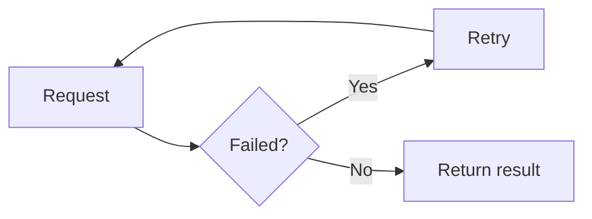

A callout — also known as an **Aside** — is a block of content set apart from the main text flow to draw the reader's attention.

In technical documentation, callouts are commonly used to:

* Warn about dangerous or irreversible actions.
* Highlight a detail that is easy to miss.
* Suggest a better way of doing something.
* Point out a common mistake.

For example, instead of writing a plain paragraph:

```md title="A plain paragraph"
Note: deleting the branch with this command cannot be undone.
```

you could write it as a callout:

**Code**

```mdx showLineNumbers title="Written as a Callout"
:::caution[Warning]
Deleting the branch with this command cannot be undone.
:::
```

**Demo**

:::caution[Warning]
Deleting the branch with this command cannot be undone.
:::

Callouts make important information stand out from the rest of the page, instead of getting lost among long paragraphs.

---

## 1. Basic Callout syntax

In MDX with Starlight, callouts are created using the `:::` syntax (three colons), followed by the callout type.

**Code**

```mdx showLineNumbers title="Basic Callout"
:::note
This is a regular note.
:::
```

**Demo**

:::note
This is a regular note.
:::

The structure has three parts:

1. The opening line `:::<type>`, which defines the callout type.
2. The callout content, written as regular Markdown.
3. The closing line `:::`.

:::caution[Warning]
The opening and closing lines must use the same number of `:` characters. If a callout contains nested content that also uses `:::` syntax (for example a callout inside a tab), the outer block must use more `:` characters than the inner one, otherwise it will be closed at the wrong position.
:::

---

## 2. Callout types

Starlight supports four callout types, each conveying a different level of importance.

| Type      | Purpose                                         |
| --------- | ------------------------------------------------ |
| `note`    | Additional, neutral information                  |
| `tip`     | A suggestion, a better way of doing something    |
| `caution` | A warning, something to pay attention to         |
| `danger`  | Danger, an action that may cause serious harm    |

### Note

**Code**

```mdx showLineNumbers title="Note"
:::note
This component only works in a client-side environment.
:::
```

**Demo**

:::note
This component only works in a client-side environment.
:::

`note` is suited for additional information the reader should know, without being a warning.

### Tip

**Code**

```mdx showLineNumbers title="Tip"
:::tip
Use `showLineNumbers` whenever you need to reference a specific line of code in your explanation.
:::
```

**Demo**

:::tip
Use `showLineNumbers` whenever you need to reference a specific line of code in your explanation.
:::

`tip` is suited for suggesting a more effective approach — one that is recommended but not mandatory.

### Caution

**Code**

```mdx showLineNumbers title="Caution"
:::caution
Renaming an API parameter is a breaking change for older clients.
:::
```

**Demo**

:::caution
Renaming an API parameter is a breaking change for older clients.
:::

`caution` is suited for actions that may cause issues, but are not yet dangerous or system-breaking.

### Danger

**Code**

```mdx showLineNumbers title="Danger"
:::danger
Running this migration in production will delete all data in the `orders` table.
:::
```

**Demo**

:::danger
Running this migration in production will delete all data in the `orders` table.
:::

`danger` should only be used for behavior that may cause data loss, downtime, or other serious consequences.

---

## 3. Changing the Callout title

Each callout type has a default title (`Note`, `Tip`, `Caution`, `Danger`). You can change the title by placing text in `[]` right after the type.

**Code**

```mdx showLineNumbers title="Callout with a custom title"
:::danger[Cannot be undone]
Deleting this bucket removes every file inside it and cannot be reversed.
:::
```

**Demo**

:::danger[Cannot be undone]
Deleting this bucket removes every file inside it and cannot be reversed.
:::

A custom title should be short and describe the actual nature of the warning, rather than repeating generic words like "Warning" or "Note".

For example, prefer:

```mdx title="A specific title"
:::caution[Rate limit]
This API is limited to 100 requests per minute.
:::
```

over:

```mdx title="A generic title"
:::caution[Warning]
This API is limited to 100 requests per minute.
:::
```

since a specific title helps readers scan the page faster.

---

## 4. Callouts with multiple lines of content

A callout can contain multiple paragraphs, lists, or other Markdown elements.

**Code**

```mdx showLineNumbers title="Multi-line callout"
:::caution[Before deploying]
Check the following steps before deploying to production:

* Migrations have been run in staging.
* The database has been backed up.
* Relevant teams have been notified.
:::
```

**Demo**

:::caution[Before deploying]
Check the following steps before deploying to production:

* Migrations have been run in staging.
* The database has been backed up.
* Relevant teams have been notified.
:::

This is useful when a callout needs to convey more than a single sentence, but it should still stay focused on a single topic.

---

## 5. Callouts containing Code

A callout can also contain a fenced code block.

:::danger
When a callout contains a code block, the callout's `:` characters must outnumber the code block's backtick characters, so MDX doesn't misinterpret the boundary between the two blocks.
:::

**Code**

````mdx showLineNumbers title="Callout containing Code"
::::caution[Required configuration]
If the `DATABASE_URL` environment variable is missing, the app will fail to start:

```bash
export DATABASE_URL="postgres://localhost:5432/app"
```
::::
````

**Demo**

::::caution[Required configuration]
If the `DATABASE_URL` environment variable is missing, the app will fail to start:

```bash
export DATABASE_URL="postgres://localhost:5432/app"
```
::::

---

## 6. Callouts containing Mermaid

Since Mermaid is also a fenced code block, the same rule about `:` characters applies when placing a Mermaid diagram inside a callout.

**Code**

````mdx showLineNumbers title="Callout containing Mermaid"
::::note[Error handling flow]
When a request fails, the system retries up to 3 times before reporting an error to the user:


::::
````

**Demo**

::::note[Error handling flow]
When a request fails, the system retries up to 3 times before reporting an error to the user:


::::

This approach is useful when you need to both warn about a behavior and illustrate it visually at the same time.

---

## 7. Callouts containing a Table

A table can also be placed inside a callout when you need to list structured information alongside a warning.

**Code**

```mdx showLineNumbers title="Callout containing a Table"
:::caution[Breaking changes in v2]
| Old field | New field | Notes |
| --- | --- | --- |
| `user_id` | `userId` | Switched to camelCase |
| `created` | `createdAt` | Renamed and formatted as ISO 8601 |
:::
```

**Demo**

:::caution[Breaking changes in v2]
| Old field | New field   | Notes                             |
| --------- | ----------- | ---------------------------------- |
| `user_id` | `userId`    | Switched to camelCase              |
| `created` | `createdAt` | Renamed and formatted as ISO 8601  |
:::

---

## 8. Which Callout type should you use?

Choosing the wrong callout type causes readers to misjudge how important the information actually is.

A simple rule of thumb:

| Situation                                                  | Callout type |
| ------------------------------------------------------------ | :-----------: |
| Additional information, safe to skip                        | `note`        |
| Best practice, optimization, a better way of doing something | `tip`         |
| May cause errors, breaking change, requires caution          | `caution`     |
| Data loss, downtime, an action that cannot be undone         | `danger`      |

:::tip
If you're unsure whether to use `caution` or `danger`, ask yourself: "If the reader ignores this callout, can the consequences be recovered from?" If not, use `danger`.
:::

---

## 9. Don't overuse Callouts

Callouts are only effective when used selectively.

Avoid this:

:::note
This function takes one parameter.
:::

:::note
This parameter has type `string`.
:::

:::note
The return value is `boolean`.
:::

when three consecutive callouts only contain ordinary information, with nothing that truly needs to be emphasized.

Instead, combine them into a regular paragraph or table:

| Parameter | Type     | Returns   |
| --------- | -------- | --------- |
| `input`   | `string` | `boolean` |

:::caution[Warning]
A page with too many callouts loses its ability to emphasize anything — readers tend to skim past all of them, including the ones that actually matter. Only use a callout for information that genuinely needs to stand out.
:::

---

## 10. Callouts don't replace headings

Callouts are meant to emphasize, not to organize a page's main content.

Avoid this:

:::note[Authentication]
A long explanation of the entire authentication mechanism...
:::

If that's part of the page's main content, use a heading instead:

```md title="Authentication"
## Authentication

A long explanation of the entire authentication mechanism...
```

A callout should represent **a short note that stands apart from the main reading flow**, not a full section of the page.

---

## 11. Where to place a Callout

A callout should be placed right where it's relevant, not all bunched up at the top or bottom of the page.

A good example — placed right after the related description:

````mdx showLineNumbers title="Placing a Callout in the right spot"
Run the following command to clear the cache:

```bash
rm -rf .cache
```

:::caution
This command clears the entire cache, including caches from previous builds. Only run it when you're sure you don't need to keep it.
:::

After clearing the cache, run the build again.
````

Placing a callout in the right spot means the reader gets the warning **exactly when they need it**, instead of having to recall a warning read at the top of the page.

---

## 12. Checklist before using a Callout

Before adding a callout, ask yourself:

* Does this information really need to stand out more than regular text?
* Have you chosen the right type (`note`, `tip`, `caution`, `danger`)?
* If there's a custom title, does it accurately describe the content?
* Are callouts being overused back-to-back?
* Is the callout being used as a substitute for a heading or table that shouldn't be replaced?
* Is the callout placed in the right spot, close to the related content?
* If the callout contains a code block or Mermaid diagram, do its `:` characters outnumber the backticks inside?

---

## Summary

Callouts are a useful tool for emphasizing important information in technical documentation, but they're only effective when used at the right time and with the right type.

Basic structure:

```mdx showLineNumbers title="Callout"
:::note[Optional title]
Callout content.
:::
```

The most important principles:

1. **Match the callout type to the level of importance**: `note` → `tip` → `caution` → `danger`.
2. **Titles should be specific**, avoiding generic repetitions of the type name.
3. **Don't overuse callouts** for ordinary information.
4. **Don't use callouts as a substitute for headings or tables.**
5. **Place callouts in the right spot**, right at the point they're relevant.
6. **When a callout contains a code block or Mermaid diagram**, increase the number of `:` characters to avoid parsing errors.

A good callout isn't the one that appears most often on a page — it's the one that makes the reader **stop exactly when they need to stop**.
