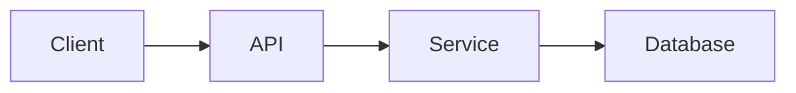
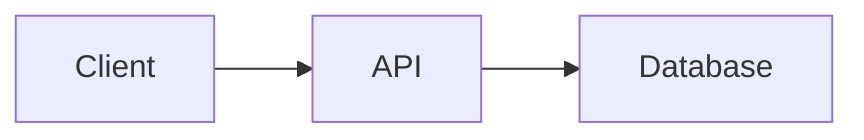
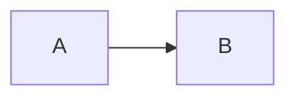
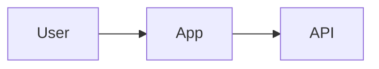
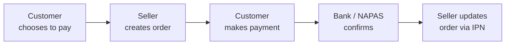
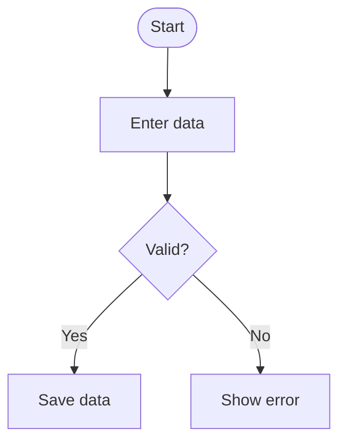
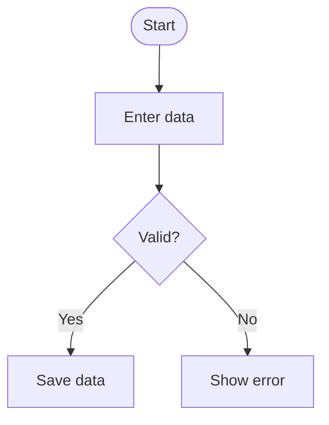
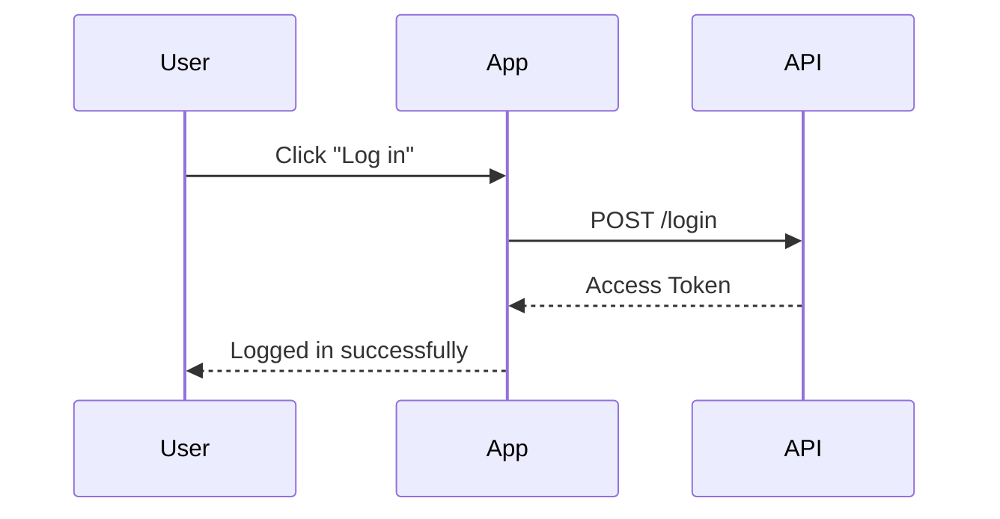
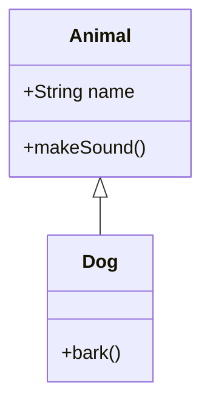
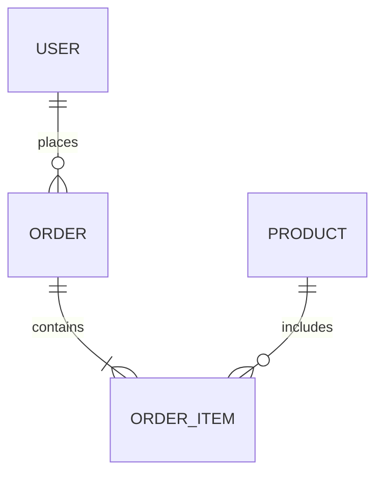

Mermaid is a text-based diagram description language. Instead of drawing every node, connector, or arrow by hand, you describe the structure of the diagram using Mermaid syntax, and the system renders that description into a visual diagram.

The interesting part is that Mermaid is still written inside a fenced code block in Markdown/MDX:

````mdx showLineNumbers title="Basic Mermaid"

````


So syntactically, in MDX, Mermaid looks a lot like a regular code block. However, the content inside isn't meant to run as a program or simply get syntax highlighted. It's **source code used to generate a diagram**.

## How is Mermaid different from a regular code block?

A regular code block:

````mdx showLineNumbers title="TypeScript"
```ts
const user = {
    name: "Ninh",
    age: 22,
};
```
````

is mainly used to display source code with syntax highlighting.

Mermaid, on the other hand:

````mdx showLineNumbers title="Flowchart"

````

is used to describe a diagram.

Put simply:

| Identifier | Purpose |
| --------- | ----------------------- |
| `ts`      | Display TypeScript |
| `java`    | Display Java |
| `json`    | Display JSON |
| `css`     | Display CSS |
| `mermaid` | Describe and render a diagram |

So the `mermaid` identifier carries more meaning than just selecting a syntax highlighting theme. It tells the system that the content inside needs to be processed as a diagram.

## Basic structure

A Mermaid diagram usually starts with a keyword that identifies the diagram type:

````mdx showLineNumbers title="Mermaid structure"

````


In the example above:

* `flowchart` identifies the diagram type.
* `LR` sets the drawing direction, **Left → Right**.
* `A` and `B` are nodes.
* `-->` creates a link between the two nodes.

From that first keyword, Mermaid determines the parser and the syntax that's allowed inside the diagram.

:::note
Always leave a blank line before and after a fenced Mermaid code block in MDX. If the block sits right next to a line of text or a table above it, some MDX parsers may fail to recognize the code fence correctly and the diagram won't render.
:::

---

## How users work with Mermaid

When reading documentation that contains Mermaid, users typically work with two parts: the **Mermaid source** and the **rendered diagram**.

## Writing Mermaid in MDX

To create a diagram, write Mermaid inside a fenced code block using the `mermaid` identifier:

````mdx showLineNumbers title="Mermaid example"

````

This part is the source the system renders into a diagram. If you need to give the diagram frame its own title, add a `%% title:` comment line at the top of the source:

````mdx showLineNumbers title="Mermaid with a title"

````

## Viewing the rendered diagram

Right below the code, the documentation should place an actual Mermaid block so the reader can see the result:


In the rendered frame, users can:

* Click **Fullscreen** to open the diagram in a larger view.
* Use **+** and **-** to zoom, up to 1000%.
* Drag to pan when the diagram is larger than the screen.
* Press **0** to reset zoom and position.
* Hold **C** to view the Mermaid source code, release **C** to return to the diagram.
* Press **Esc** to close the large view.

If a diagram type isn't supported by the current Mermaid version, the render frame will report that it couldn't render instead of breaking the page layout.

:::caution
When using diagram types with a `-beta` suffix (`architecture-beta`, `packet-beta`, `radar-beta`, `sankey-beta`, `treemap-beta`, `xychart-beta`), check the project's Mermaid version before adding them to official documentation. Beta syntax can change between versions, and a diagram that renders correctly locally isn't guaranteed to render correctly in production if the version doesn't match.
:::

---

## Mermaid diagram types

Mermaid supports many diagram types for different purposes. Don't force one diagram type to cover every situation; pick the type that fits the information you need to convey.

## Flowchart

**Flowchart** is well suited to describing process flow, conditions, procedures, or the logic of a system.

**Code**

````mdx showLineNumbers title="Flowchart"

````

**Demo**


`LR` means **Left to Right**. Besides `LR`, flowcharts commonly use:

* `TD` — Top to Down.
* `TB` — Top to Bottom.
* `RL` — Right to Left.
* `BT` — Bottom to Top.

Example with a SePay payment flow:

**Code**

````mdx showLineNumbers title="SePay payment flow (business)"

````

**Demo**


Example with a conditional branch:

**Code**

````mdx showLineNumbers title="Flowchart with a condition"

````

**Demo**



---

## Sequence Diagram

**Sequence Diagram** is used to describe the order of interactions between components in a system.

It's one of the most useful diagram types when documenting APIs, authentication, or communication flows.

**Code**

````mdx showLineNumbers title="Sequence Diagram"

````

**Demo**


Some common arrows:

* `->>` — message.
* `-->>` — response.
* `-)` — asynchronous message.
* `--x` — message ending in an X.

---

## Class Diagram

**Class Diagram** is well suited to describing classes, attributes, methods, and the relationships between classes.

**Code**

````mdx showLineNumbers title="Class Diagram"

````

**Demo**


---

## Entity Relationship Diagram

**ER Diagram** is commonly used to describe a database and the relationships between its entities.

**Code**

````mdx showLineNumbers title="Entity Relationship Diagram"

````

**Demo**


This is a great choice when a doc needs to explain a database schema at a high level.

---

## State Diagram

**State Diagram** is used to describe the states of an object or process and the transitions between them.

**Code**

````mdx showLineNumbers title="State Diagram"
```mermaid
stateDiagram-v2
    [*] --> Pending
    Pending --> Paid
    Paid --> Shipped
    Shipped --> [*]
```
````

**Demo**

```mermaid
stateDiagram-v2
    [*] --> Pending
    Pending --> Paid
    Paid --> Shipped
    Shipped --> [*]
```

---

## Mindmap

**Mindmap** is well suited to presenting the hierarchical structure of a topic.

**Code**

````mdx showLineNumbers title="Mindmap"
```mermaid
mindmap
    root((Product))
        Backend
            API
            Database
        Frontend
            Web
            Mobile
```
````

**Demo**

```mermaid
mindmap
    root((Product))
        Backend
            API
            Database
        Frontend
            Web
            Mobile
```

---

## Architecture Diagram

Architecture Diagram is used to describe the architecture between services or infrastructure components.

**Code**

````mdx showLineNumbers title="Architecture Diagram"
```mermaid
architecture-beta
    group api(cloud)[API]
    service server(server)[Server] in api
    service db(database)[Database] in api
    server:R -- L:db
```
````

**Demo**

```mermaid
architecture-beta
    group api(cloud)[API]
    service server(server)[Server] in api
    service db(database)[Database] in api
    server:R -- L:db
```

---

## Block Diagram

Block Diagram is used to describe blocks and the relationships between them.

**Code**

````mdx showLineNumbers title="Block Diagram"
```mermaid
block-beta
    columns 3
    Client Gateway Service
```
````

**Demo**

```mermaid
block-beta
    columns 3
    Client Gateway Service
```

---

## C4 Diagram

C4 Diagram is well suited to describing software architecture using the C4 model.

**Code**

````mdx showLineNumbers title="C4 Context"
```mermaid
C4Context
    Person(user, "User")
    System(app, "Application")
    Rel(user, app, "Uses")
```
````

**Demo**

```mermaid
C4Context
    Person(user, "User")
    System(app, "Application")
    Rel(user, app, "Uses")
```

---

## Gantt Chart

Gantt Chart is used to represent a plan and work progress over time.

**Code**

````mdx showLineNumbers title="Gantt Chart"
```mermaid
gantt
    title Release Plan
    dateFormat YYYY-MM-DD

    section Backend
    API Design       :a1, 2026-01-01, 5d
    API Development  :a2, after a1, 10d
```
````

**Demo**

```mermaid
gantt
    title Release Plan
    dateFormat YYYY-MM-DD

    section Backend
    API Design       :a1, 2026-01-01, 5d
    API Development  :a2, after a1, 10d
```

---

## Git Graph

Git Graph is used to describe branches, commits, and merges in Git.

**Code**

````mdx showLineNumbers title="Git Graph"
```mermaid
gitGraph
    commit
    branch feature
    checkout feature
    commit
    checkout main
    merge feature
```
````

**Demo**

```mermaid
gitGraph
    commit
    branch feature
    checkout feature
    commit
    checkout main
    merge feature
```

---

## Kanban

Kanban is used to describe the status of tasks.

**Code**

````mdx showLineNumbers title="Kanban"
```mermaid
kanban
    Todo
        Task A
        Task B
    Doing
        Task C
    Done
        Task D
```
````

**Demo**

```mermaid
kanban
    Todo
        Task A
        Task B
    Doing
        Task C
    Done
        Task D
```

---

## Packet Diagram

Packet Diagram is well suited to describing the bit or field layout of a network packet.

**Code**

````mdx showLineNumbers title="Packet Diagram"
```mermaid
packet-beta
    0-15: "Source Port"
    16-31: "Destination Port"
```
````

**Demo**

```mermaid
packet-beta
    0-15: "Source Port"
    16-31: "Destination Port"
```

---

## Pie Chart

Pie Chart is used to show the proportion between groups of data.

**Code**

````mdx showLineNumbers title="Pie Chart"
```mermaid
pie title Traffic Source
    "Organic" : 45
    "Referral" : 25
    "Direct" : 30
```
````

**Demo**

```mermaid
pie title Traffic Source
    "Organic" : 45
    "Referral" : 25
    "Direct" : 30
```

---

## Quadrant Chart

Quadrant Chart is used to classify items based on two axes.

**Code**

````mdx showLineNumbers title="Quadrant Chart"
```mermaid
quadrantChart
    title Feature Priority
    x-axis Low Impact --> High Impact
    y-axis Low Effort --> High Effort
    quadrant-1 Do first
    quadrant-2 Plan
    quadrant-3 Avoid
    quadrant-4 Delegate
```
````

**Demo**

```mermaid
quadrantChart
    title Feature Priority
    x-axis Low Impact --> High Impact
    y-axis Low Effort --> High Effort
    quadrant-1 Do first
    quadrant-2 Plan
    quadrant-3 Avoid
    quadrant-4 Delegate
```

---

## Radar Chart

Radar Chart is used to compare multiple attributes of one or more subjects.

**Code**

````mdx showLineNumbers title="Radar Chart"
```mermaid
radar-beta
    axis Speed, Security, Cost, UX
    curve Product["Speed": 80, "Security": 60, "Cost": 40, "UX": 90]
```
````

**Demo**

```mermaid
radar-beta
    axis Speed, Security, Cost, UX
    curve Product["Speed": 80, "Security": 60, "Cost": 40, "UX": 90]
```

---

## Requirement Diagram

Requirement Diagram is used to describe requirements and their relationships to system components.

**Code**

````mdx showLineNumbers title="Requirement Diagram"
```mermaid
requirementDiagram
    requirement loginReq {
        id: 1
        text: User must be able to log in
        risk: medium
    }
```
````

**Demo**

```mermaid
requirementDiagram
    requirement loginReq {
        id: 1
        text: User must be able to log in
        risk: medium
    }
```

---

## Sankey Diagram

Sankey Diagram is used to represent flow and the relative weight of data between groups.

**Code**

````mdx showLineNumbers title="Sankey Diagram"
```mermaid
sankey-beta
Traffic,Organic,45
Traffic,Referral,25
Traffic,Direct,30
```
````

**Demo**

```mermaid
sankey-beta
Traffic,Organic,45
Traffic,Referral,25
Traffic,Direct,30
```

---

## Timeline

Timeline is used to describe events in chronological order.

**Code**

````mdx showLineNumbers title="Timeline"
```mermaid
timeline
    title Product Roadmap
    2026 Q1 : Launch MVP
    2026 Q2 : Add payments
    2026 Q3 : Scale infrastructure
```
````

**Demo**

```mermaid
timeline
    title Product Roadmap
    2026 Q1 : Launch MVP
    2026 Q2 : Add payments
    2026 Q3 : Scale infrastructure
```

---

## Treemap

Treemap is used to represent hierarchical data as proportional area.

**Code**

````mdx showLineNumbers title="Treemap"
```mermaid
treemap-beta
    "Revenue"
        "Product A": 40
        "Product B": 35
        "Product C": 25
```
````

**Demo**

```mermaid
treemap-beta
    "Revenue"
        "Product A": 40
        "Product B": 35
        "Product C": 25
```

---

## User Journey

User Journey is used to describe the experience or steps a user goes through in a process.

**Code**

````mdx showLineNumbers title="User Journey"
```mermaid
journey
    title Checkout Journey
    section Cart
        Add item: 5: User
    section Payment
        Enter card: 3: User
        Confirm: 4: User
```
````

**Demo**

```mermaid
journey
    title Checkout Journey
    section Cart
        Add item: 5: User
    section Payment
        Enter card: 3: User
        Confirm: 4: User
```

---

## XY Chart

XY Chart is well suited to data with an X/Y axis, such as bar or line charts.

**Code**

````mdx showLineNumbers title="XY Chart"
```mermaid
xychart-beta
    title "Monthly Revenue"
    x-axis [Jan, Feb, Mar]
    y-axis "Revenue" 0 --> 1000
    bar [300, 500, 800]
```
````

**Demo**

```mermaid
xychart-beta
    title "Monthly Revenue"
    x-axis [Jan, Feb, Mar]
    y-axis "Revenue" 0 --> 1000
    bar [300, 500, 800]
```

---

## ZenUML

ZenUML lets you describe a sequence diagram using syntax that reads closer to code.

**Code**

````mdx showLineNumbers title="ZenUML"
```mermaid
zenuml
    Client->API: request()
    API->Client: response()
```
````

**Demo**

```mermaid
zenuml
    Client->API: request()
    API->Client: response()
```

---

## Flowchart in depth

Flowchart is one of the most common diagram types in technical documentation.

Instead of describing a long process across several paragraphs, you can turn it into a diagram so readers can see the whole flow at once.

Example of an authentication flow:

**Code**

````mdx showLineNumbers title="Authentication Flow"
```mermaid
flowchart TD
    Start([Start]) --> Login[Login Request]
    Login --> Validate{Credentials valid?}

    Validate -- Yes --> Token[Generate Token]
    Validate -- No --> Error[Return Error]

    Token --> Response[Return Response]
    Error --> End([End])
    Response --> End
```
````

**Demo**

```mermaid
flowchart TD
    Start([Start]) --> Login[Login Request]
    Login --> Validate{Credentials valid?}

    Validate -- Yes --> Token[Generate Token]
    Validate -- No --> Error[Return Error]

    Token --> Response[Return Response]
    Error --> End([End])
    Response --> End
```

## Subgraph

When a flowchart has many components, `subgraph` can be used to group related nodes together.

**Code**

````mdx showLineNumbers title="Flowchart with Subgraph"
```mermaid
flowchart LR
    subgraph Client
        Mobile
        Web
    end

    subgraph Backend
        API
        Service
        Database
    end

    Mobile --> API
    Web --> API
    API --> Service
    Service --> Database
```
````

**Demo**

```mermaid
flowchart LR
    subgraph Client
        Mobile
        Web
    end

    subgraph Backend
        API
        Service
        Database
    end

    Mobile --> API
    Web --> API
    API --> Service
    Service --> Database
```

`subgraph` is especially useful when describing architecture, since it helps readers tell apart the boundaries between frontend, backend, database, or external systems.

---

## Sequence Diagram in depth

Sequence Diagram is especially useful when a doc needs to explain API requests/responses.

Example of an OAuth login flow:

**Code**

````mdx showLineNumbers title="OAuth Authentication Flow"
```mermaid
sequenceDiagram
    participant User
    participant App
    participant OAuth
    participant API

    User->>App: Click Login
    App->>OAuth: Authorization Request
    OAuth-->>App: Authorization Code
    App->>API: Exchange Code
    API->>OAuth: Verify Code
    OAuth-->>API: Access Token
    API-->>App: Session
    App-->>User: Login Success
```
````

**Demo**

```mermaid
sequenceDiagram
    participant User
    participant App
    participant OAuth
    participant API

    User->>App: Click Login
    App->>OAuth: Authorization Request
    OAuth-->>App: Authorization Code
    App->>API: Exchange Code
    API->>OAuth: Verify Code
    OAuth-->>API: Access Token
    API-->>App: Session
    App-->>User: Login Success
```

When a doc describes an API, authentication, payment, or communication between multiple services, a sequence diagram is usually far easier to read than a long list of requests and responses.

---

## When should you use Mermaid?

Mermaid is especially well suited when the information has **relationships, order, or structure**.

Use Mermaid when:

* Several components interact with each other.
* There's a multi-step process flow.
* There's an `if/else` branch.
* You need to describe a request/response.
* You need to describe architecture.
* You need to describe a database relationship.
* You need to describe a lifecycle or state.
* You need to describe a timeline or roadmap.
* You need to describe a Git branch/merge.

On the other hand, not everything needs a diagram.

If a process only has two or three simple steps:

> The user logs in → the API authenticates → the server returns a token.

then a sentence can be easier to read than a whole diagram.

---

## Keeping Mermaid diagrams readable

A diagram that's too large can backfire. If readers have to keep zooming or scrolling just to follow the flow, the diagram is making the doc harder to read, not easier.

A few principles worth applying:

### 1. One diagram, one purpose

Instead of cramming an entire architecture into one giant diagram, split it into:

* High-level architecture.
* Authentication flow.
* Payment flow.
* Database relationship.
* Deployment architecture.

### 2. Don't overload it with nodes

If a flowchart starts accumulating too many nodes or branches, consider splitting it into several diagrams.

### 3. Name nodes clearly

Avoid this:

```text
A --> B --> C
```

if the diagram is meant for readers of the documentation.

Use this instead:

```text
Client --> API --> Auth Service --> Database
```

:::danger
Avoid special characters such as `"`, `(`, `)`, `:`, `#`, or raw line breaks inside a node's label without wrapping it in quotes. This is the most common cause of Mermaid syntax parse errors, and when it happens the whole diagram — sometimes the whole page — may fail to render instead of just flagging the exact spot that's wrong.
:::

### 4. Use the right diagram type

Don't use a flowchart for everything.

| Content           | Suitable diagram   |
| ------------------ | ----------------- |
| Process / logic    | Flowchart         |
| Request / response | Sequence          |
| Class relationship | Class             |
| Database           | ER Diagram        |
| State / lifecycle  | State             |
| Architecture       | Architecture / C4 |
| Git workflow       | Git Graph         |
| Timeline           | Timeline / Gantt  |
| User experience    | User Journey      |
| Data proportion    | Pie / Sankey      |
| Metrics            | XY / Radar        |

---

## Mermaid and MDX

In MDX, Mermaid can sit right next to regular code blocks.

For example, the same page can contain both TypeScript and Mermaid:

**Code**

````mdx showLineNumbers title="TypeScript + Mermaid"
```ts
const user = await api.getUser();
```

```mermaid
flowchart LR
    App --> API --> Database
```
````

**Demo**

```ts
const user = await api.getUser();
```

```mermaid
flowchart LR
    App --> API --> Database
```

This lets technical documentation combine **source code** and **visual explanation** on the same page.

---

## A note on Mermaid versions

Not every diagram type has the same level of stability across Mermaid versions.

Some syntax carries a `-beta` suffix, for example:

* `architecture-beta`
* `packet-beta`
* `radar-beta`
* `sankey-beta`
* `treemap-beta`
* `xychart-beta`

So before adding a new diagram type to official documentation, you should check:

1. The Mermaid version used by the project.
2. Whether that diagram type is supported by that version.
3. Whether the current syntax has changed compared to Mermaid's documentation.
4. Whether the production build renders the diagram the same way the development environment does.

In particular, don't rely only on reading the source to verify this. A Mermaid diagram can be syntactically valid and still fail to render if the project's integration or Mermaid version doesn't support that diagram type.

---

## Mermaid rendering in documentation

Mermaid doesn't automatically turn into a diagram just because the Markdown contains:

````md
```mermaid
...
```
````

The project needs a **Mermaid rendering pipeline** to recognize the `mermaid` code block, parse the source, and render it as a diagram.

The exact pipeline depends on how the project is built. For example, it could be:

* A Markdown/MDX plugin.
* A remark/rehype integration.
* A Starlight integration.
* A Mermaid component.
* Client-side Mermaid rendering.
* Build-time diagram rendering.

So the project's documentation should describe the **actual pipeline in use**, rather than assuming every MDX environment handles Mermaid the same way.

---

## Summary

Mermaid is a powerful way to turn text into a diagram in technical documentation.

Syntactically in MDX, Mermaid still uses a fenced code block:

````mdx showLineNumbers title="Mermaid"
```mermaid
flowchart LR
    Client --> API --> Database
```
````

but instead of just displaying source code, the system can render that source into a visual diagram.

When writing documentation, remember to:

* Use `mermaid` as the code fence identifier.
* Choose the right diagram type for the content.
* Always provide the source code so readers can copy it.
* Render the diagram right below it so readers can see the result.
* Split a large diagram into several smaller ones.
* Check the Mermaid version before using new syntax.
* Make sure the project's MDX/Markdown pipeline actually supports Mermaid.

A good pattern for documentation is:

````mdx showLineNumbers title="Diagram name demo"
```mermaid
flowchart LR
    Client --> API --> Database
```
````

followed immediately by the rendered **Mermaid Demo** right below it. This layout lets readers see the result while still letting developers copy the exact source to reuse.
