import { Tabs, TabItem } from '@astrojs/starlight/components';

This document describes **each business flow** of the SDK, with sequence diagrams and branching
conditions matching the current source code exactly.

## List of flows

1. [SDK Initialization](#1-sdk-initialization)
2. [Login / Logout](#2-login--logout)
3. [Joining a LIVE Room](#3-joining-a-live-room)
4. [Receiving and Routing Overlays (LIVE)](#4-receiving-and-routing-overlays-live)
5. [Rendering an Overlay on Screen](#5-rendering-an-overlay-on-screen)
6. [Lifecycle of an Overlay WebView](#6-lifecycle-of-an-overlay-webview)
7. [Answering a Question (Mini Game)](#7-answering-a-question-mini-game)
8. [Predict (`typeTimeline = 3`)](#8-predict-typetimeline--3)
9. [Lucky Spin (`typeTimeline = 5`)](#9-lucky-spin-typetimeline--5)
10. [Headline (`typeTimeline = 4`)](#10-headline-typetimeline--4)
11. [Overlay Recall — overlay-recall](#11-overlay-recall--overlay-recall)
12. [Auxiliary Events: liveviews, fan-club, ckst](#12-auxiliary-events-liveviews-fan-club-ckst)
13. [VOD Flow](#13-vod-flow)
14. [Disconnection and Recovery](#14-disconnection-and-recovery)
15. [Releasing Resources](#15-releasing-resources)

## 1. SDK Initialization

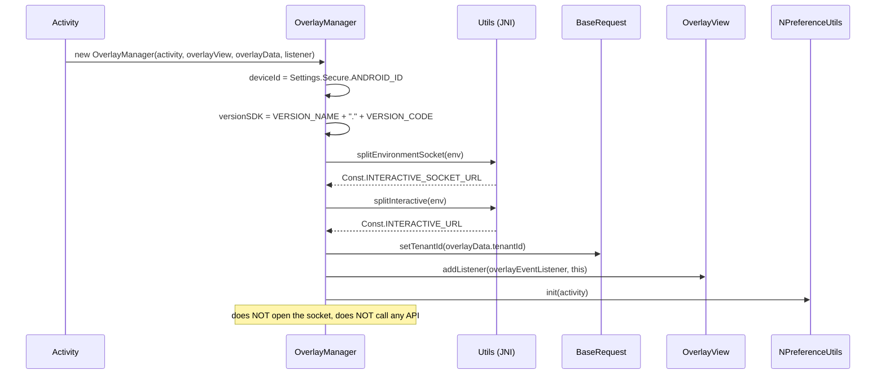

After this step the SDK is in the **Idle** state: it knows the environment and tenant, and has a
place to render into — but is not yet attached to any content.

## 2. Login / Logout

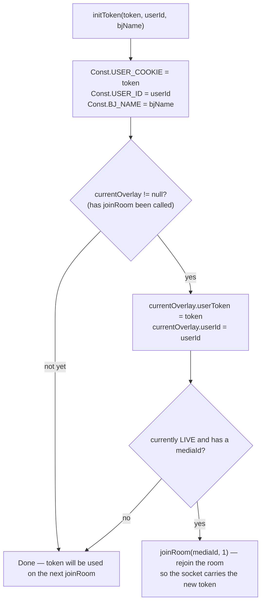

Practical implications:

- **Logging in while watching a Live stream** → the SDK reconnects automatically; the currently
  displayed overlay is cleaned up (`cleanUp()` inside `joinRoom`).
- **Logging out** = `initToken("", "")`; if a Live session is active, the SDK also rejoins the room
  in an anonymous state.
- `Authorization` header: if the token starts with `"ey"` (JWT) → `"Bearer <token>"`, otherwise it is
  sent as-is.

---

## 3. Joining a LIVE Room

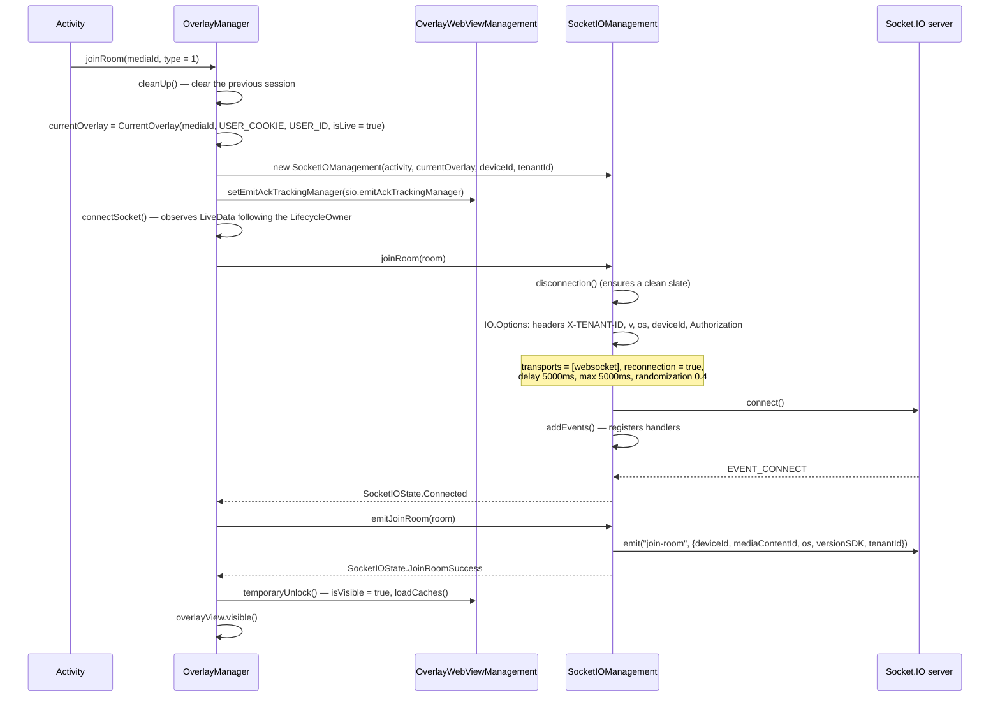

Things to remember:

- The `emit("join-room")` call **only happens after the socket connects successfully**, not
  immediately when `joinRoom()` is called.
- Before `Connected`, `OverlayWebViewManagement.isVisible = false` → any overlay that arrives early is
  **placed into the cache** instead of being shown.
- `overlayView` is only made `visible()` inside `temporaryUnlock()`.

## 4. Receiving and Routing Overlays (LIVE)

### 4.1. Socket-layer pre-filtering

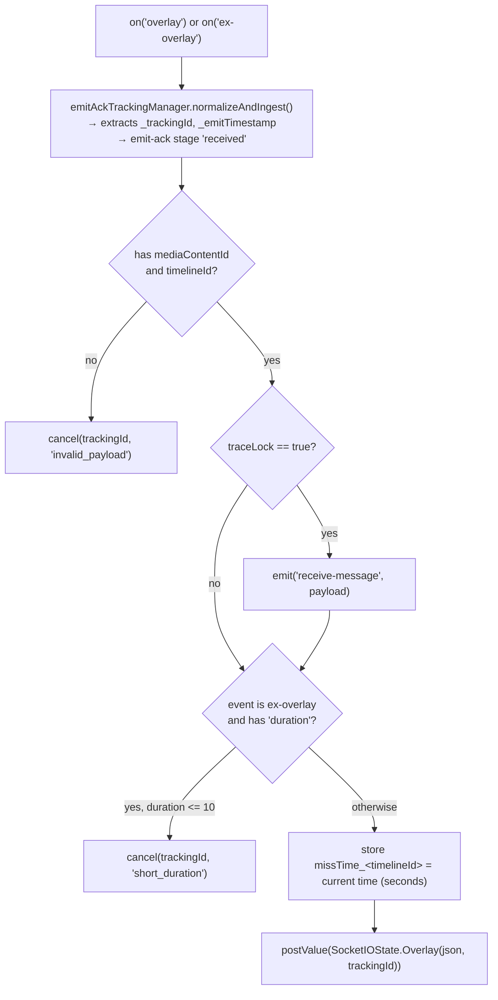

### 4.2. `OverlayManager` business-logic checks

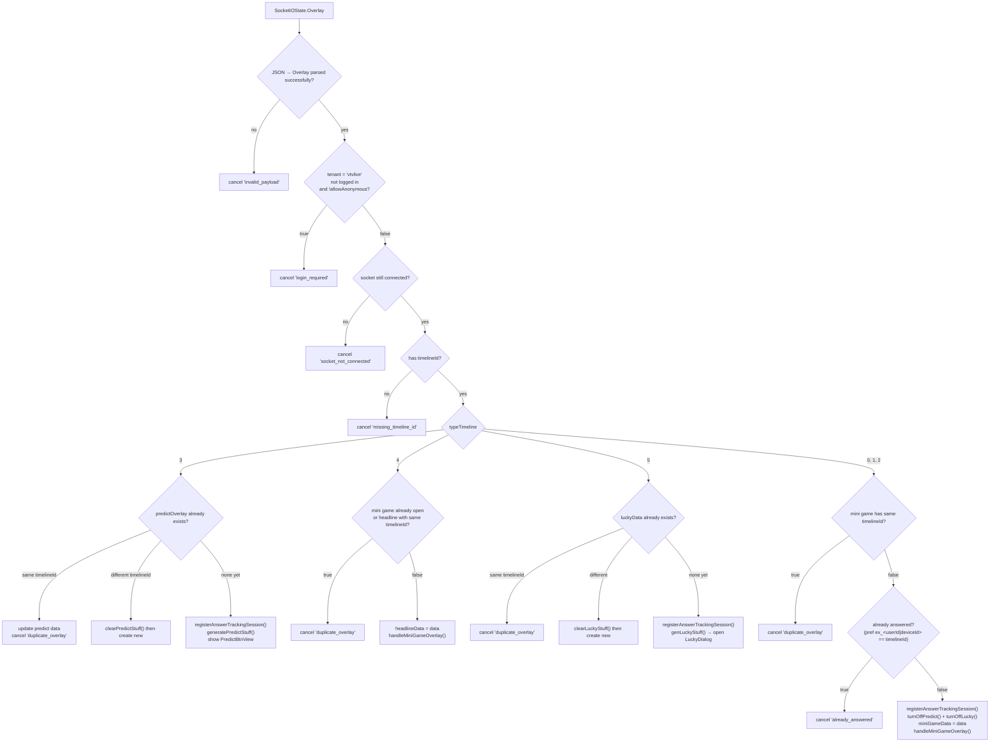

> The `ex_...` key uses `userId` when logged in; if not logged in but the overlay allows anonymous
> access, it uses `deviceId` instead.

## 5. Rendering an Overlay on Screen

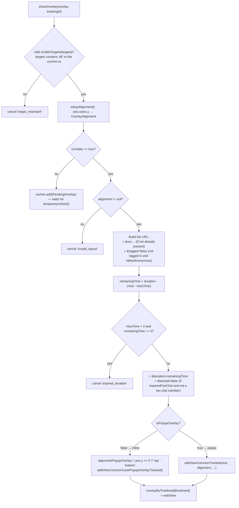

**Geometric constraints** in `OverlayView`:

- `addViewCommonTracked`: width/height as percentages (`constrainPercentWidth/Height`) anchored to
  one of 9 positions (`LeftTop` … `RightBottom`) derived from `metadata.pos`.
- `addViewCommonCasePopupOverlayTracked`: width `WRAP_CONTENT`, height as a percentage, anchored
  top/bottom/left/right according to `alignmentPopupOverlay`.
- Both call `clearViews()` before adding → **only one overlay WebView exists at a time**.

---

## 6. Lifecycle of an Overlay WebView

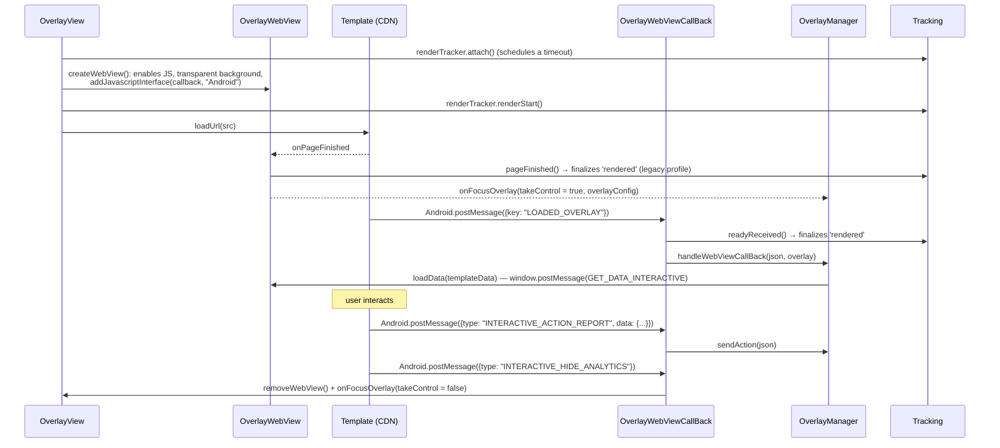

Page load errors (`onReceivedError`, `onReceivedHttpError`, `onReceivedSslError`) all result in:
`renderTracker.failed(...)` → hide the WebView → `onFocusOverlay(webViewError = true)`.

## 7. Answering a Question (Mini Game)

This is the most complex flow, with 4 layers of checks before the API call is sent.

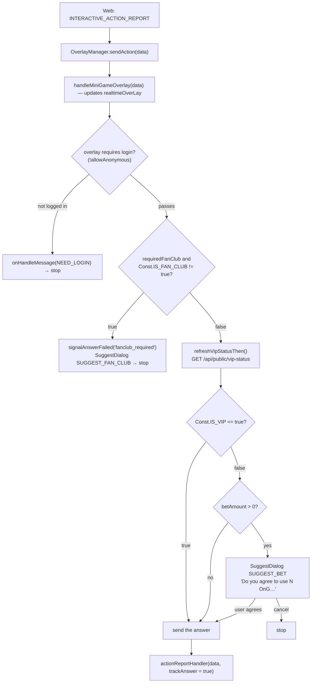

### 7.1. `actionReportHandler` — sending the API call

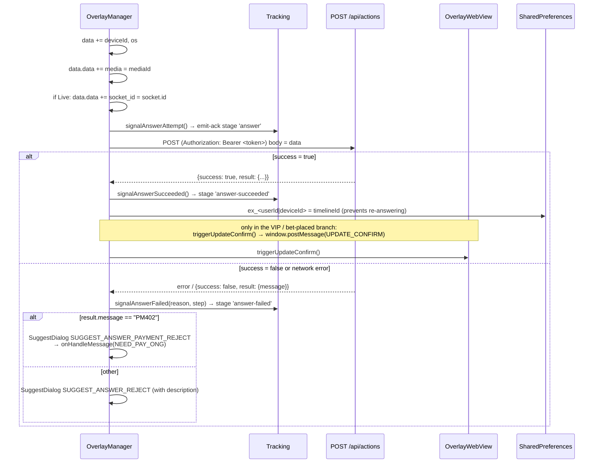

Error-code mapping → `failureReason` in tracking (`AnswerTrackingMapper`):

| `result.message` | `failureReason` | `failureStep` |
|---|---|---|
| `EX400` | `api_EX400` | `api_response` |
| `TL404` | `api_TL404` | `api_response` |
| `PM402` | `api_PM402` | `api_response` |
| other, `success = false` | `api_false` | `api_response` |
| network error | `network_error` | `network` |
| empty / unparsable body | `unknown_response` | `unknown_response` |

### 7.2. Other `type` values in `sendAction`

| `type` | Behavior |
|---|---|
| `INTERACTIVE_SHOW_ANALYTICS` | `onShowITR(true)` + records the action via `/api/actions` |
| `INTERACTIVE_HIDE_ANALYTICS` | Records it, clears `overlay`/`miniGameData`, **re-enables** predict and lucky |
| `INTERACTIVE_OPEN_ANALYTICS` | `onShowITR(true)` + records it (predict/lucky) |
| `INTERACTIVE_CLOSE_ANALYTICS` | Records it (predict/lucky) |
| `action = CLICK_ADS` + has `url` | Does not call the API, opens an external browser via `onClickAdsOverlay(url)` |

## 8. Predict (`typeTimeline = 3`)

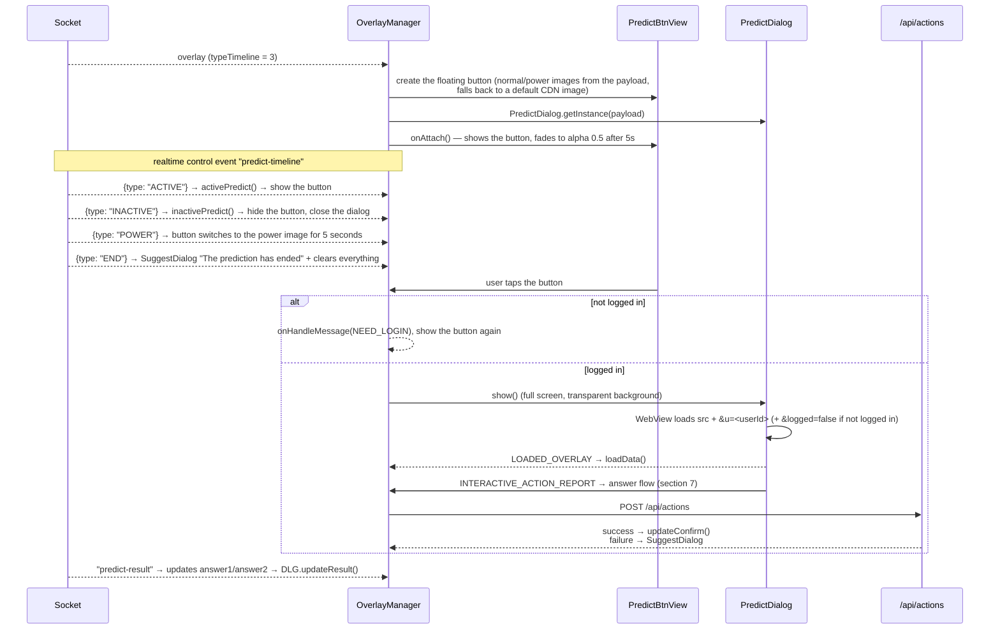

Flags controlling whether the button is shown:

| Flag | Meaning | Who changes it |
|---|---|---|
| `isPredictOn` | Whether it's allowed to be shown (disabled while a mini game occupies the screen) | `turnOnPredict()` / `turnOffPredict()` |
| `isPredictActive` | Whether the server allows interaction | `ACTIVE` / `INACTIVE` events |
| `isPredictDialogOn` | Whether the dialog is currently open | `showPredictDialog()` / `hidePredictDialog()` |

The button is only shown when `isPredictOn && isPredictActive`.

## 9. Lucky Spin (`typeTimeline = 5`)

Structured the same way as Predict (`LuckyBtnView` + `LuckyDialog`, socket event `lucky-event` with
`ACTIVE/INACTIVE/POWER/END`), with **one important difference**:

<Tabs>
  <TabItem label="Kotlin">
```kotlin
// OverlayManager.genLuckyStuff() — last line
showLuckyDialog()
```
  </TabItem>
  <TabItem label="Java">
```java
// OverlayManager.genLuckyStuff() — last line
showLuckyDialog();
```
  </TabItem>
</Tabs>

→ The lucky overlay **opens its dialog automatically as soon as it is received**, without waiting for
the user to tap a button.

The result returned by the API is pushed down to the web via `UPDATE_NUMBER_LUCKY`:

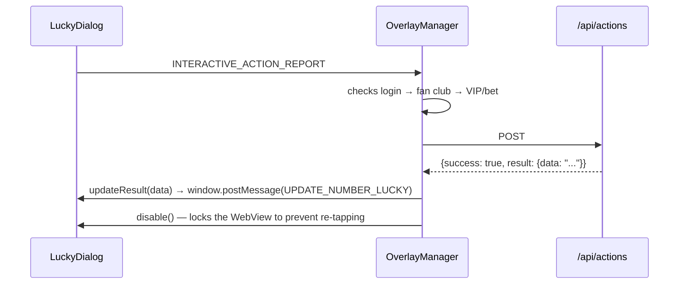

---

## 10. Headline (`typeTimeline = 4`)

- Shares the same rendering path as the mini game (`handleMiniGameOverlay`).
- Skipped if **a mini game is currently open** (`miniGameData != null`) or if it shares the same
  `timelineId` as the current headline.
- Only handles two `type` values: `INTERACTIVE_SHOW_ANALYTICS` and `INTERACTIVE_HIDE_ANALYTICS`
  (no answer flow).

## 11. Overlay Recall — overlay-recall

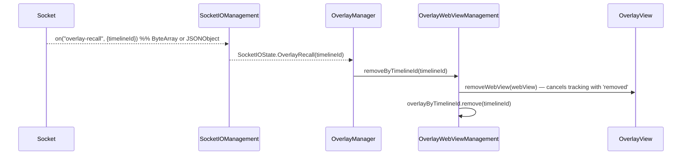

Used when an editor removes an overlay that is being broadcast system-wide.

## 12. Auxiliary Events: liveviews, fan-club, ckst

| Socket event | Handling |
|---|---|
| `liveviews` | Parses `OverlayLiveViews.count`, **adds 230**, calls `onHandleLiveViews(count)` |
| `data` (fan-club) | If `mediaId` matches the media currently being watched (comparing the part before the `_`) → updates `Const.IS_FAN_CLUB`; otherwise sets it to `false` |
| `ckst` | The server asks for the player status → the SDK emits back `ckst` with `{action: "CHECK_PLAYER_STATUS", sessionId, data: {deviceId, os, mediaContentId, playerStatus}}` |
| `update-result` | `OverlayWebView.updateResult(data)` → `window.postMessage(UPDATE_DATA_INTERACTIVE)` |
| `predict-result` | Updates `answer1`/`answer2` on `predictOverlay`, calls `PredictDialog.updateResult()` |

> Adding 230 to `liveViews` is intentional behavior in the current code
> ([OverlayManager.kt:435](../interactive/src/main/java/vn/interactive/OverlayManager.kt:435)) —
> if the app needs the raw number, it must subtract it back out on the app side.

`playerStatus` is only non-empty when the app has called `addPlayerListener(...)`.

---

## 13. VOD Flow

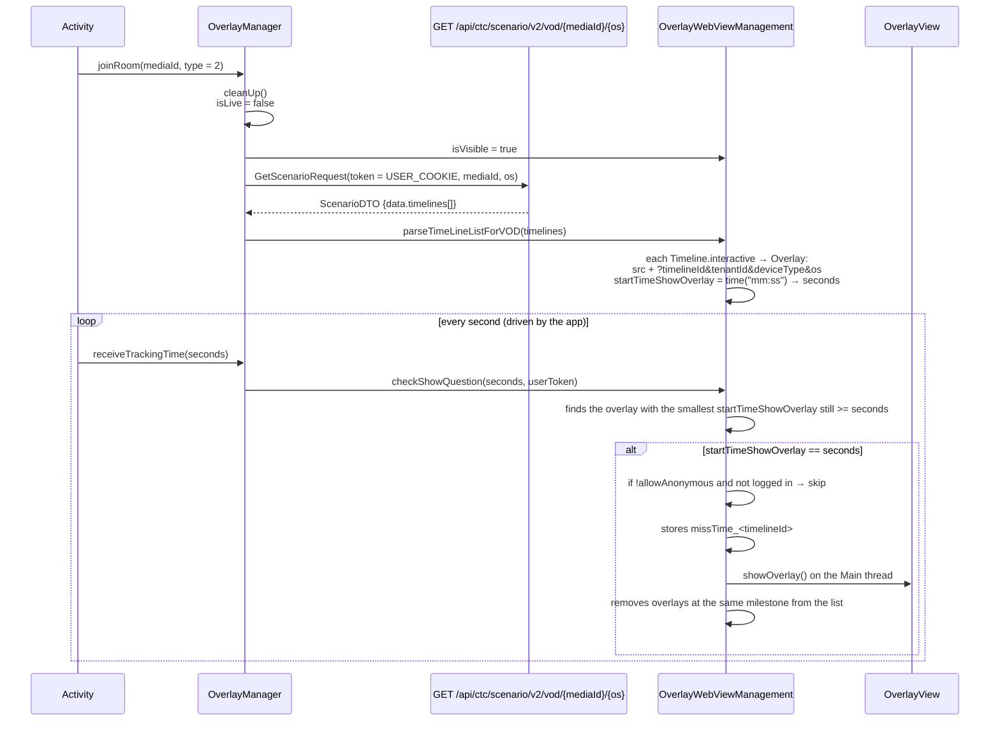

Differences from LIVE:

| | LIVE | VOD |
|---|---|---|
| Overlay source | Pushed via Socket.IO | Entire scenario preloaded via REST |
| Display trigger | Realtime event | `receiveTrackingTime(seconds)` fed by the app |
| `socketIOManagement` | Present | **null** (all socket calls are safely skipped) |
| `socket_id` in the action | Present | Absent |
| emit-ack tracking | Present | Absent (no socket to emit through) |
| Predict / Lucky / liveviews | Present | Absent |

## 14. Disconnection and Recovery

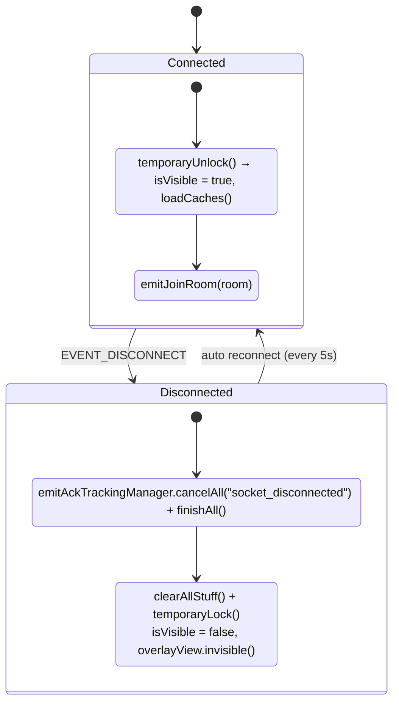

- **Overlay cache**: while `isVisible = false`, new overlays go into `caches`. Upon unlocking,
  `loadCaches()` only displays the **last element**; earlier ones have their tracking canceled with
  the reason `superseded_cache`.
- **`missTime`**: thanks to the saved timestamp, an overlay that reappears after a disconnection has
  its `duration` reduced by the elapsed time; if it has expired it is dropped (`expired_duration`).
- The `EVENT_CONNECT_ERROR` event → `SocketIOState.Error` → `clearAllStuff()`.

## 15. Releasing Resources

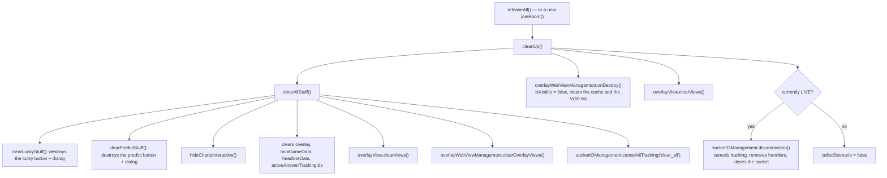

Call `releaseAll()`:

- in the `onDestroy()` of the Activity that hosts the player,
- when the user exits the content (closes the player, returns to a list),
- before switching to a different `mediaId` **if** `joinRoom()` is not called right away (since
  `joinRoom` already cleans up on its own).
