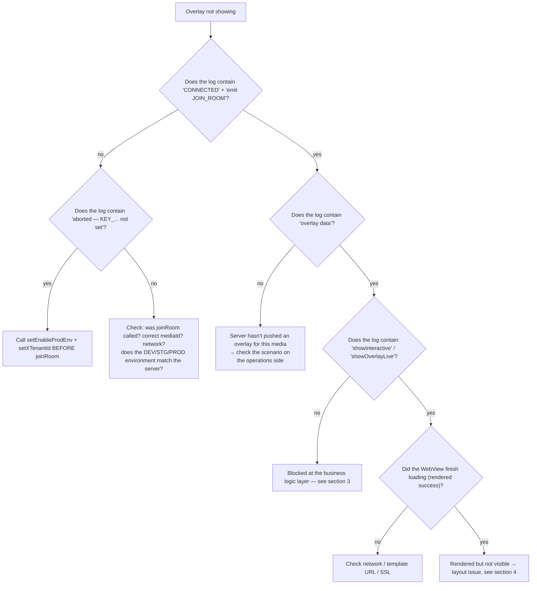

## 1. Enabling SDK logs

The SDK logs via the `logLine(...)` function (`Const/PrintLog.swift`) — always `print`ed with the
**`Interactive:`** prefix. View it in the Xcode Console, or filter with:

```bash
# When running via Console.app / log stream
log stream --predicate 'eventMessage CONTAINS "Interactive:"'
```

Notable log strings (prefix `Interactive:`):

| Log | Meaning |
|---|---|
| `[Socket] connectSocket() — env: ...` | Starting to prepare the connection |
| `[Socket] ❌ connectSocket() aborted — KEY_X_TENANT_ID not set` | `setXTenantId` hasn't been called yet |
| `[Socket] ❌ connectSocket() aborted — KEY_ENABLE_PROD_ENV not set` | `setEnableProdEnv` hasn't been called yet |
| `[Socket] ✅ CONNECTED — sid: ...` | Socket connected |
| `[Socket] emit JOIN_ROOM — mediaContentId: ...` | Joined the room |
| `Interactive-socket overlay data` | Overlay received from the server |
| `startShowLiveOverlayWithDataReceived` | Starting to process the overlay |
| `1 showInteractive isView : false` | Overlay blocked by `Compensatory` (already interacted) |
| `quá giờ trả lời` | Overlay's `duration` (from `ts`) has expired |
| `[Socket] 🔌 DISCONNECTED` / `🔄 RECONNECT` | Connection lost/restored |

---

## 2. Overlay not showing — diagnostic tree



---

## 3. Blocked at the business logic layer

| Symptom | Cause | Handling |
|---|---|---|
| `showInteractive isView : false` | `Compensatory` — this timepoint was already interacted with, still within `frequencyLimit` | By design. To test again: delete the `INTERACTIVE_<userId>` / `INTERACTIVE_DEFAULT` suite |
| `quá giờ trả lời` | Overlay's `duration` (from `ts`) has expired | By design |
| Overlay doesn't show, `targets` mismatch | `targets` contains neither `iphone` nor `all` | Fix the scenario so `targets` includes `iphone`/`all` |
| Predict/lucky button not showing for OnPlus/OnLiveTV/SeeNow | `receiveDataActionButtonPredict` returns early for tenants `vtvlive`/`onlivetv`/`VTVprime` | Current by-design behavior; if you want to enable it, change the tenant condition in the SDK |
| User taps to answer but nothing happens | `!allowAnonymous` and not logged in | Make sure `InteractiveLoginDelegate.showInteractiveLogin()` is implemented and `initAuthenToken` is called after login |
| The "You must be a FanClub member of …" dialog shows | `requiredFanClub` and `KEY_FAN_CLUB == false` | By design; need to join the fanclub (wait for the socket `data` event to update it) |
| The "Use N OnG to answer?" dialog shows | `typeTimeline == 2`, `betAmount > 0`, not a VIP | By design (telco VIP flow) |

---

## 4. Overlay rendered but not visible / wrong position

| Cause | Symptom | Handling |
|---|---|---|
| `uiView` (overlay container) has size 0 | Log shows normal rendering, screen is empty | Constrain `uiView` to properly overlay the video frame before `initOverlay` |
| `uiView` is being drawn over by the player | Overlay "flickers" then disappears | Add `uiView` **after** the player (subview order), or increase `zPosition` |
| `predictView` in the wrong position | Predict/lucky button is misaligned | Update the `predictView` frame in `showLayoutViewPredictRoot()` (see the `updateLayoutPredict` demo) |
| `resizeVideoView` not called on frame change | Overlay doesn't resize with the fullscreen player | Call `interactive.resizeVideoView(width:height:)` when the video frame changes |
| `locationLayoutViewRoot` not handled | Overlay always stays in one place | Implement `InteractiveViewDelegate.locationLayoutViewRoot(location:width:height:)` to align by `location` 0..8 |

The overlay WebView is a **transparent** `WKWebView` (`isOpaque = false`, `.clear` background, no
scrolling). If you see a black/white background covering the video, check whether the web template has
a transparent background.

---

## 5. Socket fails to connect

Checklist:

1. **Not configured**: log `aborted — KEY_X_TENANT_ID not set` / `KEY_ENABLE_PROD_ENV not set`.
   → Call `InteractiveSetting().setXTenantId(...)` and `setEnableProdEnv(...)` at startup.
2. **Wrong environment**: `Enviroment` must match the server system (DEV/STG/PROD) — the URL is
   derived from the env.
3. **Wrong tenant**: the server may reject the room.
4. **Token**: the socket's `Authorization` header is sent **as-is** (no automatic `Bearer` prefix). If
   the backend requires `Bearer` for the socket, you must pass a string that already includes the
   prefix into `initAuthenToken`.
5. **`isConnected()` returns `true` while actually still connecting**: the function returns `true`
   even during `.connecting`/`reconnects` — don't rely on it alone to confirm you're online.

---

## 6. Crash after integration

| Error | Cause | Handling |
|---|---|---|
| Crash `Unexpectedly found nil` right when calling joinRoom / an API | Force-unwrapping `UserDefaults.string(forKey: KEY_X_TENANT_ID)!` / `KEY_ENABLE_PROD_ENV!` before configuration | **Always** call `setEnableProdEnv` + `setXTenantId` first (this is likely the cause of the `[fixbug] crash` commit) |
| Missing symbol at link time (Alamofire / SocketIO / SwiftyJSON) | The static XCFramework doesn't carry its dependencies | Re-declare the pods in the app's target |
| Missing RxSwift/RxCocoa symbol | The Rx `*.xcframework` files aren't embedded | Embed `RxSwift/RxCocoa/RxRelay.xcframework` (Embed & Sign) |
| WebView doesn't receive callbacks | Template calls the wrong interface name | The interface must be **`IOS`** (`window.webkit.messageHandlers.IOS.postMessage(...)`) |

---

## 7. VOD: overlay not appearing at the right timepoint

| Cause | Handling |
|---|---|
| App doesn't call `getTimeVideo()` | Add a 1-second loop/observer after `joinRoom(type: 2)` |
| Wrong unit fed in (milliseconds instead of seconds) | `getTimeVideo` expects **seconds** (matched against `timeShow`) |
| User seeks past a timepoint | The SDK matches on the **exact second** (`timeShow == Int(time)`); the timepoint is skipped — a current limitation |
| Not logged in, and the overlay is not `allowAnonymous` | `showInteractiveVod` skips it; log in then call `joinRoom` again |
| Scenario returns empty | Check `callApiScenarioForVod` (env, `X-TENANT-ID`, `mediaId`); `convertVodInteractive` only picks up `showStatus == "ACTIVE"` |

---

## 8. Technical notes to keep in mind for maintenance

Points in the current code that are easy to get confused by, worth recording:

- **`liveViews + 230`**: `showCCU` hardcodes an addition of 230 to the viewer count before calling
  `showLiveView`. If you need the raw number, the app must subtract it itself.
- **`CkstData.data` mapped to the JSON key `"os"`**: the emitted `ckst` payload has a nested field
  named `os` (not `data`). Cross-check with the backend if there's a mismatch.
- **`UPDATE_COUTER`** (missing the letter N) and **`PredictResult.timlineId`** (missing the letter e)
  are kept **as-is** in the code — the web template must match this exact spelling.
- **`DialogLuckyNumberView` is shared for both predict and lucky** at runtime; `DialogPredictView` is
  almost never used.
- **`LiveCompensatoryShotImpl.loadScenarioLive`** returns **synchronously**, before the Alamofire
  request finishes → it almost always returns `nil`. Only `fetchOverlayStatus` (used by
  `fetchInteractiveStatus`) works correctly. Be careful if reusing this function.
- **Two different casings for the tenant header**: the socket uses `x-tenant-id` (lowercase), REST
  uses `X-TENANT-ID` (uppercase).
- **Sentry has been disabled**: both `SentryInteractor` and `InteractiveSetting.startSentry` are
  commented out.
- **`addCallback` is a single slot**: calling it again overwrites the previous callback — don't attach
  multiple listeners.

---

## 9. Frequently asked questions

**Does the SDK automatically follow the `UIViewController` lifecycle?**
No. The app must call `releaseAll()` itself when exiting the screen. The SDK only listens to
`orientationDidChange` on its own, to re-align the predict button.

**Can multiple minigame overlays show at the same time?**
No. `showOverlayLive` calls `cancelActiveOverlay` + `onStop()` before adding a new one → there is
always only one minigame overlay. The predict/lucky button is a separate view so it can coexist (the
SDK automatically hides the button while a minigame occupies the screen).

**What happens if the account is switched mid-session?**
Call `initAuthenToken(newToken, newUserId, "")`. If currently Live, the SDK automatically rejoins the
room with the new token.

**Do I need to call `releaseAll()` before every `joinRoom()`?**
No — `joinRoom()` already calls `removeAllView()` and handles the socket itself. Only call
`releaseAll()` when actually exiting.

**Does rotating the screen lose the overlay?**
A minigame overlay controlled by the server will be re-pushed if still valid; the predict button is
re-aligned via `orientationDidChange`. Layout is controlled by the app via `InteractiveViewDelegate`.

**Which WebView does the SDK use?**
`WKWebView` (some dialogs use `NoZoomWKWebView` to block pinch-zoom). JavaScript is enabled, the
background is transparent, and scrolling is disabled.

---

[← Tracking emit-ack](05-tracking-emit-ack.md) · [Back to index](README.md)
