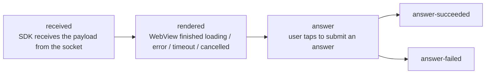
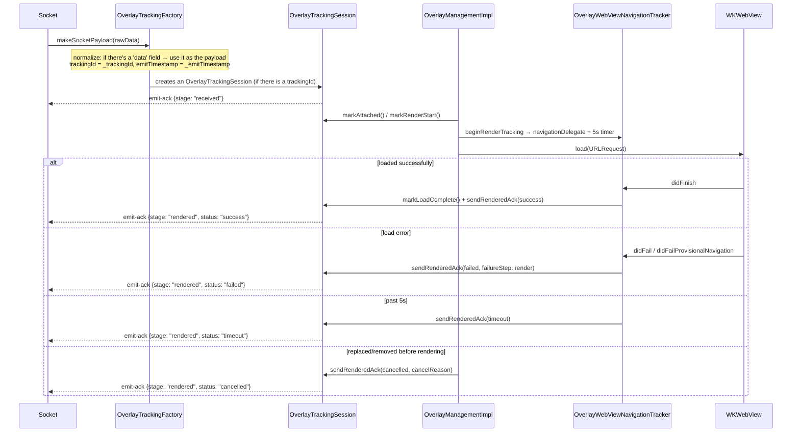
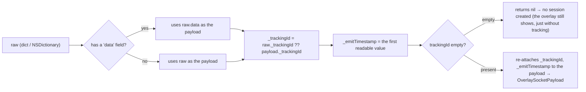

This mechanism answers the operations team's question: *"Did the overlay the server pushed actually
reach the user's device, did it render, and did the user answer it?"* — measured on the client itself,
sent back to the server via the **`emit-ack`** socket event.

> The entire tracking layer lives in `Libraries/Overlay/Tracking/OverlayTracking.swift`. The app does
> **not** interact with it directly — the SDK measures and sends everything itself through the already
> open socket.
>
> ⚠️ Tracking **only runs in LIVE mode**. `showOverlayVod` does not call `beginRenderTracking`, and VOD
> has no socket to emit through.

---

## 1. Stages



| Stage (`OverlayTrackingStage`) | Meaning | Ends the session? |
|---|---|---|
| `received` | A valid payload has entered the SDK | No |
| `rendered` | Finalizes the display result along with `status` | Yes, if `status != success` |
| `answer` | Starts sending the answer | No |
| `answer-succeeded` | API returned `success == true` | Yes |
| `answer-failed` | API error / rejection / network error | Yes |

`status` of `rendered` (`OverlayTrackingStatus`): `success` | `failed` | `timeout` | `cancelled`.

Each stage is sent only **once** per session (`emittedStages` is a `Set`). After the session calls
`finish()`, any further `emitStage` call is ignored.

---

## 2. Structure of the payload sent to the server

```jsonc
// socket.emit("emit-ack", payload)
{
  "trackingId": "<_trackingId taken from the overlay payload>",
  "event": "overlay",
  "stage": "received | rendered | answer | answer-succeeded | answer-failed",
  "deviceId": "<identifierForVendor>",
  "clientContext": { /* see below */ }
}
```

### `clientContext` — common fields

| Field | Source |
|---|---|
| `profile` | `"overlay.legacyIframe"` (fixed constant, iOS has only 1 profile) |
| `transportMode` | `"legacyIframe"` |
| `sdkVersion` | `ApiConst.VERSION_SDK` (`"2025-05-25"`) |
| `platform` | `"ios"` |
| `os` | `UIDevice.systemName + " " + systemVersion` (e.g. `"iOS 17.5"`) |
| `deviceClass` | `"tablet"` if iPad, otherwise `"mobile"` |
| `viewportWidth`, `viewportHeight` | `UIScreen.main.bounds` |

### Per stage

| Stage | Extra fields |
|---|---|
| `received` | `emitTimestamp`, `receiveTimestamp`, `receiveLatencyMs`, `ackLatencyMs`, `timeline{received, ackSent}` |
| `rendered` | `status`, `receiveLatencyMs`, `renderLatencyMs`, `ackLatencyMs`, `timeline{attached, renderStart, loadComplete, readyReceived, ackSent}`, `duration?`, `overlayType?`, `failureReason?`, `failureStep?`, `custom.cancelReason?` |
| `answer*` | `actionType` (`answer_submit`), `actionResult` (`attempted`/`success`/`failure`), `actionLatencyMs`, `occurrenceId` (= `timelineId`), `overlayType?`, `failureReason?`, `failureStep?`, `custom{…}`, `timeline` |

> Unlike the Android version, iOS **has only one profile**, `overlay.legacyIframe`, with a **fixed
> render timeout of 5000 ms** (`OverlayTrackingConstants.renderTimeoutMs = 5.0`). There is no `ws=1` /
> `wsInteractive` branch, and `readyReceived` in the timeline is always `NSNull()` (iOS finalizes
> `rendered` based on the WebView's `didFinish`, without waiting for the template to report
> `LOADED_OVERLAY`).

---

## 3. Measurement flow for one overlay (Live)



`OverlayTrackingSession` uses the `renderedAckSent` flag to ensure `rendered` is only fired **once**
even when timeout and `didFinish` happen close together.

---

## 4. Payload normalization (`OverlayTrackingFactory`)



Thanks to this step, the rest of the SDK works with an already "unwrapped" payload (`data`), while still
keeping the tracking metadata (`_trackingId`, `_emitTimestamp`).

There are **two paths that create a session**:
1. In `SocketIOManagementImpl.trackedOverlayPayload()` — when receiving `overlay`/`ex-overlay`, creates
   the session and sends `received` immediately.
2. As a fallback in `InteractiveControllerView.startShowLiveOverlayWithDataReceived()` — if the payload
   doesn't yet include a session but `OverlayLive.trackingId` isn't empty, creates a new session and
   sends `received`.

---

## 5. Cancellation reasons (`cancelReason` / `failureReason`)

The list of places where the SDK **deliberately doesn't show / cancels tracking** of an overlay —
useful when investigating "why didn't the overlay show":

| Value | Where it originates | Cause |
|---|---|---|
| `invalid_overlay_state` | `showOverlayLive` | `pos.alignment == nil` or `uiOvelay == nil` |
| `replaced_by_new_overlay` | `showOverlayLive` | A new overlay replaces the one currently shown |
| `recalled` | `recallOverlay` | Server recalled the overlay by `timelineId` |
| `remove_all_view` | `removeAllView` | Clears all views (rejoining / leaving the room) |
| `interactive_hide` | `INTERACTIVE_HIDE_ANALYTICS` | Web reports the overlay closed |
| `load_error` / `render` | Navigation delegate | WebView failed to load |
| `timeout` | 5s timer | WebView didn't finish loading within 5 seconds |
| `api_EX400` / `api_TL404` / `api_PM402` / `api_false` | `/api/actions` API | Server rejected the answer |
| `network_error` (`network`) | No network when answering | `Connectivity.isConnectedToInternet == false` |
| `unknown_response` | Response couldn't be parsed | Malformed API response body |

---

## 6. Latency calculations

`OverlayTrackingSession` uses millisecond timestamps (`Date().timeIntervalSince1970 * 1000`):

- `receiveLatencyMs = receiveTimestamp - emitTimestamp` — server→client network latency.
- `renderLatencyMs = loadComplete - receiveTimestamp` — WebView render time.
- `ackLatencyMs` — ack send latency.
- `actionLatencyMs = actionTimestamp - (readyReceived ?? loadComplete ?? renderStart ?? receive)` —
  time from render to when the user answers.

---

## 7. Impact on integrating apps

- Tracking **doesn't** add any permissions, and doesn't call a separate API — it uses the already open
  socket.
- In **VOD mode there is no tracking**.
- If an overlay has no `_trackingId` (the server didn't attach one), the overlay still displays
  normally but **doesn't** emit emit-ack.
- The app doesn't need to do anything; this is an observability tool for the operations/backend team.

---

[← API Reference](04-api-reference.md) · [Back to index](README.md) · [Next: Common Errors →](06-loi-thuong-gap.md)
