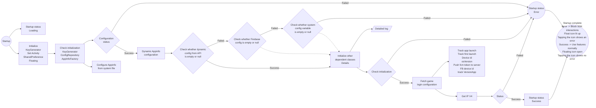
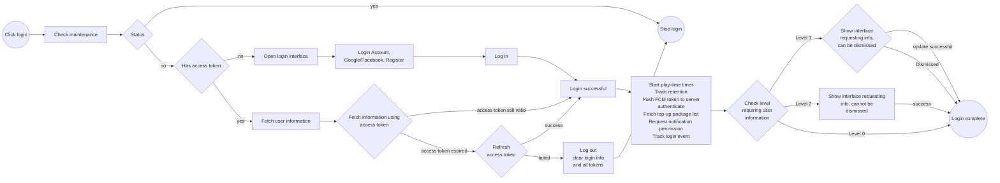
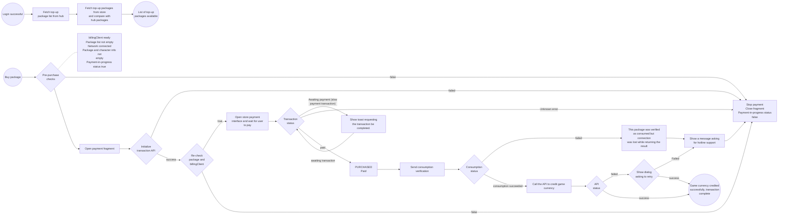
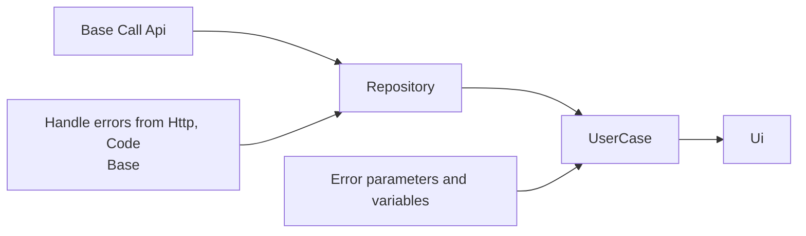
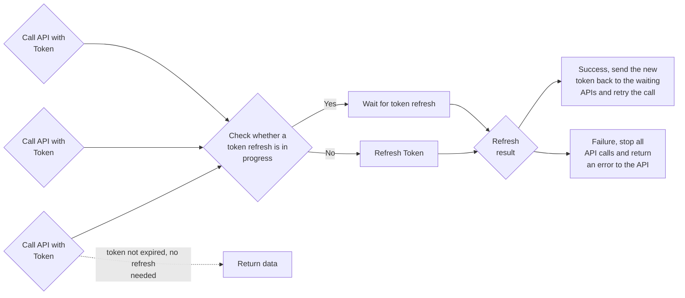
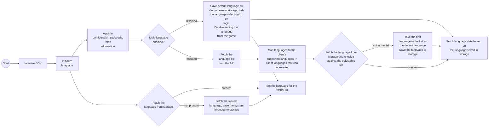
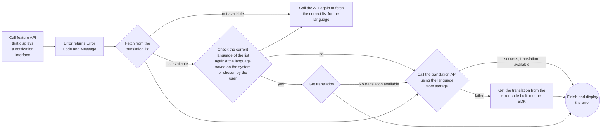
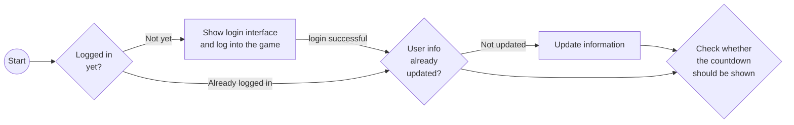

# I. Overview

VLiveSDK provides the following main feature groups:

```markmap
# VLiveSDK
## OIDC v2
### Login
#### Vlive account
- username/password
#### SNS
- Facebook
- Google
- Apple
- Zalo
#### Quick login
#### VLive OpenID
### Logout
### Registration
### Forget password
### Profile
- user name
- birthday
- sex
- avatar
### Link user accounts
### Deactive account
## Floating button
- Drag/drop
- Show/hide
- Dimming (reduce opacity)
## Permission Manager
- Nomal permissions
- Runtime permissions
## Log Manager
- Intergration log
## Push notification
- Firebase Messaging
## Tracking
- Appflyer
- Facebook
- Firebase
## Payment
- other payment methods (Momo, Zalopay,...)
### In-App Purchase
- List Product
## Configuration
### Environment configs
- dev
- staging
- prod
### general configs
### UI configs
- enable
- disable
### configs tracking
- press 10 times on logo to show all configs
```

## 1. Libraries used

| Library | Version | Notes |
| --- | --- | --- |
| retrofit2 | 2.9.0 | |
| billingclient | 8.0.0 | |
| play-services-base | 18.5.0 | |
| play-services-auth | 21.3.0 | |
| firebase-bom | 33.0.0 | |
| game-tracking | 1.0.5 | |
| app-update | 2.1.0 | |
| glide | 4.15.1 | |
| browser | 1.8.0 | |
| facebook-android-sdk | 17.0.0 | |
| af-android-sdk | 6.16.0 | |
| installreferrer | 2.2 | |
| play:review | 2.0.2 | |
| okhttp3:logging-interceptor | 4.11.0 | |
| recaptcha:recaptcha | 18.6.0 | |
| tiktok-business-android-sdk | 1.5.0 | |
| lifecycle-process | 2.3.1 | |
| browser | 1.8.0 | |

## 2. Version notes

| Version | CommitID | Release date | Change logs |
| --- | --- | --- | --- |
| 1.0.10 | 4e39208430a7d7d59857cf66602fc4e445504ec1 | 11-May | First release |
| 1.0.11 | 5dfedc2c5b9e4c83898071c928c147d3add73266 | 13/11 | Added tracking with parameters |
| 1.0.12 | ed667303992bfc75a906f89bc819535d98a0141c | 26/11 | Changed default environment to prod |
| 1.1.0 | f06324243f69940a8165db8930b28f1e91c95e80 | 1111/12 | Countdown feature, version check before build |
| 1.1.1 | afaccbcfeea2925aad3cc791d65e0f415c39260c | 23/12 | Added automatic switch to default language if set from the game while s... |
| 1.2.0 | 01edfe4996597c5a0d0aa582e48234740ab0a828 | 24/12 | Reward-claim information update feature |
| 1.2.1 | 2eb3a17e14ace99c395fafa4c9b984c0258bd7ce | 6/1 | Added vtvlive as an account that automatically disables the countdown |
| 1.2.2 | 9836e819580880028532d537dca9f4e4f9aeb714 | 8/1 | Fixed crash when closing the game and removing the network listener |
| 1.2.3 | 66bd2071d8a803539d40cda09bac8504381c5338 | 9/1 | Upgraded tracking sdk to 1.0.6 |
| 1.3.0 | | 12/1 | Added a "play now" button configurable via appler |
| 1.3.1 | | 5/2 | Fixed Google login being hidden |
| 1.3.2 | | 6/2 | Upgraded tracking sdk to 1.0.8, fixed crash |
| 1.3.3 | | 9/4 | Fixed back navigation issue from registration |
| 1.3.4 | | 10/4 | Low-probability crash when rotating the screen |
| 1.3.5 | | 13/4 | Updated flow and new tracking events |
| 1.3.8 | | 9.5 | Fixed back navigation issue from the registration screen, tested new events |

# II. Feature details

Android Refactor Sdk Game

| Feature | Sub-feature | Status | Notes |
| --- | --- | --- | --- |
| Startup process check | Game startup configuration, including dynamic configuration, initial configuration, domains from the dynamic domain. Cannot log in until configuration is complete. Reports an error when configuration fails or is in progress | Done | |
| Dynamic configuration | | Done | |
| Authentication on login | | Done | |
| Initial game configuration | | Done | |
| Google Play Review | | Done | |
| Payment | | Done | |
| Login | Vlive account | Done | |
| ^^ | Google | Done | |
| ^^ | Facebook | Done | |
| ^^ | login check | Done | |
| Registration | | Done | |
| Forgot password | | Done | |
| Logout | | Done | |
| Update information by level | | Done | |
| Floating | Drag-and-drop and click | Done | |
| ^^ | SDK startup status | Done | |
| Tracking Event | First game install | Done | |
| ^^ | Game startup | Done | |
| ^^ | After successful login | Done | |
| ^^ | Tapping login, close, register, forgot password, login with Google/Facebook | Done | |
| ^^ | Play time | Done | |
| Dashboard | Profile | Done | |
| ^^ | Change password | Done | |
| ^^ | Change email | Done | |
| ^^ | Change birthday | Done | |
| ^^ | Delete account | Done | |
| ^^ | Logout | Done | |
| Notification | Receiving notifications | Done | |
| ^^ | Tracking notification when hidden | Done | |
| Developer feature | Enable the developer feature in the prod environment when needed. Requires 5 hidden actions: 1. Tap the password icon in the password field 10 times 2. Tap the remember password checkbox 10 times 3. Tap the policy checkbox 10 times 4. Tap the "remember password" text 10 times 5. Enter vtvlive into the hidden username login field. Notification that the developer feature is enabled | Done | |
| Tracking TikTok | | Done | |
| Multi-language | | Done | |
| Tracking Vlive | | Done | |
| Event Count Down | | Done | |
| Dynamic floating button display | | Done | |

# III. Verification and testing

| Main Feature | Feature Comparison | Code check vs. old | Real device Android 13+ | Real device Android 10 -> 12 | Ldplayer 9 emulator |
| --- | --- | --- | --- | --- | --- |
| SDK startup and configuration | New | OK | OK | OK | OK |
| Login | Old | OK | OK | OK | OK |
| Registration | Old | OK | OK | OK | OK |
| Forgot password | Old | OK | OK | OK | OK |
| Change password | Old | OK | OK | OK | OK |
| Change email | Old | OK | OK | OK | OK |
| Change birthday | Old | OK | OK | OK | OK |
| Delete account | Old | OK | OK | OK | OK |
| Logout | Old | OK | OK | OK | OK |
| Payment | Old | OK | OK | OK | OK |
| Account switching | Old | OK | OK | OK | OK |
| Tracking Notification | New | OK | OK | OK | OK |
| Developer feature | New | OK | OK | OK | OK |
| Tracking TikTok | Old | OK | OK | OK | OK |
| Tracking Vlive | New | OK | OK | OK | OK |

# IV. Flow diagrams

1. Startup and configuration



Detailed log (initializing dependent classes):


2. Login



C. Payment



D. API Structure



E. Token-authenticated API Call Structure



F. Multi-language Support





G. Displaying the game-launch countdown notification


