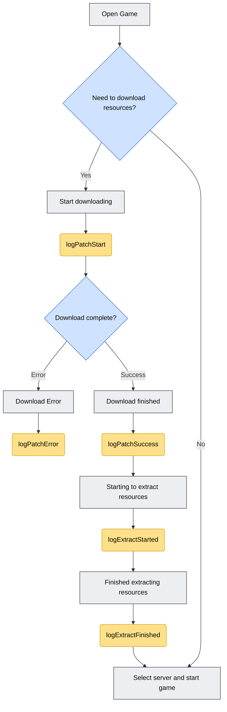
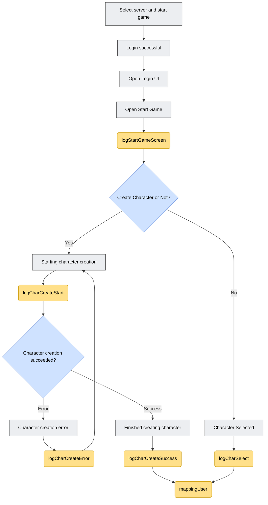
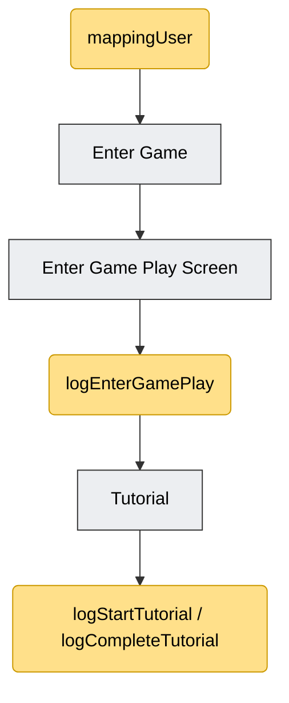

## 1. Decree 147 event update

Used to check for and display the "Event Profile" screen right after a successful login.

Should be called inside the `loginSuccess` callback of `SdkDelegate`, before letting the user into the game screen.

```objectivec
[[Sdk sharedInstance] showOrHide147];
```

All tracking functions are called through the singleton:

```objectivec
[[SdkTracking sharedInstance] ...];
```

Required framework: `ISdkTrackier.xcframework` (already included in the list of files required for SDK integration).

## 2. Mapping User

Used to attach the current character/server information to the tracking system. Should be called right after the player selects a server or a character, and before calling other log functions related to that character.

```objectivec
-(void) mappingUser:(NSString*)characterName
characterId:(NSString*)characterId
characterLevel:(NSString*)characterLevel
serverName:(NSString*)serverName
serverId:(NSString*)serverId;
```

Parameters:

| Parameter | Meaning |
|---|---|
| characterName | Character name |
| characterId | Character id |
| characterLevel | Character level |
| serverName | Server name |
| serverId | Server id |

Example:

```objectivec
[[SdkTracking sharedInstance] mappingUser:@"name"
characterId:@1
characterLevel:@1
serverName:@"test"
serverId:@"1"];
```

## 3. Log Function

The log functions are used to track the user's journey: opening the game → downloading/extracting resources → logging in/selecting a server → creating or selecting a character → entering the game → tutorial.

Notes based on the original flowchart:

- **Gray**: steps that happen inside the Game.
- **Yellow**: steps where the Game calls into the SDK (these are the log functions below).

General declarations (no parameters):

```objectivec
-(void) logStartGameScreen;
-(void) logEnterGamePlay;
-(void) logStartTutorial;
-(void) logCompleteTutorial;
```

### 3.1. logStartGameScreen

Call this when the "Open Start Game" screen (the starting screen, before entering the game) opens.

```objectivec
[[SdkTracking sharedInstance] logStartGameScreen];
```

### 3.2. logEnterGamePlay

Tracks the user entering the gameplay screen (Game Play Screen) after tapping the "Enter Game" button.

```objectivec
[[SdkTracking sharedInstance] logEnterGamePlay];
```

Call this right where the "Enter Game" button tap is handled, before transitioning to the gameplay screen.

### 3.3. Resource download

#### Start downloading resources

```objectivec
// Start downloading resources
-(void) logPatchStart:(NSNumber *_Nullable)sizeMB
withVerrsion:(NSString *_Nullable)version
withNetworkType:(NSString *_Nullable)networkType;
```

| Parameter | Meaning |
|---|---|
| sizeMB | Patch file size to update (displayed in Mb) |
| version | Installation package version |
| networkType | Network type (e.g. `"wifi"`) |

```objectivec
[[SdkTracking sharedInstance] logPatchStart:@"500"
withVerrsion:@"1.0.1"
withNetworkType:@"wifi"];
```

#### Resource download succeeded

```objectivec
-(void) logPatchSuccess:(NSNumber *_Nullable)durationSec
withAvgSpeedKbps:(NSNumber *_Nullable)avgSpeedKbps
withCdnNode:(NSString *_Nullable)cdnNode;
```

| Parameter | Meaning |
|---|---|
| durationSec | Time from when download started to when it completed |
| avgSpeedKbps | Average download speed (also check whether this can be obtained when `update_type` is Store) |
| cdnNode | CDN node used for the download |

```objectivec
[[SdkTracking sharedInstance] logPatchSuccess:@"500"
withAvgSpeedKbps:@"450"
withCdnNode:@"192.168.0.2"];
```

> **Note:** the original example in the document had a duplicated `avgSpeedKbps` parameter (a typo in the original document); the version above removes the duplicate to match the function signature.

#### Resource download failed

```objectivec
// When resource download is interrupted or fails
-(void) logPatchError:(NSString *_Nullable)errorCode
withRetryCount:(NSNumber *_Nullable)retryCount
withFailedUrl:(NSString *_Nullable)failedUrl
withCdnNode:(NSString *_Nullable)cdnNode;
```

| Parameter | Meaning |
|---|---|
| errorCode | Error code |
| retryCount | Number of retries required due to the error |
| failedUrl | URL that failed |
| cdnNode | CDN node where the error occurred |

```objectivec
[[SdkTracking sharedInstance] logPatchError:@"500"
withRetryCount:@1
withFailedUrl:@"https://cdn.game.com/patch/v120.zip"
withCdnNode:@"192.168.0.2"];
```

### 3.4. Resource extraction

#### Start extraction

Right after the download finishes, start extracting/installing:

```objectivec
-(void) logExtractStarted:(NSString *_Nullable)totalSizeMb
withTotalSize:(NSString *_Nullable)totalSize;
```

| Parameter | Meaning |
|---|---|
| totalSizeMb | Size after extraction, in Mb |
| totalSize | Number of files in the patch to extract (omit if unavailable) |

```objectivec
[[SdkTracking sharedInstance] logExtractStarted:@"500"
withTotalSize:@"400"];
```

#### Extraction completed

Once extraction is done and ready for the Login screen:

```objectivec
-(void) logExtractFinished:(NSNumber *_Nullable)durationSec
withResultCode:(NSString *_Nullable)resultCode;
```

| Parameter | Meaning |
|---|---|
| durationSec | Time from the start of extraction to success |
| resultCode | Result code (`0`/`"ok"`: OK, `1`: Disk Full) |

```objectivec
[[SdkTracking sharedInstance] logExtractFinished:@100
withResultCode:@"ok"];
```

### 3.5. Character creation

#### Start character creation

```objectivec
-(void) logCharCreateStart:(NSString *_Nullable)serverId;
```

| Parameter | Meaning |
|---|---|
| serverId | Server id |

```objectivec
[[SdkTracking sharedInstance] logCharCreateStart:@"100"];
```

> **Note:** use a timer to measure the time from the start to the completion of character creation (`durationSec` used for `logCharCreateSuccess`).

#### Character creation succeeded

```objectivec
-(void) logCharCreateSuccess:(NSString *_Nullable)serverId
withCharId:(NSString *_Nullable)charId
withCharName:(NSString *_Nullable)charName
withCharClass:(NSString *_Nullable)charClass
withDurationSec:(NSNumber *_Nullable)durationSec;
```

| Parameter | Meaning |
|---|---|
| serverId | Server id |
| charId | Character id |
| charName | Character name |
| charClass | Character class id |
| durationSec | Time from start of character creation to success |

```objectivec
[[SdkTracking sharedInstance] logCharCreateSuccess:@"100"
withCharId:@"1001"
withCharName:@"test"
withCharClass:@"1"
withDurationSec:@5];
```

> **Note:** the original document's example mistakenly copied parameters from the `logPatchStart` function (`withVerrsion`, `withNetworkType`) — these don't match the `logCharCreateSuccess` signature. The example above has been rewritten with the function's actual parameters; you should confirm with the SDK team (VTVLive) if you need a 100% accurate cross-check.

#### Character creation failed

```objectivec
-(void) logCharCreateError:(NSString *_Nullable)errorCode
withCharName:(NSString *_Nullable)charName
withServerId:(NSString *_Nullable)serverId;
```

| Parameter | Meaning |
|---|---|
| errorCode | Error code (e.g. `"NAME_DUPLICATED"`) |
| charName | Character name |
| serverId | Server id |

```objectivec
[[SdkTracking sharedInstance] logCharCreateError:@"NAME_DUPLICATED"
withCharName:@"test"
withServerId:@"1"];
```

### 3.6. Character select

After a server/character has been selected, call this function:

```objectivec
-(void) logCharSelect:(NSString *_Nullable)charId
withCharacterName:(NSString *_Nonnull)characterName
withCharLevel:(NSString *_Nullable)charLevel;
```

| Parameter | Meaning |
|---|---|
| charId | Character id |
| characterName | Character name |
| charLevel | Character level |

```objectivec
[[SdkTracking sharedInstance] logCharSelect:@"1"
withCharacterName:@"name"
withCharLevel:@"1"];
```

### 3.7. Tutorial

Two parameterless declarations (used to track the start/completion of the in-game tutorial):

```objectivec
[[SdkTracking sharedInstance] logStartTutorial];
[[SdkTracking sharedInstance] logCompleteTutorial];
```

## 4. Tracking Flowchart

The diagram below redraws the entire flow of `SdkTracking` function calls, following the original flowchart in the document, split into 3 parts according to the game's sequence.

Color legend:

- **Gray box**: steps that happen inside the Game.
- **Blue box (diamond)**: branch/decision points.
- **Yellow box**: points where the Game calls into the SDK (the `SdkTracking` functions).

### 4.1. Downloading & extracting resources



*Figure 1 — Resource download and extraction flow*

### 4.2. Login, character creation/selection



*Figure 2 — Login, character creation, or character selection flow*

### 4.3. Entering the game & Tutorial



*Figure 3 — Entering the game and tutorial flow*

> **Note:** the diagram has been redrawn for clarity, based on the correct function names/step order following the original flowchart in the document — the small example values in the original image were not copied verbatim (some of them have parameters that don't match the signature, as noted in sections 3.3 and 3.5 above).

## 5. Summary of call order in the game flow

1. Open the game → need to download an update? → `logPatchStart` → download finished: `logPatchSuccess`, or error: `logPatchError`
2. Start extraction: `logExtractStarted` → extraction finished: `logExtractFinished`
3. Open the start screen: `logStartGameScreen`
4. Login/server selection succeeds
5. Create a new character: `logCharCreateStart` → success: `logCharCreateSuccess`/error: `logCharCreateError` (or) select an existing character: `logCharSelect`
6. Attach character information to tracking: `mappingUser`
7. Tap "Enter Game": `logEnterGamePlay`
8. During the tutorial flow: `logStartTutorial`/`logCompleteTutorial`
