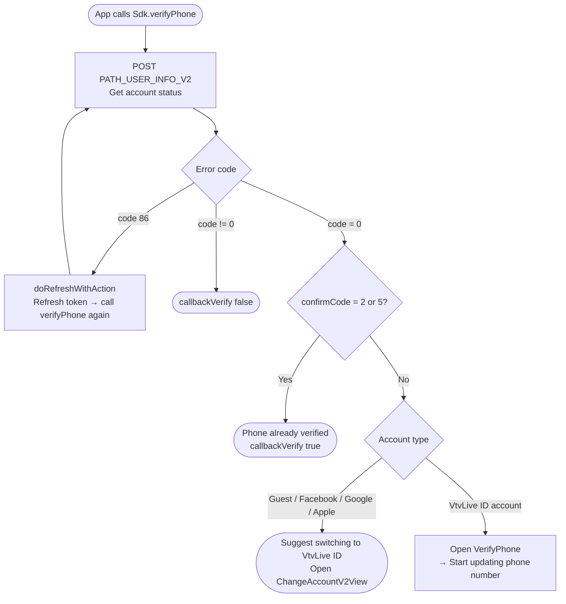
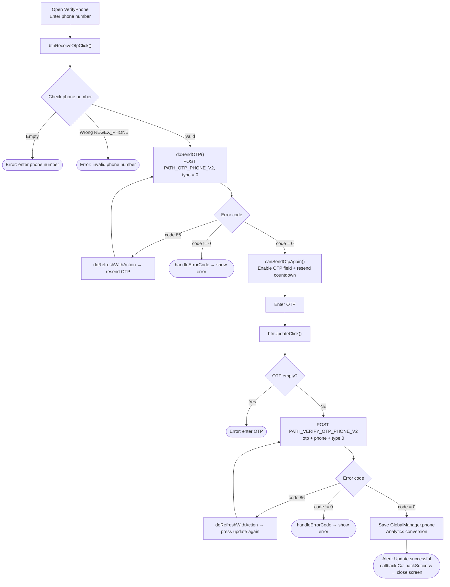
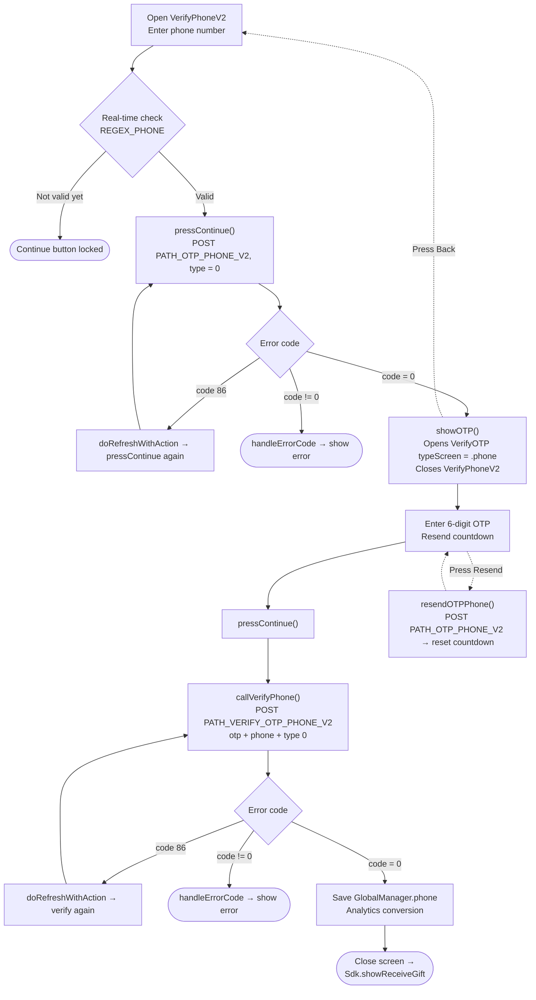

This document describes the SDK's phone number update / verification flow, built from the actual code.
The project currently has **two variants** of the screen:

- **Option 1 – `VerifyPhone`** (a single screen combining phone number input and OTP input; title *"UPDATE PHONE NUMBER"*). Invoked via `Sdk.verifyPhone(...)`.
- **Option 2 – `VerifyPhoneV2` → `VerifyOTP`** (the newer version, split into two screens; title *"Add phone number"*, tied to the gift-claiming flow `showReceiveGift`).

Both share the same 2 endpoints: `PATH_OTP_PHONE_V2` (send OTP) and `PATH_VERIFY_OTP_PHONE_V2` (verify OTP), with the parameter `type = 0` (Verify Phone) and a header carrying a Bearer accessToken.

## Entry condition – `Sdk.verifyPhone()`

Only VtvLive ID accounts that have not verified their phone number (`confirmCode` other than 2 and 5) can open the
phone number update screen; guest/social accounts will be prompted to switch accounts first.

## Option 1 – `VerifyPhone` screen

### Description – Option 1

1. **Enter phone number & send OTP** – `btnReceiveOtpClick()` checks that the phone number is not empty and matches
   `REGEX_PHONE`, then `doSendOTP()` calls `PATH_OTP_PHONE_V2` (`type = 0`, with a Bearer token).
   - `code = 0`: enables the OTP input field and starts the resend countdown (`Constants.timeOutOtpAgain`).
   - `code = 86` (token expired): `doRefreshWithAction` refreshes the token then automatically presses send again.
   - other errors: `handleErrorCode`.
2. **Enter OTP & update** – `btnUpdateClick()` checks that the OTP is not empty, calls
   `PATH_VERIFY_OTP_PHONE_V2` (`otp`, `phone`, `type = 0`).
   - `code = 0`: saves `GlobalManager.shared.phone`, records Analytics, shows the
     "Update successful" alert, fires `callback(CallbackSuccess)` then closes the screen.
   - `code = 86`: refreshes the token then retries.
   - other errors: `handleErrorCode`.
3. **Resend OTP** – when the countdown reaches 0, the "Send code" button becomes active again to call `PATH_OTP_PHONE_V2` again.

## Option 2 – `VerifyPhoneV2` → `VerifyOTP`

### Description – Option 2

1. **`VerifyPhoneV2`** – the phone number input field is checked in real time against `REGEX_PHONE`; if valid,
   the "Continue" button is enabled. `pressContinue()` calls `PATH_OTP_PHONE_V2` (`type = 0`).
   - `code = 0`: `showOTP()` opens the `VerifyOTP` screen (`typeScreen = .phone`, passing
     `phone`, `serverId`, `characterId`) and closes the current screen.
   - `code = 86`: refreshes the token then calls again.
   - other errors: `handleErrorCode`.
2. **`VerifyOTP`** – enter the 6-digit OTP, displays the masked phone number (`maskedPhoneFrom`) and a
   countdown for "Resend". `pressContinue()` → `callVerifyPhone()` calls
   `PATH_VERIFY_OTP_PHONE_V2` (`otp`, `phone`, `type = 0`).
   - `code = 0`: saves `GlobalManager.shared.phone`, logs Analytics, closes the screen and
     calls `Sdk.showReceiveGift()` (continuing the gift-claiming flow).
   - `code = 86`: refreshes the token then retries.
   - other errors: `handleErrorCode`.
   - **Resend OTP**: `resendOTPPhone()` calls `PATH_OTP_PHONE_V2` again and restarts the countdown.
   - **Back**: returns to the `VerifyPhoneV2` screen.

## Endpoints used

- `PATH_USER_INFO_V2` – gets the account verification status (in the `verifyPhone` entry condition step)
- `PATH_OTP_PHONE_V2` – sends the OTP to the phone number (POST, `type = 0`)
- `PATH_VERIFY_OTP_PHONE_V2` – verifies the OTP and updates the phone number (POST, `type = 0`)

## Notes

- The `type = 0` parameter means *Verify Phone*. Other values are used for email and other
  verification types (1 = mail, 2/3 = one-time authen, 4/5 = one-time transaction).
- Every request attaches an `accessToken` (Bearer). When `code = 86` (token expired) occurs,
  the SDK automatically runs `doRefreshWithAction` to refresh the token, then repeats the in-progress action.
- A successful update always records `GlobalManager.shared.phone` and calls
  `Analytics.initiateOnDeviceConversionMeasurement(phoneNumber:)`.
- Ending difference: Option 1 fires `callback(CallbackSuccess)` back to whatever opened the screen;
  Option 2 forwards to `Sdk.showReceiveGift()`.
