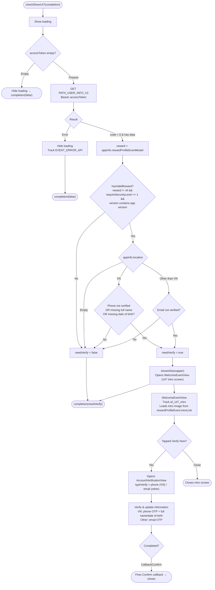

This document describes the `show147` flow, built from the actual code: `Sdk.checkShow147()` (Sdk+Ext.swift),
`WelcomeEventView` (introduction screen), and `AccountVerificationView` (verification screen).

> "147" refers to the user identity verification requirement (Decree 147). The SDK decides whether
the user must be verified based on the event configuration and account status, then shows the
introduction screen and leads into the verification screen.

Entry point (called by the app, typically after login or when entering the game):

```Swift
Sdk.sharedInstance.checkShow147 { needVerify in
    // needVerify = true if the SDK displayed the 147 identity screen
}
```

## Overview diagram



## Detailed description

### 1. `checkShow147()` – decides whether verification is required (Sdk+Ext.swift)

1. Shows loading. If `accessToken` is empty → hides loading and `completion(false)` (not
logged in, so no check is performed).

2. Calls `PATH_USER_INFO_V2` (GET, Bearer accessToken) to fetch account information.

    - **Error**: hides loading, tracks `EVENT_ERROR_API` (`id_check_token_api`), `completion(false)`.

    - **code = 0 and has data**: computes `needVerify` according to the rules below.

Rules for computing `needVerify`:

- `reward = appInfo.rewardProfileEventModel` (identity verification event configuration).

- `hasValidReward = reward != nil && reward.requireSecurityLevel == 1 && reward.version` contains
the current app version.

- If `appInfo.location` is empty → `needVerify = false`.

- Otherwise, if `hasValidReward`:

    - **Vietnam (`location == "VN"`)**: `needVerify = true` when **phone is not verified**, or
    **full name is missing**, or **date of birth is missing**.

    - **Outside Vietnam**: `needVerify = true` when **email is not verified**.

If `needVerify == true` → calls `showInfo(wrapper)` to open the introduction screen. Finally, it always
returns `completion(needVerify)` so the app knows whether the SDK displayed the identity screen.

### 2. `WelcomeEventView` – 147 introduction screen

When opened, this screen sends the `af_147_intro` tracking event (with `account_id`, `location`, `type` = PHONE/EMAIL,
`requireSecurityLevel`, `version`) and loads the introduction image from `rewardProfileEvent.introLink`
(default image based on screen orientation).

- **Tap "Verify Now"** (`btnConfirmNow`): closes the intro screen and opens `AccountVerificationView`
with `typeVerify = .phone` if in VN, otherwise `.email`. Passes `userWrapper` and `delegate`.

- **Close**: dismisses the intro screen.

### 3. `AccountVerificationView` – verification & information completion screen

Depending on `typeVerify` and account status, this screen handles:

- **VN (`.phone`)**: sends/enters a phone number OTP (`PATH_OTP_PHONE_V2` + verify) and fills in
**full name / date of birth** if missing (updated via `PATH_UPDATE_INFO_V2`).

- **Outside VN (`.email`)**: sends/enters an email OTP for verification.

When complete, fires `callback(CallbackConfirm)` so `WelcomeEventView` forwards the callback to
the caller.

## Endpoints used

- `PATH_USER_INFO_V2` – fetches account status to decide `needVerify` (GET)

- `PATH_OTP_PHONE_V2` – sends phone OTP (POST) – in `AccountVerificationView` (VN)

- `PATH_UPDATE_INFO_V2` – updates full name / date of birth (POST) – in `AccountVerificationView` (VN)

- Corresponding email OTP – in `AccountVerificationView` (outside VN)

## Notes

- The requirement to verify identity depends on the `rewardProfileEventModel` configuration
(`requireSecurityLevel == 1` and matching version) — meaning it is only enabled for configured
versions/events, not applied universally.

- Verification criteria **differ by region**: Vietnam requires phone + full name + date of birth; outside
Vietnam requires email.

- `checkShow147` is an asynchronous function that returns its result via `completion(needVerify)`; the app can
use it to gate/unlock features until the user completes identity verification.

- `location` is determined during the initialization flow (`getLocation` based on IP) — if empty, the
identity verification step is skipped.
