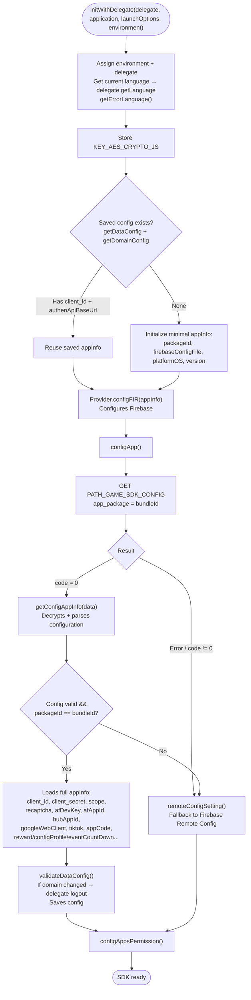

This document describes the SDK initialization flow starting from `Sdk.initWithDelegate(...)`, built from
the actual code: `Sdk+Ext.swift` (entry point), `Sdk+Config.swift` (fetching & resolving configuration).

Entry point (called by the app at startup, typically in `application(_:didFinishLaunchingWithOptions:)`):

```Swift
Sdk.sharedInstance.initWithDelegate(delegate,
                                    application: application,
                                    launchOptions: launchOptions,
                                    environment: .prod)
```

## Overall diagram



## Fallback & third-party configuration branch diagram

```mermaid
flowchart TD
    subgraph RC["remoteConfigSetting – Firebase Remote Config"]
        A1["Sets minimumFetchInterval = 0<br/>setDefaults from plist"] --> A2["remoteConfig.fetch → activate"]
        A2 -- "Success" --> A3["getAppInfoConfigDefaultFirebase()<br/>Decrypts APPINFO_CONFIG from Remote Config"]
        A2 -- "Error" --> A4["getAppInfoConfigDefault()<br/>Reads from default plist in bundle"]
        A3 -- "Decryption error" --> A4
        A3 --> A5["configAppsPermission()"]
        A4 --> A5
    end

    subgraph AP["configAppsPermission – third-party initialization"]
        B1{"Has afAppId?"} -- "No" --> B9["Skips tracking setup"]
        B1 -- "Yes" --> B2["Facebook: ApplicationDelegate didFinishLaunching + Settings"]
        B2 --> B3["AppsFlyer: devKey, appleAppID,<br/>waitForATT, delegate"]
        B3 --> B4["setupTiktTokSDK()"]
        B4 --> B5["sendLaunch()"]
        B5 --> B6["Trackier: initWith + logDevice + setTimeTrackier"]
        B9 --> B7
        B6 --> B7["getPublicIPAddress → appInfo.ipPublic<br/>getLocation → appInfo.location"]
        B7 --> B8["subscribeToTopic()"]
    end

    subgraph SL["sendLaunch → checkInit"]
        C1["applicationDidBecomeActive5s<br/>AppsFlyer.start() + appDidBecomeActive"] --> C2["checkInit()"]
        C2 --> C3["Track EVENT_APP_LAUNCH<br/>TikTok launchAPP + subscribe"]
        C3 --> C4{First app launch?}
        C4 -- "Yes" --> C5["Track EVENT_FIRST_LAUNCH"]
        C4 -- "No" --> C6{Version changed?}
        C5 --> C6
        C6 -- "Yes" --> C7["Track EVENT_UPGRADE_VERSION_SUCCESS"]
    end

    subgraph ST["subscribeToTopic"]
        D1["GET PATH_GAME_CHECK_MAINTAIN"] --> D2["Subscribes to FCM topics"]
        D1 --> D3["UpdatePushIDRepo.execute()<br/>Updates push id"]
    end
```



## Detailed description

### 1. `initWithDelegate()` – entry point (Sdk+Ext.swift)

1. Assigns `environment` and `delegate`.

2. Gets the current language (`Localize.currentLanguage()`), calls the delegate's `getLanguage` and loads
the multi-language error table (`getErrorLanguage()`).

3. Stores the encryption key `KEY_AES_CRYPTO_JS`.

4. Reads saved configuration (`getDataConfig` + `getDomainConfig`):

    - If `client_id` and `authenApiBaseUrl` already exist → reuses the saved `appInfo` (fast startup).

    - If not → initializes a minimal `appInfo` (packageId from bundle, firebase config, platformOS, version).

5. `Provider.shared.configFIR(appInfo)` configures Firebase.

6. Calls `configApp(...)` to fetch the configuration from the server.

### 2. `configApp()` – fetches configuration from server (Sdk+Config.swift)

Calls `PATH_GAME_SDK_CONFIG` (GET, `app_package = bundleId`) via `configApiService`.

- `code = 0`: `getConfigAppInfo(data)` – AES-decrypts and parses the configuration.

- Network error or `code != 0`: falls back to `remoteConfigSetting()` (Firebase Remote Config).

### 3. `getConfigAppInfo()` – decrypts & loads configuration

Decrypts the string using `KEY_AES_CRYPTO_JS`, parses the JSON and checks that all required fields
are present (client_id, client_secret, apiKeyRecapcha, afDevKey, scope, googleWebClient, packageId,
afAppId, base URLs, hubAppId, appCode, etc.).

- If all fields are present **and** `packageId == bundleIdentifier`:

    - Loads everything into `appInfo` (including extended configuration: `rewardProfileEvent`, `showFloating`,
    `configProfile`, `eventCountDown`).

    - Builds `DomainConfig`, calls `validateDataConfig()`: if the auth domain changed compared to the
    saved version, fires the delegate's `logout`; then saves the configuration.

    - Calls `configAppsPermission()`.

- If fields are missing, the package is wrong, or decryption/parsing fails → `remoteConfigSetting()`.

### 4. `remoteConfigSetting()` – Firebase Remote Config fallback

Sets `minimumFetchInterval = 0`, loads defaults from plist, then `fetch → activate`:

- Success: `getAppInfoConfigDefaultFirebase()` decrypts `APPINFO_CONFIG` from Remote Config;
if decryption fails, `getAppInfoConfigDefault()` reads from the default plist in the bundle.

- Error: `getAppInfoConfigDefault()` (default plist).

Both branches continue on to call `configAppsPermission()`. There is also an
`addOnConfigUpdateListener` registered to update the configuration when changes occur.

### 5. `configAppsPermission()` – third-party SDK initialization

Only runs when `afAppId` is present. Performs:

- Facebook SDK: `ApplicationDelegate didFinishLaunching`, configures `Settings`.

- AppsFlyer: `devKey`, `appleAppID`, `waitForATTUserAuthorization`, assigns delegate.

- `setupTiktTokSDK()` initializes the TikTok Business SDK.

- `sendLaunch()` (see item 6).

- Trackier: `initWith`, sends `logDevice`, `setTimeTrackier(30)`.

Then fetches the public IP (`getPublicIPAddress` → `appInfo.ipPublic`) and location
(`getLocation` → `appInfo.location`), then `subscribeToTopic()`.

### 6. `sendLaunch()` → `checkInit()` (Sdk+Ext.swift)

`sendLaunch()` calls `applicationDidBecomeActive5s`, `AppsFlyerLib.start()`, `appDidBecomeActive()`
and `checkInit()`. `checkInit()` sends startup tracking:

- `EVENT_APP_LAUNCH` and TikTok events `launchAPP` / `subscribe`.

- First app launch → `EVENT_FIRST_LAUNCH`.

- If the version changed compared to last time → `EVENT_UPGRADE_VERSION_SUCCESS`.

### 7. `subscribeToTopic()`

Calls `PATH_GAME_CHECK_MAINTAIN` to fetch and subscribe to FCM topics, and also runs
`UpdatePushIDRepo` to update the push id on the server.

## Endpoints used

- `PATH_GAME_SDK_CONFIG` – fetches SDK configuration from the server (GET)

- `PATH_GAME_CHECK_MAINTAIN` – fetches FCM topics / checks maintenance status (GET)

- `PATH_LOCATION` – gets the country code from IP (POST)

- `getclientip` (id.vplay.vn) – fetches the device's public IP (GET)

## Notes

- Configuration source priority: **server (`PATH_GAME_SDK_CONFIG`) → Firebase Remote Config
→ default plist in bundle**. Each tier falls through to the next on error.

- Sensitive configuration (client_id/secret, scope, base URLs) is AES-encrypted and only loaded when
`packageId` matches the app's bundle.

- `initWithDelegate` reuses saved configuration for fast startup, but still calls
`configApp` to refresh the configuration on every startup.

- If the auth domain changes between two startups, the SDK proactively fires the delegate's `logout` to
avoid using an old token on the new domain.
