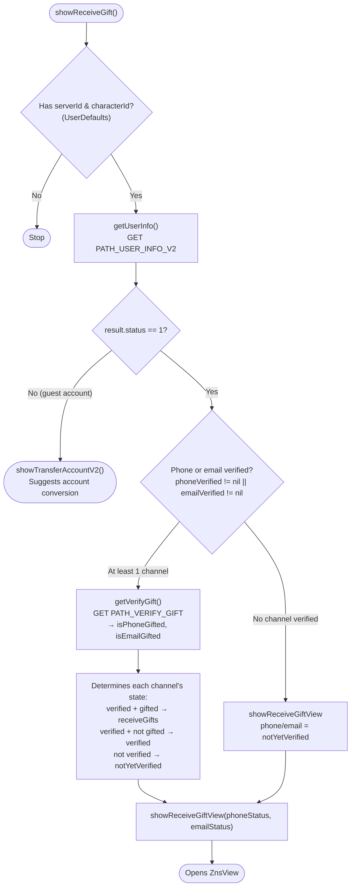
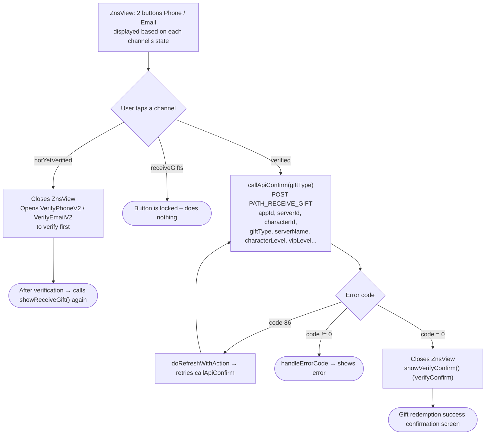

This document describes the gift redemption flow (verifying phone/email to receive a gift), built from
the actual code: `Sdk+Gift.swift` (state decision) and `ZnsView.swift` (gift selection screen).

Entry point:

```Swift
Sdk.sharedInstance.showReceiveGift()
```

`showReceiveGift()` is also called automatically **after successful phone/email verification** (from
`VerifyOTP` / `VerifyPhoneV2` / `VerifyEmailV2`), forming a loop: verification → back to gift redemption.

## Three states per channel (phone / email) – `VerifyStatus`

|State|Meaning|Button on `ZnsView`|
|---|---|---|
|`notYetVerified`|This channel is not yet verified|Tap to **open the verification screen** (VerifyPhoneV2 / VerifyEmailV2)|
|`verified`|Verified, **gift not yet received**|"Receive gift ..." – enabled, tap to **receive the gift**|
|`receiveGifts`|Gift already received|"Receive gift ..." – **locked** (grayed out)|

## 1. State decision – `showReceiveGift()`



## 2. Actions on `ZnsView`



## Detailed description

### `showReceiveGift()` – flow decision (Sdk+Gift.swift)

1. Requires `serverId` and `characterId` (read from `UserDefaults`: `KEY_SERVER_ID` /
`KEY_SERVER_NAME`); stops if missing.

2. Calls `getUserInfo()` (`PATH_USER_INFO_V2`):

    - If `result.status != 1` (guest account) → `showTransferAccountV2()` suggests converting
    to a main account, ending the gift redemption flow.

    - If `status == 1`:

        - **At least one channel already verified** (`phoneVerified != nil` or `emailVerified != nil`):
        calls `getVerifyGift()` to check whether the gift has been received, then computes each channel's state:

            - Phone: if verified → `receiveGifts` if `isPhoneGifted == true`, otherwise `verified`.

            - Email: if verified → `receiveGifts` if `isEmailGifted == true`, otherwise `verified`.

            - An unverified channel keeps `notYetVerified`.

        - **No channel verified**: both channels = `notYetVerified`.

    - Opens `ZnsView` with the two computed states (`showReceiveGiftView`).

### `getVerifyGift()` – checks whether the gift was already received

Calls `PATH_VERIFY_GIFT` (GET, with signature + Bearer accessToken) with `appId`, `appPackage`,
`serverId`, `characterId`. Returns `isPhoneGifted`, `isEmailGifted` (whether each channel already received a gift).

### `ZnsView` – gift selection screen

Displays 2 buttons (Phone / Email), with UI that changes based on each channel's state
(see table above). When a channel is tapped:

- **`notYetVerified`**: closes `ZnsView`, opens `VerifyPhoneV2` / `VerifyEmailV2` to verify first.
After verification is complete, the flow calls `showReceiveGift()` again to refresh the state.

- **`verified`**: calls `callApiConfirm()` to receive the gift.

- **`receiveGifts`**: button is locked, does nothing.

### `callApiConfirm()` – receiving the gift

Calls `PATH_RECEIVE_GIFT` (POST, with signature + Bearer accessToken) with `appId`, `appPackage`,
`serverId`, `characterId`, `sdkVersion`, `giftType` (`phone`/`email`), `serverName`,
`characterName`, `characterLevel`, `characterVipLevel`.

- `code = 0`: closes `ZnsView` and opens `VerifyConfirm` (gift redemption success confirmation screen).

- `code = 86` (token expired): `doRefreshWithAction` refreshes the token then retries `callApiConfirm()`.

- other errors: `handleErrorCode`.

## Endpoints used

- `PATH_USER_INFO_V2` – fetches account status & verification info (GET)

- `PATH_VERIFY_GIFT` – checks whether each channel already received a gift (GET)

- `PATH_RECEIVE_GIFT` – submits a gift redemption request (POST)

## Notes

- Prerequisite: `serverId` + `characterId` must be present (usually set during
`mappingUser` / `payProduct`), and the account must be a main account (`status == 1`) —
guest accounts will be redirected to account conversion.

- To receive a gift, the channel (phone/email) must **already be verified**; if not, `ZnsView` guides the user
to verify first, then automatically returns to the gift redemption flow.

- Gift redemption requests use headers with a **signature** (`createHeaderFieldWithSignatureAndBearerToken`).

- A successful gift redemption ends with the `VerifyConfirm` confirmation screen.
