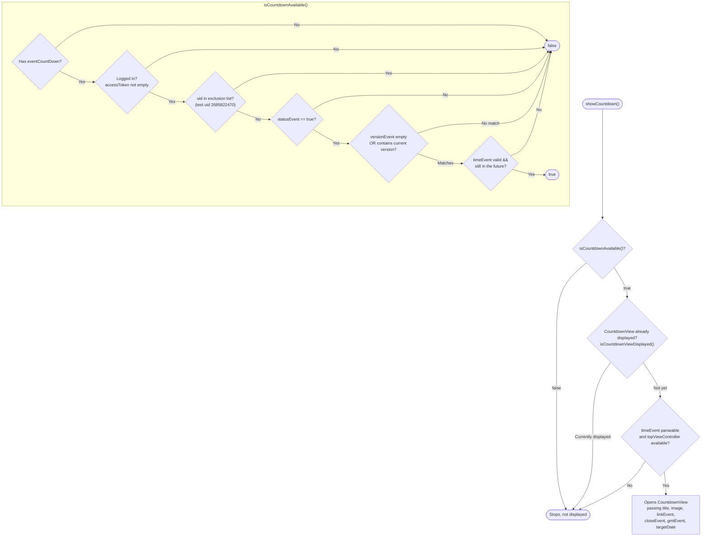
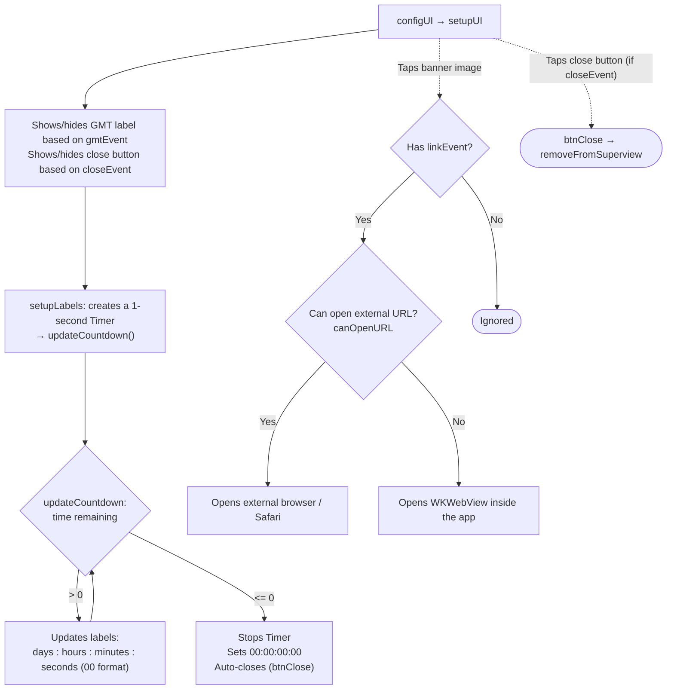

This document describes the `showCountdown` flow, built from the actual code: `Sdk+Countdown.swift` (display
conditions + opening the screen) and `CountdownView.swift` (countdown clock + opening the event link).

Entry point (called by the app to display the countdown event banner):

```Swift
Sdk.sharedInstance.showCountdown()
```

The event configuration is taken from `appInfo.eventCountDown` (loaded during the initialization flow, field `EVENT_COUNTDOWN`).

## 1. Display condition – `showCountdown()` / `isCountdownAvailable()`



## 2. `CountdownView` lifecycle



## Detailed description

### `showCountdown()` – entry point (Sdk+Countdown.swift)

1. Checks `isCountdownAvailable()`; stops if conditions are not met.

2. Checks `isCountdownViewDisplayed()` — if the banner is already displayed, stops (avoids opening a duplicate).

3. Gets `event = appInfo.eventCountDown` and parses `targetDate` from `event.timeEvent`
(format `yyyy-MM-dd'T'HH:mm:ssZ`). Stops if missing.

4. Opens `CountdownView` on `topViewController`, passing: `titleText`, `imageUrl`, `linkEvent`,
`closeEvent`, `gmtEvent`, `targetDate`.

### `isCountdownAvailable()` – display condition

Returns `true` only when **all** of the following hold:

- The `appInfo.eventCountDown` configuration is present.

- The user is logged in (`accessToken` is not empty).

- The account is **not** in the exclusion list (checks against test uid `2685822470`).

- `event.statusEvent == true` (the event is enabled).

- `versionEvent` is empty **or** contains the current app version (filtering by version).

- `timeEvent` is parseable and **still in the future** (`timeIntervalSinceNow > 0`).

### `isCountdownViewDisplayed()`

Iterates over the subviews of `topViewController`; if a `CountdownView` is already present, it is considered
displayed (no additional one is opened).

### `CountdownView` – countdown clock

- **`setupUI`**: shows/hides the GMT label based on `gmtEvent`, shows/hides the close button based on `closeEvent`
(if `closeEvent == false`, manual closing is disabled).

- **Countdown**: `setupLabels()` creates a `Timer` that fires every second calling `updateCountdown()`.

    - Time remaining: updates the 4 labels **days : hours : minutes : seconds** (2-digit format).

    - Time's up (`<= 0`): stops the timer, sets `00:00:00:00` and **auto-closes** the banner.

- **Tapping the banner image** (`imageViewTapped`): if `linkEvent` is present, opens the event link —
prefers opening the URL in an external browser (`UIApplication.open`); if that fails,
displays a `WKWebView` inside the app.

- **Close** (`btnClose`): removes the banner from the screen; `deinit` also invalidates the timer.

## Notes

- `showCountdown` **does not call any API** — all the data (end time, title, image, link,
display flag) comes from the `eventCountDown` configuration already loaded during SDK initialization.

- The banner auto-closes when time runs out; the user can only close it manually when `closeEvent == true`.

- The event is **filtered by app version** (`versionEvent`) and by enabled/disabled status
(`statusEvent`), so it only displays to the correct configured audience/version.

- There is a duplicate-display guard (`isCountdownViewDisplayed`), making it safe to call
`showCountdown()` multiple times.
