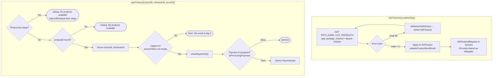
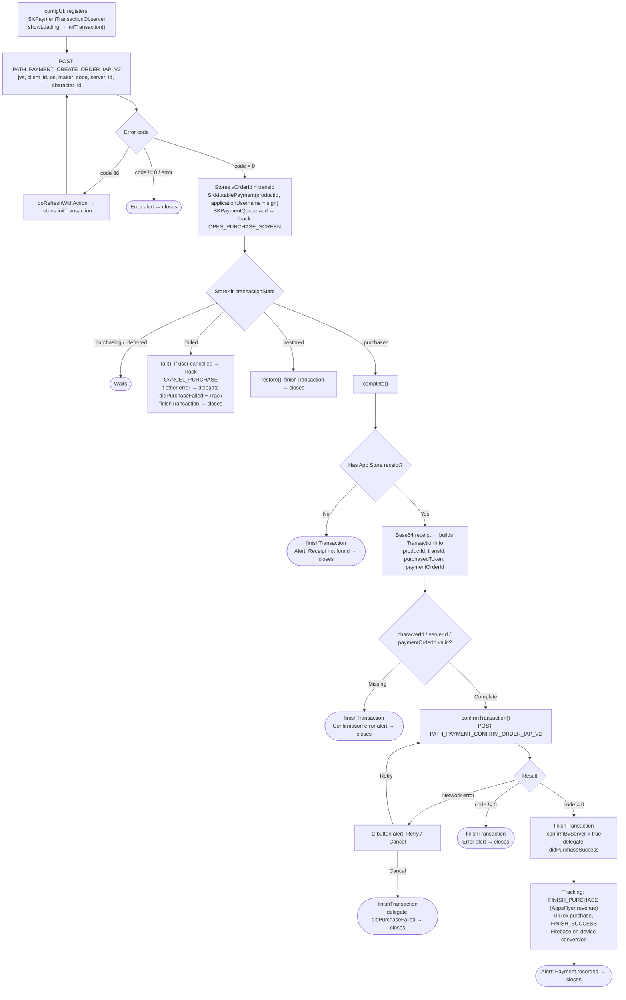

This document describes the SDK's In-App Purchase payment flow, built from the actual code:
`Sdk+Payment.swift` (public API) and `PaymentView.swift` (StoreKit transaction handling +
server-side verification).

## 1. Fetching the product list & opening payment

## 2. Transaction lifecycle in `PaymentView`

## Detailed description

### `listProducts()` – fetches the product list

Calls `PATH_GAME_LIST_PRODUCTS` (GET, with Bearer `idToken`) with `app_package` and `channel`.

- `code = 0`: converts the data into `[IAPProduct]`, then `validateProductIdentifiers()` creates
an `SKProductsRequest` to fetch real product information from StoreKit (delegate is `Provider.shared`).
If the list is empty, returns error `CODE_PAYMENT_ERROR_NO_CONFIG`.

- `code = 86`: refreshes the token then retries; on failure returns an error via `getProductTask`.

### `payProduct(productID, characterId, serverId)` – starts a purchase

1. If there are no products yet → shows a "No products available" dialog and calls `listProducts(nil)` then stops.

2. Looks up the product by `productID`; if not found → "No products available" dialog.

3. Stores `serverId`, `characterId` (in a variable and UserDefaults).

4. If `accessToken` is empty → alert "You need to log in" then stops.

5. Calls `showPaymentUI()`: if no transaction is currently in progress (`isProcessingPayment == false`),
opens `PaymentView` (passing products, serverId, characterId, productId, delegate).

### `PaymentView` – creates the order & handles the StoreKit payment

**Initialization (`configUI`)**: registers as `SKPaymentTransactionObserver`, shows loading and calls
`initTransaction()`.

**`initTransaction()`** – creates the order on the server side: calls `PATH_PAYMENT_CREATE_ORDER_IAP_V2` (POST)
with `jwt`, `client_id`, `os`, `maker_code = productId`, `server_id`, `character_id`.

- `code = 0`: stores `vOrderId = transId`, creates an `SKMutablePayment` (setting
`applicationUsername = sign` from the server) and adds it to the `SKPaymentQueue` to open Apple's payment
dialog; tracks `EVENT_OPEN_PURCHASE_SCREEN`.

- `code = 86`: refreshes the token then retries `initTransaction()`.

- other errors: shows an error alert then closes.

**Transaction monitoring (`paymentQueue:updatedTransactions`)**:

- `.purchasing` / `.deferred`: waits.

- `.failed` → `fail()`: if the user cancelled, tracks `EVENT_CANCEL_PURCHASE`; if another error occurred,
fires the delegate's `didPurchaseFailed` and tracks; always `finishTransaction` then closes.

- `.restored` → `restore()`: `finishTransaction` then closes.

- `.purchased` → `complete()`.

**`complete()`** – prepares for verification: shows a "Verifying transaction" loading state, reads
`appStoreReceiptURL` to get the receipt.

- No receipt → `finishTransaction` + "Receipt not found" alert → closes.

- Has receipt → base64 encodes it, builds `TransactionInfo` (`productId`, `transId`,
`purchasedToken = receipt`, `paymentOrderId = vOrderId`).

- If `characterId` / `serverId` / `paymentOrderId` are missing → `finishTransaction` + error alert → closes.

- Otherwise → `confirmTransaction()`.

**`confirmTransaction()`** – verifies with the server: calls `PATH_PAYMENT_CONFIRM_ORDER_IAP_V2` (POST)
with `jwt`, `cid`/`client_id`, `client_secret = transactionIdentifier`, `os`,
`b_code = purchasedToken` (receipt), `transId = paymentOrderId`, `maker_code = productId`,
`character_id`, `server_id`.

- **Network error**: 2-button alert "Retry" / "Cancel". "Retry" calls `confirmTransaction` again; "Cancel"
calls `finishTransaction`, fires the delegate's `didPurchaseFailed` then closes.

- `code = 0`: `finishTransaction`, sets `confirmByServer = true`, fires the delegate's
`didPurchaseSuccess`. Records tracking `EVENT_FINISH_PURCHASE` (AppsFlyer with revenue),
the TikTok purchase event, `EVENT_FINISH_SUCCESS`, Firebase on-device conversion. Shows an alert
"Payment recorded ..." then closes.

- `code != 0`: `finishTransaction` + error alert → closes.

## Endpoints used

- `PATH_GAME_LIST_PRODUCTS` – fetches the IAP product list (GET, Bearer idToken)

- `PATH_PAYMENT_CREATE_ORDER_IAP_V2` – creates a payment order (POST)

- `PATH_PAYMENT_CONFIRM_ORDER_IAP_V2` – verifies / records the transaction (POST)

## Notes

- This is **server-verified payment**: the SDK creates the order first (getting `transId` + `sign`),
uses `sign` as the `applicationUsername` of the `SKPayment`, and only records success after the
server verifies the receipt (`PATH_..._CONFIRM_...`).

- `SKPaymentQueue.finishTransaction` is only called after verification completes (success or
the user chooses to cancel), preventing lost transactions on network errors — on a network error, the user can
tap "Retry" to verify again.

- The final result is always returned to the app via the `didPurchaseSuccess` /
`didPurchaseFailed` delegate methods (with `TransactionInfo`).

- `isProcessingPayment` ensures two payment screens can't be opened at once.
