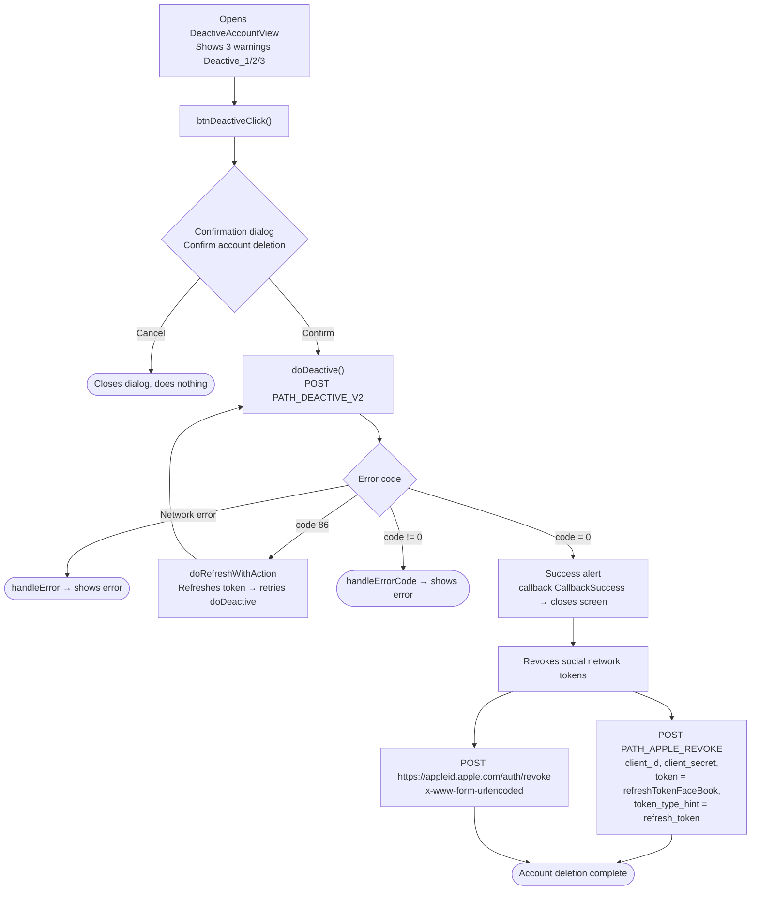

This document describes the SDK's account deletion (deactivation) flow, built from the actual code:
`DeactiveAccountView.swift`.

## Overview diagram

## Detailed description

### 1. Warning & confirmation screen

`DeactiveAccountView` shows 3 warning lines (`Deactive_1`, `Deactive_2`, `Deactive_3`)
about the consequences of deleting the account. When the delete button is tapped, `btnDeactiveClick()` opens a
2-button confirmation dialog ("Confirm account deletion"):

- **Cancel**: closes the dialog, does nothing.
- **Confirm**: calls `doDeactive()`.

### 2. Calling the account deletion API – `doDeactive()`

Calls `PATH_DEACTIVE_V2` (POST) with `deviceId`, `os`, `osVersion`, `ip` and a Bearer
accessToken header.

- `code = 0`: shows an alert (using the `message` from the server, defaulting to "Update successful"),
  fires `callback(CallbackSuccess)` then closes the screen. Then performs **social network
  token revocation** (see item 3).
- `code = 86` (token expired): `doRefreshWithAction` refreshes the token then **automatically retries** `doDeactive()`.
- other errors: `handleErrorCode` displays the error message.
- network error: `handleError`.

### 3. Facebook / Apple token revocation

Immediately after successful account deletion, the SDK revokes the stored social refresh token
(`GlobalManager.shared.refreshTokenFaceBook`) via two calls:

1. `PATH_APPLE_REVOKE` (POST, via `appleApiService`) with `client_id`, `client_secret`,
   `token = refreshTokenFaceBook`, `token_type_hint = "refresh_token"`.
2. A direct call to `https://appleid.apple.com/auth/revoke` (POST,
   `application/x-www-form-urlencoded`) with `client_id`, `client_secret`, `token`,
   `token_type_hint = "KeyRefreshToken"`.

Both are fire-and-forget (they do not block the main flow).

## Endpoints used

- `PATH_DEACTIVE_V2` – deletes / deactivates the account (POST, with Bearer accessToken)
- `PATH_APPLE_REVOKE` – revokes the social refresh token on the backend (POST)
- `https://appleid.apple.com/auth/revoke` – revokes the token directly with Apple (POST)

## Notes

- Account deletion has a **mandatory confirmation step** (2-button dialog) before calling the API.
- After success, in addition to deleting the account, social network tokens are also revoked to ensure
  no social login session remains active.
- On `code = 86`, the SDK automatically refreshes the token and retries the in-progress deletion operation.
- This screen is typically opened from the settings/account information section (e.g. `PersonalView`).
