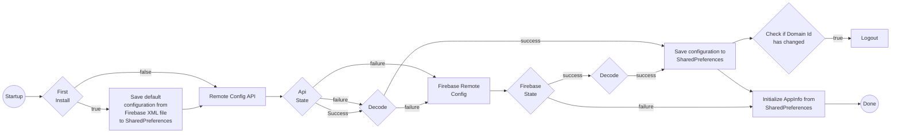
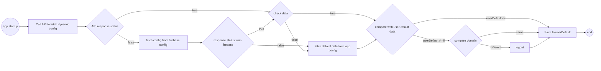

## Overview

1. Purpose

    1. Minimize configuration errors when integrating with partners

    2. Allow customizing the domain and configuration in emergency cases, avoiding the need to rebuild the SDK -> re-review the application.

2. Additional information

    The SDK will prioritize fetching configuration from the BE API. If the API call fails or the returned data cannot be decoded, the SDK will automatically fall back to Firebase Remote Config. If both sources fail, the SDK will use the configuration previously saved in SharedPreferences (or the default configuration in the Firebase XML file if it is the first installation).

## API

1. Flow diagram

    - Android

    - iOS

2. Details

    - Production domain: [https://config.vapi24.vn](https://config.vapi24.vn/)

    - Beta domain: https://beta-config.vapi24.vn

## Firebase Remote Config

1. Flow diagram

2. Details

## Version

| **Platform** | **Inventory** | **Tag version** | **CommitID** | **Release date** |
| --- | --- | --- | --- | --- |
| Android | | | | |
| IOS | | | | |
