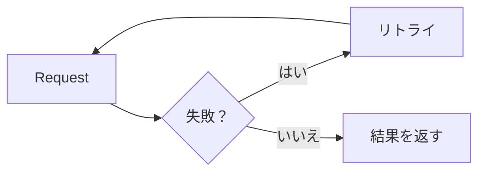

注釈ボックス（**Callout**、**Aside** とも呼ばれる）は、本文の流れから切り離して読者の注意を引くためのコンテンツブロックです。

技術ドキュメントでは、注釈ボックスは主に次の目的で使われます。

* 危険または元に戻せない操作を警告する。
* 見落としやすい注意点を強調する。
* より良い方法を提案する。
* よくある間違いを指摘する。

例えば、次のような普通の文章の代わりに:

```md title="普通の段落"
注意: このコマンドでブランチを削除すると元に戻せません。
```

注釈ボックスで書くことができます。

**コード**

```mdx showLineNumbers title="注釈ボックスで書く"
:::caution[警告]
このコマンドでブランチを削除すると元に戻せません。
:::
```

**デモ**

:::caution[警告]
このコマンドでブランチを削除すると元に戻せません。
:::

注釈ボックスを使うことで、重要な情報が長い文章の中に埋もれることなく、ページの他の部分よりも目立たせることができます。

---

## 1. 基本構文

Starlight を使った MDX では、注釈ボックスは `:::`（コロン3つ）の構文で作成し、その後にタイプを続けます。

**コード**

```mdx showLineNumbers title="基本の注釈ボックス"
:::note
これは通常の注意事項です。
:::
```

**デモ**

:::note
これは通常の注意事項です。
:::

構造は3つの部分からなります。

1. 開始行 `:::<type>` — 注釈ボックスのタイプを指定します。
2. 注釈ボックスの内容 — 通常の Markdown で記述します。
3. 終了行 `:::`。

:::caution[警告]
開始行と終了行は同じ数の `:` を使う必要があります。注釈ボックスの中に、同じ `:::` 構文を使う要素（例えばタブの中の注釈ボックス）が入る場合、外側のブロックは内側より多くの `:` を使わなければ、閉じる位置がずれてしまいます。
:::

---

## 2. 注釈ボックスのタイプ

Starlight は4種類の注釈ボックスをサポートしており、それぞれ重要度のレベルが異なります。

| タイプ    | 用途                                   |
| --------- | -------------------------------------- |
| `note`    | 補足的で中立的な情報                    |
| `tip`     | 提案、より良い方法                      |
| `caution` | 警告、続行前に注意が必要                |
| `danger`  | 危険、深刻な結果を招く可能性がある操作   |

### Note

**コード**

```mdx showLineNumbers title="Note"
:::note
このコンポーネントはクライアントサイド環境でのみ動作します。
:::
```

**デモ**

:::note
このコンポーネントはクライアントサイド環境でのみ動作します。
:::

`note` は、読者が知っておくべき補足情報に適していますが、警告の意味は持ちません。

### Tip

**コード**

```mdx showLineNumbers title="Tip"
:::tip
説明の中で特定のコード行を参照する必要がある場合は `showLineNumbers` を使いましょう。
:::
```

**デモ**

:::tip
説明の中で特定のコード行を参照する必要がある場合は `showLineNumbers` を使いましょう。
:::

`tip` は、より効率的な方法を提案したい場合に適しています。必須ではありませんが、採用が推奨されます。

### Caution

**コード**

```mdx showLineNumbers title="Caution"
:::caution
API パラメーターの名前を変更すると、古いクライアントにとっては破壊的変更になります。
:::
```

**デモ**

:::caution
API パラメーターの名前を変更すると、古いクライアントにとっては破壊的変更になります。
:::

`caution` は、問題を引き起こす可能性はあるものの、まだ危険やシステム破壊のレベルには達していない操作に適しています。

### Danger

**コード**

```mdx showLineNumbers title="Danger"
:::danger
本番環境でこのマイグレーションを実行すると、`orders` テーブルの全データが削除されます。
:::
```

**デモ**

:::danger
本番環境でこのマイグレーションを実行すると、`orders` テーブルの全データが削除されます。
:::

`danger` は、データ損失、ダウンタイム、その他の深刻な結果を招く可能性がある操作にのみ使用すべきです。

---

## 3. 注釈ボックスのタイトルを変更する

各タイプにはデフォルトのタイトル（`Note`、`Tip`、`Caution`、`Danger`）があります。タイプの直後に `[]` でテキストを指定することで、タイトルを変更できます。

**コード**

```mdx showLineNumbers title="タイトルを指定した注釈ボックス"
:::danger[元に戻せません]
このバケットを削除すると、中のすべてのファイルが削除され、元に戻せません。
:::
```

**デモ**

:::danger[元に戻せません]
このバケットを削除すると、中のすべてのファイルが削除され、元に戻せません。
:::

カスタムタイトルは短く、警告の本質を正確に表すべきであり、「警告」や「注意」のような一般的な言葉を繰り返すべきではありません。

例えば、次のように書くのが望ましいです。

```mdx title="具体的なタイトル"
:::caution[レート制限]
この API は1分あたり100リクエストに制限されています。
:::
```

次のように書くのではなく:

```mdx title="一般的なタイトル"
:::caution[警告]
この API は1分あたり100リクエストに制限されています。
:::
```

具体的なタイトルは、読者がページをより速くスキャンするのに役立ちます。

---

## 4. 複数行の内容を持つ注釈ボックス

注釈ボックスには、複数の段落、リスト、その他の Markdown 要素を含めることができます。

**コード**

```mdx showLineNumbers title="複数行の注釈ボックス"
:::caution[デプロイ前に]
本番環境にデプロイする前に、以下の手順を確認してください。

* staging 環境でマイグレーションを実行済みであること。
* データベースをバックアップ済みであること。
* 関係するチームに通知済みであること。
:::
```

**デモ**

:::caution[デプロイ前に]
本番環境にデプロイする前に、以下の手順を確認してください。

* staging 環境でマイグレーションを実行済みであること。
* データベースをバックアップ済みであること。
* 関係するチームに通知済みであること。
:::

注釈ボックスが1文以上の内容を伝える必要がある場合に適していますが、それでも内容は単一のトピックに集中させるべきです。

---

## 5. コードを含む注釈ボックス

注釈ボックスの中には、フェンス付きコードブロックを含めることもできます。

:::danger
注釈ボックスがコードブロックを含む場合、注釈ボックスの `:` の数は、内部のコードブロックのバッククォートの数より多くなければなりません。そうしないと、MDX が2つのブロックの境界を誤認識してしまいます。
:::

**コード**

````mdx showLineNumbers title="コードを含む注釈ボックス"
::::caution[必須の設定]
環境変数 `DATABASE_URL` が設定されていない場合、アプリは起動に失敗します。

```bash
export DATABASE_URL="postgres://localhost:5432/app"
```
::::
````

**デモ**

::::caution[必須の設定]
環境変数 `DATABASE_URL` が設定されていない場合、アプリは起動に失敗します。

```bash
export DATABASE_URL="postgres://localhost:5432/app"
```
::::

---

## 6. Mermaid を含む注釈ボックス

Mermaid もフェンス付きコードブロックの一種であるため、注釈ボックスの中に Mermaid の図を配置する場合も同じ `:` の数のルールが適用されます。

**コード**

````mdx showLineNumbers title="Mermaid を含む注釈ボックス"
::::note[エラー処理フロー]
リクエストが失敗した場合、システムはユーザーにエラーを報告する前に最大3回リトライします。


::::
````

**デモ**

::::note[エラー処理フロー]
リクエストが失敗した場合、システムはユーザーにエラーを報告する前に最大3回リトライします。


::::

この方法は、警告と同時にその挙動を視覚的に示したい場合に便利です。

---

## 7. テーブルを含む注釈ボックス

警告と一緒に構造化された情報を並べたい場合、テーブルを注釈ボックスの中に配置することもできます。

**コード**

```mdx showLineNumbers title="テーブルを含む注釈ボックス"
:::caution[v2 での破壊的変更]
| 旧フィールド | 新フィールド | 備考 |
| --- | --- | --- |
| `user_id` | `userId` | camelCase に変更 |
| `created` | `createdAt` | 名称を変更し ISO 8601 形式に |
:::
```

**デモ**

:::caution[v2 での破壊的変更]
| 旧フィールド | 新フィールド | 備考                       |
| ------------ | ------------ | -------------------------- |
| `user_id`    | `userId`     | camelCase に変更            |
| `created`    | `createdAt`  | 名称を変更し ISO 8601 形式に |
:::

---

## 8. どのタイプを使うべきか？

注釈ボックスのタイプを間違えると、読者は情報の重要度を誤って判断してしまいます。

シンプルな判断基準:

| 状況                                             | タイプ    |
| ------------------------------------------------ | :-------: |
| 補足情報で、無視しても問題ない                   | `note`    |
| ベストプラクティス、最適化、より良い方法の提案    | `tip`     |
| エラーや破壊的変更を招く可能性があり、注意が必要 | `caution` |
| データ損失、ダウンタイム、元に戻せない操作        | `danger`  |

:::tip
`caution` と `danger` のどちらを使うべきか迷ったら、「読者がこの注釈ボックスを無視した場合、その結果は回復可能か？」と自問してください。回復できないなら `danger` を使います。
:::

---

## 9. 注釈ボックスを乱用しない

注釈ボックスは、選択的に使われたときにのみ効果を発揮します。

次のようにするのは避けましょう。

:::note
この関数は1つの引数を受け取ります。
:::

:::note
この引数の型は `string` です。
:::

:::note
戻り値は `boolean` です。
:::

3つの注釈ボックスが連続して、特に強調すべき内容もなく普通の情報しか含んでいない場合、このような書き方は適していません。

代わりに、通常の文章やテーブルにまとめましょう。

| パラメーター | 型       | 戻り値    |
| ------------- | -------- | --------- |
| `input`       | `string` | `boolean` |

:::caution[警告]
注釈ボックスが多すぎるページは、強調の効果を失います。読者はすべての注釈ボックスを読み飛ばすようになり、本当に重要なものまで見逃してしまいます。本当に目立たせる必要がある情報にのみ注釈ボックスを使いましょう。
:::

---

## 10. 注釈ボックスは見出し構造の代わりにはならない

注釈ボックスは強調のためのものであり、ページの主要な内容を構成するためのものではありません。

次のようにするのは良くない例です。

:::note[Authentication]
認証の仕組み全体を説明する長い文章......
:::

それがページの主要な内容であるなら、見出しを使いましょう。

```md title="Authentication"
## Authentication

認証の仕組み全体を説明する長い文章......
```

注釈ボックスは、**主な読みの流れから外れた短い注意事項**を表すものであり、ページの完全な1セクションではありません。

---

## 11. 注釈ボックスを置く位置

注釈ボックスは、関連する内容と直接対応する位置に置くべきであり、ページの先頭や末尾にまとめて置くべきではありません。

良い例 — 関連する説明のすぐ後に置く。

````mdx showLineNumbers title="注釈ボックスを正しい位置に置く"
以下のコマンドを実行してキャッシュをクリアします。

```bash
rm -rf .cache
```

:::caution
このコマンドは以前のビルドのキャッシュも含めて、キャッシュ全体を削除します。保持する必要がないことを確認した上で実行してください。
:::

キャッシュをクリアした後、再度ビルドを実行してください。
````

注釈ボックスを正しい位置に置くことで、読者は**必要なタイミングで**警告を受け取ることができ、ページの先頭で読んだ警告を思い出す必要がなくなります。

---

## 12. 注釈ボックスを使う前のチェックリスト

注釈ボックスを追加する前に、次の点を自問してください。

* この情報は本当に通常の文章より目立たせる必要があるか？
* 適切なタイプ（`note`、`tip`、`caution`、`danger`）を選んでいるか？
* カスタムタイトルがある場合、内容を正確に表しているか？
* 注釈ボックスが連続して乱用されていないか？
* 見出しやテーブルの代わりに注釈ボックスを使ってしまっていないか？
* 注釈ボックスは関連する内容の近く、正しい位置に置かれているか？
* コードブロックや Mermaid を含む場合、`:` の数がバッククォートの数より多くなっているか？

---

## まとめ

注釈ボックスは、技術ドキュメントで重要な情報を強調するための有効な手段ですが、適切なタイミングで適切なタイプを使ったときにのみ効果を発揮します。

基本構造:

```mdx showLineNumbers title="注釈ボックス"
:::note[任意のタイトル]
注釈ボックスの内容。
:::
```

最も重要な原則:

1. **重要度に応じてタイプを選ぶ**: `note` → `tip` → `caution` → `danger`。
2. **タイトルは具体的にする**、タイプ名を一般的に繰り返すのは避ける。
3. **通常の情報に注釈ボックスを乱用しない。**
4. **見出しやテーブルの代わりに注釈ボックスを使わない。**
5. **注釈ボックスを正しい位置に置く**、関連する内容のすぐ近くに。
6. **コードブロックや Mermaid を含む場合**、`:` の数を増やして解析エラーを避ける。

良い注釈ボックスとは、ページに最も多く登場するものではなく、読者が**本当に止まるべきタイミングで止まらせる**ものです。
