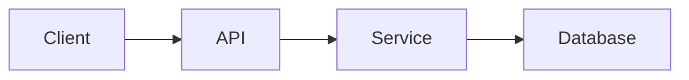
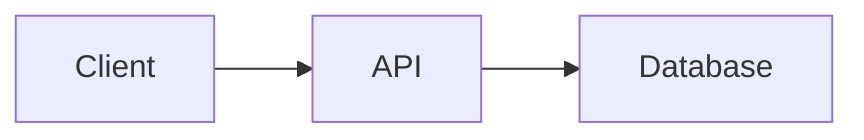
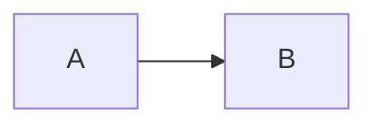
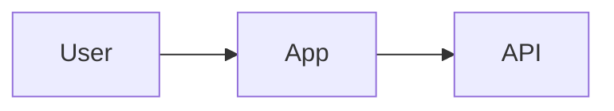
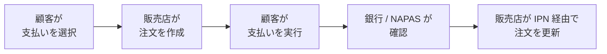
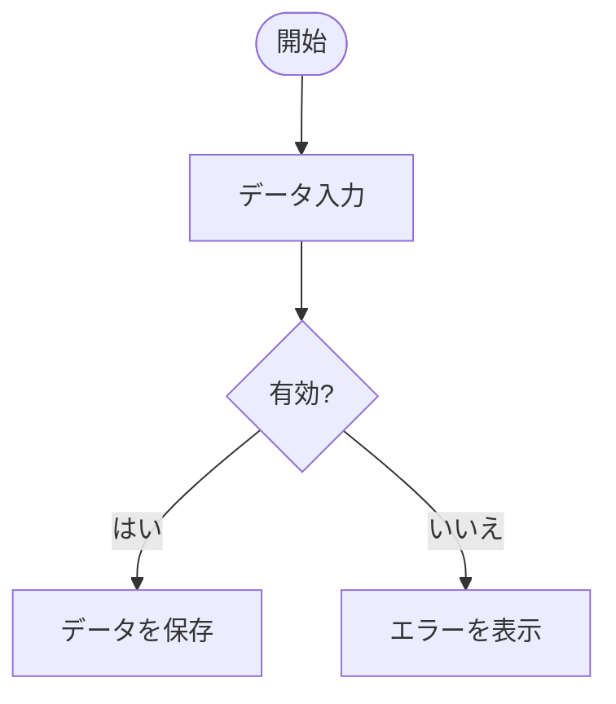
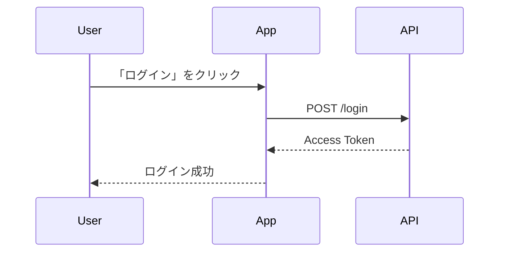
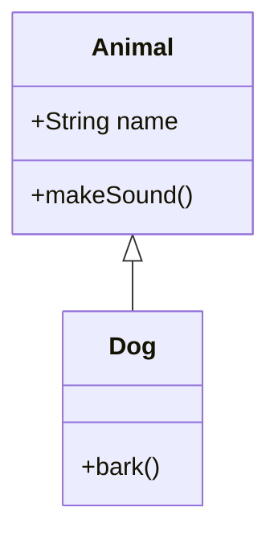
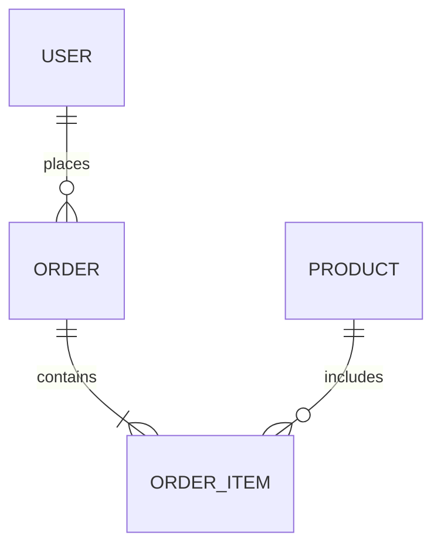

Mermaid はテキストで diagram を記述するための言語です。node や線、矢印を1つずつ自分で描く代わりに、Mermaid の構文で diagram の構造を記述するだけで、システムがその記述を視覚的な図として render してくれます。

興味深いのは、Mermaid も Markdown/MDX のフェンス付きコードブロックの中に書く、という点です。

````mdx showLineNumbers title="基本的な Mermaid"

````


そのため、MDX の構文としては、Mermaid は通常のコードブロックによく似て見えます。しかし中身は、プログラムとして実行されるものでも、単なるシンタックスハイライトの対象でもありません。それは **diagram を生成するためのソースコード** です。

## Mermaid は通常のコードブロックと何が違うのか

通常のコードブロック:

````mdx showLineNumbers title="TypeScript"
```ts
const user = {
    name: "Ninh",
    age: 22,
};
```
````

は、主にシンタックスハイライト付きでソースコードを表示するために使われます。

一方 Mermaid は:

````mdx showLineNumbers title="Flowchart"

````

diagram を記述するために使われます。

シンプルに整理すると:

| 種類      | 目的                |
| --------- | ----------------------- |
| `ts`      | TypeScript を表示 |
| `java`    | Java を表示 |
| `json`    | JSON を表示 |
| `css`     | CSS を表示 |
| `mermaid` | diagram を記述して render する |

したがって、識別子 `mermaid` は、単にシンタックスハイライトの種類を選ぶ以上の意味を持ちます。それは、中身が diagram として処理されるべきであることをシステムに伝えています。

## 基本構造

Mermaid 図は、通常 diagram の種類を示すキーワードから始まります。

````mdx showLineNumbers title="Mermaid の構造"

````


上の例では:

* `flowchart` が diagram の種類を示す。
* `LR` は描画方向が **Left → Right**（左から右）であることを示す。
* `A` と `B` は node である。
* `-->` は2つの node をつなぐ。

Mermaid は、この最初のキーワードから、その diagram の中で使えるパーサーと構文を決定します。

:::note
MDX の中で Mermaid のフェンス付きコードブロックの前後には、必ず空行を入れてください。ブロックが直前のテキスト行やテーブルにすぐ隣接していると、一部の MDX パーサーがコードフェンスを正しく認識できず、diagram が render されないことがあります。
:::

---

## ユーザーは Mermaid をどう使うか

Mermaid を含むドキュメントを読むとき、ユーザーは通常 **Mermaid のソース** と **render された diagram** の2つの部分を扱います。

## MDX で Mermaid を書く

diagram を作成するには、`mermaid` という identifier を使ってフェンス付きコードブロックの中に Mermaid を書きます。

````mdx showLineNumbers title="Mermaid の例"

````

この部分がソースとなり、システムがこれを diagram として render します。diagram のフレームに固有のタイトルを付けたい場合は、ソースの先頭に `%% title:` というコメント行を追加します。

````mdx showLineNumbers title="タイトル付き Mermaid"

````

## render された diagram を見る

コードのすぐ下に、実際の Mermaid ブロックを配置しておくと、読者は結果を確認できます。


render されたフレームの中で、ユーザーは次のことができます。

* **Fullscreen** をクリックすると、diagram を大きな表示で開けます。
* **+** と **-** でズームでき、最大 1000% まで拡大できます。
* diagram が画面より大きい場合は、ドラッグして pan できます。
* **0** を押すと、ズームと位置がリセットされます。
* **C** キーを押している間、Mermaid のソースコードを表示し、離すと diagram に戻ります。
* **Esc** を押すと、大きな表示を閉じます。

現在の Mermaid のバージョンでサポートされていない diagram の種類の場合、render フレームはページのレイアウトを崩す代わりに、render できなかった旨を表示します。

:::caution
`-beta` が付く diagram の種類(`architecture-beta`、`packet-beta`、`radar-beta`、`sankey-beta`、`treemap-beta`、`xychart-beta`)を使う場合は、正式なドキュメントに追加する前にプロジェクトの Mermaid バージョンを確認してください。beta の構文はバージョン間で変わることがあり、ローカルで正しく render できても、バージョンが一致していなければ本番環境で正しく render される保証はありません。
:::

---

## Mermaid diagram の種類

Mermaid は目的に応じたさまざまな diagram の種類をサポートしています。1つの diagram の種類をすべての状況に無理に使おうとせず、伝えたい情報に合った種類を選びましょう。

## Flowchart

**Flowchart** は、処理フロー、条件分岐、手順、あるいはシステムのロジックを記述するのに適しています。

**コード**

````mdx showLineNumbers title="Flowchart"

````

**デモ**


`LR` は **Left to Right**（左から右）という意味です。`LR` 以外にも、flowchart では次のような方向がよく使われます。

* `TD` — Top to Down（上から下）。
* `TB` — Top to Bottom（上から下）。
* `RL` — Right to Left（右から左）。
* `BT` — Bottom to Top（下から上）。

SePay の決済フローの例:

**コード**

````mdx showLineNumbers title="SePay 決済フロー(業務)"

````

**デモ**


条件分岐を含む例:

**コード**

````mdx showLineNumbers title="条件分岐を含む Flowchart"

````

**デモ**


---

## Sequence Diagram

**Sequence Diagram** は、システム内のコンポーネント間のやり取りの順序を記述するために使われます。

API、認証、あるいは通信フローのドキュメントを書く際に、最も役立つ diagram の種類の1つです。

**コード**

````mdx showLineNumbers title="Sequence Diagram"

````

**デモ**


よく使われる矢印:

* `->>` — message。
* `-->>` — response。
* `-)` — 非同期メッセージ（asynchronous message）。
* `--x` — X で終わるメッセージ。

---

## Class Diagram

**Class Diagram** は、class、属性、method、そして class 間の関係を記述するのに適しています。

**コード**

````mdx showLineNumbers title="Class Diagram"

````

**デモ**


---

## Entity Relationship Diagram

**ER Diagram** は、データベースと entity 間の関係を記述するためによく使われます。

**コード**

````mdx showLineNumbers title="Entity Relationship Diagram"

````

**デモ**


ドキュメントでデータベーススキーマを俯瞰的に説明したいときに、非常に適した選択肢です。

---

## State Diagram

**State Diagram** は、object や process の状態と、それらの間の transition を記述するために使われます。

**コード**

````mdx showLineNumbers title="State Diagram"
```mermaid
stateDiagram-v2
    [*] --> Pending
    Pending --> Paid
    Paid --> Shipped
    Shipped --> [*]
```
````

**デモ**

```mermaid
stateDiagram-v2
    [*] --> Pending
    Pending --> Paid
    Paid --> Shipped
    Shipped --> [*]
```

---

## Mindmap

**Mindmap** は、あるテーマの階層構造を表現するのに適しています。

**コード**

````mdx showLineNumbers title="Mindmap"
```mermaid
mindmap
    root((Product))
        Backend
            API
            Database
        Frontend
            Web
            Mobile
```
````

**デモ**

```mermaid
mindmap
    root((Product))
        Backend
            API
            Database
        Frontend
            Web
            Mobile
```

---

## Architecture Diagram

Architecture Diagram は、service やインフラ構成要素間のアーキテクチャを記述するために使われます。

**コード**

````mdx showLineNumbers title="Architecture Diagram"
```mermaid
architecture-beta
    group api(cloud)[API]
    service server(server)[Server] in api
    service db(database)[Database] in api
    server:R -- L:db
```
````

**デモ**

```mermaid
architecture-beta
    group api(cloud)[API]
    service server(server)[Server] in api
    service db(database)[Database] in api
    server:R -- L:db
```

---

## Block Diagram

Block Diagram は、block とその間の関係を記述するために使われます。

**コード**

````mdx showLineNumbers title="Block Diagram"
```mermaid
block-beta
    columns 3
    Client Gateway Service
```
````

**デモ**

```mermaid
block-beta
    columns 3
    Client Gateway Service
```

---

## C4 Diagram

C4 Diagram は、C4 モデルに沿ってソフトウェアアーキテクチャを記述するのに適しています。

**コード**

````mdx showLineNumbers title="C4 Context"
```mermaid
C4Context
    Person(user, "User")
    System(app, "Application")
    Rel(user, app, "Uses")
```
````

**デモ**

```mermaid
C4Context
    Person(user, "User")
    System(app, "Application")
    Rel(user, app, "Uses")
```

---

## Gantt Chart

Gantt Chart は、計画や作業の進捗を時系列で表現するために使われます。

**コード**

````mdx showLineNumbers title="Gantt Chart"
```mermaid
gantt
    title Release Plan
    dateFormat YYYY-MM-DD

    section Backend
    API Design       :a1, 2026-01-01, 5d
    API Development  :a2, after a1, 10d
```
````

**デモ**

```mermaid
gantt
    title Release Plan
    dateFormat YYYY-MM-DD

    section Backend
    API Design       :a1, 2026-01-01, 5d
    API Development  :a2, after a1, 10d
```

---

## Git Graph

Git Graph は、Git における branch、commit、merge を記述するために使われます。

**コード**

````mdx showLineNumbers title="Git Graph"
```mermaid
gitGraph
    commit
    branch feature
    checkout feature
    commit
    checkout main
    merge feature
```
````

**デモ**

```mermaid
gitGraph
    commit
    branch feature
    checkout feature
    commit
    checkout main
    merge feature
```

---

## Kanban

Kanban は、各 task の状態を記述するために使われます。

**コード**

````mdx showLineNumbers title="Kanban"
```mermaid
kanban
    Todo
        Task A
        Task B
    Doing
        Task C
    Done
        Task D
```
````

**デモ**

```mermaid
kanban
    Todo
        Task A
        Task B
    Doing
        Task C
    Done
        Task D
```

---

## Packet Diagram

Packet Diagram は、network packet のビットやフィールドの構造を記述するのに適しています。

**コード**

````mdx showLineNumbers title="Packet Diagram"
```mermaid
packet-beta
    0-15: "Source Port"
    16-31: "Destination Port"
```
````

**デモ**

```mermaid
packet-beta
    0-15: "Source Port"
    16-31: "Destination Port"
```

---

## Pie Chart

Pie Chart は、データグループ間の割合を示すために使われます。

**コード**

````mdx showLineNumbers title="Pie Chart"
```mermaid
pie title Traffic Source
    "Organic" : 45
    "Referral" : 25
    "Direct" : 30
```
````

**デモ**

```mermaid
pie title Traffic Source
    "Organic" : 45
    "Referral" : 25
    "Direct" : 30
```

---

## Quadrant Chart

Quadrant Chart は、2つの軸に基づいて要素を分類するために使われます。

**コード**

````mdx showLineNumbers title="Quadrant Chart"
```mermaid
quadrantChart
    title Feature Priority
    x-axis Low Impact --> High Impact
    y-axis Low Effort --> High Effort
    quadrant-1 Do first
    quadrant-2 Plan
    quadrant-3 Avoid
    quadrant-4 Delegate
```
````

**デモ**

```mermaid
quadrantChart
    title Feature Priority
    x-axis Low Impact --> High Impact
    y-axis Low Effort --> High Effort
    quadrant-1 Do first
    quadrant-2 Plan
    quadrant-3 Avoid
    quadrant-4 Delegate
```

---

## Radar Chart

Radar Chart は、1つまたは複数の対象が持つ複数の属性を比較するために使われます。

**コード**

````mdx showLineNumbers title="Radar Chart"
```mermaid
radar-beta
    axis Speed, Security, Cost, UX
    curve Product["Speed": 80, "Security": 60, "Cost": 40, "UX": 90]
```
````

**デモ**

```mermaid
radar-beta
    axis Speed, Security, Cost, UX
    curve Product["Speed": 80, "Security": 60, "Cost": 40, "UX": 90]
```

---

## Requirement Diagram

Requirement Diagram は、requirement と、それがシステムの構成要素とどう関係しているかを記述するために使われます。

**コード**

````mdx showLineNumbers title="Requirement Diagram"
```mermaid
requirementDiagram
    requirement loginReq {
        id: 1
        text: User must be able to log in
        risk: medium
    }
```
````

**デモ**

```mermaid
requirementDiagram
    requirement loginReq {
        id: 1
        text: User must be able to log in
        risk: medium
    }
```

---

## Sankey Diagram

Sankey Diagram は、グループ間のデータの流れと比重を表現するために使われます。

**コード**

````mdx showLineNumbers title="Sankey Diagram"
```mermaid
sankey-beta
Traffic,Organic,45
Traffic,Referral,25
Traffic,Direct,30
```
````

**デモ**

```mermaid
sankey-beta
Traffic,Organic,45
Traffic,Referral,25
Traffic,Direct,30
```

---

## Timeline

Timeline は、出来事を時系列順に記述するために使われます。

**コード**

````mdx showLineNumbers title="Timeline"
```mermaid
timeline
    title Product Roadmap
    2026 Q1 : Launch MVP
    2026 Q2 : Add payments
    2026 Q3 : Scale infrastructure
```
````

**デモ**

```mermaid
timeline
    title Product Roadmap
    2026 Q1 : Launch MVP
    2026 Q2 : Add payments
    2026 Q3 : Scale infrastructure
```

---

## Treemap

Treemap は、階層データを面積として表現するために使われます。

**コード**

````mdx showLineNumbers title="Treemap"
```mermaid
treemap-beta
    "Revenue"
        "Product A": 40
        "Product B": 35
        "Product C": 25
```
````

**デモ**

```mermaid
treemap-beta
    "Revenue"
        "Product A": 40
        "Product B": 35
        "Product C": 25
```

---

## User Journey

User Journey は、あるプロセスの中でユーザーが経験する体験やステップを記述するために使われます。

**コード**

````mdx showLineNumbers title="User Journey"
```mermaid
journey
    title Checkout Journey
    section Cart
        Add item: 5: User
    section Payment
        Enter card: 3: User
        Confirm: 4: User
```
````

**デモ**

```mermaid
journey
    title Checkout Journey
    section Cart
        Add item: 5: User
    section Payment
        Enter card: 3: User
        Confirm: 4: User
```

---

## XY Chart

XY Chart は、棒グラフや折れ線グラフのような X/Y 軸を持つデータに適しています。

**コード**

````mdx showLineNumbers title="XY Chart"
```mermaid
xychart-beta
    title "Monthly Revenue"
    x-axis [Jan, Feb, Mar]
    y-axis "Revenue" 0 --> 1000
    bar [300, 500, 800]
```
````

**デモ**

```mermaid
xychart-beta
    title "Monthly Revenue"
    x-axis [Jan, Feb, Mar]
    y-axis "Revenue" 0 --> 1000
    bar [300, 500, 800]
```

---

## ZenUML

ZenUML を使うと、コードに近い構文で sequence diagram を記述できます。

**コード**

````mdx showLineNumbers title="ZenUML"
```mermaid
zenuml
    Client->API: request()
    API->Client: response()
```
````

**デモ**

```mermaid
zenuml
    Client->API: request()
    API->Client: response()
```

---

## Flowchart を深掘りする

Flowchart は、技術ドキュメントで最もよく使われる diagram の種類の1つです。

長い手順を何段落もの文章で説明する代わりに、それを diagram に変換すれば、読者はフロー全体を一度に把握できます。

認証フローの例:

**コード**

````mdx showLineNumbers title="Authentication Flow"
```mermaid
flowchart TD
    Start([Start]) --> Login[Login Request]
    Login --> Validate{Credentials valid?}

    Validate -- Yes --> Token[Generate Token]
    Validate -- No --> Error[Return Error]

    Token --> Response[Return Response]
    Error --> End([End])
    Response --> End
```
````

**デモ**

```mermaid
flowchart TD
    Start([Start]) --> Login[Login Request]
    Login --> Validate{Credentials valid?}

    Validate -- Yes --> Token[Generate Token]
    Validate -- No --> Error[Return Error]

    Token --> Response[Return Response]
    Error --> End([End])
    Response --> End
```

## Subgraph

flowchart の構成要素が多くなってきた場合、`subgraph` を使って関連する node をグループ化できます。

**コード**

````mdx showLineNumbers title="Subgraph を使った Flowchart"
```mermaid
flowchart LR
    subgraph Client
        Mobile
        Web
    end

    subgraph Backend
        API
        Service
        Database
    end

    Mobile --> API
    Web --> API
    API --> Service
    Service --> Database
```
````

**デモ**

```mermaid
flowchart LR
    subgraph Client
        Mobile
        Web
    end

    subgraph Backend
        API
        Service
        Database
    end

    Mobile --> API
    Web --> API
    API --> Service
    Service --> Database
```

`subgraph` は、フロントエンド・バックエンド・データベース・外部システムの境界を読者が区別しやすくなるため、アーキテクチャを記述する際に特に役立ちます。

---

## Sequence Diagram を深掘りする

Sequence Diagram は、ドキュメントで API のリクエスト/レスポンスを説明する必要があるときに特に役立ちます。

OAuth ログインフローの例:

**コード**

````mdx showLineNumbers title="OAuth Authentication Flow"
```mermaid
sequenceDiagram
    participant User
    participant App
    participant OAuth
    participant API

    User->>App: Click Login
    App->>OAuth: Authorization Request
    OAuth-->>App: Authorization Code
    App->>API: Exchange Code
    API->>OAuth: Verify Code
    OAuth-->>API: Access Token
    API-->>App: Session
    App-->>User: Login Success
```
````

**デモ**

```mermaid
sequenceDiagram
    participant User
    participant App
    participant OAuth
    participant API

    User->>App: Click Login
    App->>OAuth: Authorization Request
    OAuth-->>App: Authorization Code
    App->>API: Exchange Code
    API->>OAuth: Verify Code
    OAuth-->>API: Access Token
    API-->>App: Session
    App-->>User: Login Success
```

ドキュメントが API、認証、決済、あるいは複数の service 間の通信を説明する場合、sequence diagram は長いリクエスト/レスポンスの箇条書きよりもはるかに読みやすいことが多いです。

---

## Mermaid を使うべきタイミング

Mermaid は、情報に**関係性・順序・構造**があるときに特に適しています。

次のような場合に Mermaid を使いましょう。

* 複数のコンポーネントが互いにやり取りする。
* 複数ステップの処理フローがある。
* `if/else` の分岐がある。
* request/response を記述する必要がある。
* architecture を記述する必要がある。
* database の relationship を記述する必要がある。
* lifecycle や state を記述する必要がある。
* timeline や roadmap を記述する必要がある。
* Git の branch/merge を記述する必要がある。

逆に、すべてに diagram が必要なわけではありません。

もしプロセスが2〜3個の単純なステップしかないなら:

> ユーザーがログイン → API が認証 → サーバーが token を返す。

というように、diagram よりも一文の方が読みやすい場合もあります。

---

## Mermaid 図を読みやすく保つ

大きすぎる diagram は逆効果になり得ます。読者がフローを理解するためにズームやスクロールを繰り返さなければならないなら、その diagram はドキュメントを読みにくくしています。

適用すべきいくつかの原則:

### 1. 1つの diagram には1つの目的を

アーキテクチャ全体を1つの巨大な diagram に詰め込む代わりに、次のように分割しましょう。

* High-level architecture。
* Authentication flow。
* Payment flow。
* Database relationship。
* Deployment architecture。

### 2. node を詰め込みすぎない

flowchart の node や分岐が多くなりすぎたら、複数の diagram に分割することを検討してください。

### 3. node の名前を明確にする

次のようにはしないでください。

```text
A --> B --> C
```

これがドキュメントの読者向けの diagram である場合は。

代わりに次のようにします。

```text
Client --> API --> Auth Service --> Database
```

:::danger
node のラベルの中で `"`、`(`、`)`、`:`、`#` などの特殊文字や生の改行を、引用符で囲まずに使うのは避けてください。これは Mermaid の構文パースエラーの最も一般的な原因であり、発生すると間違っている箇所だけでなく、diagram 全体、場合によってはページ全体が render されなくなることがあります。
:::

### 4. 適切な diagram の種類を使う

すべてに flowchart を使うべきではありません。

| 内容           | 適した diagram   |
| ------------------ | ----------------- |
| Process / logic    | Flowchart         |
| Request / response | Sequence          |
| Class relationship | Class             |
| Database           | ER Diagram        |
| State / lifecycle  | State             |
| Architecture       | Architecture / C4 |
| Git workflow       | Git Graph         |
| Timeline           | Timeline / Gantt  |
| User experience    | User Journey      |
| Data proportion    | Pie / Sankey      |
| Metrics            | XY / Radar        |

---

## Mermaid と MDX

MDX の中では、Mermaid を通常のコードブロックと並べて配置できます。

例えば、同じページに TypeScript と Mermaid の両方を含めることができます。

**コード**

````mdx showLineNumbers title="TypeScript + Mermaid"
```ts
const user = await api.getUser();
```

```mermaid
flowchart LR
    App --> API --> Database
```
````

**デモ**

```ts
const user = await api.getUser();
```

```mermaid
flowchart LR
    App --> API --> Database
```

これにより、技術ドキュメントの同じページの中で **ソースコード** と **視覚的な説明** を組み合わせることができます。

---

## Mermaid のバージョンに関する注意

すべての diagram が、Mermaid のバージョン間で同じレベルの安定性を持っているわけではありません。

一部の構文には `-beta` という接尾辞が付いています。例:

* `architecture-beta`
* `packet-beta`
* `radar-beta`
* `sankey-beta`
* `treemap-beta`
* `xychart-beta`

そのため、新しい diagram の種類を正式なドキュメントに追加する前に、次を確認するべきです。

1. プロジェクトの Mermaid バージョン。
2. そのバージョンがその diagram type をサポートしているかどうか。
3. 現在の構文が Mermaid の公式ドキュメントと比べて変わっていないかどうか。
4. 本番ビルドが開発環境と同じように diagram を render するかどうか。

特に、ソースを見るだけで確認済みとみなすべきではありません。Mermaid 図は構文的には正しくても、プロジェクトの統合方法や Mermaid のバージョンがその diagram type をサポートしていなければ、render されないことがあります。

---

## ドキュメントにおける Mermaid のレンダリング

Markdown の中に次のように書かれているからといって、Mermaid が自動的に diagram になるわけではありません。

````md
```mermaid
...
```
````

プロジェクト側に、`mermaid` のコードブロックを認識し、ソースを解析して diagram として render するための **Mermaid rendering pipeline** が必要です。

具体的な pipeline は、プロジェクトの構築方法によって異なります。例えば次のようなものが考えられます。

* Markdown/MDX プラグイン。
* remark/rehype インテグレーション。
* Starlight インテグレーション。
* Mermaid コンポーネント。
* クライアントサイドでの Mermaid レンダリング。
* ビルド時の diagram レンダリング。

そのため、プロジェクトのドキュメントは、あらゆる MDX 環境が Mermaid を同じように扱うと仮定するのではなく、**実際に使用している pipeline** を記述するべきです。

---

## まとめ

Mermaid は、技術ドキュメントの中でテキストを diagram に変える強力な方法です。

MDX の構文としては、Mermaid も依然としてフェンス付きコードブロックを使います。

````mdx showLineNumbers title="Mermaid"
```mermaid
flowchart LR
    Client --> API --> Database
```
````

しかし、単にソースコードを表示するのではなく、システムがそのソースを視覚的な diagram として render できます。

ドキュメントを書く際は、次の点を忘れないでください。

* コードフェンスの識別子として `mermaid` を使う。
* 内容に合った diagram の種類を選ぶ。
* 読者がコピーできるよう、常にソースコードを提示する。
* 読者が結果を確認できるよう、diagram をすぐ下に render する。
* 大きな diagram は複数の小さな diagram に分割する。
* 新しい構文を使う前に Mermaid のバージョンを確認する。
* プロジェクトの MDX/Markdown pipeline が実際に Mermaid をサポートしていることを確認する。

ドキュメントにおける良いパターンは次のとおりです。

````mdx showLineNumbers title="diagram 名の デモ"
```mermaid
flowchart LR
    Client --> API --> Database
```
````

その直後に、render された **Mermaid デモ** をすぐ下に表示します。この構成なら、読者は結果を見ることができ、同時に開発者は正確なソースをコピーして再利用できます。
