import { Tabs, TabItem } from '@astrojs/starlight/components';

このドキュメントは、SDK の**各業務フロー**を、現行のソースコードに正確に沿ったシーケンス図と
分岐条件とともに説明します。

## フロー一覧

1. [SDK の初期化](#1-sdk-の初期化)
2. [ログイン / ログアウト](#2-ログイン--ログアウト)
3. [LIVE ルームへの参加](#3-live-ルームへの参加)
4. [オーバーレイの受信とルーティング（LIVE）](#4-オーバーレイの受信とルーティングlive)
5. [オーバーレイの画面レンダリング](#5-オーバーレイの画面レンダリング)
6. [WebView オーバーレイのライフサイクル](#6-webview-オーバーレイのライフサイクル)
7. [質問への回答（ミニゲーム）](#7-質問への回答ミニゲーム)
8. [予測 — Predict（`typeTimeline = 3`）](#8-予測--predicttypetimeline--3)
9. [ラッキーホイール — Lucky（`typeTimeline = 5`）](#9-ラッキーホイール--luckytypetimeline--5)
10. [Headline（`typeTimeline = 4`）](#10-headlinetypetimeline--4)
11. [オーバーレイの取り消し — overlay-recall](#11-オーバーレイの取り消し--overlay-recall)
12. [補助イベント: liveviews, fan-club, ckst](#12-補助イベント-liveviews-fan-club-ckst)
13. [VOD フロー](#13-vod-フロー)
14. [接続断と復旧](#14-接続断と復旧)
15. [リソースの解放](#15-リソースの解放)

## 1. SDK の初期化

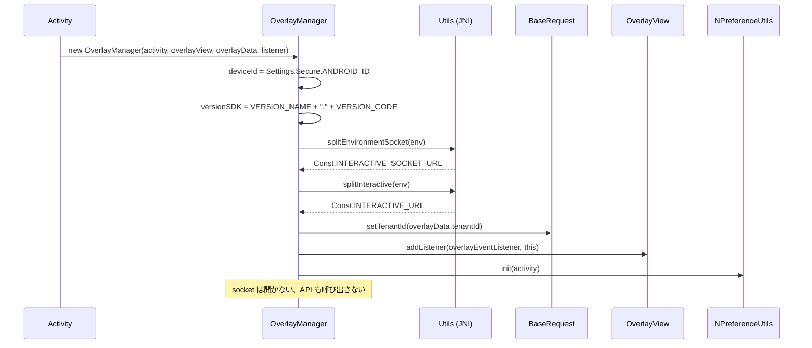

このステップの後、SDK は**Idle**状態になります。環境、テナントを把握し、レンダリング先はあるものの、
まだどのコンテンツにも紐づいていません。

## 2. ログイン / ログアウト

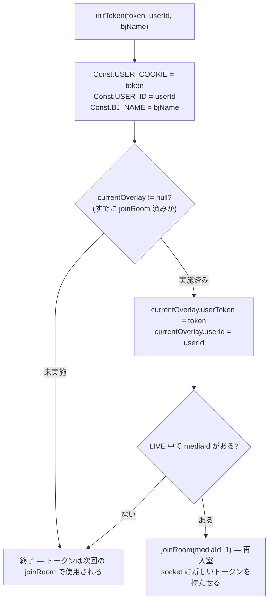

実際の意味:

- **Live 視聴中のログイン** → SDK が自動的に再接続し、表示中のオーバーレイは
  （`joinRoom` 内の `cleanUp()` で）クリアされます。
- **ログアウト** = `initToken("", "")`。Live 中であれば匿名状態で再入室します。
- `Authorization` ヘッダー: トークンが `"ey"` で始まる場合（JWT）→ `"Bearer <token>"`、それ以外はそのまま送信します。

---

## 3. LIVE ルームへの参加

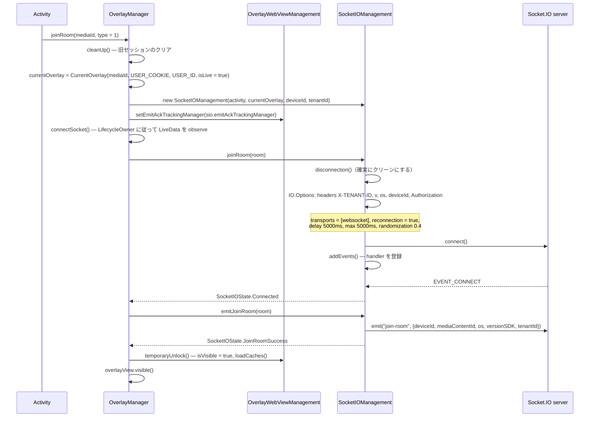

覚えておくべきポイント:

- `emit("join-room")` は**socket の接続が成功した後にのみ**実行され、`joinRoom()` を呼び出した瞬間には
  実行されません。
- `Connected` になる前は `OverlayWebViewManagement.isVisible = false` であり、早く届いたオーバーレイは
  表示されずに**キャッシュに入る**だけです。
- `overlayView` は `temporaryUnlock()` の時にのみ `visible()` になります。

## 4. オーバーレイの受信とルーティング（LIVE）

### 4.1. socket 層での事前フィルタリング

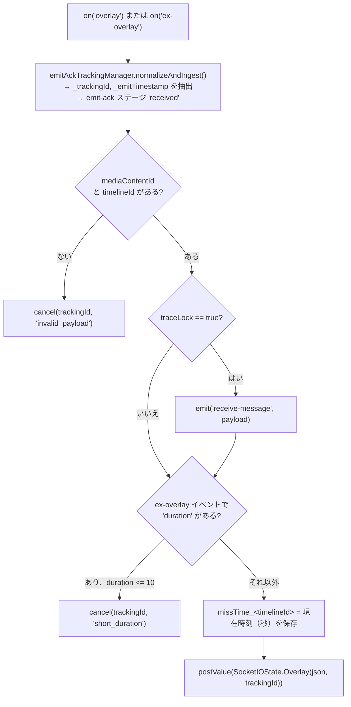

### 4.2. `OverlayManager` 層での業務チェック

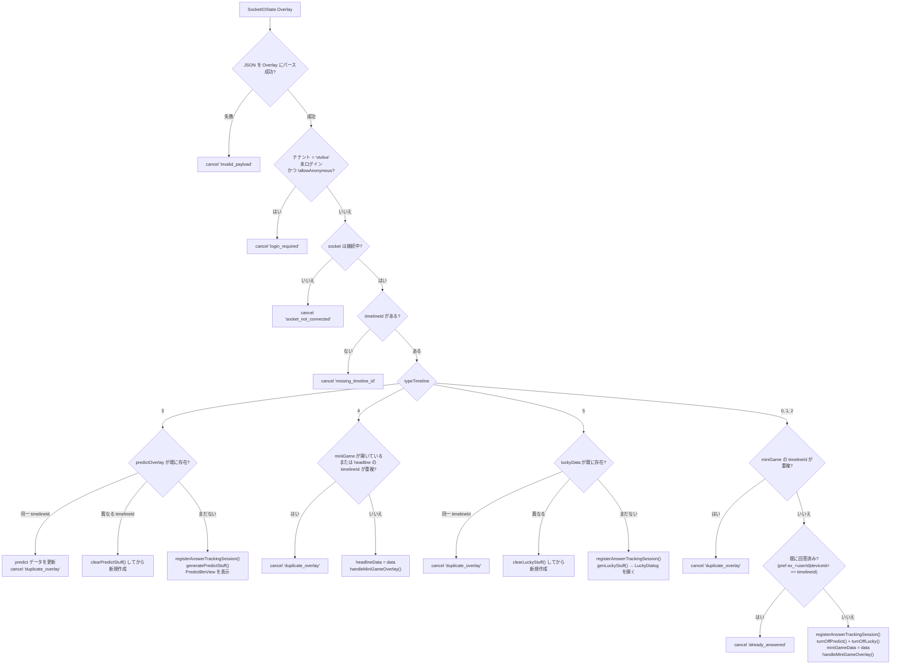

> `ex_...` キーは、ログイン済みの場合は `userId` を、未ログインだが匿名を許可するオーバーレイの場合は
> `deviceId` を使用します。

## 5. オーバーレイの画面レンダリング

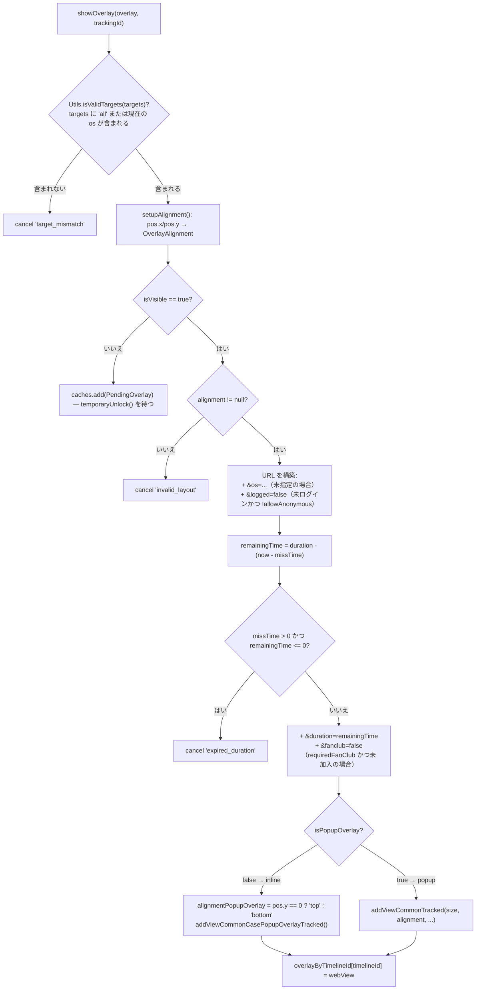

`OverlayView` における**幾何学的制約**:

- `addViewCommonTracked`: 幅/高さはパーセンテージ（`constrainPercentWidth/Height`）指定で、
  `metadata.pos` から求まる 9 方向のいずれかに配置される。
- `addViewCommonCasePopupOverlayTracked`: 幅は `WRAP_CONTENT`、高さはパーセンテージ指定で、
  `alignmentPopupOverlay` に従い上/下/左/右に配置される。
- どちらも追加前に `clearViews()` を呼び出す → **常に一つのオーバーレイ WebView のみ**存在する。

---

## 6. WebView オーバーレイのライフサイクル

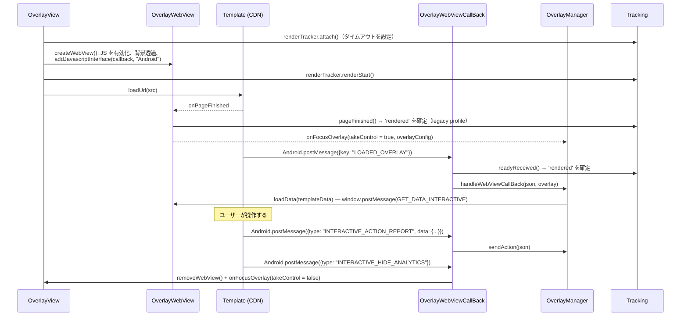

ページ読み込みエラー（`onReceivedError`, `onReceivedHttpError`, `onReceivedSslError`）はすべて:
`renderTracker.failed(...)` → WebView を隠す → `onFocusOverlay(webViewError = true)` となります。

## 7. 質問への回答（ミニゲーム）

これは最も複雑なフローで、API 送信前に 4 段階のチェックがあります。

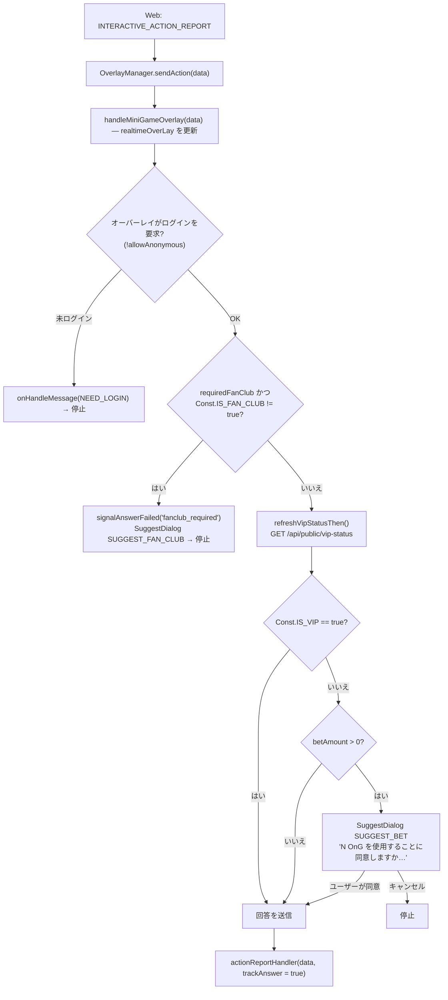

### 7.1. `actionReportHandler` — API 送信

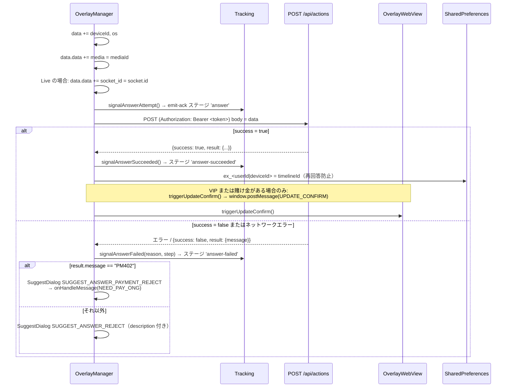

エラーコード → tracking 内の `failureReason` へのマッピング（`AnswerTrackingMapper`）:

| `result.message` | `failureReason` | `failureStep` |
|---|---|---|
| `EX400` | `api_EX400` | `api_response` |
| `TL404` | `api_TL404` | `api_response` |
| `PM402` | `api_PM402` | `api_response` |
| その他, `success = false` | `api_false` | `api_response` |
| ネットワークエラー | `network_error` | `network` |
| ボディが空 / パース不能 | `unknown_response` | `unknown_response` |

### 7.2. `sendAction` 内のその他の `type`

| `type` | 動作 |
|---|---|
| `INTERACTIVE_SHOW_ANALYTICS` | `onShowITR(true)` + `/api/actions` 経由で行動を記録 |
| `INTERACTIVE_HIDE_ANALYTICS` | 記録、`overlay`/`miniGameData` を削除、predict と lucky を**再開**する |
| `INTERACTIVE_OPEN_ANALYTICS` | `onShowITR(true)` + 記録（predict/lucky） |
| `INTERACTIVE_CLOSE_ANALYTICS` | 記録（predict/lucky） |
| `action = CLICK_ADS` + `url` あり | API を呼ばず、`onClickAdsOverlay(url)` で外部ブラウザを開く |

## 8. 予測 — Predict（`typeTimeline = 3`）

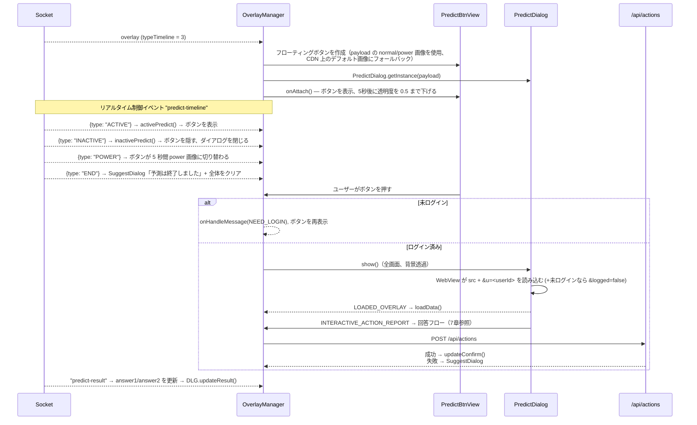

ボタン表示を制御するフラグ:

| フラグ | 意味 | 変更するのは |
|---|---|---|
| `isPredictOn` | 表示が許可されているか（ミニゲームが画面を占有中は無効化） | `turnOnPredict()` / `turnOffPredict()` |
| `isPredictActive` | サーバーが操作を許可しているか | `ACTIVE` / `INACTIVE` イベント |
| `isPredictDialogOn` | ダイアログが開いているか | `showPredictDialog()` / `hidePredictDialog()` |

ボタンは `isPredictOn && isPredictActive` の場合のみ表示されます。

## 9. ラッキーホイール — Lucky（`typeTimeline = 5`）

構造は Predict とほぼ同じです（`LuckyBtnView` + `LuckyDialog`、`lucky-event` の socket イベントで
`ACTIVE/INACTIVE/POWER/END` を使用）が、**一点重要な違い**があります:

<Tabs>
  <TabItem label="Kotlin">
```kotlin
// OverlayManager.genLuckyStuff() — 最後の行
showLuckyDialog()
```
  </TabItem>
  <TabItem label="Java">
```java
// OverlayManager.genLuckyStuff() — 最後の行
showLuckyDialog();
```
  </TabItem>
</Tabs>

→ lucky オーバーレイは**受信したら即座に**ダイアログを自動的に開き、ユーザーのボタン押下を待ちません。

API から返された結果は `UPDATE_NUMBER_LUCKY` で web に送信されます:

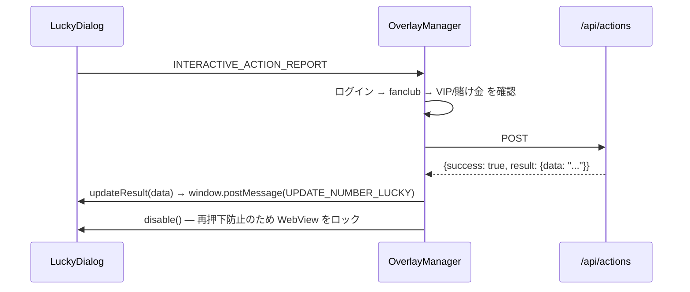

---

## 10. Headline（`typeTimeline = 4`）

- ミニゲームと同じレンダリング経路を使用します（`handleMiniGameOverlay`）。
- **ミニゲームが開いている場合**（`miniGameData != null`）または現在の headline と `timelineId` が
  重複する場合はスキップされます。
- 受け付ける `type` は `INTERACTIVE_SHOW_ANALYTICS` と `INTERACTIVE_HIDE_ANALYTICS` の 2 つのみで
  （回答フローはありません）。

## 11. オーバーレイの取り消し — overlay-recall

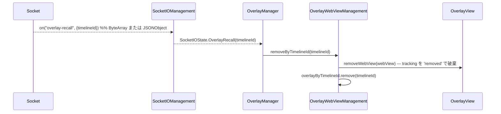

編集者がシステム全体で配信中のオーバーレイを削除する際に使用されます。

## 12. 補助イベント: liveviews, fan-club, ckst

| socket イベント | 処理 |
|---|---|
| `liveviews` | `OverlayLiveViews.count` をパースし、**230 を加算**して `onHandleLiveViews(count)` を呼ぶ |
| `data`（fan-club） | `mediaId` が視聴中のメディアと一致すれば（`_` の前部分で比較）`Const.IS_FAN_CLUB` を更新、そうでなければ `false` にする |
| `ckst` | サーバーがプレイヤー状態を問い合わせる → SDK が `ckst` を `{action: "CHECK_PLAYER_STATUS", sessionId, data: {deviceId, os, mediaContentId, playerStatus}}` で emit し返す |
| `update-result` | `OverlayWebView.updateResult(data)` → `window.postMessage(UPDATE_DATA_INTERACTIVE)` |
| `predict-result` | `answer1`/`answer2` を `predictOverlay` に更新し、`PredictDialog.updateResult()` を呼ぶ |

> `liveViews` に 230 を加算するのは現行コードの意図的な挙動です
> ([OverlayManager.kt:435](../interactive/src/main/java/vn/interactive/OverlayManager.kt:435)) —
> app が生の数値を必要とする場合は、app 側で差し引く必要があります。

`playerStatus` は app が `addPlayerListener(...)` を実行している場合のみ空でない値になります。

---

## 13. VOD フロー

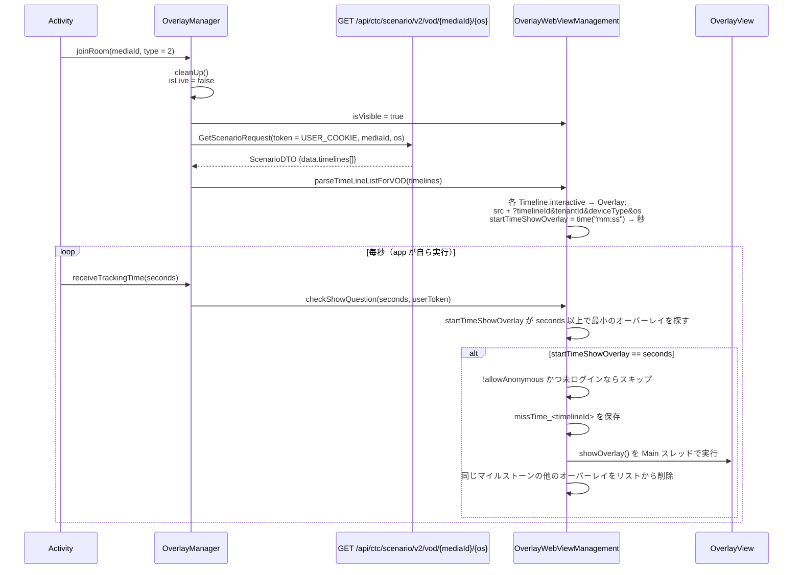

LIVE との違い:

| | LIVE | VOD |
|---|---|---|
| オーバーレイのソース | Socket.IO による配信 | REST で全シナリオを事前取得 |
| 表示トリガー | リアルタイムイベント | app が注入する `receiveTrackingTime(秒)` |
| `socketIOManagement` | あり | **null**（socket 関連の呼び出しは安全に無視される） |
| アクション内の `socket_id` | あり | なし |
| emit-ack トラッキング | あり | なし（emit する socket がない） |
| Predict / Lucky / liveviews | あり | なし |

## 14. 接続断と復旧

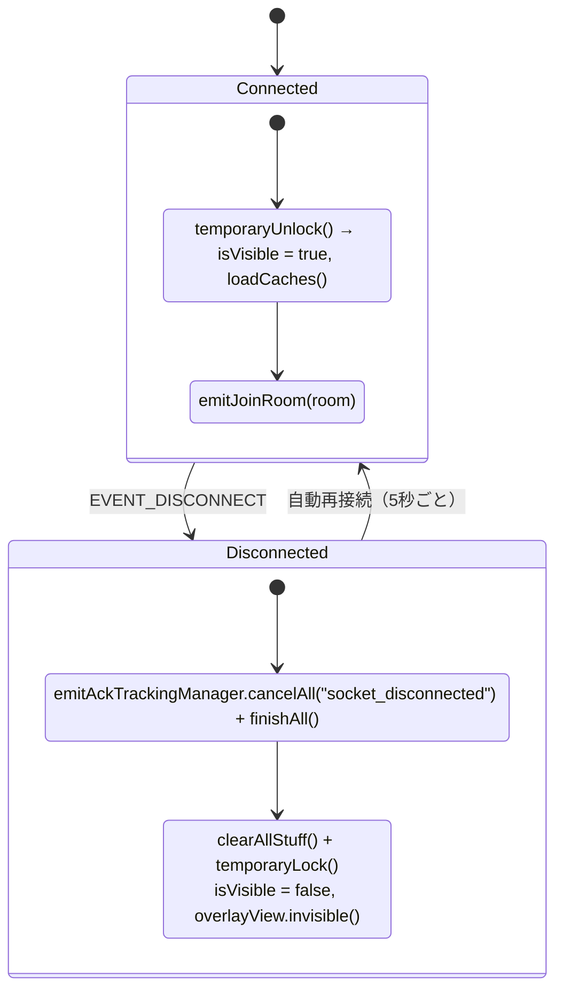

- **オーバーレイのキャッシュ**: `isVisible = false` のとき、新しいオーバーレイは `caches` に入ります。
  ロック解除時、`loadCaches()` は**最後の要素のみ**を表示し、それより前の要素は
  `superseded_cache` という理由で tracking が破棄されます。
- **`missTime`**: 保存された時刻マイルストーンにより、接続断後に再表示されるオーバーレイは
  経過した分だけ `duration` が差し引かれます。期限切れの場合は破棄されます（`expired_duration`）。
- `EVENT_CONNECT_ERROR` イベント → `SocketIOState.Error` → `clearAllStuff()`。

## 15. リソースの解放

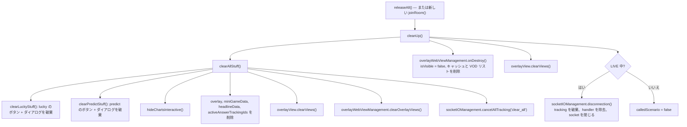

`releaseAll()` を呼び出すタイミング:

- player を含む Activity の `onDestroy()`、
- ユーザーがコンテンツから離脱するとき（player を閉じる、一覧に戻る）、
- 別の `mediaId` に切り替える前に、**すぐに** `joinRoom()` を呼ばない場合（`joinRoom` は自動的に
  クリアするため）。
