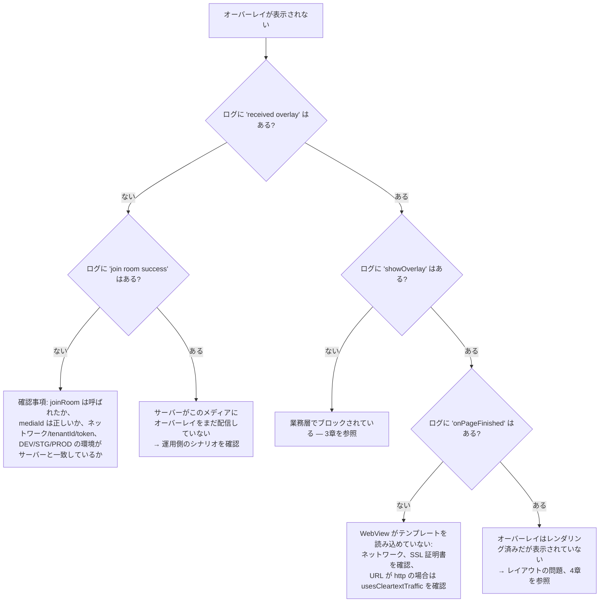

## 1. SDK のログを有効化する

SDK は `logcat {}` 関数を通じてログを出力します — **AAR が buildType `debug` でビルドされている場合のみ**
動作します（`:interactive` モジュールの `BuildConfig.DEBUG = true`）。デフォルトタグ: `Interactive`。

```bash
adb logcat -s System.out | grep Interactive
```

注目すべきログ文字列:

| ログ | 意味 |
|---|---|
| `overlay manager: Khởi tạo mới Innteractive` | コンストラクタが実行された |
| `socket io management initialization: socketUrl = ...` | 接続準備中 |
| `overlay manager socket: connected socket` / `join room success` | ルーム参加成功 |
| `socket io management addEvents: received overlay` | サーバーからオーバーレイを受信 |
| `<-- check point: showOverlay -->` | WebView の構築を開始 |
| `VLive: Website onPageFinished url: ...` | テンプレート読み込み完了 |
| `overlay web view manager: add caches` | `isVisible = false` のためオーバーレイが保留された |
| `socket io management prevent ex-overlay: user answered` | 既に回答済みのためブロックされた |

---

## 2. オーバーレイが表示されない — 診断ツリー



---

## 3. 業務層でブロックされている

ログを理由テーブルと照合します（詳細は [05 — Tracking](05-tracking-emit-ack.md#5-キャンセル理由cancelreasonのテーブル)を参照）:

| 症状 | 原因 | 対処方法 |
|---|---|---|
| `user haven't logged in yet` | テナント `vtvlive`、`initToken` 未実行、オーバーレイが匿名を許可していない | ログイン後に `initToken()` を呼び出す |
| `timelineId not found` | ペイロードに `timelineId` がない | サーバー側に報告する |
| `socket is not connect` | 処理中に socket が切断された | ネットワークを確認; SDK は 5 秒後に自動再接続する |
| `duplicate predict overlay` / `duplicate miniGame overlay` | 表示中のオーバーレイと `timelineId` が重複 | 設計通りの正しい動作 |
| `prevent ex-overlay: user answered` | このマイルストーンに既に回答済み（pref `ex_*`） | 再テストしたい場合は app のデータを削除 |
| `ex-overlay duration < 10s` | 補填オーバーレイが短すぎる | 設計通りの正しい動作 |
| Cancel `target_mismatch` | `targets` が `DEVICE_TYPE` と一致しない | 正しいバリアント（`androidmobile` / `androidtv`）でビルドするか、シナリオを修正する |
| Cancel `expired_duration` | `missTime` から計算したオーバーレイの表示時間が既に終了 | 設計通りの正しい動作 |
| `add caches` されたが表示されない | `isVisible = false`（まだ `Connected` でない） | socket が接続すれば表示される; 一度も接続しない場合は 5章を参照 |

---

## 4. オーバーレイはレンダリングされたが見えない / 位置がずれる

| 原因 | 兆候 | 対処方法 |
|---|---|---|
| `OverlayView` のサイズが `0` | レンダリングログは正常だが画面は空白 | `layout_width/height` の制約を明確に設定; 一時的に `setBackgroundColor(Color.YELLOW)` を設定して確認 |
| `OverlayView` が player に覆われている | オーバーレイが「点滅」して消える | レイアウトで `OverlayView` を player の**後**に宣言するか、`elevation`/`translationZ` を上げる |
| `OverlayView` が動画枠より大きい | オーバーレイが映像領域からはみ出る | `OverlayView` の制約を player の 16:9 枠に正確に合わせる |
| `OverlayView` が `INVISIBLE` のまま | 接続断後 | SDK は切断時に `temporaryLock()` を呼び出す; 再接続時に `visible()` に戻る |
| player の `SurfaceView` が WebView を覆う | 一部の player でのみ発生 | player に `TextureView` を使用するか、`OverlayView` を上位の別 ViewGroup に配置する |

---

## 5. socket が接続できない

チェックリスト:

1. **環境**: `EnvInteractive` はサーバーシステム（DEV/STG/PROD）と一致している必要がある — URL はネイティブから取得され、app 側では変更できない。
2. **`tenantId`**: テナントが間違っているとサーバーがルームへの参加を拒否する。
3. **権限**: `INTERNET` が不足していると明確なエラーログが出ず、`connect error` のみが見える。
4. **トークン期限切れ**: `Authorization` ヘッダーが不正な場合、サーバー設定によっては拒否されることがある。
5. **`liboverlay.so` の除外**: app が `abiFilters` または ABI 分割を使用していてアーキテクチャが不足している場合、
   `Utils` は初期化時に即座に `UnsatisfiedLinkError` を投げ、`INTERACTIVE_SOCKET_URL` が空になる。
   `unzip -l app-release.apk | grep liboverlay` で確認する。

ログ `socket io management initialization: url value uninitialized` はケース 5 の兆候です。

---

## 6. AAR 統合後のコンパイル / 実行時エラー

| エラー | 原因 | 対処方法 |
|---|---|---|
| `NoClassDefFoundError: io/socket/client/IO` | 推移的依存関係の不足 | [02 §3](02-cai-dat-va-tich-hop.md#3-依存関係の宣言) の全ライブラリを宣言する |
| `ClassCastException` / ダイアログを開くとクラッシュ | Activity が `FragmentActivity` でない | `AppCompatActivity` を使用する |
| ダイアログが開かない、ログに `showPredictDialog error` | `activity as? FragmentActivity` が `null` を返す | 上記と同様 |
| R8 有効時に WebView からコールバックが受け取れない | JS interface が難読化されている | [02 §14](02-cai-dat-va-tich-hop.md#14-proguard--r8) で `@JavascriptInterface` のルールを追加する |
| オーバーレイがデータを受信しない（`GET_DATA_INTERACTIVE`） | テンプレートが `LOADED_OVERLAY` を送信していない | web テンプレートチームと連携する |
| `UnsatisfiedLinkError: liboverlay.so` | ABI 不足 | `ndk.abiFilters` を確認し、ネイティブライブラリを除外しない |

---

## 7. VOD: オーバーレイが正しいタイミングで表示されない

| 原因 | 対処方法 |
|---|---|
| app が `receiveTrackingTime()` を呼び出していない | `joinRoom(type = 2)` の後に 1 秒ごとのループを追加する |
| 単位を間違えて注入している（ミリ秒を秒として） | `player.currentPosition` を 1000 で割る |
| ユーザーがマイルストーンをシークで飛ばした | SDK は**正確な秒数**で一致判定を行う; そのマイルストーンのオーバーレイはスキップされる — 現時点の既知の制限 |
| 未ログインで、オーバーレイが `allowAnonymous` でない | `checkShowQuestion` がスキップする; ログイン後に再度 `joinRoom` する |
| シナリオが空で返ってくる | ログ `response vod failed` を確認し、`mediaId` とトークンを確認する |

---

## 8. よくある質問

**SDK は Activity のライフサイクルに自動的に追従しますか？**
いいえ。`LifecycleOverlay` は現在空です。app は自身で `releaseAll()` を呼び出す必要があります。
socket の LiveData のみ `LifecycleOwner` に従って observe されるため、Activity が active でなくなると
自動的に発行を停止します。

**複数のオーバーレイを同時に表示できますか？**
できません。`OverlayView.addViewCommon*` は追加前に必ず `clearViews()` を呼び出すため、常に一つの
WebView オーバーレイのみです。Predict/Lucky のボタンは独立した view のため、オーバーレイと並行して
存在できます（ミニゲームが表示されると SDK が自動的にそれらを無効化します）。

**途中でアカウントを変更した場合は？**
`initToken(新しいトークン, 新しいuserId)` を呼び出してください。Live 視聴中であれば、SDK は新しい
トークンで自動的に再入室します。

**視聴者数は正確ですか？**
`onHandleLiveViews` は `count + 230`（現行コードに組み込まれた加算定数）を返します。生の数値が
必要な場合は app 側で差し引いてください。

**`joinRoom()` の前に毎回 `releaseAll()` を呼ぶ必要がありますか？**
必要ありません — `joinRoom()` は自身で `cleanUp()` を実行します。

**画面回転でオーバーレイは消えますか？**
Activity が `configChanges="orientation|screenSize"` を宣言していれば消えません。Activity が
再生成される場合は、`OverlayManager` を再構築して `joinRoom()` をやり直す必要があります。

**SDK はシステムの WebView を使用しますか？**
はい — `OverlayWebView` は `android.webkit.WebView` を継承し、JavaScript と DOM storage を有効化、
背景を透過、`cacheMode = LOAD_NO_CACHE`、外部への遷移をブロックします（`shouldOverrideUrlLoading` が
`true` を返す）。

---

[← Tracking emit-ack](05-tracking-emit-ack.md) · [目次に戻る](README.md)
