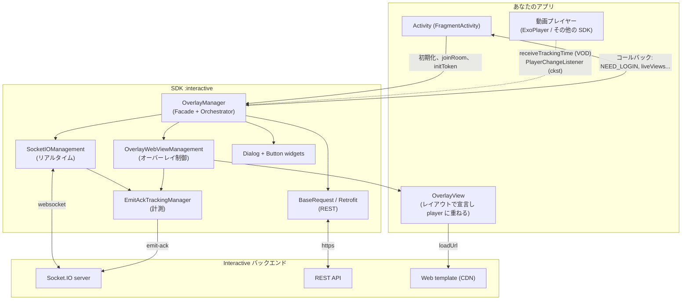
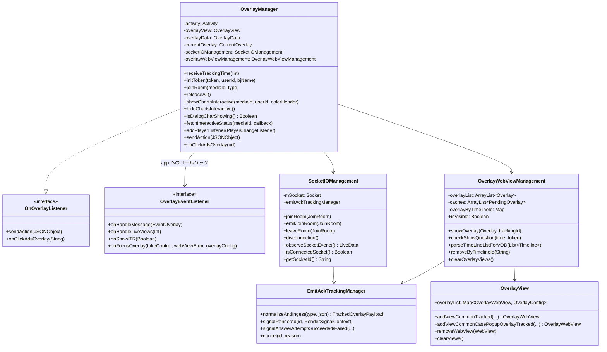
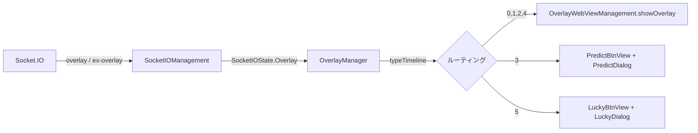
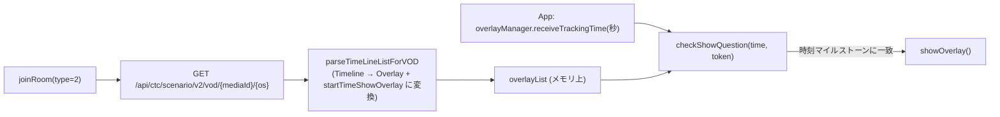
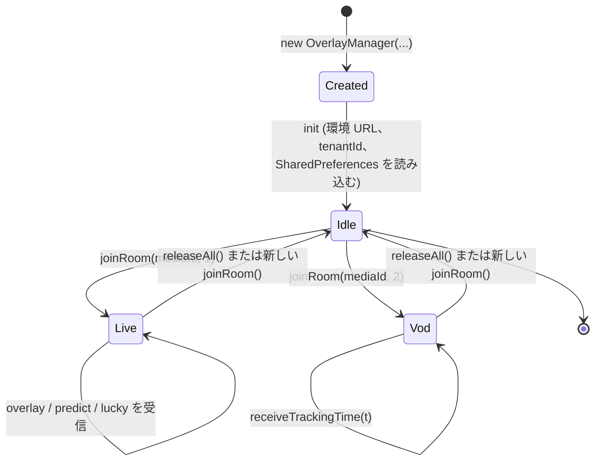
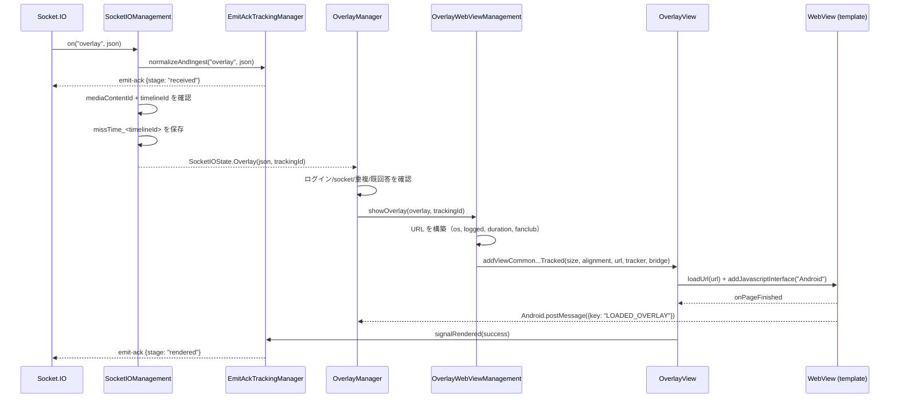
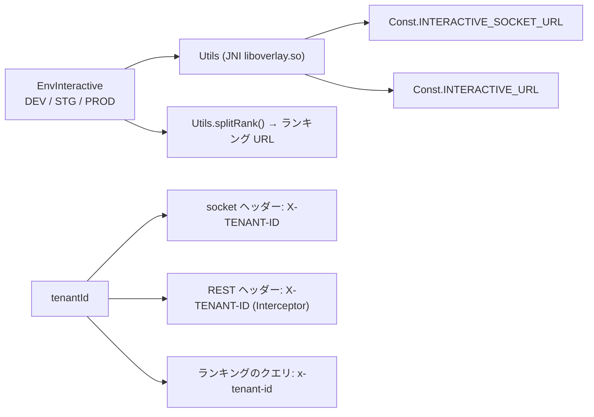

## 1. 全体像

SDK は**Android ライブラリ（AAR）**として、3 つの主要な責務をパッケージ化しています:

1. Socket.IO を介した Interactive サーバーとの**リアルタイム接続**（Live シナリオ）。
2. 透明な `WebView` 内で、web で作られたインタラクティブコンテンツの**表示制御**。
3. ユーザーのアクションを REST でサーバーに**転送**し、逆方向のイベントを app に通知する。

---

## 2. レイヤーと責務

| レイヤー | 構成要素 | 責務 |
|---|---|---|
| **Facade** | `OverlayManager` | app の唯一のエントリポイント。コマンド（`joinRoom`, `initToken`, `releaseAll`…）を受け取り、socket の状態を監視し、オーバーレイの種類を判定し、回答フローを処理する |
| **リアルタイムトランスポート** | `SocketIOManagement` | socket の作成/破棄、イベント登録、ペイロードの正規化、LiveData 経由で `SocketIOState` を発行する |
| **REST トランスポート** | `BaseRequest` + 各種 `*Request` + `OverlayService` | Retrofit クライアント、`X-TENANT-ID` ヘッダーを付与、scenario/action/vip/interactive-status API を呼び出す |
| **表示** | `OverlayWebViewManagement`, `OverlayView`, `OverlayWebView` | オーバーレイ URL の構築、WebView の生成、`metadata` に基づく位置/サイズの制約、view のクリア |
| **補助表示** | `PredictDialog`, `LuckyDialog`, `SuggestDialog`, `DialogChartsInteractive`, `PredictBtnView`, `LuckyBtnView` | 特殊な UI 形式（全画面ダイアログ、フローティングボタン） |
| **ブリッジ** | `OverlayWebViewCallBack`, `PostMessageListener` | JavaScript ⇄ Kotlin の橋渡し（`@JavascriptInterface postMessage`） |
| **可観測性** | `tracking/*` | オーバーレイのライフサイクルを計測し `emit-ack` をサーバーに送信する |
| **インフラ** | `Const`, `WSK`, `Utils`, `Ext`, `NPreferenceUtils`, `QueuedMutableLiveData` | 定数、環境 URL 取得の JNI、拡張関数、ローカルストレージ |

### コードに表れる設計原則

- **単一の Facade、内部の非公開化**: app は `OverlayManager`, `OverlayView`, `OverlayData`,
  `EnvInteractive`, `OverlayEventListener` のみに触れます。tracking 関連のクラスはすべて
  `internal` です。
- **state-driven**: socket は UI を直接呼び出さず、`QueuedMutableLiveData` を通じて
  `SocketIOState`（sealed class）を発行します。`OverlayManager` が Activity のライフサイクルに
  従って observe します。
- **インタラクティブコンテンツは web である**: SDK は質問画面を自ら描画せず、テンプレート URL を
  読み込んで `postMessage` でやり取りするだけです。これにより、インタラクティブ UI を変更しても
  app の再ビルドが不要になります。
- **環境 URL はネイティブに隠蔽される**: `Utils` が `System.loadLibrary("overlay")` を実行し、
  JNI 関数 `socketDEV/STG/PRD`, `interactiveDEV/STG/PRD` を呼び出します — URL は
  Kotlin/DEX 内に文字列として存在しません。

---

## 3. 簡略化されたクラス図

## 4. 2 つの動作モード

### 4.1. LIVE

（`type = 1`） — サーバー主導

サーバーがリアルタイムでオーバーレイを能動的に配信します。表示条件（残り時間、既に回答したか、
fanclub に加入しているかなど）はクライアント側で直ちにチェックされます。

### 4.2. VOD

（`type = 2`） — 再生進捗主導

socket はありません。SDK が全シナリオを事前に取得し、その後**app が毎秒再生時間を SDK に注入する**
必要があります:

> `startTimeShowOverlay` は `Timeline.time` の `"mm:ss"` 形式（`String.toSecond()` 関数）から
> 導出されるため、`receiveTrackingTime` に注入する単位は**秒**です。

---

## 5. スレッドモデル

| 処理 | スレッド | 備考 |
|---|---|---|
| Socket.IO イベント | socket クライアントのスレッド | `QueuedMutableLiveData.postValue` に投入 |
| `SocketIOState` の observe | **Main スレッド** | `LiveData.observe(LifecycleOwner)` 経由 |
| WebView の構築/破棄 | **Main スレッド** | `showOverlayForVod` が `GlobalScope.launch(Dispatchers.Main)` でラップ |
| VOD シナリオのパース | `Dispatchers.IO` | `parseTimeLineListForVOD` 内の `GlobalScope.launch(Dispatchers.IO)` |
| REST 呼び出し | OkHttp のスレッド、コールバックは main に戻る | `Call.enqueue` を使用 |
| Tracking emit-ack | `EmitAckTrackingManager` に `@Synchronized` | レンダリングタイマーは `Handler(Looper.getMainLooper())` で実行 |
| tracking セッションのクリア | デーモンスレッド `EmitAckTrackingCleanup` | `ScheduledExecutorService`、周期 5 分 |

`QueuedMutableLiveData` は注目に値するポイントです。`postValue` で上書きせず、状態を**キューに
積む**方式を取っています — 二つのオーバーレイイベントが接近して届いても取りこぼしを許さないため
必要な仕組みです。

---

## 6. オブジェクトのライフサイクル

コード上の重要なポイント:

- **コンストラクタは接続を開始しない。** `init {}` は環境に応じた URL の読み込み、Retrofit への
  `tenantId` 設定、`OverlayView` への listener 付与、`NPreferenceUtils` の初期化のみを行います。
- **`joinRoom()` は常に最初に `cleanUp()` を実行**します → 旧 socket を閉じ、WebView を削除し、
  保留中の tracking を破棄します。そのため `joinRoom` を連続で呼び出しても安全です。
- **`SocketIOManagement` は Live セッションごとに新規作成**され、再利用されません。
- **Live 視聴中に `initToken()` を呼ぶと自動的に `joinRoom()` が再実行**され、socket に新しい
  トークンが渡されます。

---

## 7. オーバーレイのデータフロー（Live）

各分岐（ブロックされる箇所を含む）の詳細は [03 — 動作フロー](03-luong-hoat-dong.md)を参照してください。

---

## 8. WebView ブリッジプロトコル

SDK は **`Android`**（`Const.JS_INTERFACE_NAME`）という名前の JS interface を付与します。

**Web → SDK**（`Android.postMessage(jsonString)`）:

| フィールド | 値 | 意味 |
|---|---|---|
| `key` | `LOADED_OVERLAY` | テンプレートの準備完了 → SDK がデータを送信し、同時に `rendered` を確定 |
| `type` | `INTERACTIVE_SHOW_ANALYTICS` | オーバーレイが表示された（行動ログを記録） |
| `type` | `INTERACTIVE_HIDE_ANALYTICS` | オーバーレイが閉じられた → SDK が WebView を除去し、predict/lucky を再開 |
| `type` | `INTERACTIVE_ACTION_REPORT` | ユーザーが回答/広告をクリック |
| `type` | `INTERACTIVE_OPEN_ANALYTICS` | predict/lucky ダイアログを開く |
| `type` | `INTERACTIVE_CLOSE_ANALYTICS` | predict/lucky ダイアログを閉じる |

**SDK → Web**（`evaluateJavascript` 経由の `window.postMessage(...)`）:

| `key` | いつ | 関数 |
|---|---|---|
| `GET_DATA_INTERACTIVE` | `LOADED_OVERLAY` の後 | `OverlayWebView.loadData()` / `*Dialog.loadData()` |
| `UPDATE_DATA_INTERACTIVE` | socket の `update-result` | `OverlayWebView.updateResult()` |
| `UPDATE_CONFIRM` | 回答成功（ミニゲーム/predict） | `updateConfirm()` |
| `UPDATE_COUTER` | socket の `predict-result` | `PredictDialog.updateResult()` |
| `UPDATE_NUMBER_LUCKY` | API が lucky 結果を返す | `LuckyDialog.updateResult(data)` |

---

## 9. 環境とテナントの設定

- `EnvInteractive.DEV | STG | PROD` は socket URL と REST URL の両方を決定します。
- `tenantId` はプロダクトを区別します（例: `vtvlive`, `VTVprime`, `onlive`…）。テナント `vtvlive`
  には特有のルールがあります: **`allowAnonymous` でないオーバーレイは、未ログインユーザーには
  スキップされます**。
- `BuildConfig.DEVICE_TYPE`（`androidmobile` / `androidtv`）はヘッダー `os`、テンプレート URL の
  クエリ `os=`、`targets` のフィルタ条件に反映されます。

---

## 10. ローカルストレージ

SharedPreferences は現行コードの意図により 2 つの異なるファイルで使用されています:

| キー | ファイル | 目的 |
|---|---|---|
| `missTime_<timelineId>` | `interactive_vlive` | オーバーレイ受信時刻、遅延表示時の残り `duration` の計算に使用 |
| `ex_<userId または deviceId>` | `INTERACTIVE` | 回答済みミニゲームの `timelineId` を記録し再表示を防ぐ |
| `timelineId`, `currentTime` | `interactive_vlive` | 直近に受理されたオーバーレイの記録 |
