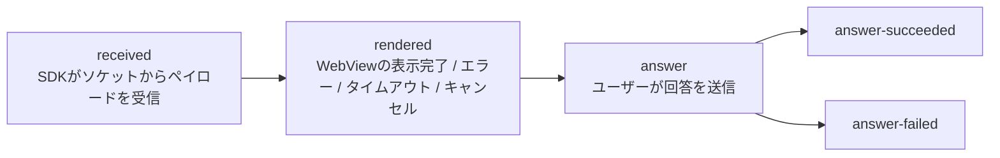
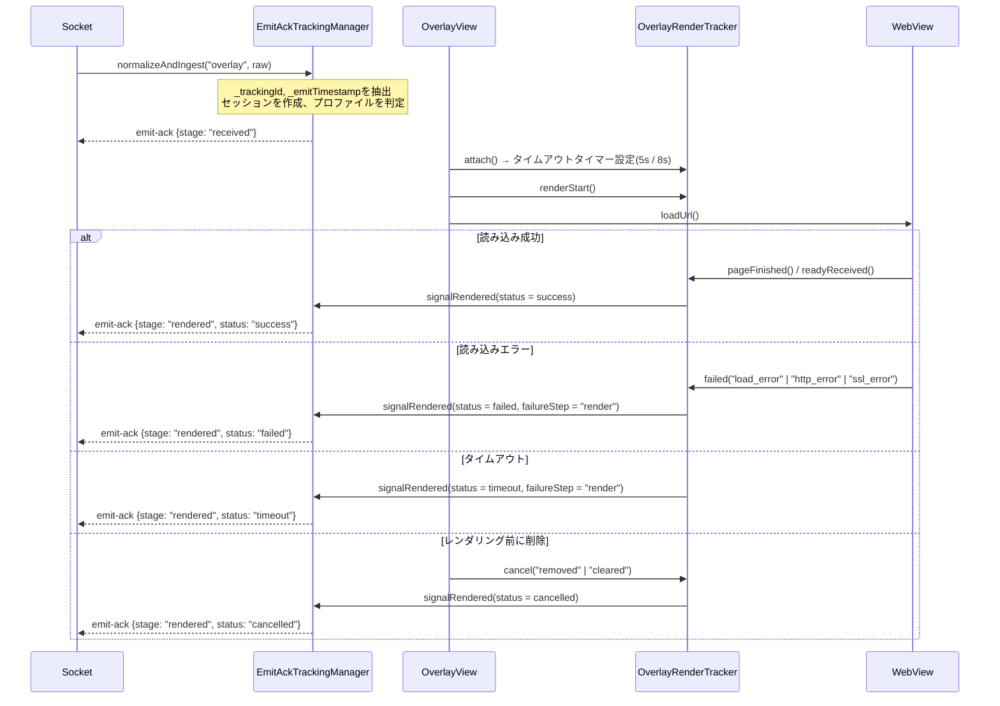
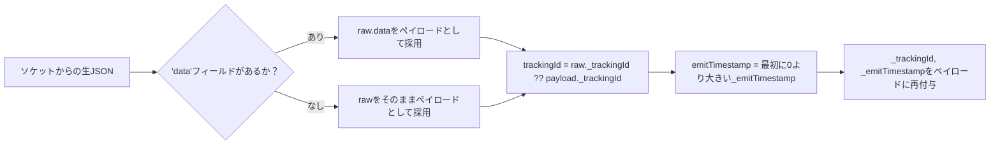

この仕組みは運用側の疑問に答えるものです。*「サーバーがプッシュしたオーバーレイは実際にユーザーの端末に届き、
レンダリングされ、ユーザーは応答したのか？」* — クライアント自身が計測し、ソケットイベント `emit-ack` で
サーバーに送り返します。

> ビルドフラグ `FEATURE_TRACKING_ACK_OVERLAY`（[interactive/build.gradle](../interactive/build.gradle)、現在は `true`）で ON/OFF を切り替えます。
> トラッキング関連のクラスはすべて `internal` であり、アプリから直接操作することはありません。

---

## 1. マイルストーン（stage）



| Stage | 意味 | セッション終了？ |
|---|---|---|
| `received` | 有効なペイロードがSDKに届いた | いいえ |
| `rendered` | 表示結果が確定（`status` 付き） | `status != success` の場合は終了 |
| `answer` | 回答送信を開始 | いいえ |
| `answer-succeeded` | APIが `success = true` を返した | 終了 |
| `answer-failed` | APIエラー / 拒否 / ネットワークエラー | 終了 |

`rendered` の `status`: `success` | `failed` | `timeout` | `cancelled`。

各stageは `trackingId` ごとに**一度だけ**送信されます（`emittedStages` は `Set`）。`emit` が
例外を投げた場合はそのstageをsetから除外し、次回のトリガーで再試行できるようにします。

---

## 2. サーバーへ送信するペイロード構造

```jsonc
// emit("emit-ack", payload)
{
  "trackingId": "<オーバーレイのペイロードから取得した_trackingId>",
  "event": "overlay",
  "stage": "received | rendered | answer | answer-succeeded | answer-failed",
  "deviceId": "<android-id>",
  "clientContext": { /* 下記参照 */ }
}
```

### `clientContext` — 共通部分

| フィールド | ソース |
|---|---|
| `profile` | `overlay.legacyIframe` または `overlay.wsInteractive` |
| `transportMode` | `legacyIframe` / `wsInteractive` |
| `overlayType` | `metadata.type` → `typeTimeline` → `type` |
| `duration` | オーバーレイの `duration`（秒） |
| `sdkVersion` | `versionName.versionCode`（例: `1.2.18`） |
| `platform` | `DEVICE_TYPE` に "tv" が含まれれば `tv`、それ以外は `android` |
| `os` | `"Android <release>"` |
| `deviceClass` | `tv` / `tablet` / `mobile_large` / `mobile` / `mobile_small` |
| `viewportWidth`, `viewportHeight` | `displayMetrics` |

### stage別の追加フィールド

| Stage | 追加フィールド |
|---|---|
| `received` | `emitTimestamp`, `receiveTimestamp`, `receiveLatencyMs`, `ackLatencyMs`, `timeline{received, ackSent}` |
| `rendered` | `status`, `receiveLatencyMs`, `renderLatencyMs`, `ackLatencyMs`, `timeline{attached, renderStart, loadComplete, readyReceived, ackSent}`, `failureReason?`, `failureStep?`, `custom.cancelReason?` |
| `answer*` | `actionType`（`answer_submit`）, `actionResult`（`attempted`/`success`/`failure`）, `actionLatencyMs`, `occurrenceId`（= `timelineId`）, `failureReason?`, `failureStep?`, `custom{timelineId, typeTimeline, mediaId, apiMessage?, apiDescription?, error?}` |

---

## 3. 2つのプロファイルとタイムアウト閾値

`EmitAckTrackingManager.resolveProfile()` はオーバーレイのURL `src` を判定します。

| 条件 | プロファイル | レンダリングタイムアウト | `rendered` 確定条件 |
|---|---|---|---|
| `src` に `?ws=1` または `&ws=1` を含む | `overlay.wsInteractive` | **8000 ms** | Webが `LOADED_OVERLAY`（`readyReceived`）を送った場合のみ |
| それ以外 | `overlay.legacyIframe` | **5000 ms** | `onPageFinished` **または** `LOADED_OVERLAY` のいずれか早い方 |

つまり新型テンプレート（`ws=1`）は準備完了を能動的に通知する必要があり、旧型テンプレートはページ読み込み完了だけで済みます。

---

## 4. オーバーレイ1件あたりの計測フロー



`OverlayRenderTracker` は `Handler(Looper.getMainLooper())` 上で動作し、`terminalSent` フラグにより
タイムアウトと `pageFinished` がほぼ同時に発生した場合でも終了シグナルが**一度だけ**発火することを保証します。

---

## 5. キャンセル理由一覧（`cancelReason`）

これはSDKが**意図的に**オーバーレイを表示しなかった全ポイントの一覧です。
「なぜオーバーレイが表示されないのか」を調査する際に非常に役立ちます。

| `cancelReason` | 発生箇所 | 原因 |
|---|---|---|
| `invalid_payload` | Socket / OverlayManager | `mediaContentId`/`timelineId` が欠落、またはJSONを `Overlay` にパースできない |
| `short_duration` | Socket（`ex-overlay`） | `duration <= 10` 秒 |
| `login_required` | OverlayManager | テナントが `vtvlive` で未ログイン、かつオーバーレイが `allowAnonymous` でない |
| `socket_not_connected` | OverlayManager | 処理時点でソケットが切断済み |
| `missing_timeline_id` | OverlayManager | `timelineId` が空 |
| `duplicate_overlay` | OverlayManager | 表示中のoverlay/predict/lucky/headlineと `timelineId` が重複 |
| `already_answered` | OverlayManager | Pref `ex_<userId\|deviceId>` にこの `timelineId` が既に記録済み |
| `target_mismatch` | WebViewManagement | `targets` に `all` を含まず、現在のプラットフォームも含まない |
| `invalid_layout` | WebViewManagement / OverlayView | `metadata.pos` から `alignment` を推定できない |
| `expired_duration` | WebViewManagement | `duration - (now - missTime) <= 0` |
| `superseded_cache` | WebViewManagement | キャッシュ内の古いオーバーレイが、ロック解除時に新しいオーバーレイに置き換えられた |
| `removed`, `cleared` | OverlayView | WebViewが削除 / すべてクリアされた |
| `socket_disconnected`, `sdk_disconnect`, `leave_room`, `clear_all`, `destroy` | Socket / Manager | セッション終了 |

---

## 6. トラッキングセッションのメモリ管理

| パラメータ | 値 |
|---|---|
| 最大セッション数 | **256**（超過時は最も古いセッションを破棄 — `LinkedHashMap` の最近アクセス順） |
| セッションごとのTTL | **30分** |
| バックグラウンドクリーンアップ周期 | **5分**（デーモンスレッド `EmitAckTrackingCleanup`） |

セッションは以下の場合に即座に削除されます: `success` 以外の `status` を伴う `rendered`、`answer-succeeded`、`answer-failed`、
またはルーム退出/ソケット切断時の `finish()`/`cancelAll()`。

---

## 7. ペイロードの正規化（`TrackingPayloadNormalizer`）



このステップにより、SDKの残りの部分は常に「展開済み」のペイロードを扱いながら、トラッキング用の
メタデータを保持できます。

---

## 8. 連携アプリへの影響

- トラッキングは**追加の権限を必要とせず**、専用APIも呼び出しません — 既存の開いているソケットを利用します。
- **トラッキング非対応のVODモード**では動作しません（emitするソケットが存在しないため）。
- アプリ側で完全に無効化したい場合は、`FEATURE_TRACKING_ACK_OVERLAY` を `false` に変更してAARを再ビルドしてください。

---

[← APIリファレンス](04-api-reference.md) · [目次へ戻る](README.md) · [次へ: よくあるエラー →](06-loi-thuong-gap.md)
