このドキュメントは、現行のソースコード（`InteractiveControllerView.swift`、`OverlayManagementImpl.swift`、
`PredictManagementImpl.swift`、`SocketIOManagementImpl.swift`）どおりに、iOS SDK の**各業務フロー**を
シーケンス図と分岐条件とともに説明します。

## フロー一覧

1. [初期化と設定](#1-初期化と設定)
2. [ログイン / ログアウト](#2-ログイン--ログアウト)
3. [LIVE ルームへの参加](#3-live-ルームへの参加)
4. [オーバーレイの受信とルーティング（LIVE）](#4-オーバーレイの受信とルーティングlive)
5. [minigame オーバーレイのレンダリング](#5-minigame-オーバーレイのレンダリング)
6. [minigame の質問への回答（login → fanclub → VIP/bet）](#6-minigame-の質問への回答)
7. [Predict — 頭脳対決（`typeTimeline = 3`）](#7-predict--頭脳対決typetimeline--3)
8. [Lucky — ラッキーナンバー（`typeTimeline = 5`）](#8-lucky--ラッキーナンバーtypetimeline--5)
9. [オーバーレイの取り消し — overlay-recall](#9-オーバーレイの取り消しoverlay-recall)
10. [補助イベント: liveviews, fanclub, ckst, update-result](#10-補助イベント)
11. [VOD フロー](#11-vod-フロー)
12. [接続断と復旧](#12-接続断と復旧)
13. [リソースの解放](#13-リソースの解放)

---

## 1. 初期化と設定

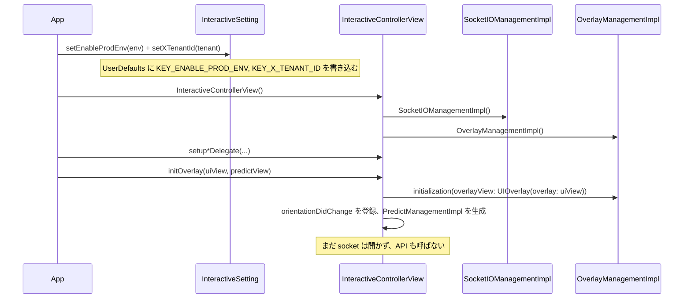

このステップの後、SDK は**準備完了**の状態になります。環境・テナントを把握し、レンダリング用の2つの view を持ちますが、まだコンテンツはアタッチされていません。

---

## 2. ログイン / ログアウト

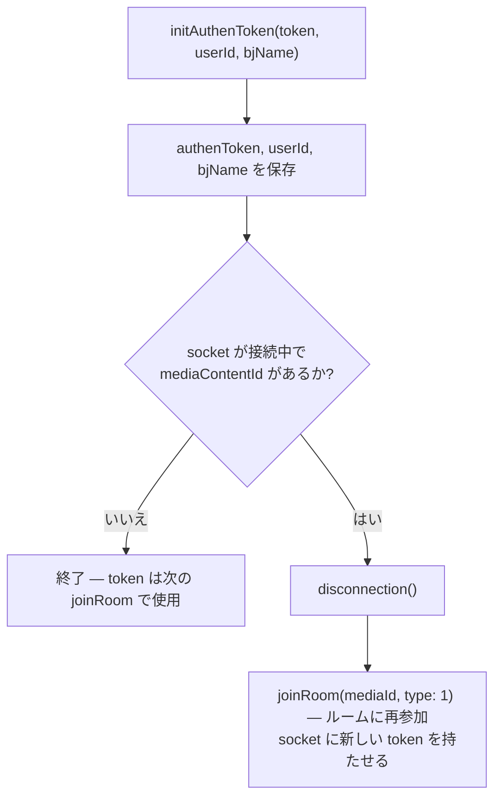

意味:

- **Live 視聴中にログイン**すると → SDK が自動的に切断・再接続し、表示中のオーバーレイは破棄されます。
- **ログアウト** = `initAuthenToken("", "", "")`。
- socket ヘッダー `Authorization` にはトークンが**原文のまま**入ります。REST では JWT（`"ey"` から始まる）に `Bearer ` が付与されます。

---

## 3. LIVE ルームへの参加

```mermaid
sequenceDiagram
    participant APP as App
    participant ICV as InteractiveControllerView
    participant SIO as SocketIOManagementImpl
    participant WS as Socket.IO server

    APP->>ICV: joinRoom(mediaId, type: 1)
    ICV->>ICV: media が異なる場合 → 旧ルームを leaveRoom()
    ICV->>SIO: 接続中なら → disconnection()
    ICV->>ICV: removeAllView(); mediaContentId = mediaId
    ICV->>ICV: handleEventsSocket() — 接続前にコールバックを設定
    ICV->>SIO: connectSocket() → connection(url, authenToken)
    SIO->>SIO: buildSocket() — tenantId と env のガード（空でないか）
    Note over SIO: ヘッダー x-tenant-id, v, os=iphone, deviceId, Authorization<br/>forceWebsockets, reconnectWait 5, randomization 0.4
    SIO->>SIO: addEvents()（ハンドラー登録）
    SIO->>WS: socket.connect()
    WS-->>SIO: clientEvent .connect
    SIO-->>ICV: callback CONNECTED
    ICV->>SIO: joinRoom(JoinRoomData(mediaContentId))
    SIO->>WS: emit("join-room", {deviceId, mediaContentId, os, tenantId, versionSDK})
```

重要なポイント:

- `emit("join-room")` は**socket の接続が成功した後にのみ**発生します（`SocketEvents.CONNECTED` の分岐内）。`joinRoom()` を呼んだ瞬間ではありません。
- `handleEventsSocket()` は `CONNECTED` イベントを取りこぼさないように、`connectSocket()` より**先に**呼ばれます。
- `KEY_X_TENANT_ID` が空の場合 `buildSocket()` は**停止**します。`connectSocket()` は env またはテナントが空の場合に停止します。

---

## 4. オーバーレイの受信とルーティング（LIVE）

### 4.1. socket 層での事前フィルタリング（`SocketIOManagementImpl`）

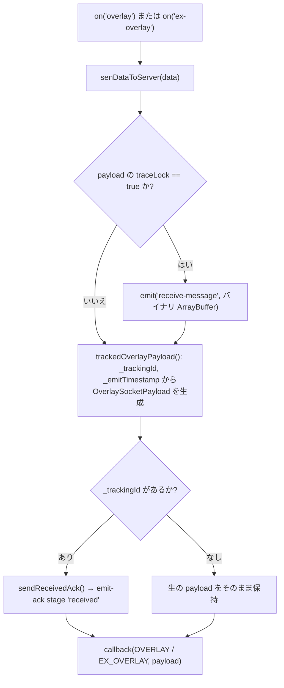

### 4.2. `InteractiveControllerView` 層（`startShowLiveOverlayWithDataReceived`）

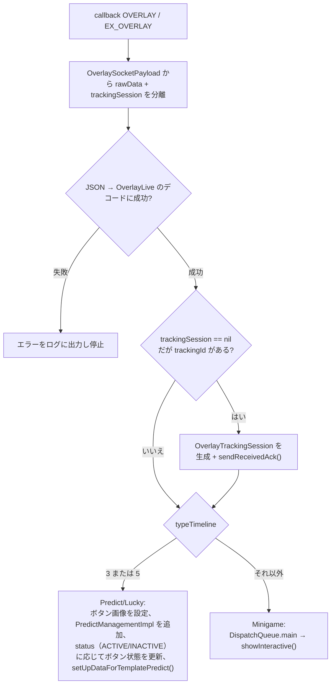

`showInteractive()` の内部:

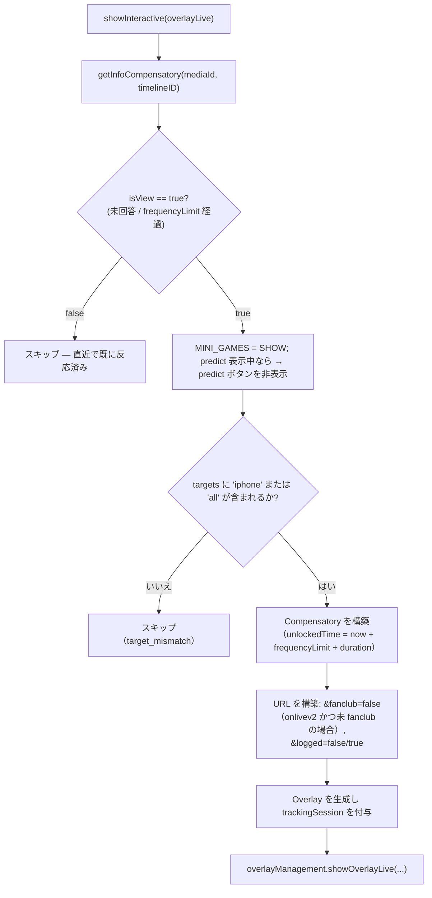

> `getInfoCompensatory` は `UserDefaults(suiteName: INTERACTIVE_<userId|DEFAULT>)` を `mediaId` で読み取ります。既に回答済みで、まだ `frequencyLimit` 内であれば `false` を返します（再表示しません）。

---

## 5. minigame オーバーレイのレンダリング

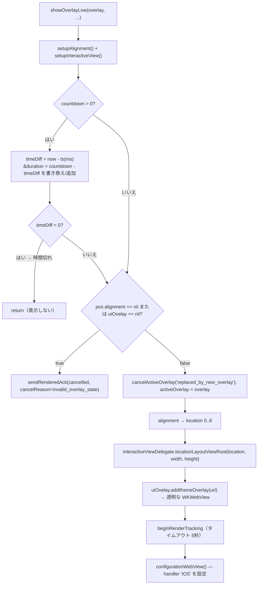

**幾何学的な制約**: `location`（0..8）は `OverlayPosition.pos.x`/`pos.y`（各軸 0/1/2）から算出され、9つの位置
（`LeftTop`…`RightBottom`）にマッピングされます。サイズ `size.w/size.h` は枠に対する**比率**です。
実際の配置はアプリの `locationLayoutViewRoot(location:width:height:)` 内で処理され、WebView はルート枠に
重ねて配置されます。

**同時に表示できる minigame オーバーレイは1つだけ**: `showOverlayLive` は新しいオーバーレイを追加する前に
`cancelActiveOverlay` + `uiOvelay?.onStop()` を呼び出します。

---

## 6. minigame の質問への回答

WebView が `IOS.postMessage({type: INTERACTIVE_ACTION_REPORT, data})` を送ると発火します。
**Live**（`handleWebViewCallBack`）と **VOD**（`handleWebViewCallBackVod`）の2つの分岐があります。

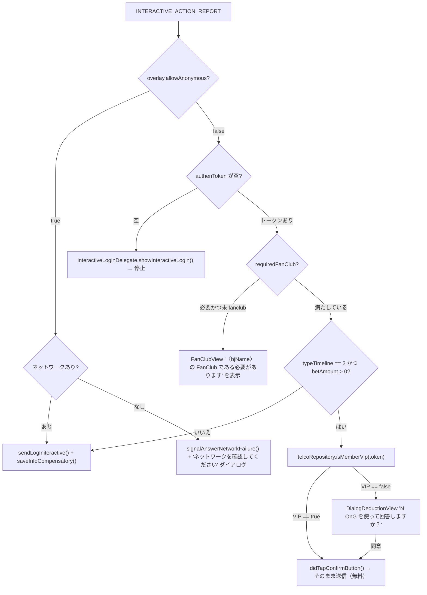

### 6.1. `sendLogIniteractive` — API `/api/actions` の呼び出し

```mermaid
sequenceDiagram
    participant OMI as OverlayManagementImpl
    participant TRK as OverlayTrackingSession
    participant API as POST /api/actions
    participant WV as WKWebView

    OMI->>OMI: action == CLICK_ADS の場合 → Safari で urlLinkAds を開き、API は呼ばない
    OMI->>OMI: data に media, socket_id, versionSDK を追加; params に deviceId, type, os=iphone を追加
    OMI->>TRK: sendAnswerAttempt() → emit-ack stage 'answer'
    OMI->>API: POST（token が 'ey' から始まる場合 Authorization Bearer、X-TENANT-ID）
    alt success == true
        API-->>OMI: {success: true, result}
        OMI->>TRK: sendAnswerSucceeded() → stage 'answer-succeeded'
        Note over OMI,WV: isReturnData の分岐（bet/VIP）: postMessage UPDATE_CONFIRM
        OMI->>OMI: saveInfoCompensatory()
    else success == false / エラー
        API-->>OMI: {success: false, result{message, description}} またはネットワークエラー
        OMI->>TRK: sendAnswerFailed(reason, step) → stage 'answer-failed'
        OMI->>OMI: result.message に応じて showDialogDedution
    end
```

エラーコードから `failureReason`（`OverlayTrackingFailure.answerFailureReason`）へのマッピング:

| `result.message` | `failureReason` | `failureStep` |
|---|---|---|
| `EX400` | `api_EX400` | `api_response` |
| `TL404` | `api_TL404` | `api_response` |
| `PM402` | `api_PM402` | `api_response` |
| その他、`success == false` | `api_false` | `api_response` |
| ネットワークエラー | `network_error` | `network` |
| body がパースできない | `unknown_response` | `unknown_response` |

`result.message` によるガイドダイアログ（`showDialogDedution`）:

| `message` | 内容 |
|---|---|
| `PM402` | 「OnG をチャージしてください」→ `showSubscibeView` / `NEED_PAY` を表示 |
| `EX400` | 「この質問にはすでに回答済みです」 |
| `answerSuccess` | 「質問への回答に成功しました」 |
| その他 | 「回答に失敗しました」 |

---

## 7. Predict — 頭脳対決（`typeTimeline = 3`）

```mermaid
sequenceDiagram
    participant WS as Socket
    participant ICV as InteractiveControllerView
    participant PMI as PredictManagementImpl
    participant DLG as DialogLuckyNumberView（共用）
    participant API as /api/actions

    WS-->>ICV: overlay (typeTimeline = 3)
    ICV->>PMI: ボタン画像を設定（payload 内の idle/power、なければ CDN_PREDICT_* にフォールバック）
    ICV->>PMI: ボタンを addSubview; status に応じて状態を更新
    ICV->>PMI: setUpDataForTemplatePredict() → setUrlWebView + setDataForPredict

    Note over WS,ICV: リアルタイムイベント 'predict-timeline'（DataButtonPredict）
    WS-->>ICV: {type: ACTIVE} → ボタン表示、PREDICT = SHOW
    WS-->>ICV: {type: INACTIVE} → ボタン非表示、ダイアログ破棄、PREDICT = HIDE_CMS
    WS-->>ICV: {type: POWER} → ボタン画像を power に変更、alpha を 1 → 0.5 に5秒後変化
    WS-->>ICV: {type: END} → 結果キャッシュを削除、ボタン非表示、hideLayoutViewPredictRoot、PREDICT = END

    PMI->>PMI: ユーザーがボタンをタップ（didButtonClick）
    alt authenToken が空
        PMI->>PMI: DialogConfirmView → showInteractiveLogin()
    else トークンあり
        PMI->>DLG: embededInteractiveContentView() → URL をロード、handler 'IOS'
        DLG->>PMI: INTERACTIVE_ACTION_REPORT → 回答フロー（login/fanclub/VIP）
        PMI->>API: POST /api/actions (isReturnData = true)
        API-->>PMI: 成功 → UPDATE_CONFIRM; 失敗 → showDialogDedution
    end

    WS-->>ICV: 'predict-result' → answer1/answer2 → UPDATE_COUTER（postMessage）
```

ボタンの状態を制御するフラグ（`UserDefaults` に保存、定数 `TypeInteractive`）:

| キー | 意味 |
|---|---|
| `MINI_GAMES` | minigame が画面を占有中かどうか（`SHOW`/`HIDE`） |
| `PREDICT` | predict ボタンの状態（`SHOW`/`HIDE`/`HIDE_CMS`/`END`） |
| `POPUP_PREDICT` | predict ダイアログが開いているか（`SHOW`/`HIDE`） |
| `INTERACTIVE_TYPE_TIMELINE` | `3` predict、`5` lucky、`0` なし |

ボタン画像: predict は**動く GIF**（`CDN_PREDICT_IDLE/POWER`）、lucky は**静止 PNG**
（`CDN_LUCKY_IDLE/POWER`）を使用し、拡張子 `.gif` で区別されます。

> ⚠️ `predict-timeline` / `lucky-event` の全フローは、テナント `vtvlive`、
> `onlivetv`、`VTVprime` では**スキップされます**（`receiveDataActionButtonPredict` 内で早期リターン）。

---

## 8. Lucky — ラッキーナンバー（`typeTimeline = 5`）

構造は Predict とほぼ同じ（`DialogLuckyNumberView` を共用）ですが、以下の点が異なります。

- URL には `&u=<userId>` が追加されます（lucky のみ）。
- デフォルト画像は `CDN_LUCKY_IDLE/POWER`（PNG）です。
- API から返された結果は **`UPDATE_NUMBER_LUCKY`** で Web に送られます。

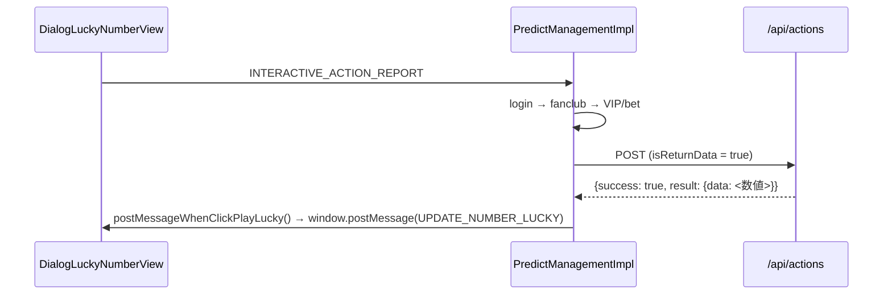

---

## 9. オーバーレイの取り消し — overlay-recall

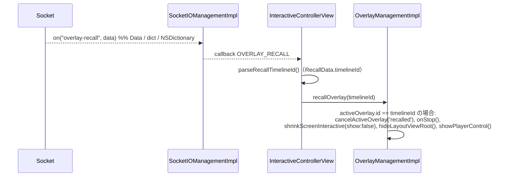

編集担当者がシステム全体で配信中のオーバーレイを取り下げる際に使用されます。`timelineId` が現在表示中の
オーバーレイと一致する場合のみ削除されます。

---

## 10. 補助イベント

| socket イベント | 処理 |
|---|---|
| `liveviews` | `LiveViewDto.count` をパースし、`showLiveView(liveView: 230 + count)` を呼ぶ（**230 を加算**） |
| `data`（fanclub） | `FanClub` をデコード。視聴中の media の `_` より前の部分と `mediaId` が一致し `isFanClub` の場合 → `KEY_FAN_CLUB = true`、そうでなければ `false` |
| `ckst` | `CkstResponse` をデコード。delegate から `getPlayerState()` を取得 → `CkstData(action: "CHECK_PLAYER_STATUS", sessionId, data: Ckst{deviceId, os, mediaContentId, playerStatus, tenantId})` として `ckst` を再度 emit |
| `update-result` | `sendMessageResultinteractive()` → `window.postMessage(UPDATE_DATA_INTERACTIVE)` |
| `predict-result` | `answer1`/`answer2` を更新し、`DATA_RESULT_PREDICT` にキャッシュ、`UPDATE_COUTER` を送信 |
| `branching` | `Branching` をデコード。`action`（`START/PLAY_MINIGAME/END_VIDEO_BRANCHING`）に応じて `BranchingSocketIODelegate` を呼ぶ（分岐動画のプリロード/表示/終了） |

> `liveViews + 230` は現行コード（`showCCU`）における意図的な仕様です。生の数値が必要な場合はアプリ側で引いてください。
>
> emit される `ckst` の payload では、`data` フィールドが（`CkstData` の `CodingKeys` により）**JSON key `"os"`** に
> マッピングされます — バックエンドと照合する際は注意してください。

---

## 11. VOD フロー

```mermaid
sequenceDiagram
    participant APP as App
    participant ICV as InteractiveControllerView
    participant API as GET /api/ctc/scenario/v2/vod/{mediaId}/{os}
    participant OMI as OverlayManagementImpl

    APP->>ICV: joinRoom(mediaId, type: 2)
    ICV->>ICV: 接続中なら → disconnection(); removeAllView()
    ICV->>API: callApiScenarioForVod（header X-TENANT-ID）
    API-->>ICV: VODOverlayData {data.timelines[]}
    ICV->>ICV: convertVodInteractive(): showStatus == ACTIVE を抽出し、<br/>timeShow（秒）順に並べる

    loop 毎秒（アプリが送り込む）
        APP->>ICV: getTimeVideo(time: 秒)
        ICV->>ICV: timeShow == Int(time) となるタイムラインを検索
        alt 秒が一致
            ICV->>ICV: showInteractiveVod(): allowAnonymous/token を確認
            ICV->>ICV: URL を構築（timelineId, tenantId, deviceType=IOS）
            ICV->>OMI: showOverlayVod(overlay, token, mediaId)
            ICV->>ICV: リストからタイムラインを削除（再表示しない）
        end
    end
```

LIVE との違い:

| | LIVE | VOD |
|---|---|---|
| オーバーレイの供給源 | Socket.IO からのプッシュ | REST でシナリオ全体を事前取得 |
| 表示のトリガー | リアルタイムイベント | アプリが送り込む `getTimeVideo(秒)` |
| `socketIO` | 接続あり | 切断（socket 関連の呼び出しは安全に無視される） |
| action 内の `socket_id` | あり | なし |
| emit-ack トラッキング | あり | **なし**（`showOverlayVod` は `beginRenderTracking` を呼ばない） |
| Predict / Lucky / liveviews / ckst | あり | なし |
| 表示条件 | login/fanclub/VIP をすべて満たす | `allowAnonymous` またはトークンありのみ |

---

## 12. 接続断と復旧

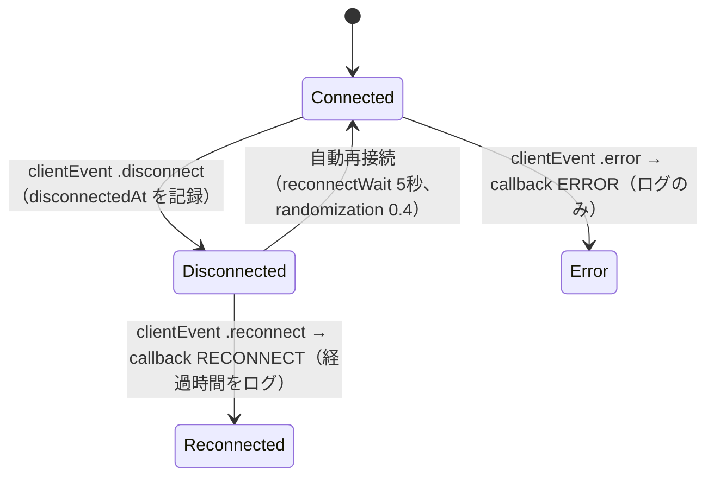

- Socket.IO クライアントは自動的に再接続します（`.reconnects(true)`、`reconnectWait 5`）。`.connect` が再度発生すると、
  コールバック `CONNECTED` が実行され → `mediaContentId` がある場合は**再度 `join-room` を emit**します。
- `isConnected()` は `status == .connecting` や `reconnects == true` の場合も `true` を返します。
  「接続済み」ではなく「接続中/接続予定」と捉えるべきです。
- `disconnection()` は client と app の**すべての**ハンドラーを解除し、`disconnect()` を呼び、`socketManager = nil` にします。

---

## 13. リソースの解放

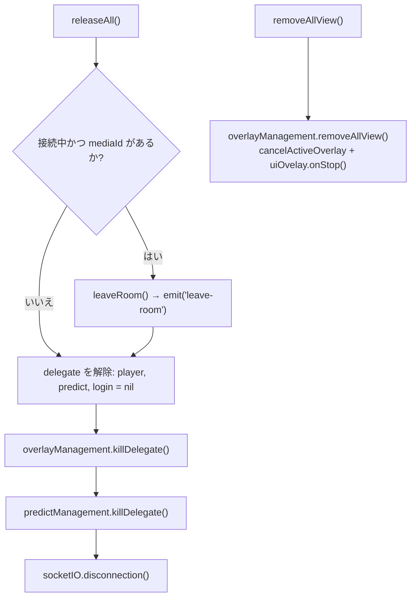

`releaseAll()` を呼ぶべきタイミング:

- プレイヤー画面を離れるとき（`viewWillDisappear`/`deinit`）、
- ユーザーがコンテンツを離れたとき、
- 別の `mediaId` に切り替える前、**ただし**すぐに `joinRoom()` を呼ばない場合のみ（`joinRoom` は既に自動で
  `removeAllView()` と socket 処理を行うため）。

---

[← インストールと統合](/ja/itr/ios/installation_integration/) · [目次へ](/ja/itr/getting-started/overview/) · [次へ: API リファレンス →](/ja/itr/ios/api_reference/)
