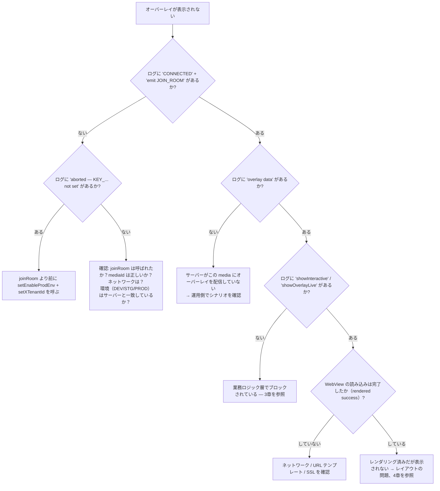

## 1. SDK のログを有効化する

SDK は `logLine(...)` 関数（`Const/PrintLog.swift`）でログを出力します — 常にプレフィックス
**`Interactive:`** 付きで `print` されます。Xcode コンソールで確認するか、次のようにフィルタしてください。

```bash
# Console.app / log stream 経由で実行する場合
log stream --predicate 'eventMessage CONTAINS "Interactive:"'
```

注目すべきログ文字列（プレフィックス `Interactive:`）:

| ログ | 意味 |
|---|---|
| `[Socket] connectSocket() — env: ...` | 接続準備を開始 |
| `[Socket] ❌ connectSocket() aborted — KEY_X_TENANT_ID not set` | `setXTenantId` が未呼び出し |
| `[Socket] ❌ connectSocket() aborted — KEY_ENABLE_PROD_ENV not set` | `setEnableProdEnv` が未呼び出し |
| `[Socket] ✅ CONNECTED — sid: ...` | socket が接続済み |
| `[Socket] emit JOIN_ROOM — mediaContentId: ...` | ルームに参加済み |
| `Interactive-socket overlay data` | サーバーからオーバーレイを受信 |
| `startShowLiveOverlayWithDataReceived` | オーバーレイの処理を開始 |
| `1 showInteractive isView : false` | `Compensatory` によりオーバーレイがブロックされた（回答済み） |
| `quá giờ trả lời` | オーバーレイの `duration` が `ts` から見て経過した |
| `[Socket] 🔌 DISCONNECTED` / `🔄 RECONNECT` | 接続断/復旧 |

---

## 2. オーバーレイが表示されない — 診断ツリー



---

## 3. 業務ロジック層でブロックされている

| 症状 | 原因 | 対処 |
|---|---|---|
| `showInteractive isView : false` | `Compensatory` — 回答済みで `frequencyLimit` 内 | 想定どおりの動作。再テストするには suite `INTERACTIVE_<userId>` / `INTERACTIVE_DEFAULT` を削除する |
| `quá giờ trả lời`（時間切れ） | オーバーレイの `duration` が `ts` から見て経過した | 想定どおりの動作 |
| オーバーレイが表示されない、`targets` が一致しない | `targets` に `iphone` も `all` も含まれていない | シナリオを修正し `targets` に `iphone`/`all` を含める |
| OnPlus/OnLiveTV/SeeNow で predict/lucky ボタンが表示されない | `receiveDataActionButtonPredict` がテナント `vtvlive`/`onlivetv`/`VTVprime` で早期リターン | 現行の仕様どおり。有効化したい場合は SDK 内のテナント条件を修正する |
| ユーザーが回答ボタンを押しても何も起こらない | `!allowAnonymous` かつ未ログイン | `InteractiveLoginDelegate.showInteractiveLogin()` を実装し、ログイン後に `initAuthenToken` を呼んでいることを確認する |
| 「〈…〉の FanClub である必要があります」ダイアログが表示される | `requiredFanClub` かつ `KEY_FAN_CLUB == false` | 想定どおりの動作。fanclub に加入する必要がある（socket イベント `data` の更新を待つ） |
| 「N OnG を使って回答しますか？」ダイアログが表示される | `typeTimeline == 2`、`betAmount > 0`、VIP ではない | 想定どおりの動作（telco VIP フロー） |

---

## 4. オーバーレイはレンダリングされるが表示されない/位置がずれる

| 原因 | 兆候 | 対処 |
|---|---|---|
| `uiView`（オーバーレイコンテナ）のサイズが 0 | レンダリングログは正常だが画面は空 | `initOverlay` の前に `uiView` が動画枠に正しく重なるよう制約する |
| `uiView` がプレイヤーの下に隠れている | オーバーレイが「点滅」してすぐ消える | player の**後に**`uiView` を追加する（subview の順序を調整）、または `zPosition` を上げる |
| `predictView` の位置がずれている | predict/lucky ボタンの位置がおかしい | `showLayoutViewPredictRoot()` 内で `predictView` の frame を更新する（デモの `updateLayoutPredict` 参照） |
| 画面サイズ変更時に `resizeVideoView` を呼んでいない | プレイヤーのフルスクリーン化にオーバーレイが追従しない | 動画枠が変わったときに `interactive.resizeVideoView(width:height:)` を呼ぶ |
| `locationLayoutViewRoot` が未実装 | オーバーレイが常に同じ位置に固定される | `InteractiveViewDelegate.locationLayoutViewRoot(location:width:height:)` を実装し `location`（0..8）に応じて配置する |

オーバーレイの WebView は**透明な** `WKWebView`（`isOpaque = false`、背景 `.clear`、スクロールなし）です。
黒/白の背景が動画を覆っている場合は、Web テンプレートの背景が透明かどうかを確認してください。

---

## 5. socket が接続できない

チェックリスト:

1. **未設定**: ログに `aborted — KEY_X_TENANT_ID not set` / `KEY_ENABLE_PROD_ENV not set` が出る。
   → アプリ起動時に `InteractiveSetting().setXTenantId(...)` と `setEnableProdEnv(...)` を呼ぶ。
2. **環境の誤り**: `Enviroment` はサーバー側の環境（DEV/STG/PROD）と一致している必要があります — URL は env
   から決まります。
3. **テナントの誤り**: サーバーがルームを拒否する可能性があります。
4. **トークン**: socket ヘッダー `Authorization` は**原文のまま**送信されます（自動で `Bearer` は付与されません）。
   backend が socket に `Bearer` を要求する場合は、`initAuthenToken` にプレフィックス付きの文字列をあらかじめ
   渡す必要があります。
5. **`isConnected()` が `true` を返すが実際は接続中**: この関数は `.connecting`/`reconnects` の場合も `true`
   を返します — オンラインであることの確証としてこれだけに頼らないでください。

---

## 6. 統合後のクラッシュ

| エラー | 原因 | 対処 |
|---|---|---|
| `joinRoom` / API 呼び出し直後に `Unexpectedly found nil` でクラッシュ | 未設定の状態で `UserDefaults.string(forKey: KEY_X_TENANT_ID)!` / `KEY_ENABLE_PROD_ENV!` を force-unwrap している | **必ず**先に `setEnableProdEnv` + `setXTenantId` を呼ぶ（コミット `[fixbug] crash` の原因である可能性が高い） |
| リンク時にシンボル不足（Alamofire / SocketIO / SwiftyJSON） | 静的 XCFramework は依存関係を同梱していない | アプリの target で pod を再宣言する |
| RxSwift/RxCocoa のシンボル不足 | Rx の `*.xcframework` を組み込んでいない | `RxSwift/RxCocoa/RxRelay.xcframework` を組み込む（Embed & Sign） |
| WebView がコールバックを受け取らない | テンプレートのインターフェース名が間違っている | インターフェース名は **`IOS`** である必要がある（`window.webkit.messageHandlers.IOS.postMessage(...)`） |

---

## 7. VOD: 想定した時点でオーバーレイが表示されない

| 原因 | 対処 |
|---|---|
| アプリが `getTimeVideo()` を呼んでいない | `joinRoom(type: 2)` の後に1秒間隔のループ/observer を追加する |
| 単位を間違えて送っている（秒ではなくミリ秒） | `getTimeVideo` は**秒**を受け取る（`timeShow` と一致） |
| ユーザーがその時点をシークで飛ばした | SDK は**秒単位で完全一致**でのみ照合する（`timeShow == Int(time)`）。飛ばされた時点はスキップされる — 現状の制限 |
| 未ログインで、オーバーレイが `allowAnonymous` でない | `showInteractiveVod` がスキップされる。ログイン後に再度 `joinRoom` する |
| シナリオが空で返ってくる | `callApiScenarioForVod`（env、`X-TENANT-ID`、`mediaId`）を確認する。`convertVodInteractive` は `showStatus == "ACTIVE"` のみを取得する |

---

## 8. 保守時に知っておくべき技術的注意点

現行コード中の紛らわしい点をまとめました。

- **`liveViews + 230`**: `showCCU` は `showLiveView` を呼ぶ前に視聴者数へ固定で 230 を加算します。生の数値が
  必要な場合はアプリ側で引いてください。
- **`CkstData.data` は JSON key `"os"` にマッピングされる**: emit される `ckst` の payload には `os` という
  名前のネストされたフィールドがあります（`data` ではありません）。backend と食い違いがある場合は照合してください。
- **`UPDATE_COUTER`**（N が抜けている）と **`PredictResult.timlineId`**（e が抜けている）は、コード中の
  **原文どおり**の綴りです — Web テンプレート側もこの綴りに正確に合わせる必要があります。
- **`DialogLuckyNumberView` は predict と lucky の両方で実行時に共用**されます。`DialogPredictView` は
  ほとんど使用されていません。
- **`LiveCompensatoryShotImpl.loadScenarioLive`** は Alamofire のリクエストが完了する前に**同期的に**値を
  返してしまうため、ほぼ常に `nil` を返します。`fetchInteractiveStatus` に使われる `fetchOverlayStatus` のみ
  正しく動作します。この関数を再利用する際は注意してください。
- **テナントヘッダーの大文字/小文字が異なる**: socket は `x-tenant-id`（小文字）、REST は `X-TENANT-ID`
  （大文字）を使用します。
- **Sentry は無効化されています**: `SentryInteractor` と `InteractiveSetting.startSentry` はどちらも
  コメントアウトされています。
- **`addCallback` は単一スロット**: 後から呼ぶと前のコールバックを上書きします — 複数の listener を
  アタッチすることはできません。

---

## 9. よくある質問

**SDK は `UIViewController` のライフサイクルを自動的に追跡しますか？**
いいえ。アプリは画面を離れる際に自分で `releaseAll()` を呼ぶ必要があります。SDK が自動で監視するのは
`orientationDidChange`（predict ボタンの再配置のため）のみです。

**複数の minigame オーバーレイを同時に表示できますか？**
できません。`showOverlayLive` は新しいものを追加する前に `cancelActiveOverlay` + `onStop()` を呼ぶため、
常に minigame オーバーレイは1つだけです。predict/lucky ボタンは独立した view のため並行して存在できます
（minigame が画面を占有している間は SDK がボタンを自動的に非表示にします）。

**途中でアカウントを切り替えた場合はどうなりますか？**
`initAuthenToken(新しいtoken, 新しいuserId, "")` を呼びます。Live 中であれば、SDK が自動的に新しいトークンで
ルームに再参加します。

**毎回 `joinRoom()` の前に `releaseAll()` を呼ぶ必要がありますか？**
いいえ — `joinRoom()` は既に自動で `removeAllView()` と socket 処理を行います。本当に画面を離れるときのみ
`releaseAll()` を呼んでください。

**画面回転するとオーバーレイは消えますか？**
サーバーが制御する minigame オーバーレイは、まだ有効であれば再送されます。predict ボタンは
`orientationDidChange` を通じて再配置されます。レイアウトは `InteractiveViewDelegate` を通じてアプリ側が
制御します。

**SDK はどの WebView を使用していますか？**
`WKWebView`（一部のダイアログはピンチズームを禁止する `NoZoomWKWebView` を使用）。JavaScript は有効、
背景は透明、スクロールは無効です。

---

[← Tracking emit-ack](/ja/itr/ios/tracking_emit_ack/) · [目次へ](/ja/itr/getting-started/overview/)
