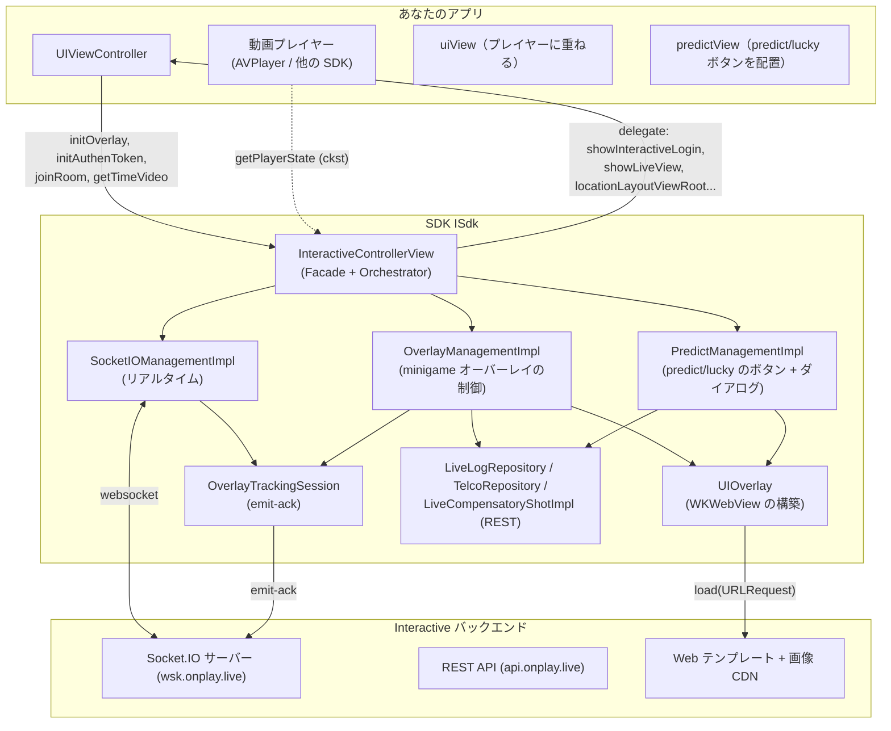
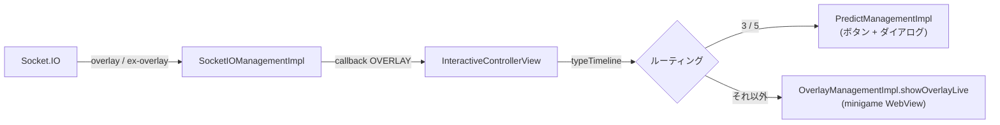
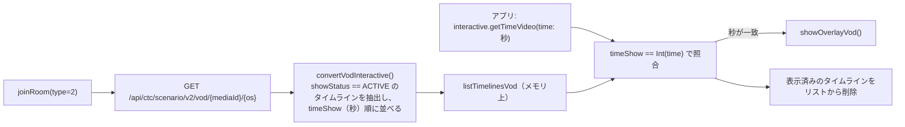
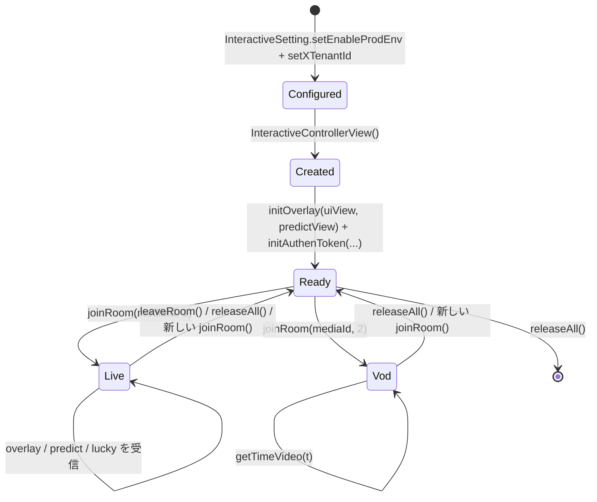
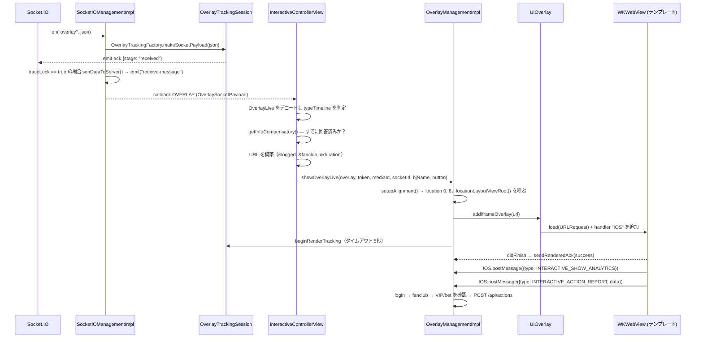
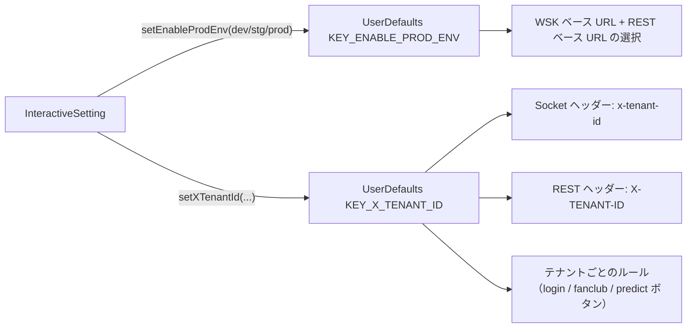

## 1. 全体像

SDK は **iOS ライブラリ（XCFramework `ISdk`）** であり、次の3つの主要な責務をまとめています。

1. Socket.IO 経由で Interactive サーバーとの**リアルタイム接続**を行う（Live シナリオ）。
2. 透明な `WKWebView` 内で（Web で書かれた）インタラクティブコンテンツの**表示制御**を行う。
3. ユーザーの操作を REST 経由でサーバーへ**転送**し、delegate 経由でアプリを**コールバック**する。

---

## 2. レイヤーと責務

| レイヤー | コンポーネント（ファイル） | 責務 |
|---|---|---|
| **Facade / Orchestrator** | `InteractiveControllerView` | アプリの唯一の入口。コマンド（`joinRoom`、`initAuthenToken`、`getTimeVideo`、`releaseAll` など）を受け取り、socket イベントを監視し、オーバーレイの種類（minigame / predict / lucky）を判定し、各マネージャーを制御する |
| **設定** | `InteractiveSetting` | 環境（`KEY_ENABLE_PROD_ENV`）とテナント（`KEY_X_TENANT_ID`）を `UserDefaults` に書き込む |
| **リアルタイム transport** | `SocketIOManagementImpl` (`SocketIOManagement`) | socket の生成/破棄、イベント登録、payload の正規化、emit-ack の送信 |
| **オーバーレイ制御** | `OverlayManagementImpl` (`OverlayManagement`) | minigame オーバーレイの構築、回答フロー（login → fanclub → VIP/bet → API 呼び出し）の処理、トラッキング |
| **predict/lucky 制御** | `PredictManagementImpl` | GIF の浮動ボタン、predict/lucky ダイアログ、専用の回答フロー |
| **WebView 表示** | `UIOverlay`、`ConfigureWebView` (`NoZoomWKWebView`) | 透明な `WKWebView` の生成、オーバーレイのライフサイクルに応じたアタッチ/デタッチ |
| **補助的な表示** | `DialogLuckyNumberView`、`DialogPredictView`、`DialogConfirmView`、`DialogDeductionView`、`FanClubView`、`LeaderboardView` | フルスクリーンダイアログ / 浮動ボタン / ランキング表 |
| **Bridge** | `OverlayWebViewCallBack`、`PredictWebViewCallBack` | JavaScript ⇄ Swift のブリッジ（`WKScriptMessageHandler`、インターフェース名 `IOS`） |
| **REST** | `LiveLogRepository`（`/api/actions`）、`TelcoRepository`（`/api/public/vip-status`）、`LiveCompensatoryShotImpl`（`interactive-status`）、`OverlayVod*` 系クラス（VOD） | Alamofire 経由で API を呼び出す |
| **Observability** | `OverlayTracking.swift`（`OverlayTrackingSession`、`OverlayTrackingFactory`） | オーバーレイのライフサイクルを計測し `emit-ack` を送信する |
| **インフラ** | `ApiConst`、`TypeInteractive`、`SocketEvents`、`Utils`、`PrintLog`、各種 `Codable` モデル | 定数、ユーティリティ、データモデル |

### コードに表れている設計原則

- **アプリ向けの Facade はひとつ**: アプリは基本的に `InteractiveControllerView` + `InteractiveSetting` + 各種 delegate `protocol` にのみ触れます。内部のマネージャーは `public` ですが、直接呼び出す必要は通常ありません。
- **イベントは単一のコールバックを通る**: socket は SDK に対してクロージャ `(String, Any) -> ()` で通知します（`addCallback` で登録、単一スロット）。`InteractiveControllerView.handleEventsSocket()` がイベント名で `switch` します。
- **インタラクティブコンテンツは Web**: SDK は質問 UI を自前で描画せず、`WKWebView` にテンプレート URL をロードし、`postMessage` でやり取りします。インタラクティブな UI の変更にアプリの再ビルドは不要です。
- **設定は `UserDefaults` に保持される**: 環境とテナントはあらゆる箇所で再取得されます（socket ヘッダー、REST のベース URL 選択など）。これは未設定時に発生する**force-unwrap によるクラッシュ**の原因の一つでもあります。

---

## 3. クラス図（簡略版）

```mermaid
classDiagram
    class InteractiveControllerView {
        +overlayManagement: OverlayManagement?
        +predictManagement: PredictManagementImpl!
        +socketIO: SocketIOManagement?
        +interactivePlayerDelegate
        +interactiveLoginDelegate
        +interactivePredictDelegate
        +initOverlay(uiView, predictView)
        +initAuthenToken(authenToken, userId, bjName)
        +joinRoom(mediaId, type)
        +getTimeVideo(time)
        +leaveRoom()
        +releaseAll()
        +removeAllView()
        +resizeVideoView(width, height)
        +showChartsInteractive(...)
        +fetchInteractiveStatus(mediaId, completion)
    }

    class SocketIOManagement {
        <<protocol>>
        +connection(url, authenToken)
        +joinRoom(JoinRoomData)
        +leaveRoom(JoinRoomData)
        +ckstRoom(CkstData)
        +sendEmitAck(trackingId, event, stage, clientContext)
        +addCallback((String, Any) -> ())
        +isConnected() Bool
        +getSocketId() String
        +disconnection()
    }

    class OverlayManagement {
        <<protocol>>
        +initialization(overlayView: UIOverlay)
        +showOverlayLive(overlay, authenToken, mediaContentId, socketId, bjName, buttonPredict)
        +showOverlayVod(overlay, authenToken, mediaContentId)
        +recallOverlay(timelineId)
        +removeAllView()
        +resizeVideoView(width, height)
        +setupDelegate(...)
        +killDelegate()
    }

    class PredictManagementImpl {
        +button: UIImageView
        +setUrlImagePredict(imageIdle, imagePower)
        +setDataForPredict(chooseRightNumber, mediaContentId, authenToken, socketId)
        +embededInteractiveContentView()
        +setHiddenButton(Bool)
    }

    class UIOverlay {
        +addIframeOverlay(url) WKWebView
        +removeWebView(webView)
        +onStop()
        +resizeOverlayViewNew(widthOverlay, heightOverlay)
    }

    class OverlayTrackingSession {
        +sendReceivedAck()
        +sendRenderedAck(status, overlay, ...)
        +sendAnswerAttempt/Succeeded/Failed(...)
        +finish()
    }

    InteractiveControllerView --> SocketIOManagement
    InteractiveControllerView --> OverlayManagement
    InteractiveControllerView --> PredictManagementImpl
    OverlayManagement --> UIOverlay
    OverlayManagement --> OverlayTrackingSession
    SocketIOManagement --> OverlayTrackingSession
```

## 4. 2つの動作モード

### 4.1. LIVE（`type = 1`、`ApiConst.TYPE_LIVE`）— サーバー主導

サーバーが Socket.IO 経由で能動的にオーバーレイを送信します。表示/回答の条件（ログイン、fanclub、VIP/bet、回答済みかどうか）はクライアント側で即座にチェックされます。

### 4.2. VOD（`type = 2`、`ApiConst.TYPE_VOD`）— 再生進行に基づく

socket は使用しません。SDK は REST 経由でシナリオ全体を事前に取得し、その後**アプリが再生時間を送り込む**必要があります。

> `timeShow` は `Timelines.time`（`"SS"`、`"MM:SS"`、`"HH:MM:SS"` 形式、関数 `parseTimeToSeconds`）から算出されるため、`getTimeVideo` に渡す単位は**秒**です。

---

## 5. スレッドモデル

| 処理 | スレッド | 備考 |
|---|---|---|
| Socket.IO イベント | Socket.IO クライアントのスレッド | `addCallback` のクロージャに渡される |
| WebView の生成/破棄 | **メインスレッド** | `showInteractive`/`setUpDataForTemplatePredict` は `DispatchQueue.main.async` 内で呼ばれる |
| REST 呼び出し | Alamofire のスレッド、コールバックはメインに戻る | `AF.request(...).response*` |
| emit-ack トラッキング | `OverlayTrackingSession` 内で同期処理（フラグ `emittedStages`、`finished`） | レンダリングタイマーはメインの `Timer` を使用 |
| predict ボタンの画像/alpha 変更 | メイン（`Timer.scheduledTimer`） | **5秒後**に alpha を 0.5 にフェード |

> Android 版と異なり、iOS には `QueuedMutableLiveData` は**ありません**。オーバーレイイベントはコールバック内で逐次処理されます。`addCallback` は**単一スロット**であり、後から呼ぶと前のものを上書きします。

---

## 6. オブジェクトのライフサイクル

コード上の重要なポイント:

- **コンストラクタ `InteractiveControllerView()` は `SocketIOManagementImpl` と `OverlayManagementImpl` を生成するのみ**で、接続や API 呼び出しはまだ行いません。
- **`joinRoom(type: 1)`** は（media が異なる場合）旧ルームを離脱し、旧 socket を切断し、`removeAllView()` を行い、socket コールバックを再設定してから `connectSocket()` します。`emit("join-room")` は**socket が接続に成功した後**（`SocketEvents.CONNECTED` 分岐内）にのみ発生します。
- **`joinRoom(type: 2)`** は（開いていれば）socket を切断し、`removeAllView()` を行い、REST で VOD シナリオを取得します。
- **接続中かつ media がある状態で `initAuthenToken()`** を呼ぶと → SDK は socket を切断し、新しいトークンを持たせるために `joinRoom(type: 1)` を再実行します。
- **`releaseAll()`** は（接続中であれば）`leaveRoom()` を呼び、すべての delegate を解除し、`disconnection()` します。

---

## 7. minigame オーバーレイのデータフロー（Live）

各分岐の詳細（ブロックされるケースを含む）は [03 — 動作フロー](/ja/itr/ios/detailed_workflow/) を参照してください。

---

## 8. WebView ブリッジプロトコル

SDK は `WKScriptMessageHandler` を **`IOS`** という名前で登録します（`userContentController.add(callBack, name: "IOS")`）。

**Web → SDK**（`window.webkit.messageHandlers.IOS.postMessage(jsonString)`）— `OverlayDataCallback { data, type }` にデコードされます。

| `type`（定数 `TypeInteractive`） | 意味 |
|---|---|
| `INTERACTIVE_SHOW_ANALYTICS` | オーバーレイが表示された → `showLayoutViewRoot()`、プレイヤーコントロールを非表示 |
| `INTERACTIVE_HIDE_ANALYTICS` | オーバーレイが閉じた → WebView を破棄、トラッキングを終了、プレイヤーコントロールを再表示 |
| `INTERACTIVE_ACTION_REPORT` | ユーザーの回答 / 広告クリック（`action = CLICK_ADS`） |
| `INTERACTIVE_OPEN_ANALYTICS` / `INTERACTIVE_CLOSE_ANALYTICS` | predict/lucky ダイアログの開閉（`PredictManagementImpl` 内で処理） |
| `INTERACTIVE_PING_ANALYTICS` | フィルタ用のみ、ログには記録されない |

**SDK → Web**（`webView.evaluateJavaScript("window.postMessage('<json>', '*')")`）:

| `key` | いつ | 発生元 |
|---|---|---|
| `UPDATE_DATA_INTERACTIVE` | Socket `update-result` | `sendMessageResultinteractive()` |
| `UPDATE_COUTER` *(原文ママ、N が抜けている)* | Socket `predict-result` → `answer1/answer2` | `receiveDataResultPredict()` + ダイアログ再オープン時 |
| `UPDATE_NUMBER_LUCKY` | API が lucky の結果を返す | `postMessageWhenClickPlayLucky()` |
| `UPDATE_CONFIRM` | 回答成功（bet/VIP 分岐） | `postMessageWhenAnswerSuccess()` |

> ⚠️ Android 版との違い: iOS では `LOADED_OVERLAY` / `GET_DATA_INTERACTIVE` キーは**使用されません**。iOS のテンプレートは、パラメータが付与済みの URL でそのままロードされ、追加データ（結果）は上記のキー経由で後から送られます。

---

## 9. 環境・テナントの設定

- `Enviroment` = `DEV`（`"dev"`）/ `STG`（`"stg"`）/ `PROD`（`"prod"`）— socket URL（`*.onplay.live` WSK）、REST URL、ランキング表 URL の両方を決定します。
- `TenantIdType`: `vtvlive`（OnPlus）、`onlivev2` = `onliveLiveStream`（SOOP）、`onlivetv` = `onliveTV`（OnLive TV）、`VTVprime`（SeeNow）。現行コードにおける特有のルール:
  - **predict/lucky ボタンはテナント `vtvlive`、`onlivetv`、`VTVprime` では無効化**されます（`receiveDataActionButtonPredict` が早期リターン）。
  - **テナント `onlivev2` のみ**、ユーザーが未 fanclub の場合に `&fanclub=false` パラメータを付与します。
- `ApiConst.OS = "iphone"` は socket ヘッダーの `os`、`/api/actions` の body の `os` フィールド、VOD シナリオ URL の `os` パラメータ、オーバーレイの `targets` フィルタ条件（`targets.contains("iphone")` または `"all"`）に使用されます。

---

## 10. ローカルストレージ（`UserDefaults`）

| キー / suite | 用途 |
|---|---|
| `KEY_ENABLE_PROD_ENV`、`KEY_X_TENANT_ID` | 環境 + テナント（事前設定が必須） |
| `KEY_MEDIA_CONTENT_ID` | 直近に join した media |
| `MINI_GAMES`、`PREDICT`、`POPUP_PREDICT`、`INTERACTIVE_TYPE_TIMELINE` | 表示状態マシン（`SHOW`/`HIDE`/`HIDE_CMS`/`END`） |
| `KEY_FAN_CLUB` | ユーザーが現在視聴中の media の fanclub かどうか |
| suite `INTERACTIVE_<userId>` / `INTERACTIVE_DEFAULT`、key = `mediaId` | `Compensatory` — 同一の時点の再表示/再回答を防止 |
| suite `DATA_RESULT_PREDICT`、key = `timelineId` | ダイアログ再オープン時に再送するための predict 結果（`answer1`/`answer2`）のキャッシュ |

---

[← 目次へ](/ja/itr/getting-started/overview/) · [次へ: インストールと統合 →](/ja/itr/ios/installation_integration/)
