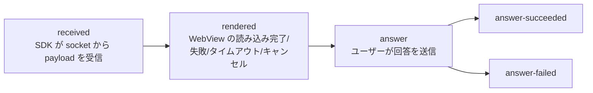
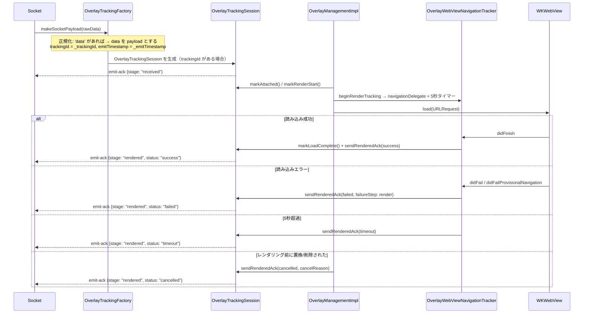
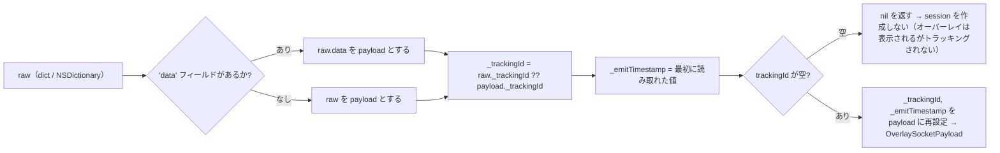

この仕組みは、運用側の疑問に答えるためのものです。*「サーバーが配信したオーバーレイは、実際にユーザーの端末に
届いているのか、レンダリングできているのか、ユーザーは回答しているのか？」* — これをクライアント自身が計測し、
socket イベント **`emit-ack`** でサーバーに送り返します。

> トラッキングのクラス群はすべて `Libraries/Overlay/Tracking/OverlayTracking.swift` にあります。アプリは**直接**
> 操作しません — SDK が自動的に計測し、開いている socket 経由で自動送信します。
>
> ⚠️ トラッキングは**LIVE モードでのみ**動作します。`showOverlayVod` は `beginRenderTracking` を呼ばず、
> VOD には emit 用の socket がありません。

---

## 1. 各ステージ（stage）



| Stage（`OverlayTrackingStage`） | 意味 | セッション終了？ |
|---|---|---|
| `received` | 有効な payload が SDK に入った | いいえ |
| `rendered` | `status` とともに表示結果を確定 | `status != success` の場合は終了 |
| `answer` | 回答の送信開始 | いいえ |
| `answer-succeeded` | API が `success == true` を返した | 終了 |
| `answer-failed` | API エラー/拒否/ネットワークエラー | 終了 |

`rendered` の `status`（`OverlayTrackingStatus`）: `success` | `failed` | `timeout` | `cancelled`。

各 stage はセッションごとに**一度だけ**送信されます（`emittedStages` は `Set`）。セッションが `finish()`
した後は、それ以降の `emitStage` はすべて無視されます。

---

## 2. サーバーへ送る payload の構造

```jsonc
// socket.emit("emit-ack", payload)
{
  "trackingId": "<オーバーレイ payload から取得した _trackingId>",
  "event": "overlay",
  "stage": "received | rendered | answer | answer-succeeded | answer-failed",
  "deviceId": "<identifierForVendor>",
  "clientContext": { /* 下記参照 */ }
}
```

### `clientContext` — 共通部分

| フィールド | 由来 |
|---|---|
| `profile` | `"overlay.legacyIframe"`（固定値、iOS には1つの profile しかない） |
| `transportMode` | `"legacyIframe"` |
| `sdkVersion` | `ApiConst.VERSION_SDK`（`"2025-05-25"`） |
| `platform` | `"ios"` |
| `os` | `UIDevice.systemName + " " + systemVersion`（例: `"iOS 17.5"`） |
| `deviceClass` | iPad の場合 `"tablet"`、それ以外は `"mobile"` |
| `viewportWidth`、`viewportHeight` | `UIScreen.main.bounds` |

### stage ごとの追加フィールド

| Stage | 追加フィールド |
|---|---|
| `received` | `emitTimestamp`、`receiveTimestamp`、`receiveLatencyMs`、`ackLatencyMs`、`timeline{received, ackSent}` |
| `rendered` | `status`、`receiveLatencyMs`、`renderLatencyMs`、`ackLatencyMs`、`timeline{attached, renderStart, loadComplete, readyReceived, ackSent}`、`duration?`、`overlayType?`、`failureReason?`、`failureStep?`、`custom.cancelReason?` |
| `answer*` | `actionType`（`answer_submit`）、`actionResult`（`attempted`/`success`/`failure`）、`actionLatencyMs`、`occurrenceId`（= `timelineId`）、`overlayType?`、`failureReason?`、`failureStep?`、`custom{…}`、`timeline` |

> Android 版との違い: iOS は**profile が1つだけ**（`overlay.legacyIframe`）で、**レンダリングタイムアウトは
> 固定5000ms**（`OverlayTrackingConstants.renderTimeoutMs = 5.0`）です。`ws=1` / `wsInteractive` の分岐はなく、
> timeline の `readyReceived` は常に `NSNull()` です（iOS は WebView の `didFinish` をもって `rendered` を確定し、
> テンプレートからの `LOADED_OVERLAY` 通知は待ちません）。

---

## 3. あるオーバーレイに対する計測フロー（Live）



`OverlayTrackingSession` はフラグ `renderedAckSent` を用いて、タイムアウトと `didFinish` がほぼ同時に発生しても
`rendered` が**一度だけ**発火することを保証します。

---

## 4. Payload の正規化（`OverlayTrackingFactory`）



このステップにより、SDK の残りの部分は「展開済み」の payload（`data`）を扱いつつ、トラッキング用の
メタデータ（`_trackingId`、`_emitTimestamp`）を保持できます。

session の生成経路は**2つ**あります。

1. `SocketIOManagementImpl.trackedOverlayPayload()` 内 — `overlay`/`ex-overlay` を受信した際に session を
   生成し、即座に `received` を送信。
2. `InteractiveControllerView.startShowLiveOverlayWithDataReceived()` 内の予備経路 — payload に session が
   付いていないが `OverlayLive.trackingId` が空でない場合、新しい session を生成し `received` を送信。

---

## 5. キャンセル理由（`cancelReason` / `failureReason`）

SDK が**意図的にオーバーレイを非表示にする/トラッキングを中止する**箇所の一覧です。「なぜオーバーレイが
表示されないのか」を調査する際に有用です。

| 値 | 発生箇所 | 原因 |
|---|---|---|
| `invalid_overlay_state` | `showOverlayLive` | `pos.alignment == nil` または `uiOvelay == nil` |
| `replaced_by_new_overlay` | `showOverlayLive` | 新しいオーバーレイが表示中のものを置き換えた |
| `recalled` | `recallOverlay` | サーバーが `timelineId` によりオーバーレイを取り消した |
| `remove_all_view` | `removeAllView` | すべての view をクリア（再参加/退出） |
| `interactive_hide` | `INTERACTIVE_HIDE_ANALYTICS` | Web がオーバーレイのクローズを通知 |
| `load_error` / `render` | Navigation delegate | WebView の読み込みエラー |
| `timeout` | 5秒タイマー | WebView が5秒以内に読み込み完了しなかった |
| `api_EX400` / `api_TL404` / `api_PM402` / `api_false` | API `/api/actions` | サーバーが回答を拒否 |
| `network_error`（`network`） | 回答時にネットワークがない | `Connectivity.isConnectedToInternet == false` |
| `unknown_response` | レスポンスをパースできない | API の body が不正な形式 |

---

## 6. 計測される遅延（latency）

`OverlayTrackingSession` はミリ秒単位のタイムスタンプ（`Date().timeIntervalSince1970 * 1000`）を使用します。

- `receiveLatencyMs = receiveTimestamp - emitTimestamp` — サーバー→クライアントのネットワーク遅延。
- `renderLatencyMs = loadComplete - receiveTimestamp` — WebView のレンダリング時間。
- `ackLatencyMs` — ack 送信の遅延。
- `actionLatencyMs = actionTimestamp - (readyReceived ?? loadComplete ?? renderStart ?? receive)` —
  レンダリングからユーザーの回答までの時間。

---

## 7. 統合アプリへの影響

- トラッキングは**権限を追加せず**、独自の API 呼び出しも行いません — 開いている socket をそのまま使用します。
- **VOD モードにはトラッキングがありません**。
- オーバーレイに `_trackingId` がない場合（サーバーが付与しなかった場合）、オーバーレイは通常どおり
  表示されますが、emit-ack は**発生しません**。
- アプリ側で特別な対応は不要です。これは運用/バックエンドチーム向けの観測ツールです。

---

[← API リファレンス](/ja/itr/ios/api_reference/) · [目次へ](/ja/itr/getting-started/overview/) · [次へ: よくあるエラー →](/ja/itr/ios/error/)
