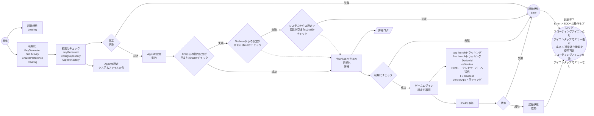
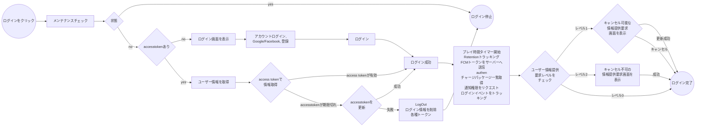
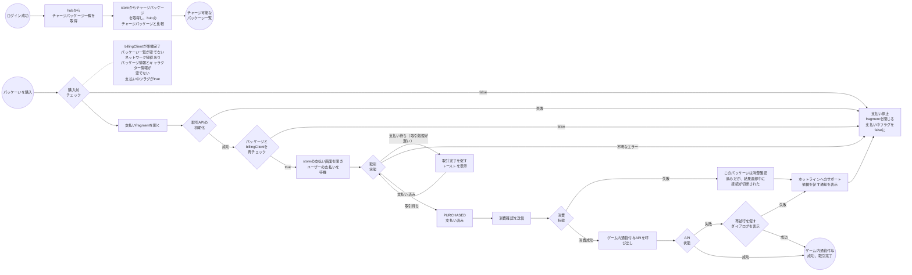
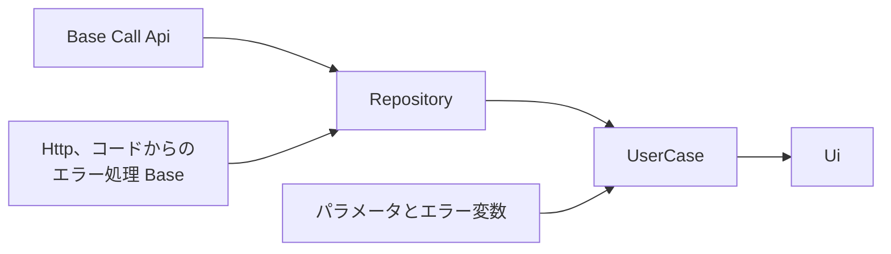
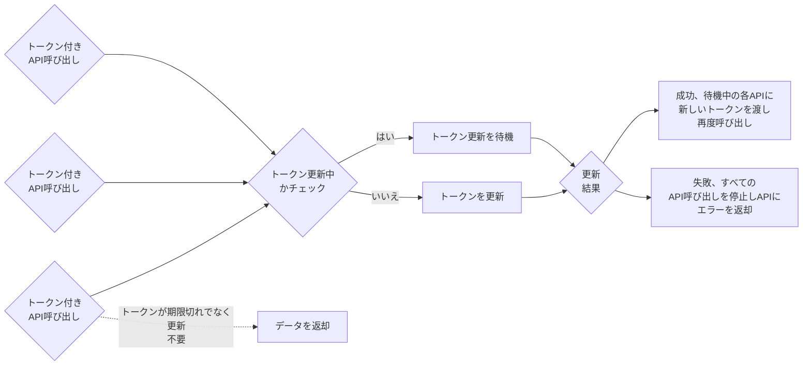
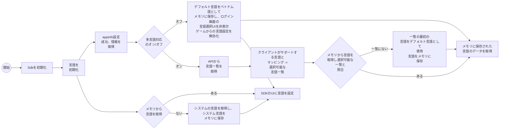
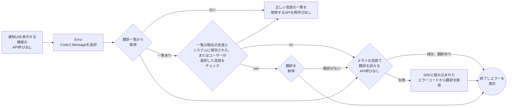
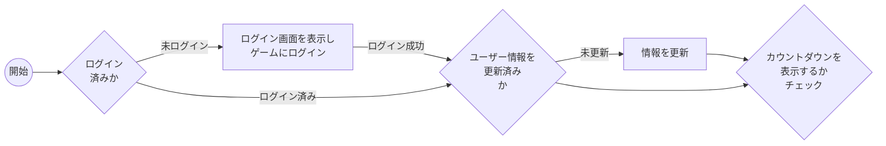

# I. 概要

VLiveSDKは、以下の主要な機能グループを提供します。

```markmap
# VLiveSDK
## OIDC v2
### Login
#### Vlive account
- username/password
#### SNS
- Facebook
- Google
- Apple
- Zalo
#### Quick login
#### VLive OpenID
### Logout
### Registration
### Forget password
### Profile
- user name
- birthday
- sex
- avatar
### Link user accounts
### Deactive account
## Floating button
- Drag/drop
- Show/hide
- Dimming (reduce opacity)
## Permission Manager
- Nomal permissions
- Runtime permissions
## Log Manager
- Intergration log
## Push notification
- Firebase Messaging
## Tracking
- Appflyer
- Facebook
- Firebase
## Payment
- other payment methods (Momo, Zalopay,...)
### In-App Purchase
- List Product
## Configuration
### Environment configs
- dev
- staging
- prod
### general configs
### UI configs
- enable
- disable
### configs tracking
- press 10 times on logo to show all configs
```

## 1. 使用ライブラリ

| ライブラリ | バージョン | 備考 |
| --- | --- | --- |
| retrofit2 | 2.9.0 | |
| billingclient | 8.0.0 | |
| play-services-base | 18.5.0 | |
| play-services-auth | 21.3.0 | |
| firebase-bom | 33.0.0 | |
| game-tracking | 1.0.5 | |
| app-update | 2.1.0 | |
| glide | 4.15.1 | |
| browser | 1.8.0 | |
| facebook-android-sdk | 17.0.0 | |
| af-android-sdk | 6.16.0 | |
| installreferrer | 2.2 | |
| play:review | 2.0.2 | |
| okhttp3:logging-interceptor | 4.11.0 | |
| recaptcha:recaptcha | 18.6.0 | |
| tiktok-business-android-sdk | 1.5.0 | |
| lifecycle-process | 2.3.1 | |
| browser | 1.8.0 | |

## 2. バージョンノート

| バージョン | コミットID | リリース日 | 変更履歴 |
| --- | --- | --- | --- |
| 1.0.10 | 4e39208430a7d7d59857cf66602fc4e445504ec1 | 11-May | 初回リリース |
| 1.0.11 | 5dfedc2c5b9e4c83898071c928c147d3add73266 | 13/11 | パラメータ付きトラッキングを追加 |
| 1.0.12 | ed667303992bfc75a906f89bc819535d98a0141c | 26/11 | デフォルト環境をprodに変更 |
| 1.1.0 | f06324243f69940a8165db8930b28f1e91c95e80 | 1111/12 | カウントダウン機能、ビルド前のバージョンチェック |
| 1.1.1 | afaccbcfeea2925aad3cc791d65e0f415c39260c | 23/12 | ゲーム側からsetされた場合の自動デフォルト言語切り替えを追加... |
| 1.2.0 | 01edfe4996597c5a0d0aa582e48234740ab0a828 | 24/12 | 受け取り情報の更新機能 |
| 1.2.1 | 2eb3a17e14ace99c395fafa4c9b984c0258bd7ce | 6/1 | vtvliveアカウントはカウントダウンを自動的にオフにする機能を追加 |
| 1.2.2 | 9836e819580880028532d537dca9f4e4f9aeb714 | 8/1 | ゲーム終了時のネットワークリスナー解除に伴うクラッシュを修正 |
| 1.2.3 | 66bd2071d8a803539d40cda09bac8504381c5338 | 9/1 | tracking sdkを1.0.6にアップグレード |
| 1.3.0 | | 12/1 | appflyerで設定する「今すぐプレイ」ボタンを追加 |
| 1.3.1 | | 5/2 | Googleログインが非表示になる不具合を修正 |
| 1.3.2 | | 6/2 | tracking sdkを1.0.8にアップグレードしクラッシュを修正 |
| 1.3.3 | | 9/4 | 登録画面からの戻る操作の不具合を修正 |
| 1.3.4 | | 10/4 | 画面回転時に低確率でクラッシュする問題あり |
| 1.3.5 | | 13/4 | フローと新しいトラッキングイベントを更新 |
| 1.3.8 | | 9.5 | 登録画面からの戻る操作の不具合を修正、新しいイベントを試験導入 |

# II. 機能詳細

Android Refactor Sdk Game

| 機能 | サブ機能 | 状態 | 備考 |
| --- | --- | --- | --- |
| 起動プロセスのチェック | 動的設定、初期設定、動的ドメインからのドメインを含むゲーム起動設定。設定が完了するまではログインできない。設定失敗時または設定中はエラーを表示 | 完了 | |
| 動的設定 | | 完了 | |
| ログイン時のauthen | | 完了 | |
| ゲームの初期設定 | | 完了 | |
| Google Playレビュー | | 完了 | |
| 支払い | | 完了 | |
| ログイン | Vliveアカウント | 完了 | |
| ^^ | Google | 完了 | |
| ^^ | Facebook | 完了 | |
| ^^ | ログインチェック | 完了 | |
| 登録 | | 完了 | |
| パスワードを忘れた場合 | | 完了 | |
| ログアウト | | 完了 | |
| レベルに応じた情報更新 | | 完了 | |
| フローティング | ドラッグ＆ドロップとクリック | 完了 | |
| ^^ | SDKの起動状態 | 完了 | |
| トラッキングイベント | ゲーム初回インストール | 完了 | |
| ^^ | ゲーム起動 | 完了 | |
| ^^ | ログイン成功後 | 完了 | |
| ^^ | ログイン、閉じる、登録、パスワードを忘れた場合、Google/Facebookログインの押下 | 完了 | |
| ^^ | プレイ時間 | 完了 | |
| ダッシュボード | プロフィール | 完了 | |
| ^^ | パスワード変更 | 完了 | |
| ^^ | メールアドレス変更 | 完了 | |
| ^^ | 生年月日変更 | 完了 | |
| ^^ | アカウント削除 | 完了 | |
| ^^ | ログアウト | 完了 | |
| 通知 | 通知受信 | 完了 | |
| ^^ | 非表示時の通知トラッキング | 完了 | |
| 開発者向け機能 | 必要に応じてprod環境で開発者向け機能を有効化。有効化には隠し操作が5つ必要 1. パスワード入力欄のパスワードアイコンを10回タップ 2. パスワードを記憶するチェックボックスを10回タップ 3. ポリシーのチェックボックスを10回タップ 4. パスワードを記憶するテキストを10回タップ 5. ユーザー名欄にvtvliveと入力し非表示ログイン 開発者向け機能が有効化された旨の通知 | 完了 | |
| Tiktokトラッキング | | 完了 | |
| 多言語対応 | | 完了 | |
| Vliveトラッキング | | 完了 | |
| イベントカウントダウン | | 完了 | |
| 動的フローティングボタンの表示 | | 完了 | |

# III. 検証とテスト

| 主要機能 | 機能比較 | 旧コードとの比較 | Android 13以上の実機 | Android 10〜12の実機 | Ldplayer 9エミュレータ |
| --- | --- | --- | --- | --- | --- |
| SDKの起動と設定 | 新規 | OK | OK | OK | OK |
| ログイン | 旧 | OK | OK | OK | OK |
| 登録 | 旧 | OK | OK | OK | OK |
| パスワードを忘れた場合 | 旧 | OK | OK | OK | OK |
| パスワード変更 | 旧 | OK | OK | OK | OK |
| メールアドレス変更 | 旧 | OK | OK | OK | OK |
| 生年月日変更 | 旧 | OK | OK | OK | OK |
| アカウント削除 | 旧 | OK | OK | OK | OK |
| ログアウト | 旧 | OK | OK | OK | OK |
| 支払い | 旧 | OK | OK | OK | OK |
| アカウント切り替え | 旧 | OK | OK | OK | OK |
| 通知トラッキング | 新規 | OK | OK | OK | OK |
| 開発者向け機能 | 新規 | OK | OK | OK | OK |
| Tiktokトラッキング | 旧 | OK | OK | OK | OK |
| Vliveトラッキング | 新規 | OK | OK | OK | OK |

# IV. フロー図

1. 起動と設定



詳細ログ（依存クラスの初期化）:


2. ログイン



C. 支払い



D. APIの構造



E. トークン付きAPIコールの構造



F. 多言語対応





G. ゲーム開始のカウントダウン通知表示


