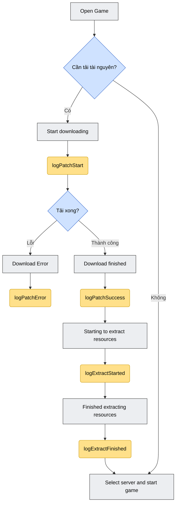
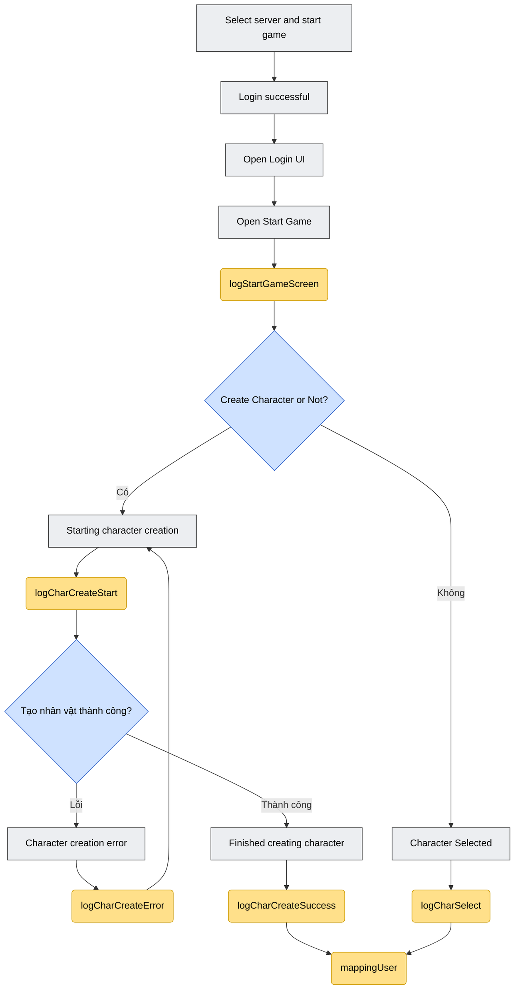
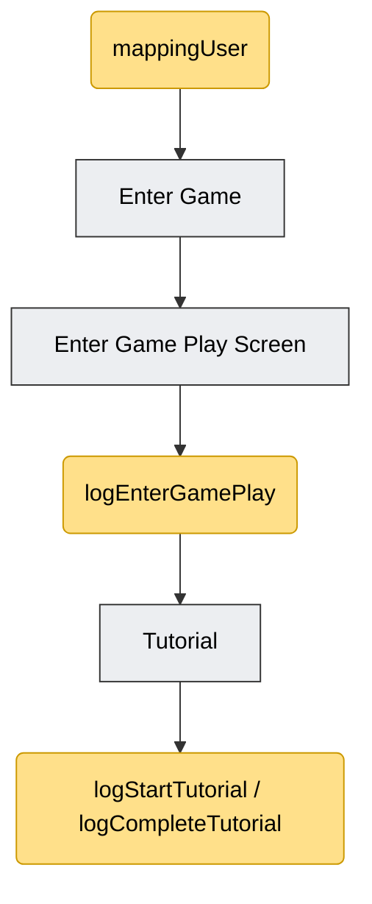

## 1. イベント147の更新

ログイン成功直後に「Event Profile」（イベント情報）画面をチェックして表示するために使用します。

`SdkDelegate`の`loginSuccess`コールバック内で、ゲーム画面に入る前にすぐに呼び出すことを推奨します。

```objectivec
[[Sdk sharedInstance] showOrHide147];
```

すべてのトラッキング関数はsingleton経由で呼び出されます。

```objectivec
[[SdkTracking sharedInstance] ...];
```

必要なframework: `ISdkTrackier.xcframework`（SDK統合に必要なドキュメント一覧に既に含まれています）。

## 2. Mapping User

現在のキャラクター/サーバー情報をトラッキングシステムに紐付けるために使用します。プレイヤーがサーバーまたはキャラクターを選択した直後、そのキャラクターに関連する他のログ関数を呼び出す前に呼び出すことを推奨します。

```objectivec
-(void) mappingUser:(NSString*)characterName
characterId:(NSString*)characterId
characterLevel:(NSString*)characterLevel
serverName:(NSString*)serverName
serverId:(NSString*)serverId;
```

パラメータ:

| パラメータ | 意味 |
|---|---|
| characterName | キャラクター名 |
| characterId | キャラクターId |
| characterLevel | キャラクターレベル |
| serverName | サーバー名 |
| serverId | サーバーId |

例:

```objectivec
[[SdkTracking sharedInstance] mappingUser:@"name"
characterId:@1
characterLevel:@1
serverName:@"test"
serverId:@"1"];
```

## 3. Log Function

ログ関数は、ゲームを開く → リソースのダウンロード/解凍 → ログイン/サーバー選択 → キャラクター作成または選択 → ゲームに入る → チュートリアル、というユーザーの動線を追跡するために使用します。

元のflowchartに基づく注記:

- **灰色**: Game内で発生するステップ。
- **黄色**: GameがSDKを呼び出すステップ（つまり以下のログ関数）。

概要宣言（パラメータなし）:

```objectivec
-(void) logStartGameScreen;
-(void) logEnterGamePlay;
-(void) logStartTutorial;
-(void) logCompleteTutorial;
```

### 3.1. logStartGameScreen

「Open Start Game」画面（ゲームに入る前の開始画面）が開かれた際に呼び出します。

```objectivec
[[SdkTracking sharedInstance] logStartGameScreen];
```

### 3.2. logEnterGamePlay

「Vào Game」/「Enter Game」ボタンを押した後、ユーザーがゲームプレイ画面（Game Play Screen）に入ったことをトラッキングします。

```objectivec
[[SdkTracking sharedInstance] logEnterGamePlay];
```

「Vào Game」ボタンの押下イベントを処理する箇所で、ゲームプレイ画面へ遷移する前に呼び出してください。

### 3.3. リソースのダウンロード (Resource download)

#### リソースのダウンロード開始

```objectivec
// Bắt đầu tải tài nguyên
-(void) logPatchStart:(NSNumber *_Nullable)sizeMB
withVerrsion:(NSString *_Nullable)version
withNetworkType:(NSString *_Nullable)networkType;
```

| パラメータ | 意味 |
|---|---|
| sizeMB | 更新が必要なpatchファイルの容量（Mb単位で表示） |
| version | インストールパッケージのversion |
| networkType | ネットワークの種類（例: `"wifi"`） |

```objectivec
[[SdkTracking sharedInstance] logPatchStart:@"500"
withVerrsion:@"1.0.1"
withNetworkType:@"wifi"];
```

#### リソースのダウンロード成功

```objectivec
-(void) logPatchSuccess:(NSNumber *_Nullable)durationSec
withAvgSpeedKbps:(NSNumber *_Nullable)avgSpeedKbps
withCdnNode:(NSString *_Nullable)cdnNode;
```

| パラメータ | 意味 |
|---|---|
| durationSec | ダウンロード開始からダウンロード完了までの時間 |
| avgSpeedKbps | 平均ダウンロード速度（`update_type`がStoreの場合に取得できるか追加で確認してください） |
| cdnNode | ダウンロードに使用したCDNノード |

```objectivec
[[SdkTracking sharedInstance] logPatchSuccess:@"500"
withAvgSpeedKbps:@"450"
withCdnNode:@"192.168.0.2"];
```

> **注意:** ドキュメント原文の例では`avgSpeedKbps`パラメータが重複していました（原文の誤記）。上記は関数のシグネチャに合わせて重複部分を削除しています。

#### リソースのダウンロード失敗

```objectivec
// Khi việc tải tài nguyên bị gián đoạn hoặc thất bại
-(void) logPatchError:(NSString *_Nullable)errorCode
withRetryCount:(NSNumber *_Nullable)retryCount
withFailedUrl:(NSString *_Nullable)failedUrl
withCdnNode:(NSString *_Nullable)cdnNode;
```

| パラメータ | 意味 |
|---|---|
| errorCode | エラーコード |
| retryCount | エラーによるリトライ回数 |
| failedUrl | エラーが発生したURL |
| cdnNode | エラーが発生したCDNノード |

```objectivec
[[SdkTracking sharedInstance] logPatchError:@"500"
withRetryCount:@1
withFailedUrl:@"https://cdn.game.com/patch/v120.zip"
withCdnNode:@"192.168.0.2"];
```

### 3.4. リソースの解凍 (Resource extraction)

#### 解凍開始

ダウンロード完了直後に、解凍/インストールを開始します。

```objectivec
-(void) logExtractStarted:(NSString *_Nullable)totalSizeMb
withTotalSize:(NSString *_Nullable)totalSize;
```

| パラメータ | 意味 |
|---|---|
| totalSizeMb | 解凍後の容量（Mb単位） |
| totalSize | 解凍が必要なpatch内のファイル数（取得できない場合はスキップ） |

```objectivec
[[SdkTracking sharedInstance] logExtractStarted:@"500"
withTotalSize:@"400"];
```

#### 解凍完了

解凍が完了したら、Login画面に入る準備が整います。

```objectivec
-(void) logExtractFinished:(NSNumber *_Nullable)durationSec
withResultCode:(NSString *_Nullable)resultCode;
```

| パラメータ | 意味 |
|---|---|
| durationSec | 解凍開始から成功までの時間 |
| resultCode | 結果コード（`0`/`"ok"`: OK、`1`: Disk Full） |

```objectivec
[[SdkTracking sharedInstance] logExtractFinished:@100
withResultCode:@"ok"];
```

### 3.5. キャラクター作成 (Character creation)

#### キャラクター作成開始

```objectivec
-(void) logCharCreateStart:(NSString *_Nullable)serverId;
```

| パラメータ | 意味 |
|---|---|
| serverId | サーバーId |

```objectivec
[[SdkTracking sharedInstance] logCharCreateStart:@"100"];
```

> **注意:** 作成開始からキャラクター作成完了までの時間を計測するためにtimerを使用する必要があります（`durationSec`は`logCharCreateSuccess`で使用）。

#### キャラクター作成成功

```objectivec
-(void) logCharCreateSuccess:(NSString *_Nullable)serverId
withCharId:(NSString *_Nullable)charId
withCharName:(NSString *_Nullable)charName
withCharClass:(NSString *_Nullable)charClass
withDurationSec:(NSNumber *_Nullable)durationSec;
```

| パラメータ | 意味 |
|---|---|
| serverId | サーバーId |
| charId | キャラクターId |
| charName | キャラクター名 |
| charClass | キャラクターのclass/クラスId |
| durationSec | キャラクター作成開始から成功までの時間 |

```objectivec
[[SdkTracking sharedInstance] logCharCreateSuccess:@"100"
withCharId:@"1001"
withCharName:@"test"
withCharClass:@"1"
withDurationSec:@5];
```

> **注意:** ドキュメント原文の例では、`logPatchStart`のパラメータ（`withVerrsion`、`withNetworkType`）が誤ってコピーされており、`logCharCreateSuccess`のシグネチャと一致していませんでした。上記の例は関数の実際のパラメータに従って書き直しています。正確な内容を確認したい場合はSDKチーム（VTVLive）にご確認ください。

#### キャラクター作成失敗

```objectivec
-(void) logCharCreateError:(NSString *_Nullable)errorCode
withCharName:(NSString *_Nullable)charName
withServerId:(NSString *_Nullable)serverId;
```

| パラメータ | 意味 |
|---|---|
| errorCode | エラーコード（例: `"NAME_DUPLICATED"`） |
| charName | キャラクター名 |
| serverId | サーバーId |

```objectivec
[[SdkTracking sharedInstance] logCharCreateError:@"NAME_DUPLICATED"
withCharName:@"test"
withServerId:@"1"];
```

### 3.6. キャラクター選択 (Character select)

サーバー選択/キャラクター選択が完了したら、この関数を呼び出します。

```objectivec
-(void) logCharSelect:(NSString *_Nullable)charId
withCharacterName:(NSString *_Nonnull)characterName
withCharLevel:(NSString *_Nullable)charLevel;
```

| パラメータ | 意味 |
|---|---|
| charId | キャラクターId |
| characterName | キャラクター名 |
| charLevel | キャラクターレベル |

```objectivec
[[SdkTracking sharedInstance] logCharSelect:@"1"
withCharacterName:@"name"
withCharLevel:@"1"];
```

### 3.7. Tutorial

パラメータなしの2つの宣言関数（ゲーム内のチュートリアル開始/完了をトラッキングするために使用）:

```objectivec
[[SdkTracking sharedInstance] logStartTutorial];
[[SdkTracking sharedInstance] logCompleteTutorial];
```

## 4. トラッキングの流れ図 (Flowchart)

`SdkTracking`の関数呼び出し全体のフローを、ドキュメント原文のflowchartに沿って再構成し、ゲームの流れに応じて3つのパートに分けています。

色の凡例:

- **灰色のボックス**: Game内で発生するステップ。
- **青色のボックス（ひし形）**: 分岐/判定ポイント。
- **黄色のボックス**: GameがSDKを呼び出すポイント（`SdkTracking`の関数）。

### 4.1. リソースのダウンロード＆解凍



*図1 — リソースのダウンロードと解凍の流れ*

### 4.2. ログイン、キャラクター作成/選択



*図2 — ログイン、キャラクター作成または選択の流れ*

### 4.3. ゲームに入る & チュートリアル



*図3 — ゲームに入る流れとチュートリアル*

> **注意:** この図はドキュメント原文のflowchartにある正しい関数名/手順の順序に基づいて、わかりやすく再構成したものです。原文の図に含まれる一部のパラメータ例値（上記3.3および3.5で述べたように、シグネチャと一致しない箇所がある）はそのままコピーしていません。

## 5. ゲームの流れに沿った呼び出し順序のまとめ

1. ゲームを開く → 更新のダウンロードが必要？ → `logPatchStart` → ダウンロード完了: `logPatchSuccess`、またはエラー: `logPatchError`
2. 解凍開始: `logExtractStarted` → 解凍完了: `logExtractFinished`
3. 開始画面を開く: `logStartGameScreen`
4. ログイン/サーバー選択成功
5. 新規キャラクター作成: `logCharCreateStart` → 成功: `logCharCreateSuccess`/失敗: `logCharCreateError`（または）既存キャラクターの選択: `logCharSelect`
6. キャラクター情報をトラッキングに紐付け: `mappingUser`
7. 「Vào Game」を押す: `logEnterGamePlay`
8. プレイガイドの流れの中で: `logStartTutorial`/`logCompleteTutorial`
