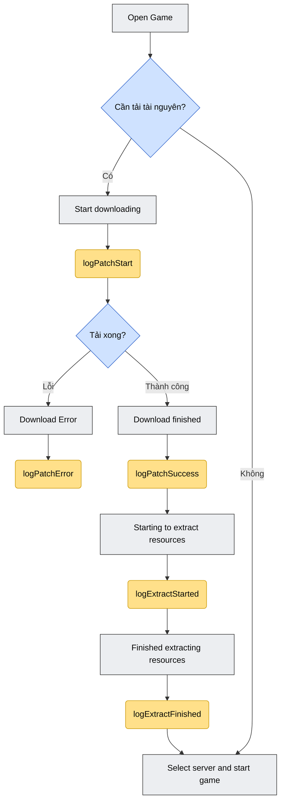
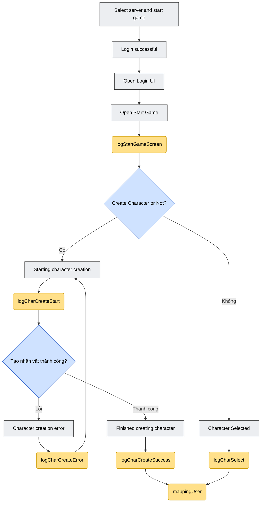
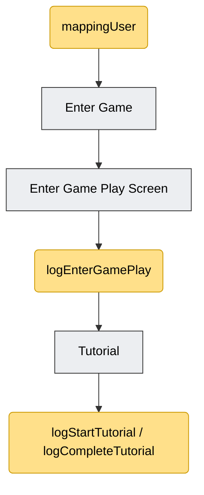

## 1. Nghị định（政令）147 イベントのアップデート

ログイン成功直後に「Event Profile」（イベント情報）画面を表示すべきかチェックし、表示するために使用します。

`SdkDelegate` の `loginSuccess` コールバック内で、ゲーム画面に入る前に呼び出すことを推奨します。

```objectivec
[[Sdk sharedInstance] showOrHide147];
```

すべてのトラッキング関数はシングルトン経由で呼び出します。

```objectivec
[[SdkTracking sharedInstance] ...];
```

必要なフレームワーク: `ISdkTrackier.xcframework`（SDK 統合に必要なドキュメント一覧に既に含まれています）。

## 2. Mapping User

現在のキャラクター/サーバー情報をトラッキングシステムに紐付けるために使用します。プレイヤーがサーバーまたはキャラクターを選択した直後、かつそのキャラクターに関連する他のログ関数を呼び出す前に呼び出すことを推奨します。

```objectivec
-(void) mappingUser:(NSString*)characterName
characterId:(NSString*)characterId
characterLevel:(NSString*)characterLevel
serverName:(NSString*)serverName
serverId:(NSString*)serverId;
```

パラメータ:

| パラメータ | 意味 |
|---|---|
| characterName | キャラクター名 |
| characterId | キャラクター Id |
| characterLevel | キャラクターレベル |
| serverName | サーバー名 |
| serverId | サーバー Id |

例:

```objectivec
[[SdkTracking sharedInstance] mappingUser:@"name"
characterId:@1
characterLevel:@1
serverName:@"test"
serverId:@"1"];
```

## 3. Log Function

以下のログ関数は、ユーザーの行動フロー（ゲームを開く → リソースのダウンロード/解凍 → ログイン/サーバー選択 → キャラクター作成または選択 → ゲームに入る → チュートリアル）を追跡するために使用します。

元のフローチャートに基づく注記:

- **グレー**: ゲーム内で発生するステップ。
- **黄色**: ゲームが SDK を呼び出すステップ（以下のログ関数がこれに該当）。

概要の宣言（パラメータなし）:

```objectivec
-(void) logStartGameScreen;
-(void) logEnterGamePlay;
-(void) logStartTutorial;
-(void) logCompleteTutorial;
```

### 3.1. logStartGameScreen

「Open Start Game」画面（ゲームに入る前の開始画面）が開かれたときに呼び出します。

```objectivec
[[SdkTracking sharedInstance] logStartGameScreen];
```

### 3.2. logEnterGamePlay

「ゲームに入る」/「Enter Game」ボタンを押した後、ユーザーがゲームプレイ画面（Game Play Screen）に入ったことをトラッキングします。

```objectivec
[[SdkTracking sharedInstance] logEnterGamePlay];
```

「ゲームに入る」ボタンの押下イベントを処理する箇所で、ゲームプレイ画面に切り替わる前に呼び出してください。

### 3.3. リソースのダウンロード（Resource download）

#### リソースのダウンロード開始

```objectivec
// リソースのダウンロード開始
-(void) logPatchStart:(NSNumber *_Nullable)sizeMB
withVerrsion:(NSString *_Nullable)version
withNetworkType:(NSString *_Nullable)networkType;
```

| パラメータ | 意味 |
|---|---|
| sizeMB | アップデートが必要なパッチファイルの容量（Mb 表示） |
| version | インストールパッケージのバージョン |
| networkType | ネットワークの種類（例: `"wifi"`） |

```objectivec
[[SdkTracking sharedInstance] logPatchStart:@"500"
withVerrsion:@"1.0.1"
withNetworkType:@"wifi"];
```

#### リソースのダウンロード成功

```objectivec
-(void) logPatchSuccess:(NSNumber *_Nullable)durationSec
withAvgSpeedKbps:(NSNumber *_Nullable)avgSpeedKbps
withCdnNode:(NSString *_Nullable)cdnNode;
```

| パラメータ | 意味 |
|---|---|
| durationSec | ダウンロード開始からダウンロード完了までの時間 |
| avgSpeedKbps | 平均ダウンロード速度（`update_type` が Store の場合に取得できるか別途確認） |
| cdnNode | ダウンロードに使用した CDN ノード |

```objectivec
[[SdkTracking sharedInstance] logPatchSuccess:@"500"
withAvgSpeedKbps:@"450"
withCdnNode:@"192.168.0.2"];
```

> **注:** 元のドキュメントのサンプルには `avgSpeedKbps` パラメータの重複（元ドキュメントのタイプミス）がありましたが、上記は関数のシグネチャに合わせて重複部分を削除しています。

#### リソースのダウンロード失敗

```objectivec
// リソースのダウンロードが中断または失敗した場合
-(void) logPatchError:(NSString *_Nullable)errorCode
withRetryCount:(NSNumber *_Nullable)retryCount
withFailedUrl:(NSString *_Nullable)failedUrl
withCdnNode:(NSString *_Nullable)cdnNode;
```

| パラメータ | 意味 |
|---|---|
| errorCode | エラーコード |
| retryCount | エラーによるリトライ回数 |
| failedUrl | 失敗した URL |
| cdnNode | エラーが発生した CDN ノード |

```objectivec
[[SdkTracking sharedInstance] logPatchError:@"500"
withRetryCount:@1
withFailedUrl:@"https://cdn.game.com/patch/v120.zip"
withCdnNode:@"192.168.0.2"];
```

### 3.4. リソースの解凍（Resource extraction）

#### 解凍開始

ダウンロード完了直後、解凍/インストールを開始します。

```objectivec
-(void) logExtractStarted:(NSString *_Nullable)totalSizeMb
withTotalSize:(NSString *_Nullable)totalSize;
```

| パラメータ | 意味 |
|---|---|
| totalSizeMb | 解凍後の容量（Mb 表示） |
| totalSize | パッチ内で解凍が必要なファイル数（取得できない場合は省略） |

```objectivec
[[SdkTracking sharedInstance] logExtractStarted:@"500"
withTotalSize:@"400"];
```

#### 解凍完了

解凍が完了し、ログイン画面に入る準備ができたとき。

```objectivec
-(void) logExtractFinished:(NSNumber *_Nullable)durationSec
withResultCode:(NSString *_Nullable)resultCode;
```

| パラメータ | 意味 |
|---|---|
| durationSec | 解凍開始から成功までの時間 |
| resultCode | 結果コード（`0`/`"ok"`: OK、`1`: Disk Full） |

```objectivec
[[SdkTracking sharedInstance] logExtractFinished:@100
withResultCode:@"ok"];
```

### 3.5. キャラクター作成（Character creation）

#### キャラクター作成開始

```objectivec
-(void) logCharCreateStart:(NSString *_Nullable)serverId;
```

| パラメータ | 意味 |
|---|---|
| serverId | サーバー Id |

```objectivec
[[SdkTracking sharedInstance] logCharCreateStart:@"100"];
```

> **注:** 作成開始からキャラクター作成完了までの時間を計測するために、タイマーを使用する必要があります（`durationSec` は `logCharCreateSuccess` で使用します）。

#### キャラクター作成成功

```objectivec
-(void) logCharCreateSuccess:(NSString *_Nullable)serverId
withCharId:(NSString *_Nullable)charId
withCharName:(NSString *_Nullable)charName
withCharClass:(NSString *_Nullable)charClass
withDurationSec:(NSNumber *_Nullable)durationSec;
```

| パラメータ | 意味 |
|---|---|
| serverId | サーバー Id |
| charId | キャラクター Id |
| charName | キャラクター名 |
| charClass | キャラクターのクラス Id |
| durationSec | 作成開始から作成成功までの時間 |

```objectivec
[[SdkTracking sharedInstance] logCharCreateSuccess:@"100"
withCharId:@"1001"
withCharName:@"test"
withCharClass:@"1"
withDurationSec:@5];
```

> **注:** 元のドキュメントのサンプルは `logPatchStart` のパラメータ（`withVerrsion`、`withNetworkType`）を誤ってコピーしたもので、`logCharCreateSuccess` のシグネチャと一致していませんでした。上記の例は関数の実際のパラメータに合わせて書き直しています。100% 正確に照合が必要な場合は SDK チーム（VTVLive）に再確認してください。

#### キャラクター作成失敗

```objectivec
-(void) logCharCreateError:(NSString *_Nullable)errorCode
withCharName:(NSString *_Nullable)charName
withServerId:(NSString *_Nullable)serverId;
```

| パラメータ | 意味 |
|---|---|
| errorCode | エラーコード（例: `"NAME_DUPLICATED"`） |
| charName | キャラクター名 |
| serverId | サーバー Id |

```objectivec
[[SdkTracking sharedInstance] logCharCreateError:@"NAME_DUPLICATED"
withCharName:@"test"
withServerId:@"1"];
```

### 3.6. キャラクター選択（Character select）

サーバー/キャラクターの選択が完了したら、以下の関数を呼び出してください。

```objectivec
-(void) logCharSelect:(NSString *_Nullable)charId
withCharacterName:(NSString *_Nonnull)characterName
withCharLevel:(NSString *_Nullable)charLevel;
```

| パラメータ | 意味 |
|---|---|
| charId | キャラクター Id |
| characterName | キャラクター名 |
| charLevel | キャラクターレベル |

```objectivec
[[SdkTracking sharedInstance] logCharSelect:@"1"
withCharacterName:@"name"
withCharLevel:@"1"];
```

### 3.7. チュートリアル

パラメータなしの 2 つの宣言（ゲーム内のチュートリアル開始/完了をトラッキングするために使用）:

```objectivec
[[SdkTracking sharedInstance] logStartTutorial];
[[SdkTracking sharedInstance] logCompleteTutorial];
```

## 4. トラッキングの図（Flowchart）

`SdkTracking` の各関数呼び出しの流れ全体を、ドキュメント原本のフローチャートに沿って描き直したもので、ゲームの進行順序に従って 3 つのパートに分かれています。

色の凡例:

- **グレーのボックス**: ゲーム内で発生するステップ。
- **青のボックス（ひし形）**: 分岐/判断ポイント。
- **黄色のボックス**: ゲームが SDK を呼び出すポイント（`SdkTracking` の各関数）。

### 4.1. リソースのダウンロード＆解凍



*図 1 — リソースのダウンロードと解凍の流れ*

### 4.2. ログイン、キャラクターの作成/選択



*図 2 — ログイン、キャラクター作成または選択の流れ*

### 4.3. ゲームに入る & チュートリアル



*図 3 — ゲームに入る流れとチュートリアル*

> **注:** この図は、ドキュメント原本のフローチャートにある正しい関数名/手順の順序に基づいて、わかりやすく描き直したものです。元の図にある小さなサンプル値（3.3 節と 3.5 節で述べたように、シグネチャと一致しない箇所がいくつかありました）はそのままコピーしていません。

## 5. ゲームの流れに沿った呼び出し順序のまとめ

1. ゲームを開く → アップデートのダウンロードが必要？ → `logPatchStart` → ダウンロード完了: `logPatchSuccess`、またはエラー: `logPatchError`
2. 解凍開始: `logExtractStarted` → 解凍完了: `logExtractFinished`
3. 開始画面を開く: `logStartGameScreen`
4. ログイン/サーバー選択の成功
5. 新規キャラクター作成: `logCharCreateStart` → 成功: `logCharCreateSuccess`/失敗: `logCharCreateError`（または）既存キャラクターの選択: `logCharSelect`
6. キャラクター情報をトラッキングに紐付け: `mappingUser`
7. 「ゲームに入る」を押す: `logEnterGamePlay`
8. チュートリアルの流れ中: `logStartTutorial`/`logCompleteTutorial`
