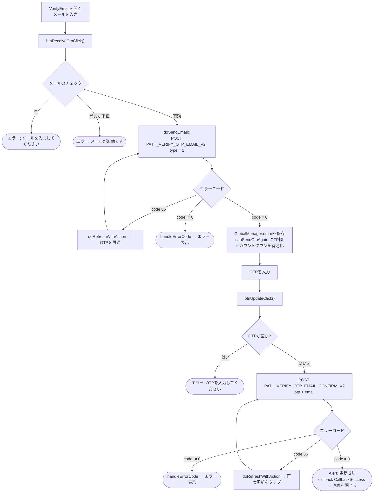
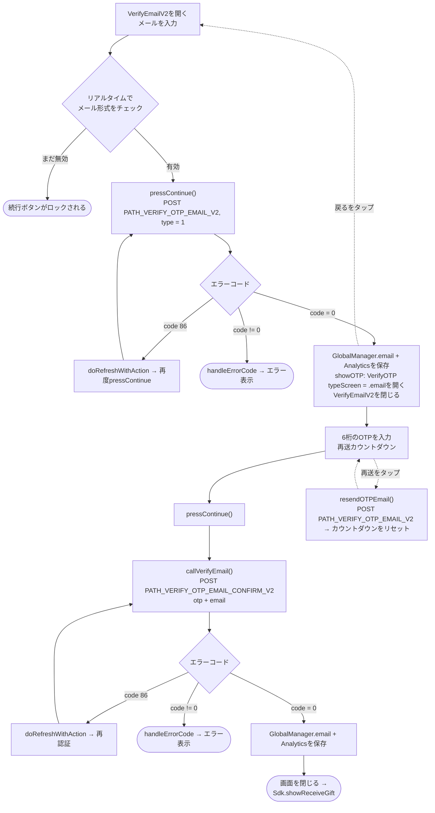

本ドキュメントは、実際のコードから作成したSDKのメール更新／認証フローについて説明します。
電話番号フローと同様に、projectには**2つのバリエーション**の画面があります。

- **方法1 – `VerifyEmail`**（メール入力とOTP入力を1つにまとめた画面。タイトルは *「メールの更新」*）。`callback(CallbackSuccess)` で終了します。
- **方法2 – `VerifyEmailV2` → `VerifyOTP`**（新版、2画面に分割。タイトルは *「メールの追加」*、ギフト受け取りフロー `showReceiveGift` に紐づきます）。

両方とも共通で2つのendpointを使用します: `PATH_VERIFY_OTP_EMAIL_V2`（OTP送信、`type = 1`）と
`PATH_VERIFY_OTP_EMAIL_CONFIRM_V2`（OTP認証）。すべてのrequestにBearer accessTokenが付与されます。

## 方法1 – `VerifyEmail` 画面

### 説明 – 方法1

1. **メール入力とOTP送信** – `btnReceiveOtpClick()` がメールが空でないこと、正しい
   形式（email regex）であることを確認し、その後 `doSendEmail()` が `PATH_VERIFY_OTP_EMAIL_V2`（`type = 1`）を呼び出します。
   - `code = 0`: `GlobalManager.shared.email` を保存し、OTP入力欄を有効にして再送カウントダウンを開始します。
   - `code = 86`（token期限切れ）: `doRefreshWithAction` がtokenを更新してから自動的に再送します。
   - その他のエラー: `handleErrorCode`。
2. **OTP入力と確認** – `btnUpdateClick()` がOTPが空でないことを確認し、
   `PATH_VERIFY_OTP_EMAIL_CONFIRM_V2`（`otp`、`email`）を呼び出します。
   - `code = 0`: 「更新成功」のalertを表示し、`callback(CallbackSuccess)` を発行してから画面を閉じます。
   - `code = 86`: tokenをrefreshしてから再試行します。
   - その他のエラー: `handleErrorCode`。
3. **OTPの再送** – カウントダウンが0になると、「コード送信」ボタンが再度有効になり `PATH_VERIFY_OTP_EMAIL_V2` を再度呼び出せます。

## 方法2 – `VerifyEmailV2` → `VerifyOTP`

### 説明 – 方法2

1. **`VerifyEmailV2`** – メール入力欄はリアルタイムでチェックされ、有効なら
   「続行」ボタンが有効になります。`pressContinue()` が `PATH_VERIFY_OTP_EMAIL_V2`（`type = 1`）を呼び出します。
   - `code = 0`: `GlobalManager.shared.email` + Analyticsを保存し、`showOTP()` が
     `VerifyOTP` 画面（`typeScreen = .email`、`email`、`serverId`、`characterId` を渡す）を開き、
     現在の画面を閉じます。
   - `code = 86`: tokenをrefreshしてから再度呼び出します。
   - その他のエラー: `handleErrorCode`。
2. **`VerifyOTP`** – 6桁のOTPを入力し、マスクされたメール（`maskedEmailFrom`）と
   「再送」用のカウントダウンを表示します。`pressContinue()` → `callVerifyEmail()` が
   `PATH_VERIFY_OTP_EMAIL_CONFIRM_V2`（`otp`、`email`）を呼び出します。
   - `code = 0`: `GlobalManager.shared.email` を保存し、Analyticsを記録し、画面を閉じて
     `Sdk.showReceiveGift()` を呼び出します。
   - `code = 86`: tokenをrefreshしてから再試行します。
   - その他のエラー: `handleErrorCode`。
   - **OTPの再送**: `resendOTPEmail()` が `PATH_VERIFY_OTP_EMAIL_V2` を再度呼び出し、カウントダウンを再開します。
   - **戻る**: `VerifyEmailV2` 画面に戻ります。

## 使用するendpoint

- `PATH_VERIFY_OTP_EMAIL_V2` – メールへOTPを送信（POST、`type = 1`）
- `PATH_VERIFY_OTP_EMAIL_CONFIRM_V2` – OTPを認証してメールを更新（POST）

## 備考

- パラメータ `type = 1` は *Verify Mail* を意味します（電話番号フローの `type = 0` とは異なります）。
- すべてのrequestに `accessToken`（Bearer）が付与されます。`code = 86`（token期限切れ）が発生した場合、
  SDKは自動的に `doRefreshWithAction` でtokenを更新してから、中断していた操作を繰り返します。
- 更新成功時は必ず `GlobalManager.shared.email` に記録し、
  `Analytics.initiateOnDeviceConversionMeasurement(emailAddress:)` を呼び出します。
- 終了時の違い: 方法1は画面を開いた側に対して `callback(CallbackSuccess)` を発行します。
  方法2は `Sdk.showReceiveGift()` に処理を継続します。
- SĐT（電話番号）フローとのendpointの違い: メールは `PATH_VERIFY_OTP_EMAIL_V2`
  （送信/再送）と `PATH_VERIFY_OTP_EMAIL_CONFIRM_V2`（認証）のペアを使用します。一方、電話番号は
  `PATH_OTP_PHONE_V2` と `PATH_VERIFY_OTP_PHONE_V2` を使用します。

