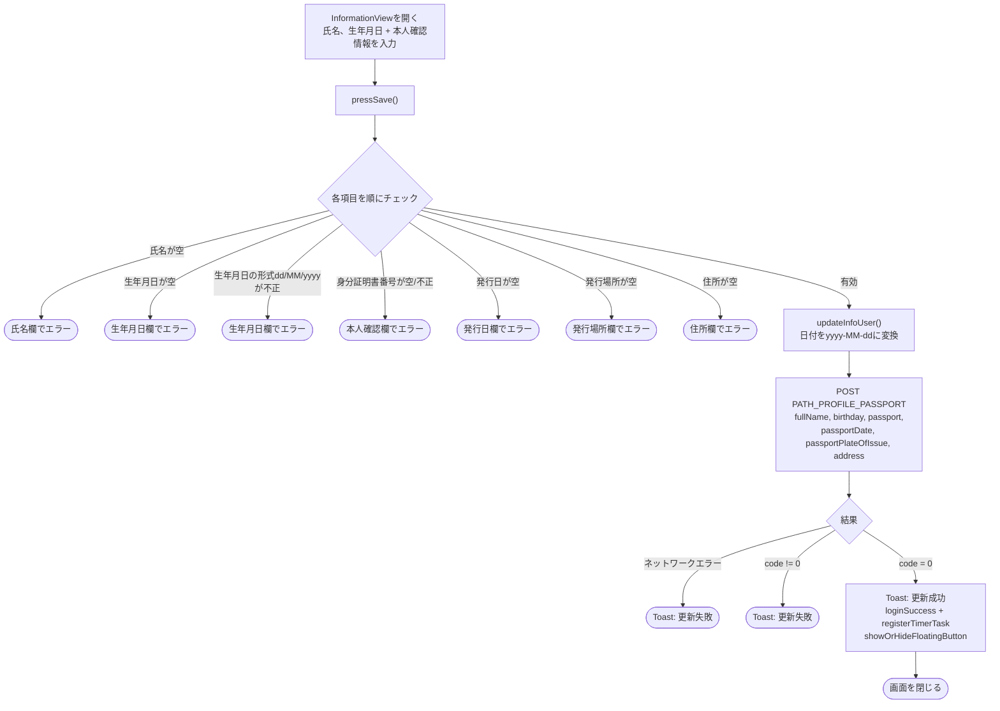
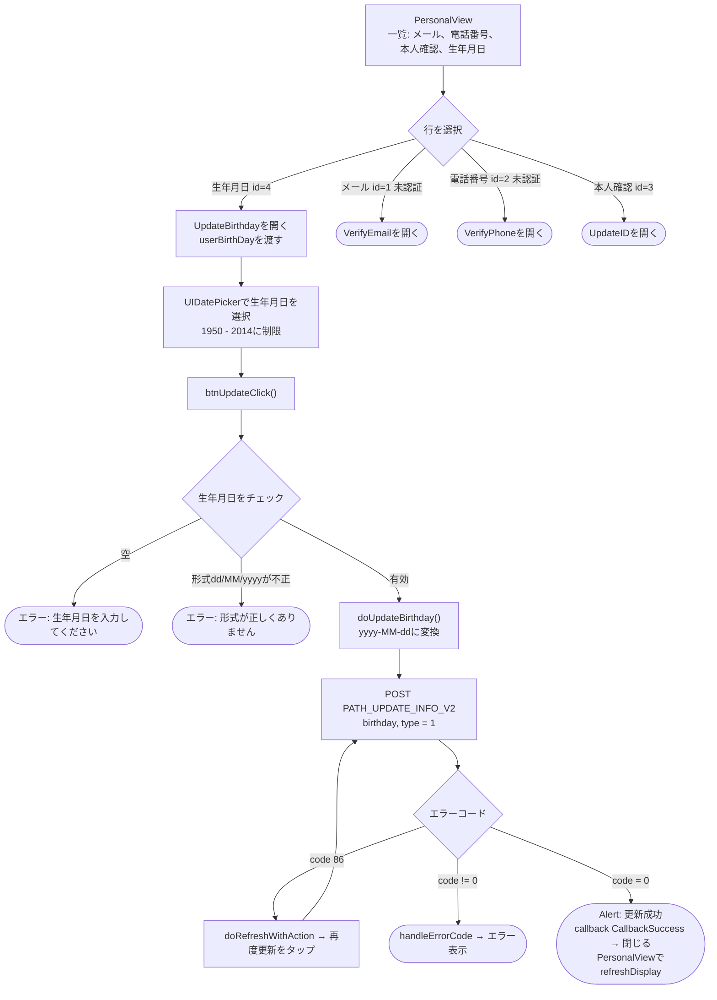

本ドキュメントは、実際のコードから作成したSDKの氏名・生年月日更新フローについて説明します。
projectには関連する**2つの画面**があります。

- **`InformationView`** – **氏名 + 生年月日**を同時に更新（本人確認情報: 身分証明書番号、
  発行日、発行場所、住所を含む）します。endpointは `PATH_PROFILE_PASSPORT` です。
  これはアカウント情報／本人確認を完了させる画面です（`requireSecurityLevel`）。
- **`UpdateBirthday`** – **生年月日のみ**を更新します。endpointは `PATH_UPDATE_INFO_V2` です。
  個人情報画面 `PersonalView` から開かれます（氏名を個別に編集する欄はここにはなく、
  氏名はタイトルとしてのみ表示されます）。

どちらもBearer accessTokenを付与し、`code = 86` が発生した場合は自動でtokenをrefreshします。

## 方法1 – `InformationView`（氏名 + 生年月日を同時に更新）

### 説明 – 方法1

ユーザーは氏名（`tfName`）、生年月日（`tfBirthDay`、UIDatePickerで選択）と各本人確認
項目を入力します。保存ボタンを押すと、`pressSave()` が順に以下をチェックします。

- 氏名は空にできません。
- 生年月日は空にできず、`dd/MM/yyyy` の形式に一致する必要があります。
- 身分証明書番号は空でなく有効である必要があります（`^[0-9]{9,12}$` またはパスポート `^[A-Z][0-9]{8}$`）。
- 発行日、発行場所、住所は空にできません。

有効な場合 → `updateInfoUser()` が生年月日（および発行日）を `yyyy-MM-dd` に変換し、
`PATH_PROFILE_PASSPORT`（POST）を `fullName`、`birthday`、`passport`、`passportDate`、
`passportPlateOfIssue`、`address`（`deviceId`、`os`、`osVersion`、`ip` も含む）で呼び出します。

- `code = 0`: 「情報の更新に成功しました」のtoastを表示し、`loginSuccess()`（delegate
  `loginSuccess` + `registerTimerTask` を発行）、`showOrHideFloatingButton()` を呼び出してから画面を閉じます。
- ネットワークエラーまたは `code != 0`: 「アカウント情報の更新に失敗しました!」のtoastを表示します。

> 注意: この画面は**氏名と生年月日を同時に**1つのrequestで更新しますが、
> 本人確認情報も含めてすべて入力しなければ保存できません。

## 方法2 – `UpdateBirthday`（生年月日のみ、`PersonalView`から開く）

### 説明 – 方法2

`PersonalView` はリスト形式の個人情報画面です（メール、電話番号、本人確認、
生年月日、ログアウト）。アカウントの氏名はタイトルにのみ表示され、ここでは編集しません。
**生年月日**の行（`id = 4`、タイプ `.edit`）を選択すると、`UpdateBirthday` が開きます（現在の生年月日を渡します）。

`UpdateBirthday` では、ユーザーは `UIDatePicker`（1950/01/01から2014/01/01の範囲に制限）で
日付を選択します。`btnUpdateClick()` が生年月日が空でなく `dd/MM/yyyy` の形式に一致することを確認し、
`doUpdateBirthday()` が `yyyy-MM-dd` に変換して `PATH_UPDATE_INFO_V2`（POST）を
`birthday`、`type = 1` で呼び出します。

- `code = 0`: 「更新成功」のalertを表示し、`callback(CallbackSuccess)` を発行 → 画面を閉じます。
  `PersonalView` がcallbackを受け取り `refreshDisplay()` でリストを更新します。
- `code = 86`（token期限切れ）: `doRefreshWithAction` がtokenを更新してから自動的に再度更新します。
- その他のエラー: `handleErrorCode`。

## 使用するendpoint

- `PATH_PROFILE_PASSPORT` – 氏名 + 生年月日 + 本人確認情報を更新（POST）– `InformationView` で使用
- `PATH_UPDATE_INFO_V2` – 生年月日を更新（POST、`birthday`、`type = 1`）– `UpdateBirthday` で使用

## 備考

- 生年月日はUI上では常に `dd/MM/yyyy` で入力・表示されますが、serverには `yyyy-MM-dd` で送信されます。
- `InformationView` は本人確認情報もすべて必須とする統合更新画面であり、セキュリティ完了
  フロー（`requireSecurityLevel`）に紐づきます。成功すると `loginSuccess()` を通じてログインを継続します。
- `UpdateBirthday` は生年月日のみを変更し、`code = 86` が発生した場合は自動でtokenをrefreshし、
  callbackを通じて `PersonalView` に結果を返して表示を更新します。
- 現在のSDKには**氏名のみを編集する専用画面はありません**。氏名は
  `InformationView` の中でのみ一緒に更新されます。

