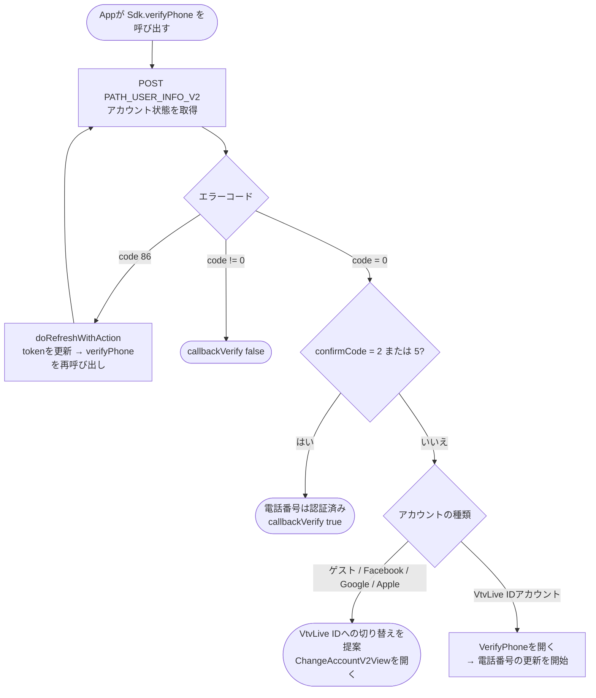
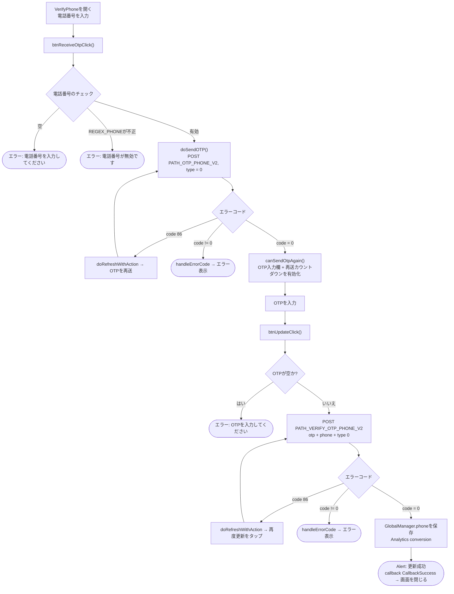
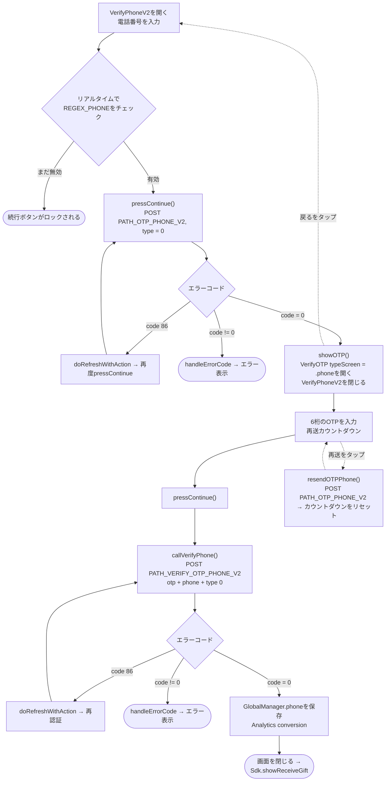

本ドキュメントは、実際のコードから作成したSDKの電話番号更新／認証フローについて説明します。
現在projectには**2つのバリエーション**の画面があります。

- **方法1 – `VerifyPhone`**（電話番号入力とOTP入力を1つにまとめた画面。タイトルは *「電話番号の更新」*）。`Sdk.verifyPhone(...)` から呼び出されます。
- **方法2 – `VerifyPhoneV2` → `VerifyOTP`**（新版、2画面に分割。タイトルは *「電話番号の追加」*、ギフト受け取りフロー `showReceiveGift` に紐づきます）。

両方とも共通で2つのendpointを使用します: `PATH_OTP_PHONE_V2`（OTP送信）と `PATH_VERIFY_OTP_PHONE_V2`（OTP認証）。パラメータ `type = 0`（Verify Phone）と、Bearer accessTokenを含むheaderを使用します。

## フローに入る条件 – `Sdk.verifyPhone()`

電話番号が未認証のVtvLive IDアカウント（`confirmCode` が2でも5でもない）のみが
電話番号更新画面を開くことができます。ゲスト/ソーシャルアカウントは先にアカウント切り替えを提案されます。

## 方法1 – `VerifyPhone` 画面

### 説明 – 方法1

1. **電話番号入力とOTP送信** – `btnReceiveOtpClick()` が電話番号が空でなく
   `REGEX_PHONE` に一致することを確認し、その後 `doSendOTP()` が `PATH_OTP_PHONE_V2`（`type = 0`、Bearer tokenを含む）を呼び出します。
   - `code = 0`: OTP入力欄を有効にし、再送カウントダウン（`Constants.timeOutOtpAgain`）を開始します。
   - `code = 86`（token期限切れ）: `doRefreshWithAction` がtokenを更新してから自動的に再送します。
   - その他のエラー: `handleErrorCode`。
2. **OTP入力と更新** – `btnUpdateClick()` がOTPが空でないことを確認し、
   `PATH_VERIFY_OTP_PHONE_V2`（`otp`、`phone`、`type = 0`）を呼び出します。
   - `code = 0`: `GlobalManager.shared.phone` を保存し、Analyticsを記録し、「更新成功」の
     alertを表示し、`callback(CallbackSuccess)` を発行してから画面を閉じます。
   - `code = 86`: tokenをrefreshしてから再試行します。
   - その他のエラー: `handleErrorCode`。
3. **OTPの再送** – カウントダウンが0になると、「コード送信」ボタンが再度有効になり `PATH_OTP_PHONE_V2` を再度呼び出せます。

## 方法2 – `VerifyPhoneV2` → `VerifyOTP`

### 説明 – 方法2

1. **`VerifyPhoneV2`** – 電話番号入力欄は `REGEX_PHONE` によりリアルタイムでチェックされ、
   有効なら「続行」ボタンが有効になります。`pressContinue()` が `PATH_OTP_PHONE_V2`（`type = 0`）を呼び出します。
   - `code = 0`: `showOTP()` が `VerifyOTP` 画面（`typeScreen = .phone`、`phone`、
     `serverId`、`characterId` を渡す）を開き、現在の画面を閉じます。
   - `code = 86`: tokenをrefreshしてから再度呼び出します。
   - その他のエラー: `handleErrorCode`。
2. **`VerifyOTP`** – 6桁のOTPを入力し、マスクされた電話番号（`maskedPhoneFrom`）と
   「再送」用のカウントダウンを表示します。`pressContinue()` → `callVerifyPhone()` が
   `PATH_VERIFY_OTP_PHONE_V2`（`otp`、`phone`、`type = 0`）を呼び出します。
   - `code = 0`: `GlobalManager.shared.phone` を保存し、Analyticsを記録し、画面を閉じて
     `Sdk.showReceiveGift()`（ギフト受け取りフローを継続）を呼び出します。
   - `code = 86`: tokenをrefreshしてから再試行します。
   - その他のエラー: `handleErrorCode`。
   - **OTPの再送**: `resendOTPPhone()` が `PATH_OTP_PHONE_V2` を再度呼び出し、カウントダウンを再開します。
   - **戻る**: `VerifyPhoneV2` 画面に戻ります。

## 使用するendpoint

- `PATH_USER_INFO_V2` – アカウントの認証状態を取得（`verifyPhone` の条件判定ステップで使用）
- `PATH_OTP_PHONE_V2` – 電話番号へOTPを送信（POST、`type = 0`）
- `PATH_VERIFY_OTP_PHONE_V2` – OTPを認証して電話番号を更新（POST、`type = 0`）

## 備考

- パラメータ `type = 0` は *Verify Phone* を意味します。他の値はメールや他の認証種別
  （1 = mail、2/3 = one-time authen、4/5 = one-time transaction）に使用されます。
- すべてのrequestに `accessToken`（Bearer）が付与されます。`code = 86`（token期限切れ）が発生した場合、
  SDKは自動的に `doRefreshWithAction` でtokenを更新してから、中断していた操作を繰り返します。
- 更新成功時は必ず `GlobalManager.shared.phone` に記録し、
  `Analytics.initiateOnDeviceConversionMeasurement(phoneNumber:)` を呼び出します。
- 終了時の違い: 方法1は画面を開いた側に対して `callback(CallbackSuccess)` を発行します。
  方法2は `Sdk.showReceiveGift()` に処理を継続します。

