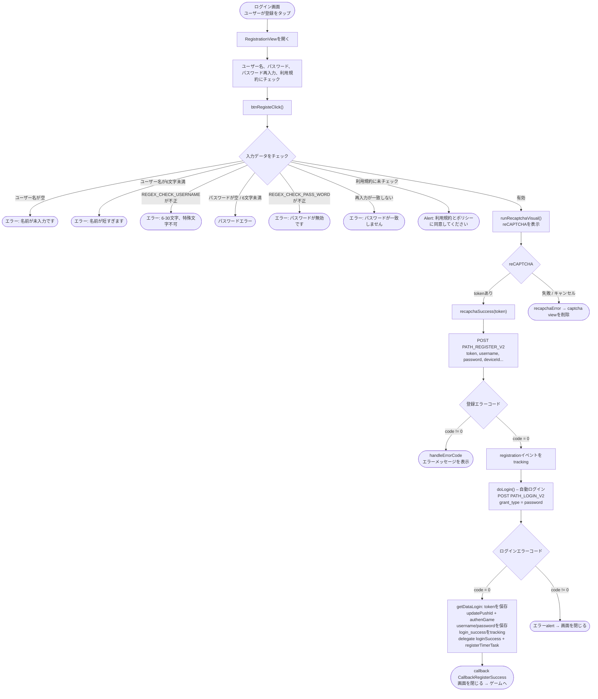

本ドキュメントは、実際のコードから作成したSDKのアカウント登録フローについて説明します。
`RegistrationView.swift`（登録画面を開く場所は `LoginViewNew.swift`）。

## 全体フロー図

## 詳細な説明

### 1. 登録画面を開く

ログイン画面（`LoginViewNew`）から、ユーザーが**登録**をタップすると →
`RegistrationView` が開きます。画面には**ユーザー名**、**パスワード**、
**パスワード再入力**の入力欄と、**利用規約 & ポリシー**への同意チェックボックスがあります。

### 2. 入力データのチェック – `btnRegisteClick()`

APIを呼び出す前に、SDKは順に以下をチェックします（エラーが見つかった時点で報告して即座に停止します）。

- ユーザー名は空にできません。
- パスワードは空にできません。
- ユーザー名は最低6文字必要です。
- パスワードは最低6文字必要です。
- ユーザー名は `REGEX_CHECK_USERNAME`（6〜30文字、特殊文字不可）に一致する必要があります。
- パスワードは `REGEX_CHECK_PASS_WORD` に一致する必要があります。
- パスワード再入力欄は空にできません。
- パスワードとパスワード再入力は一致している必要があります。
- 利用規約 & ポリシーへの同意チェック（`isCheck`）が必要です。

すべて有効な場合 → `runRecaptchaVisual()` を呼び出します。

### 3. reCAPTCHA認証 – `runRecaptchaVisual()`

`apiKeyRecapcha` と `baseWebId` を使って `RecaptchaVisual` を表示します。
tokenが取得できた場合 → `recapchaSuccess(token)` を呼び出します。エラー/キャンセルの場合は →
`recapchaError()` がcaptcha viewを削除します。

### 4. 登録APIの呼び出し – `recapchaSuccess()`

`PATH_REGISTER_V2`（POST）を以下のパラメータで呼び出します。
`reCaptChaVer = ios-v2`、`token`、`username`、`password`、`rePassword`、
`deviceId`、`os`、`osVersion`、（あれば）`ip`。

- `code = 0`: `registration` イベント（TikTok）をtrackingし → `doLogin()` を呼び出して**自動ログイン**します。
- `code != 0`: `handleErrorCode` がエラーメッセージを表示します。

### 5. 登録後の自動ログイン – `doLogin()`

`PATH_LOGIN_V2`（POST）を `grant_type = password` で、たった今登録したusername/passwordを使って呼び出します。

- `code = 0`:
  - `getDataLogin()` が `accessToken` / `refreshToken` を保存します。
  - `updatePushId()`、`authenGame()`、`Utils.sayHi()` を実行します。
  - username/passwordをストレージ（`KeyUserName`、`KeyPassword`）に保存します。
  - `login_success`（タイプ `Username`）をtrackingし、TikTokの `login` をtrackingします。
  - delegate `loginSuccess(userInfo, accessToken, refreshToken)` と `registerTimerTask()` を呼び出します。
  - `callback(CallbackRegisterSuccess)` を呼び出してから画面を閉じます → ゲームへ。
- `code != 0`: エラーalertを表示してから画面を閉じます。

## 使用するendpoint

- `PATH_REGISTER_V2` – アカウント登録（POST）
- `PATH_LOGIN_V2` – 登録後の自動ログイン（POST、`grant_type = password`）
- `PATH_GAME_AUTH` – ログイン後のゲーム認証（`authenGame`）

## 備考

- 登録成功後、SDKは**ユーザーに再ログインを求めず**、たった今作成した情報を使って自動的に
  ログインし、その後 `CallbackRegisterSuccess` callbackを発行します。
- ユーザー名/パスワードの有効性に関するすべての条件は先にクライアント側でチェックされ、
  reCAPTCHAは登録API呼び出し前の必須ステップです。

