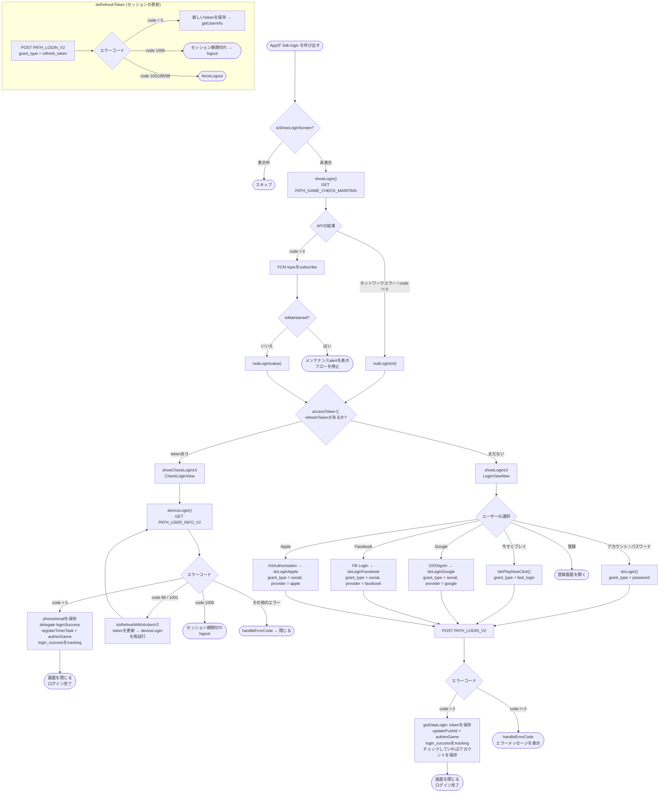

本ドキュメントは、実際のコードから作成したSDKのログインフローについて説明します。
`Sdk+Authentication.swift`、`CheckLoginView.swift`、`LoginViewNew.swift`、`LoginWrapper.swift`。

## 全体フロー図

## 詳細な説明

### 1. エントリーポイント – `login()` / `showLogin()`

appが `Sdk.login()` を呼び出すと、SDKは画面の重複表示を避けるために
`isShowLoginScreen` フラグをチェックします。まだ表示されていない場合、`showLogin()` が
メンテナンスチェックAPI `PATH_GAME_CHECK_MAINTAIN`（GET）を `packageId`、`channel`、`version` で呼び出します。

- APIが**エラー**の場合、または `code != 0` を返した場合 → そのまま `realLogin(nil)` を呼び出します。
- `code = 0` の場合 → 返されたFCM topicをsubscribeし、`isMaintained` をチェックします。
  - `isMaintained = true` → メンテナンス通知のalertを表示し、フローを**停止**します。
  - `isMaintained = false` → `realLogin(value)` を呼び出します。

### 2. 分岐 – `realLogin()`

デバイスに既にtokenが保存されているかどうかに基づいて分岐します。

- **`accessToken` と `refreshToken` がすでにある場合** → `showCheckLoginUI()`（`CheckLoginView` を開く）し、
  ユーザー操作なしで自動的に再ログインします。
- **tokenがない場合** → `showLoginUI()`（`LoginViewNew` を開く）でユーザーにログイン方法を選択させます。

### 3. 自動再ログイン – `CheckLoginView.deviceLogin()`

Bearer accessTokenを付けて `PATH_USER_INFO_V2`（GET）を呼び出します。

- `code = 0`: `phone`/`email` を保存し、delegate `loginSuccess(userInfo, accessToken, refreshToken)` を呼び出し、
  `registerTimerTask()`、`authenGame()`、`updatePushId()` を実行し、`login_success`（タイプ `Refresh`）をtrackingします。
- `code = 86` または `1001`: `doRefreshWithActionV2` を呼び出してtokenを更新してから `deviceLogin()` を**再試行**します。
- `code = 1008`: セッション期限切れ → `Sdk.logout()`。
- その他のエラー: `handleErrorCode` がメッセージを表示してから画面を閉じます。

### 4. ログイン画面 – `LoginViewNew`

ユーザーはいずれかの方法を選択します。すべて共通のendpoint `PATH_LOGIN_V2`（POST）を呼び出します。

| 方法 | 処理関数 | `grant_type` | 備考 |
|---|---|---|---|
| アカウント / パスワード | `doLogin()` | `password` | アカウント記憶オプションあり（パスワードはAES-256で暗号化） |
| 今すぐプレイ | `btnPlayNowClick()` | `fast_login` | ランダムな `nonce` を追加 |
| Google | `doLoginGoogle()` | `social` | `provider = google`、tokenは `GIDSignIn` から取得 |
| Facebook | `doLoginFacebook()` | `social` | `provider = facebook` / `facebook_limited` |
| Apple | `doLoginApple()` | `social` | `provider = apple`、`ASAuthorization` 経由 |
| 登録 | `btnRegisterClick()` | – | 登録画面を開く |

Apple / Facebook / Googleのsocialボタンは、設定で有効になっている場合のみ表示され
（`enableAppleLogin`、`enableFacebookLogin`、`enableGoogleLogin`）、ボタンの順序は
ユーザーの直近のログイン方法に応じて並び替えられます。

`PATH_LOGIN_V2` が返す結果:

- `code = 0`: `getDataLogin()` がtokenを保存し、`updatePushId()`、`authenGame()` を呼び出し、
  `login_success` をtrackingし、ユーザーが「記憶する」にチェックしていればアカウントを保存してから画面を閉じます。
- `code != 0`: `handleErrorCode` が対応するエラーメッセージを表示します。

### 5. セッションの更新 – `doRefreshToken()`

token期限切れ時に共通で使用されます: `grant_type = refresh_token` で `PATH_LOGIN_V2` を呼び出します。

- `code = 0`: 新しいtokenを保存してから `getUserInfo()` を呼び出します。
- `code = 1008`: セッション期限切れの通知を表示 → `logout()`。
- `code = 1001 / 85 / 98`: `forceLogout()`。

## 使用するendpoint

- `PATH_GAME_CHECK_MAINTAIN` – メンテナンスチェック（GET）
- `PATH_LOGIN_V2` – ログイン / token更新（POST、`grant_type` で区別）
- `PATH_USER_INFO_V2` – ユーザー情報を取得（GET）
- `PATH_GAME_AUTH` – ログイン後のゲーム認証（`authenGame`）
- `PATH_LOGOUT` – ログアウト

## 重要なエラーコード

- `CODE_0` – 成功
- `CODE_86`、`CODE_1001` – tokenの更新が必要（refreshしてから繰り返す）
- `CODE_1008` – ログインセッションの期限切れ → logout
- `CODE_1001 / 85 / 98` – 強制ログアウト（`forceLogout`）

