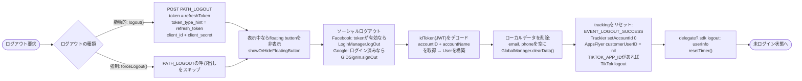

本ドキュメントは、`Sdk+Authentication.swift` 内の実際のコードから作成したSDKのログアウトフローについて説明します。**2つの関数**があります。

- **`logout()`** – 能動的ログアウト（ユーザーがログアウトをタップ）。server上のrefresh tokenを
  失効させるために `PATH_LOGOUT` APIを呼び出します。
- **`forceLogout()`** – セッションが無効になったことによる強制ログアウト（エラーコード `1001 / 85 / 98`、
  または `1008` – セッション期限切れ）。`PATH_LOGOUT` APIは呼び出さず、ローカルデータのクリアのみを行います。

どちらもユーザーを未ログイン状態に戻し、delegate `logout` を発行します。

## ログアウトの呼び出し箇所

`logout()` は通常以下から呼び出されます。
- `PersonalView` → `showSignOut()`（確認ダイアログ）→ `doSignOut()` → `Sdk.logout()`。
- `CheckLoginView` → ログアウトが必要な場合の `doSignOut()`。
- セッション期限切れ（`code = 1008`）時、`doRefreshToken` / `getUserInfo` にて → 通知を表示 → `logout()`。

`forceLogout()` はrefresh tokenが `code = 1001 / 85 / 98` を返した場合に呼び出されます
（アカウントがロックされた／セッションが他の場所で取り消された）。

## 全体フロー図

## 詳細な説明

### `logout()` と `forceLogout()` の違い

**業務上唯一の違い**: `logout()` は `PATH_LOGOUT` API（POST）を呼び出してserver上の
`refreshToken` を失効させます（fire-and-forget）。一方 `forceLogout()` はserver側で既に
セッションが無効化されているため、このステップを省略します。その他のクリーンアップ手順は同じです。

`PATH_LOGOUT` のbody:
`token = refreshToken`、`token_type_hint = "refresh_token"`、`client_id`、`client_secret`。
headerは `ServiceProcessor.createHeaderFieldType1()`。

### 共通のクリーンアップ手順

1. **floating buttonを非表示にする** – 表示中であれば `showOrHideFloatingButton()` を呼び出します。
2. **ソーシャルログアウト**:
   - Facebook: `AccessToken.current` が有効であれば → `LoginManager().logOut()`。
   - Google: `GIDSignIn.hasPreviousSignIn()` であれば → `GIDSignIn.sharedInstance.signOut()`。
3. **返却用のユーザー情報を構築** – `idToken`（JWT）をデコードし、payloadから `accountID` と
   `accountName` を取得して `User` オブジェクトを作成します（delegateで使用）。
4. **ローカルデータを削除** – `email`、`phone` を空にし、`GlobalManager.shared.clearData()` を呼び出します
   （tokenとログイン状態を削除）。
5. **tracking / analyticsのリセット**:
   - `EVENT_LOGOUT_SUCCESS` イベントを送信します。
   - `TrackierSdk.setAccountId(0, withAccountName: "")`。
   - `AppsFlyerLib.shared().customerUserID = nil`。
   - `TIKTOK_APP_ID` の設定があれば `TikTokBusiness.logout()`。
6. **appへの通知とtimerのリセット**:
   - delegate `delegate?.sdk?(self, logout: userInfo)` を呼び出してappにログアウトを通知します。
   - `resetTimer()` がセッションカウンターを停止します。

上記のステップの後、SDKは未ログイン状態になります。次回 `Sdk.login()` を呼び出すと
再びログイン画面が表示されます。

## 使用するendpoint

- `PATH_LOGOUT` – server上のrefresh tokenを失効（POST、`logout()` のみで使用）

## 備考

- `forceLogout()` はアカウント名を取得するために `getAccountNameInPayloadV2` を使用します（`logout()`
  が使用する `getAccountNameInPayload` とは異なります）が、クリーンアップとdelegateの部分は同じです。
- `PATH_LOGOUT` の呼び出しはfire-and-forgetです。SDKはserverの結果を待たずに即座にローカルの
  データをクリアするため、ユーザーは常にクライアント側で確実にログアウトされます。
- ログアウト時は常にdelegate `logout` を `User`（accountID、accountName）とともに発行し、
  appが状態を同期して対応するUI処理を行えるようにします。

