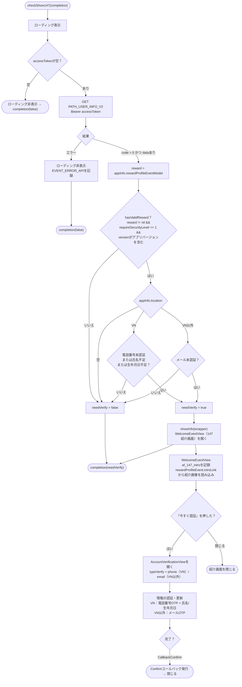

このドキュメントは `show147` フローについて、実際のコード
`Sdk.checkShow147()`（Sdk+Ext.swift）、`WelcomeEventView`（紹介画面）、
`AccountVerificationView`（認証画面）を基に説明します。

> "147" はユーザー本人確認要求（政令147号）に対応します。SDKはイベント設定と
アカウントの状態に基づき、ユーザーに認証を必須とするかどうかを判定し、紹介画面を
表示してから認証画面へ遷移させます。

エントリーポイント（アプリ側が呼び出す。通常はログイン後、またはゲーム起動時）：

```Swift
Sdk.sharedInstance.checkShow147 { needVerify in
    // needVerify = true の場合、SDKは147本人確認画面を表示済み
}
```

## 全体フロー図



## 詳細説明

### 1. `checkShow147()` — 本人確認の必須判定（Sdk+Ext.swift）

1. ローディングを表示。`accessToken` が空であれば → ローディングを非表示にし
`completion(false)`（未ログインの場合は判定しない）。

2. `PATH_USER_INFO_V2`（GET、Bearer accessToken）を呼び出しアカウント情報を取得。

    - **エラー**：ローディングを非表示にし、`EVENT_ERROR_API`（`id_check_token_api`）を記録、
    `completion(false)`。

    - **code = 0 かつ dataあり**：以下のルールに従って `needVerify` を算出。

`needVerify` の算出ルール：

- `reward = appInfo.rewardProfileEventModel`（本人確認イベントの設定）。

- `hasValidReward = reward != nil && reward.requireSecurityLevel == 1 && reward.version` が
アプリの現在バージョンを含む。

- `appInfo.location` が空 → `needVerify = false`。

- そうでなく `hasValidReward` の場合：

    - **ベトナム（`location == "VN"`）**：**電話番号未認証**、または**氏名不足**、
    または**生年月日不足**のいずれかであれば `needVerify = true`。

    - **ベトナム以外**：**メール未認証**であれば `needVerify = true`。

`needVerify == true` の場合 → `showInfo(wrapper)` を呼び出し紹介画面を開く。最終的に常に
`completion(needVerify)` を返し、アプリはSDKが本人確認画面を表示したかどうかを把握できる。

### 2. `WelcomeEventView` — 147紹介画面

表示時、この画面はトラッキング `af_147_intro`（`account_id`、`location`、`type` = PHONE/EMAIL、
`requireSecurityLevel`、`version` を含む）を送信し、`rewardProfileEvent.introLink` から
紹介画像を読み込む（画面の向きに応じたデフォルト画像）。

- **「今すぐ認証」を押す**（`btnConfirmNow`）：紹介画面を閉じ、`AccountVerificationView` を開く。
VNの場合 `typeVerify = .phone`、それ以外は `.email`。`userWrapper` と `delegate` を渡す。

- **閉じる**：紹介画面を除去。

### 3. `AccountVerificationView` — 認証・情報補完画面

`typeVerify` とアカウントの状態に応じて、この画面は以下を処理する：

- **VN（`.phone`）**：電話番号OTPの送信/入力（`PATH_OTP_PHONE_V2` + verify）と、不足している
場合の**氏名・生年月日**の補完（`PATH_UPDATE_INFO_V2` 経由で更新）。

- **VN以外（`.email`）**：メールOTPの送信/入力による認証。

完了時、`callback(CallbackConfirm)` を発行し、`WelcomeEventView` が呼び出し元へコールバックを
伝達する。

## 使用エンドポイント

- `PATH_USER_INFO_V2` — `needVerify` 判定のためアカウント状態を取得（GET）

- `PATH_OTP_PHONE_V2` — 電話番号OTP送信（POST） — `AccountVerificationView`（VN）にて

- `PATH_UPDATE_INFO_V2` — 氏名/生年月日の更新（POST） — `AccountVerificationView`（VN）にて

- 対応するメールOTP — `AccountVerificationView`（VN以外）にて

## 備考

- 本人確認必須の条件は `rewardProfileEventModel` の設定
（`requireSecurityLevel == 1` かつバージョン一致）に依存する — つまり設定された
バージョン/イベントに対してのみ有効化され、一律に適用されるわけではない。

- 認証基準は**地域によって異なる**：ベトナムは電話番号＋氏名＋生年月日を要求し、
ベトナム以外はメールを要求する。

- `checkShow147` は `completion(needVerify)` を通じて結果を返す非同期関数であり、アプリは
それに基づきユーザーが本人確認を完了するまで機能をブロック/解放できる。

- `location` は初期化フロー（IPによる `getLocation`）で決定される — 空の場合は
本人確認ステップをスキップする。
