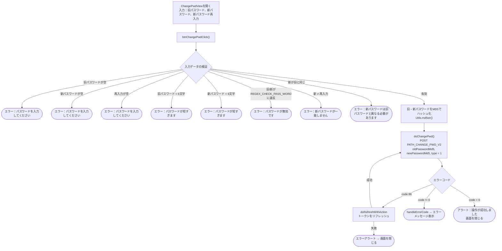

このドキュメントは、SDKの（**ログイン済みユーザー**による）パスワード変更フローについて、
実際のコード `ChangePwdView.swift`（タイトル *「パスワード変更」*）を基に説明します。

> 区別：これは**パスワード変更**（旧パスワードを知っている、ログイン中）であり、
> **パスワードを忘れた場合**（メール/電話番号のOTPで再取得）とは異なる。

## 全体フロー図

## 詳細説明

### 1. 入力とデータ検証 — `btnChangePwdClick()`

画面には3つの入力欄がある：**旧パスワード**（`txtPwd`）、**新パスワード**（`txtNewPwd`）、
**新パスワード再入力**（`txtConfirmNewPwd`）。「パスワード変更」を押すと、SDKは順番に
検証を行う（エラーが見つかった場合、該当欄を赤くして処理を停止）：

- 旧パスワード、新パスワード、再入力はすべて空にできない。
- 旧パスワードと新パスワードは最低6文字。
- 旧パスワードと新パスワードは `REGEX_CHECK_PASS_WORD` に一致する必要がある。
- 新パスワードと再入力は一致する必要がある。
- 新パスワードは旧パスワードと異なる必要がある。

### 2. ハッシュ化とAPI呼び出し — `doChangePwd()`

検証に成功すると → 旧・新パスワードは送信前に**MD5でハッシュ化**される（`Utils.md5str`）。
`PATH_CHANGE_PWD_V2`（POST）を `oldPasswordMd5`、`newPasswordMd5`、`type = 1`
（`deviceId`、`os`、`osVersion`、`ip` を含む）とBearer accessTokenヘッダーで呼び出す。

- `code = 0`：アラート「操作が成功しました」を表示 → 画面を閉じる。
- `code = 86`（トークン期限切れ）：`doRefreshWithAction` でトークンをリフレッシュし、
  成功すれば `doChangePwd()` を**自動的に再実行**、失敗すればエラーアラートを表示して
  画面を閉じる。
- その他のエラー：`handleErrorCode` でエラーメッセージを表示。

## 使用エンドポイント

- `PATH_CHANGE_PWD_V2` — ログイン中のパスワード変更（POST、`type = 1`）

## 備考

- パスワードは**平文で送信されない**：旧・新パスワードともにクライアント側でMD5ハッシュ化
  （`oldPasswordMd5`、`newPasswordMd5`）してからサーバーへ送信する。
- すべての操作に `accessToken`（Bearer）が必要。`code = 86` の場合、SDKは自動的に
  トークンをリフレッシュしてから、実行中だったパスワード変更リクエストを繰り返す。
- パスワード変更に成功しても、この画面では**再ログインを要求しない** — 成功メッセージを
  表示して画面を閉じるのみ。
