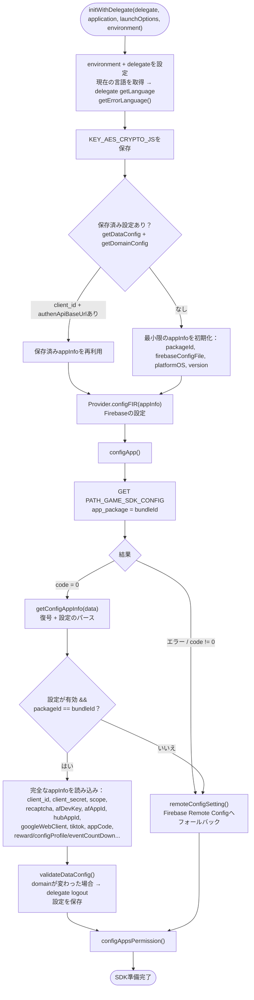

このドキュメントは `Sdk.initWithDelegate(...)` から始まるSDK初期化フローについて、
実際のコード `Sdk+Ext.swift`（エントリーポイント）、`Sdk+Config.swift`（設定の取得と解析）を
基に説明します。

エントリーポイント（アプリが起動時に呼び出す。通常は
`application(_:didFinishLaunchingWithOptions:)` 内）：

```Swift
Sdk.sharedInstance.initWithDelegate(delegate,
                                    application: application,
                                    launchOptions: launchOptions,
                                    environment: .prod)
```

## 全体フロー図



## フォールバックとサードパーティ設定の分岐図

```mermaid
flowchart TD
    subgraph RC["remoteConfigSetting – Firebase Remote Config"]
        A1["minimumFetchInterval = 0に設定<br/>plistからsetDefaults"] --> A2["remoteConfig.fetch → activate"]
        A2 -- "成功" --> A3["getAppInfoConfigDefaultFirebase()<br/>Remote ConfigからAPPINFO_CONFIGを復号"]
        A2 -- "エラー" --> A4["getAppInfoConfigDefault()<br/>バンドル内デフォルトplistから読み込み"]
        A3 -- "復号エラー" --> A4
        A3 --> A5["configAppsPermission()"]
        A4 --> A5
    end

    subgraph AP["configAppsPermission – サードパーティ初期化"]
        B1{"afAppIdあり？"} -- "なし" --> B9["トラッキング部分をスキップ"]
        B1 -- "あり" --> B2["Facebook：ApplicationDelegate didFinishLaunching + Settings"]
        B2 --> B3["AppsFlyer：devKey, appleAppID,<br/>waitForATT, delegate"]
        B3 --> B4["setupTiktTokSDK()"]
        B4 --> B5["sendLaunch()"]
        B5 --> B6["Trackier：initWith + logDevice + setTimeTrackier"]
        B9 --> B7
        B6 --> B7["getPublicIPAddress → appInfo.ipPublic<br/>getLocation → appInfo.location"]
        B7 --> B8["subscribeToTopic()"]
    end

    subgraph SL["sendLaunch → checkInit"]
        C1["applicationDidBecomeActive5s<br/>AppsFlyer.start() + appDidBecomeActive"] --> C2["checkInit()"]
        C2 --> C3["EVENT_APP_LAUNCHを記録<br/>TikTok launchAPP + subscribe"]
        C3 --> C4{初回アプリ起動？}
        C4 -- "はい" --> C5["EVENT_FIRST_LAUNCHを記録"]
        C4 -- "いいえ" --> C6{バージョン変更？}
        C5 --> C6
        C6 -- "あり" --> C7["EVENT_UPGRADE_VERSION_SUCCESSを記録"]
    end

    subgraph ST["subscribeToTopic"]
        D1["GET PATH_GAME_CHECK_MAINTAIN"] --> D2["各FCMトピックを購読"]
        D1 --> D3["UpdatePushIDRepo.execute()<br/>push idを更新"]
    end
```



## 詳細説明

### 1. `initWithDelegate()` — エントリーポイント（Sdk+Ext.swift）

1. `environment` と `delegate` を設定。

2. 現在の言語を取得（`Localize.currentLanguage()`）、delegateの `getLanguage` を呼び出し、
多言語エラーテーブルを読み込む（`getErrorLanguage()`）。

3. 暗号化キー `KEY_AES_CRYPTO_JS` を保存。

4. 保存済み設定を読み込む（`getDataConfig` + `getDomainConfig`）：

    - `client_id` と `authenApiBaseUrl` が既にある場合 → 保存済み `appInfo` を再利用
    （高速起動）。

    - ない場合 → 最小限の `appInfo` を初期化（bundleからのpackageId、firebase設定、
    platformOS、version）。

5. `Provider.shared.configFIR(appInfo)` でFirebaseを設定。

6. `configApp(...)` を呼び出しサーバーから設定を取得。

### 2. `configApp()` — サーバーから設定を取得（Sdk+Config.swift）

`configApiService` 経由で `PATH_GAME_SDK_CONFIG`（GET、`app_package = bundleId`）を呼び出す。

- `code = 0`：`getConfigAppInfo(data)` — AES復号と設定のパース。

- ネットワークエラーまたは `code != 0`：`remoteConfigSetting()`（Firebase Remote Config）へ
切り替え。

### 3. `getConfigAppInfo()` — 設定の復号と読み込み

`KEY_AES_CRYPTO_JS` で文字列を復号し、JSONをパースして必須フィールドがすべて揃っているか
確認する（client_id、client_secret、apiKeyRecapcha、afDevKey、scope、googleWebClient、
packageId、afAppId、各ベースURL、hubAppId、appCodeなど）。

- フィールドが十分**かつ** `packageId == bundleIdentifier` の場合：

    - すべてを `appInfo` に読み込む（拡張設定を含む：`rewardProfileEvent`、`showFloating`、
    `configProfile`、`eventCountDown`）。

    - `DomainConfig` を構築し、`validateDataConfig()` を呼び出す。保存済みのものと比較して
    authenドメインが変わった場合、delegateの `logout` を発行。その後設定を保存。

    - `configAppsPermission()` を呼び出す。

- フィールド不足、パッケージ不一致、または復号/パースエラーの場合 → `remoteConfigSetting()`。

### 4. `remoteConfigSetting()` — Firebase Remote Configフォールバック

`minimumFetchInterval = 0` を設定し、plistからデフォルトを読み込み、`fetch → activate` を
実行する：

- 成功：`getAppInfoConfigDefaultFirebase()` がRemote Configから `APPINFO_CONFIG` を復号する。
復号エラーの場合は `getAppInfoConfigDefault()` がバンドル内デフォルトplistから読み込む。

- エラー：`getAppInfoConfigDefault()`（デフォルトplist）。

両方の分岐とも続けて `configAppsPermission()` を呼び出す。さらに `addOnConfigUpdateListener`
を登録して、変更があった場合に設定を更新する。

### 5. `configAppsPermission()` — サードパーティSDKの初期化

`afAppId` がある場合のみ実行される。以下を行う：

- Facebook SDK：`ApplicationDelegate didFinishLaunching`、`Settings` の設定。

- AppsFlyer：`devKey`、`appleAppID`、`waitForATTUserAuthorization`、delegateを設定。

- `setupTiktTokSDK()` でTikTok Business SDKを初期化。

- `sendLaunch()`（項目6参照）。

- Trackier：`initWith`、`logDevice` を送信、`setTimeTrackier(30)`。

その後、公開IP（`getPublicIPAddress` → `appInfo.ipPublic`）と位置情報
（`getLocation` → `appInfo.location`）を取得し、`subscribeToTopic()` を実行。

### 6. `sendLaunch()` → `checkInit()`（Sdk+Ext.swift）

`sendLaunch()` は `applicationDidBecomeActive5s`、`AppsFlyerLib.start()`、
`appDidBecomeActive()`、`checkInit()` を呼び出す。`checkInit()` は起動トラッキングを送信する：

- `EVENT_APP_LAUNCH` およびTikTokイベント `launchAPP` / `subscribe`。

- 初回アプリ起動 → `EVENT_FIRST_LAUNCH`。

- 前回からバージョンが変更されている場合 → `EVENT_UPGRADE_VERSION_SUCCESS`。

### 7. `subscribeToTopic()`

`PATH_GAME_CHECK_MAINTAIN` を呼び出し各FCMトピックを取得・購読すると同時に、
`UpdatePushIDRepo` を実行してサーバーへpush idを更新する。

## 使用エンドポイント

- `PATH_GAME_SDK_CONFIG` — サーバーからSDK設定を取得（GET）

- `PATH_GAME_CHECK_MAINTAIN` — FCMトピックの取得 / メンテナンス確認（GET）

- `PATH_LOCATION` — IPから国コードを取得（POST）

- `getclientip`（id.vplay.vn） — デバイスの公開IPを取得（GET）

## 備考

- 設定ソースの優先順位：**サーバー（`PATH_GAME_SDK_CONFIG`）→ Firebase Remote Config
→ バンドル内デフォルトplist**。各層でエラーになった場合、次の層に落ちる。

- 機密性の高い設定（client_id/secret、scope、各ベースURL）はAES暗号化されており、
`packageId` がアプリのbundleと一致する場合のみ読み込まれる。

- `initWithDelegate` は保存済み設定を再利用して高速起動するが、毎回の起動時に
`configApp` を呼び出して設定を更新する。

- 2回の起動間でauthenドメインが変更された場合、SDKは新しいドメインで古いトークンを
使用しないよう、能動的にdelegateの `logout` を発行する。
