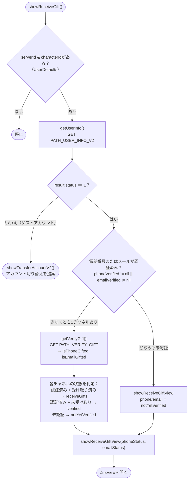
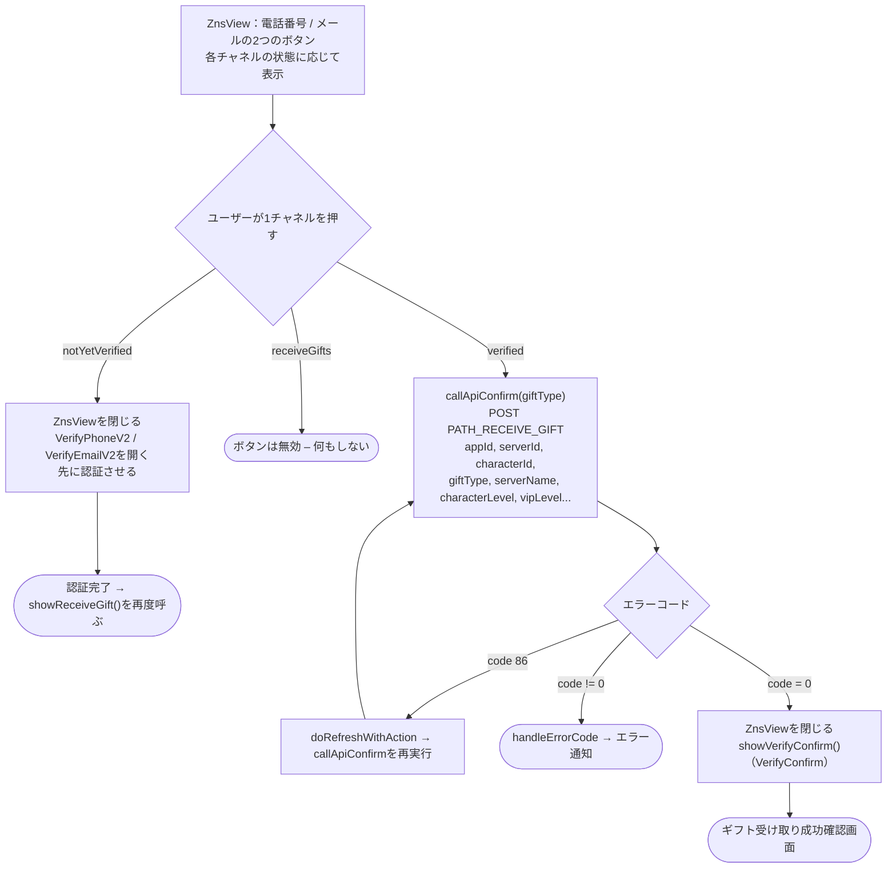

このドキュメントはギフト受け取りフロー（ギフト受け取りのための電話番号/メール認証）について、
実際のコード `Sdk+Gift.swift`（状態判定）と `ZnsView.swift`（ギフト受け取り選択画面）を
基に説明します。

エントリーポイント：

```Swift
Sdk.sharedInstance.showReceiveGift()
```

`showReceiveGift()` は、**電話番号/メール認証成功後**（`VerifyOTP` / `VerifyPhoneV2` /
`VerifyEmailV2` から）にも自動的に呼び出され、認証 → ギフト受け取りへ戻るというループを
形成する。

## 各チャネル（電話番号 / メール）の3つの状態 — `VerifyStatus`

|状態|意味|`ZnsView`上のボタン|
|---|---|---|
|`notYetVerified`|このチャネルは未認証|押すと**認証画面を開く**（VerifyPhoneV2 / VerifyEmailV2）|
|`verified`|認証済み、**未受け取り**|「受け取る...」— 有効、押すと**ギフトを受け取る**|
|`receiveGifts`|受け取り済み|「受け取る...」— **無効**（グレー）|

## 1. 状態判定 — `showReceiveGift()`



## 2. `ZnsView`上の操作



## 詳細説明

### `showReceiveGift()` — フロー判定（Sdk+Gift.swift）

1. `serverId` と `characterId` が必須（`UserDefaults`：`KEY_SERVER_ID` /
`KEY_SERVER_NAME` から読み込み）。不足していれば停止。

2. `getUserInfo()`（`PATH_USER_INFO_V2`）を呼び出す：

    - `result.status != 1`（ゲストアカウント）の場合 → `showTransferAccountV2()` で
    メインアカウントへの切り替えを提案し、ギフト受け取りフローを終了。

    - `status == 1` の場合：

        - **少なくとも1チャネルが認証済み**（`phoneVerified != nil` または
        `emailVerified != nil`）：`getVerifyGift()` を呼び出しギフト受け取り済みかを
        確認し、各チャネルの状態を算出：

            - 電話番号：認証済み → `isPhoneGifted == true` なら `receiveGifts`、
            それ以外は `verified`。

            - メール：認証済み → `isEmailGifted == true` なら `receiveGifts`、
            それ以外は `verified`。

            - 未認証のチャネルは `notYetVerified` のまま。

        - **どちらのチャネルも未認証**：両方とも `notYetVerified`。

    - 算出された2つの状態で `ZnsView` を開く（`showReceiveGiftView`）。

### `getVerifyGift()` — 受け取り済みかどうかの確認

`PATH_VERIFY_GIFT`（GET、署名 + Bearer accessToken付き）を `appId`、`appPackage`、
`serverId`、`characterId` で呼び出す。`isPhoneGifted`、`isEmailGifted`（各チャネルが
受け取り済みかどうか）を返す。

### `ZnsView` — ギフト受け取り選択画面

2つのボタン（電話番号 / メール）を表示し、各チャネルの状態に応じてUIが変化する
（上表参照）。1チャネルを押すと：

- **`notYetVerified`**：`ZnsView` を閉じ、`VerifyPhoneV2` / `VerifyEmailV2` を開いて
先に認証させる。認証完了後、フローは `showReceiveGift()` を再度呼び出して状態を更新する。

- **`verified`**：`callApiConfirm()` を呼び出しギフトを受け取る。

- **`receiveGifts`**：ボタンは無効で、何もしない。

### `callApiConfirm()` — ギフト受け取り

`PATH_RECEIVE_GIFT`（POST、署名 + Bearer accessToken付き）を `appId`、`appPackage`、
`serverId`、`characterId`、`sdkVersion`、`giftType`（`phone`/`email`）、`serverName`、
`characterName`、`characterLevel`、`characterVipLevel` で呼び出す。

- `code = 0`：`ZnsView` を閉じ `VerifyConfirm`（ギフト受け取り成功確認画面）を開く。

- `code = 86`（トークン期限切れ）：`doRefreshWithAction` でトークンをリフレッシュし
`callApiConfirm()` を再実行。

- その他のエラー：`handleErrorCode`。

## 使用エンドポイント

- `PATH_USER_INFO_V2` — アカウント状態＆認証状況を取得（GET）

- `PATH_VERIFY_GIFT` — 各チャネルの受け取り済み状況を確認（GET）

- `PATH_RECEIVE_GIFT` — ギフト受け取りリクエストを送信（POST）

## 備考

- 前提条件：`serverId` + `characterId` が必要（通常 `mappingUser` / `payProduct` 時に
設定される）。また、アカウントはメインアカウント（`status == 1`）である必要がある —
ゲストアカウントはアカウント切り替えへ誘導される。

- ギフトを受け取るには、チャネル（電話番号/メール）が**認証済み**である必要がある。
未認証の場合、`ZnsView` はユーザーを認証へ誘導し、自動的にギフト受け取りフローへ戻る。

- ギフト受け取りリクエストには**署名**付きヘッダーを使用する
（`createHeaderFieldWithSignatureAndBearerToken`）。

- ギフト受け取り成功は `VerifyConfirm` 確認画面で終了する。
