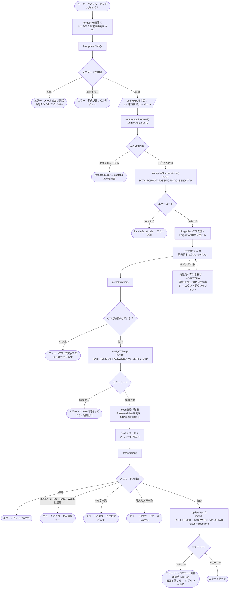

このドキュメントはSDKのパスワード再取得・再設定フローについて、実際のコード
`ForgotPwd.swift`（メール/電話番号入力） → `ForgotPwdOTP.swift`（OTP認証） →
`PasswordView.swift`（新パスワード設定）を基に説明します。

## 全体フロー図

## 詳細説明

### ステップ1 – メール/電話番号の入力（`ForgotPwd`）

ユーザーはメールまたは電話番号を入力する。`btnUpdateClick()` は以下を検証する：

- 空にできない。
- `isValidPhoneOrEmail()` で正しい形式であることを確認：
  - `REGEX_PHONE`（ベトナムの電話番号）に一致 → `verifyType = 1`。
  - メールの正規表現に一致 → `verifyType = 2`。
  - どちらにも一致しない → 形式エラーを表示。

有効な場合 → `runRecaptchaVisual()` を呼び出しreCAPTCHAを表示。トークンが取得できたら、
`recapchaSuccess()` が `PATH_FORGOT_PASSWORD_V2_SEND_OTP`（POST）を
`reCaptChaVer`、`reCaptChaToken`、`verifyInfo`、`clientId`、`deviceId`、`os`、`osVersion`、
`ip` で呼び出す。

- `code = 0`：`ForgotPwdOTP` 画面を開き（`verifyInfo`、`verifyType` を渡す）、
現在の画面を閉じる。
- `code != 0`：`handleErrorCode(99)` でエラーメッセージを表示。

### ステップ2 – OTP認証（`ForgotPwdOTP`）

画面にはOTP6桁の入力欄と再送信のカウントダウン（`Constants.timeOutOtpAgain`）が表示される。

確認ボタンを押すと、`pressConfirm()` はOTPが6文字揃っているかを確認し、揃っていれば
`verifyOTP()` を呼び出す → `PATH_FORGOT_PASSWORD_V2_VERIFY_OTP`（POST）を
`verifyInfo`、`otp`、`clientId`、`deviceId`...で呼び出す。

- `code = 0`：レスポンス（`ForgotPwdOTPJsonWrapper`）から `token` を取得し、
  `PasswordView`（`token` を渡す）を開いてOTP画面を閉じる。
- `code != 0`：アラートを表示（OTPが間違っているか期限切れ）。

**再送信：**カウントダウンが0になると、ラベルが「再送信」に変わる。押すと再度
reCAPTCHAを実行してから `PATH_FORGOT_PASSWORD_V2_SEND_OTP` を再度呼び出す。成功すれば
カウントダウンを再起動し、失敗すればエラーを表示する。

### ステップ3 – 新パスワードの設定（`PasswordView`）

ユーザーは新パスワードと再入力を行う。`pressAction()` は以下を検証する：

- 空にできない。
- `REGEX_CHECK_PASS_WORD` に一致する。
- 最低6文字。
- 再入力が一致する必要がある。

有効な場合 → `updatePass()` が `PATH_FORGOT_PASSWORD_V2_UPDATE`（POST）を
`token`（OTPステップで取得）、`password`、`clientId`、`deviceId`、`os`、`osVersion`、
`ip` で呼び出す。

- `code = 0`：アラート「パスワード変更が成功しました」→ 画面を閉じ、ユーザーは新しい
パスワードでログイン画面に戻る。
- `code != 0`：エラーアラートを表示。

## 使用エンドポイント

- `PATH_FORGOT_PASSWORD_V2_SEND_OTP` — メール/電話番号にOTPを送信（POST、reCAPTCHAあり）
- `PATH_FORGOT_PASSWORD_V2_VERIFY_OTP` — OTPを認証し `token` を返す（POST）
- `PATH_FORGOT_PASSWORD_V2_UPDATE` — `token` を使って新パスワードを設定（POST）

## 備考

- reCAPTCHAはOTP送信のたびに必須のステップ（初回、再送信の両方）。
- OTP認証後に受け取る `token` が、最終ステップでパスワード変更を許可するものである。
  有効なOTPがなければtokenを取得できない。
- パスワード変更成功後、フローは**自動ログインしない**。ユーザーをログイン画面へ戻し、
  新しいパスワードで再ログインさせる。
