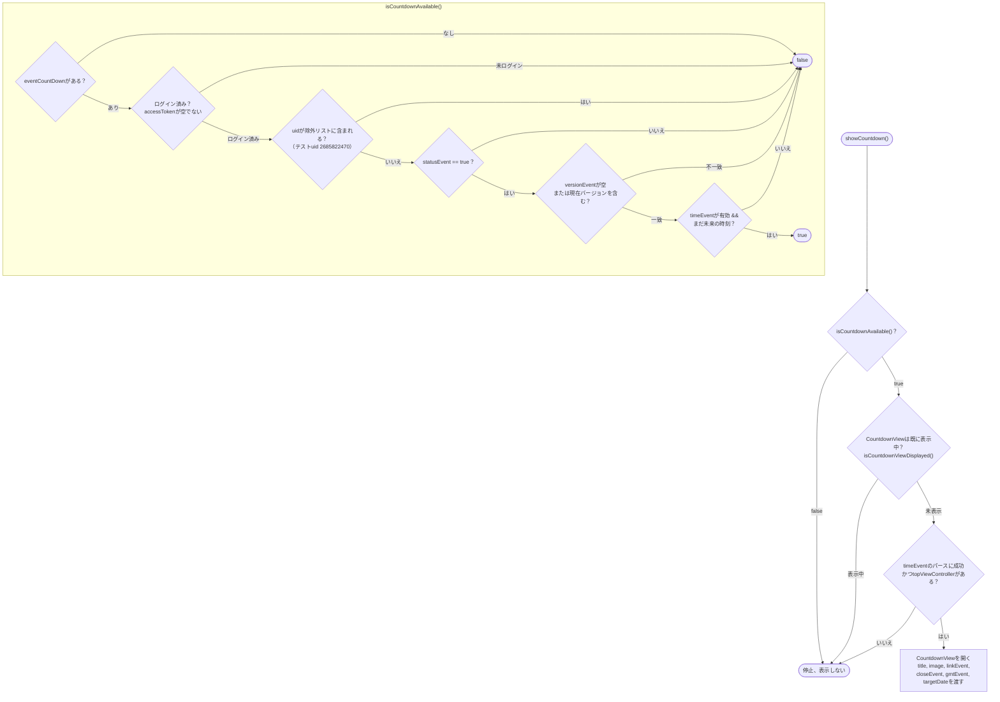
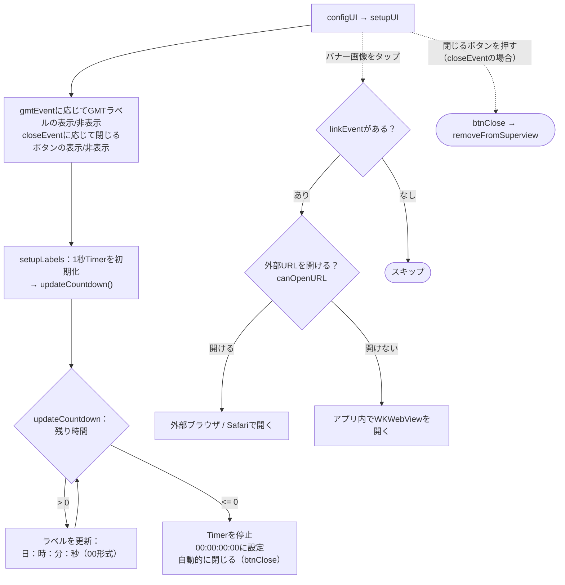

このドキュメントは `showCountdown` フローについて、実際のコード
`Sdk+Countdown.swift`（表示条件＋画面表示）と `CountdownView.swift`（カウントダウン時計＋
イベントリンクを開く処理）を基に説明します。

エントリーポイント（アプリがカウントダウンイベントバナーを表示するために呼び出す）：

```Swift
Sdk.sharedInstance.showCountdown()
```

イベント設定は `appInfo.eventCountDown`（初期化フローで、フィールド `EVENT_COUNTDOWN` から
読み込まれる）から取得される。

## 1. 表示条件 – `showCountdown()` / `isCountdownAvailable()`



## 2. `CountdownView` のライフサイクル



## 詳細説明

### `showCountdown()` – エントリーポイント（Sdk+Countdown.swift）

1. `isCountdownAvailable()` を確認する。条件を満たさない場合は停止。

2. `isCountdownViewDisplayed()` を確認する — バナーが既に表示中であれば停止する
（重複表示を防止）。

3. `event = appInfo.eventCountDown` を取得し、`event.timeEvent`
（`yyyy-MM-dd'T'HH:mm:ssZ` 形式）から `targetDate` をパースする。取得できなければ停止。

4. `CountdownView` を `topViewController` 上に開き、`titleText`、`imageUrl`、`linkEvent`、
`closeEvent`、`gmtEvent`、`targetDate` を渡す。

### `isCountdownAvailable()` – 表示条件

以下の**すべて**を満たす場合のみ `true` を返す：

- `appInfo.eventCountDown` の設定がある。

- ログイン済み（`accessToken` が空でない）。

- アカウントが除外リストに**含まれていない**（テストuid `2685822470` のチェックコード）。

- `event.statusEvent == true`（イベントが有効化されている）。

- `versionEvent` が空、**または**アプリの現在バージョンを含む（バージョンによるフィルタ）。

- `timeEvent` がパース可能で**まだ未来の時刻である**（`timeIntervalSinceNow > 0`）。

### `isCountdownViewDisplayed()`

`topViewController` のサブビューを走査し、既に `CountdownView` があれば表示中とみなし
（追加で開かない）。

### `CountdownView` – カウントダウン時計

- **`setupUI`**：`gmtEvent` に応じてGMTラベルの表示/非表示、`closeEvent` に応じて閉じる
ボタンの表示/非表示（`closeEvent == false` の場合、手動で閉じることはできない）。

- **カウントダウン**：`setupLabels()` が毎秒 `updateCountdown()` を呼び出す `Timer` を作成。

    - 残り時間あり：**日：時：分：秒**の4つのラベルを更新（2桁形式）。

    - 時間切れ（`<= 0`）：タイマーを停止し、`00:00:00:00` を設定して**自動的に**バナーを
    閉じる。

- **バナー画像をタップ**（`imageViewTapped`）：`linkEvent` があればイベントリンクを開く —
外部ブラウザで開くことを優先（`UIApplication.open`）。開けない場合はアプリ内で
`WKWebView` を表示する。

- **閉じる**（`btnClose`）：バナーを画面から除去する。`deinit` でもタイマーを破棄する。

## 備考

- `showCountdown` は**APIを呼び出さない** — すべてのデータ（終了時刻、タイトル、画像、
リンク、表示フラグ）はSDK初期化時に既に読み込まれた `eventCountDown` 設定から取得する。

- バナーは時間切れで自動的に閉じる。ユーザーが手動で閉じられるのは
`closeEvent == true` の場合のみ。

- イベントは**アプリのバージョン**（`versionEvent`）と有効/無効の状態
（`statusEvent`）でフィルタされるため、設定された対象/バージョンにのみ正しく表示される。

- 重複表示防止のチェック（`isCountdownViewDisplayed`）があり、`showCountdown()` を
複数回呼び出しても安全である。
