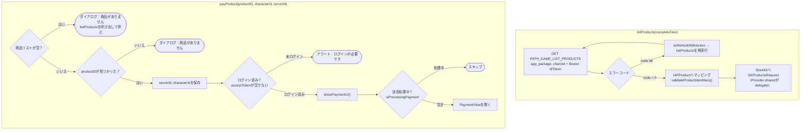
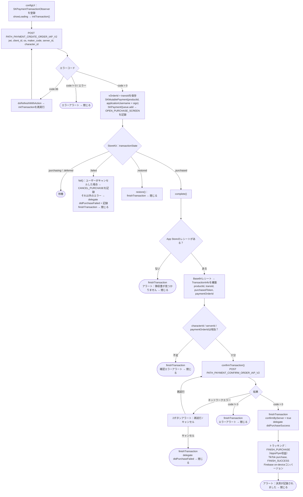

このドキュメントはSDKのIn-App Purchase決済フローについて、実際のコード
`Sdk+Payment.swift`（公開API）と `PaymentView.swift`（StoreKitトランザクション処理＋
サーバー認証）を基に説明します。

## 1. 商品リストの取得と決済画面を開く

## 2. `PaymentView` におけるトランザクションのライフサイクル

## 詳細説明

### `listProducts()` – 商品リストの取得

`PATH_GAME_LIST_PRODUCTS`（GET、Bearer `idToken` 付き）を `app_package` と `channel` で
呼び出す。

- `code = 0`：データを `[IAPProduct]` に変換し、`validateProductIdentifiers()` が
`SKProductsRequest` を作成してStoreKitから実際の商品情報を取得する（delegateは
`Provider.shared`）。リストが空の場合は `CODE_PAYMENT_ERROR_NO_CONFIG` エラーを返す。

- `code = 86`：トークンをリフレッシュしてから再実行。失敗した場合は `getProductTask` 経由で
エラーを返す。

### `payProduct(productID, characterId, serverId)` – 購入の開始

1. 商品が1つもない場合 → ダイアログ「商品がありません」を表示し `listProducts(nil)` を
呼び出して停止。

2. `productID` に一致する商品を検索。見つからない場合 → ダイアログ「商品がありません」。

3. `serverId`、`characterId` を保存（変数とUserDefaults両方に）。

4. `accessToken` が空の場合 → アラート「ログインが必要です」を表示して停止。

5. `showPaymentUI()` を呼び出す：実行中のトランザクションがない場合
（`isProcessingPayment == false`）、`PaymentView` を開く（products、serverId、
characterId、productId、delegateを渡す）。

### `PaymentView` – 注文作成とStoreKit決済

**初期化（`configUI`）**：`SKPaymentTransactionObserver` として登録し、ローディングを
表示して `initTransaction()` を呼び出す。

**`initTransaction()`** – サーバー側で注文を作成：`PATH_PAYMENT_CREATE_ORDER_IAP_V2`
（POST）を `jwt`、`client_id`、`os`、`maker_code = productId`、`server_id`、
`character_id` で呼び出す。

- `code = 0`：`vOrderId = transId` を保存し、`SKMutablePayment` を作成
（サーバーからの `sign` を `applicationUsername` に設定）して `SKPaymentQueue` に追加し、
Appleの決済ダイアログを開く。`EVENT_OPEN_PURCHASE_SCREEN` を記録。

- `code = 86`：トークンをリフレッシュしてから `initTransaction()` を再実行。

- その他のエラー：エラーアラートを表示して閉じる。

**トランザクションの監視（`paymentQueue:updatedTransactions`）**：

- `.purchasing` / `.deferred`：待機。

- `.failed` → `fail()`：ユーザーがキャンセルした場合 `EVENT_CANCEL_PURCHASE` を記録。
それ以外のエラーの場合、delegateの `didPurchaseFailed` を発行して記録。いずれの場合も
`finishTransaction` を実行してから閉じる。

- `.restored` → `restore()`：`finishTransaction` を実行してから閉じる。

- `.purchased` → `complete()`。

**`complete()`** – 認証の準備：「トランザクションを認証中」のローディングを表示し、
`appStoreReceiptURL` からレシートを読み込む。

- レシートがない → `finishTransaction` + アラート「領収書が見つかりません」→ 閉じる。

- レシートがある → base64エンコードし、`TransactionInfo`（`productId`、`transId`、
`purchasedToken = receipt`、`paymentOrderId = vOrderId`）を構築。

- `characterId` / `serverId` / `paymentOrderId` のいずれかが不足 → `finishTransaction` +
エラーアラート → 閉じる。

- 条件を満たす場合 → `confirmTransaction()`。

**`confirmTransaction()`** – サーバーとの認証：`PATH_PAYMENT_CONFIRM_ORDER_IAP_V2`
（POST）を `jwt`、`cid`/`client_id`、`client_secret = transactionIdentifier`、`os`、
`b_code = purchasedToken`（レシート）、`transId = paymentOrderId`、
`maker_code = productId`、`character_id`、`server_id` で呼び出す。

- **ネットワークエラー**：2ボタンアラート「再試行」/「キャンセル」。「再試行」で
`confirmTransaction` を再実行。「キャンセル」で `finishTransaction`、delegateの
`didPurchaseFailed` を発行してから閉じる。

- `code = 0`：`finishTransaction`、`confirmByServer = true` を設定、delegateの
`didPurchaseSuccess` を発行。トラッキング `EVENT_FINISH_PURCHASE`（AppsFlyer、収益付き）、
TikTok購入イベント、`EVENT_FINISH_SUCCESS`、Firebase on-deviceコンバージョンを記録。
アラート「決済が記録されました...」を表示してから閉じる。

- `code != 0`：`finishTransaction` + エラーアラート → 閉じる。

## 使用エンドポイント

- `PATH_GAME_LIST_PRODUCTS` — IAP商品リストの取得（GET、Bearer idToken）

- `PATH_PAYMENT_CREATE_ORDER_IAP_V2` — 決済注文の作成（POST）

- `PATH_PAYMENT_CONFIRM_ORDER_IAP_V2` — トランザクションの認証／記録（POST）

## 備考

- これは**サーバー側で認証を行う決済**である：SDKは先に注文を作成し（`transId` +
`sign` を取得）、`sign` を `SKPayment` の `applicationUsername` として使用し、
サーバーがレシートを認証した後（`PATH_..._CONFIRM_...`）にのみ成功を記録する。

- `SKPaymentQueue.finishTransaction` は認証完了後（成功、またはユーザーがキャンセルを
選択した場合）にのみ呼び出され、ネットワークエラー時にトランザクションを失わないように
している — ネットワークエラー時、ユーザーは「再試行」を押して再度認証できる。

- 最終結果は常にdelegateの `didPurchaseSuccess` / `didPurchaseFailed`
（`TransactionInfo` を伴う）を通じてアプリへ返される。

- `isProcessingPayment` により、同時に2つの決済画面が開かないことを保証する。
