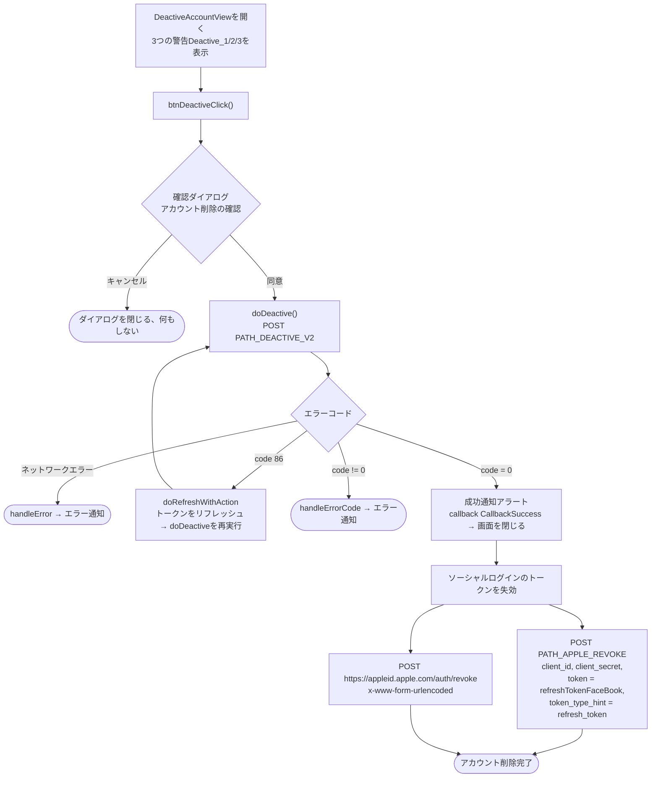

このドキュメントはSDKのアカウント削除（無効化）フローについて、実際のコード
`DeactiveAccountView.swift` を基に説明します。

## 全体フロー図

## 詳細説明

### 1. 警告画面と確認

`DeactiveAccountView` はアカウント削除の影響について3行の警告
（`Deactive_1`、`Deactive_2`、`Deactive_3`）を表示する。削除ボタンを押すと、
`btnDeactiveClick()` が2ボタンの確認ダイアログ（「アカウント削除の確認」）を開く：

- **キャンセル**：ダイアログを閉じ、何も実行しない。
- **同意**：`doDeactive()` を呼び出す。

### 2. アカウント削除APIの呼び出し – `doDeactive()`

`PATH_DEACTIVE_V2`（POST）を `deviceId`、`os`、`osVersion`、`ip` とBearer accessToken
ヘッダーで呼び出す。

- `code = 0`：アラートを表示（サーバーからの `message` を使用、デフォルトは
  「更新が成功しました」）、`callback(CallbackSuccess)` を発行してから画面を閉じる。
  その後、**ソーシャルログインのトークンを失効**する処理を実行する（項目3参照）。
- `code = 86`（トークン期限切れ）：`doRefreshWithAction` でトークンをリフレッシュし、
  `doDeactive()` を**自動的に再実行**する。
- その他のエラー：`handleErrorCode` でエラーメッセージを表示。
- ネットワークエラー：`handleError`。

### 3. Facebook / Appleトークンの失効

アカウント削除成功直後、SDKは保存中のソーシャルリフレッシュトークン
（`GlobalManager.shared.refreshTokenFaceBook`）を2つの呼び出しで失効させる：

1. `PATH_APPLE_REVOKE`（POST、`appleApiService` 経由）を `client_id`、`client_secret`、
   `token = refreshTokenFaceBook`、`token_type_hint = "refresh_token"` で呼び出す。
2. `https://appleid.apple.com/auth/revoke` を直接呼び出す（POST、
   `application/x-www-form-urlencoded`）、`client_id`、`client_secret`、`token`、
   `token_type_hint = "KeyRefreshToken"` で。

いずれもfire-and-forget（メインフローをブロックしない）。

## 使用エンドポイント

- `PATH_DEACTIVE_V2` — アカウントの削除／無効化（POST、Bearer accessToken付き）
- `PATH_APPLE_REVOKE` — バックエンド側でソーシャルリフレッシュトークンを失効（POST）
- `https://appleid.apple.com/auth/revoke` — Appleに対し直接トークンを失効（POST）

## 備考

- アカウント削除にはAPI呼び出し前に**必須の確認ステップ**（2ボタンダイアログ）がある。
- 成功後、アカウント削除に加えてソーシャルログインのトークンも失効させ、
  ソーシャルログインのセッションが一切残らないようにしている。
- `code = 86` の場合、SDKは自動的にトークンをリフレッシュしてから、
  実行中だった削除操作を繰り返す。
- この画面は通常、設定/アカウント情報部分（例：`PersonalView`）から開かれる。
