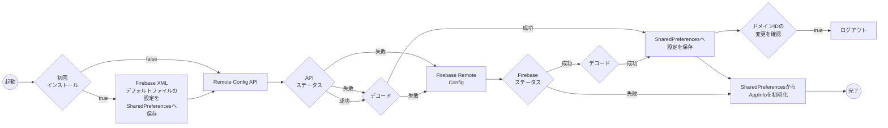
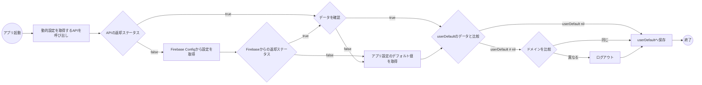

## 概要

1. 目的

    1. パートナーとの連携時における設定ミスを最小限に抑える

    2. 緊急時にドメインや設定をカスタマイズできるようにし、SDKの再ビルド -> アプリの再審査を回避する

2. 補足情報

    SDKはまずBE APIから設定を取得することを優先します。APIの呼び出しが失敗するか、返却されたデータをデコードできない場合、SDKは自動的にFirebase Remote Configへフォールバックします。両方のソースが失敗した場合、SDKは以前にSharedPreferencesへ保存しておいた設定を使用します（初回インストール時はFirebase XMLファイル内のデフォルト設定を使用）。

## API

1. フローチャート

    - Android

    - IOS

2. 詳細

    - 本番ドメイン: [https://config.vapi24.vn](https://config.vapi24.vn/)

    - ベータドメイン: https://beta-config.vapi24.vn

## Firebase Remote Config

1. フローチャート

2. 詳細

## バージョン

| **Platform** | **Inventory** | **Tag version** | **CommitID** | **Release date** |
| --- | --- | --- | --- | --- |
| Android | | | | |
| IOS | | | | |
