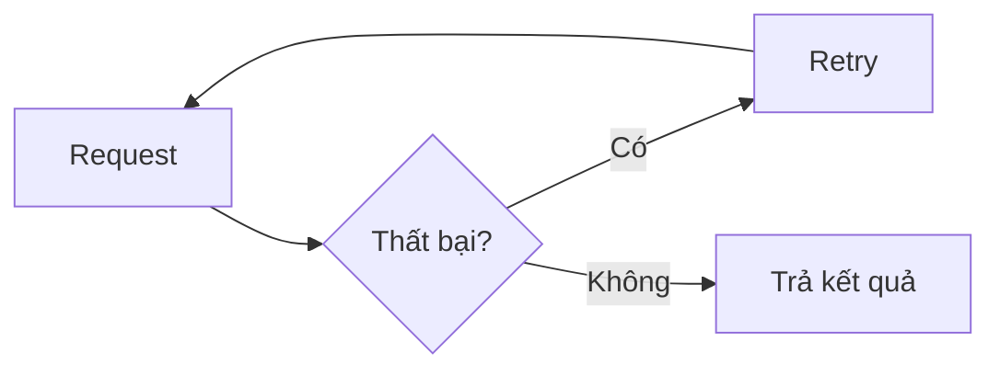

Khung chú thích (**Callout**, còn gọi là **Aside**) là khối nội dung được tách riêng khỏi luồng văn bản chính để thu hút sự chú ý của người đọc.

Trong technical documentation, khung chú thích thường được dùng để:

* Cảnh báo hành vi nguy hiểm hoặc không thể đảo ngược.
* Nhấn mạnh một lưu ý dễ bị bỏ qua.
* Gợi ý một cách làm tốt hơn.
* Nêu bật lỗi thường gặp.

Ví dụ, thay vì viết một đoạn văn bình thường:

```md title="Đoạn văn thông thường"
Lưu ý: xoá branch bằng lệnh này sẽ không thể khôi phục lại.
```

có thể viết bằng khung chú thích:

**Mã nguồn**

```mdx showLineNumbers title="Viết bằng Khung chú thích"
:::caution[Cảnh báo]
Xoá branch bằng lệnh này sẽ không thể khôi phục lại.
:::
```

**Thử nghiệm**

:::caution[Cảnh báo]
Xoá branch bằng lệnh này sẽ không thể khôi phục lại.
:::

Khung chú thích giúp thông tin quan trọng nổi bật hơn so với phần còn lại của trang, thay vì bị chìm giữa các đoạn văn dài.

---

## 1. Cú pháp Khung chú thích cơ bản

Trong MDX với Starlight, khung chú thích được tạo bằng cú pháp `:::` (ba dấu hai chấm), theo sau là loại khung chú thích.

**Mã nguồn**

```mdx showLineNumbers title="Khung chú thích cơ bản"
:::note
Đây là một lưu ý thông thường.
:::
```

**Thử nghiệm**

:::note
Đây là một lưu ý thông thường.
:::

Cấu trúc gồm ba phần:

1. Dòng mở `:::<type>` xác định loại khung chú thích.
2. Nội dung khung chú thích, viết bằng Markdown bình thường.
3. Dòng đóng `:::`.

:::caution[Cảnh báo]
Dòng mở và dòng đóng phải có cùng số dấu `:`. Nếu khung chú thích chứa nội dung lồng bên trong cũng dùng cú pháp `:::` (ví dụ khung chú thích trong tab), khối bọc ngoài phải dùng nhiều dấu `:` hơn khối bên trong để tránh bị đóng sai vị trí.
:::

---

## 2. Các loại Khung chú thích

Starlight hỗ trợ bốn loại khung chú thích, mỗi loại mang một mức độ quan trọng khác nhau.

| Loại      | Mục đích                                  |
| --------- | ------------------------------------------ |
| `note`    | Thông tin bổ sung, trung tính              |
| `tip`     | Gợi ý, cách làm tốt hơn                    |
| `caution` | Cảnh báo, cần chú ý trước khi tiếp tục      |
| `danger`  | Nguy hiểm, hành vi có thể gây hậu quả nghiêm trọng |

### Note

**Mã nguồn**

```mdx showLineNumbers title="Note"
:::note
Component này chỉ hoạt động trong môi trường client-side.
:::
```

**Thử nghiệm**

:::note
Component này chỉ hoạt động trong môi trường client-side.
:::

`note` phù hợp cho thông tin bổ sung mà người đọc nên biết, nhưng không mang tính cảnh báo.

### Tip

**Mã nguồn**

```mdx showLineNumbers title="Tip"
:::tip
Dùng `showLineNumbers` khi cần tham chiếu đến một dòng code cụ thể trong phần giải thích.
:::
```

**Thử nghiệm**

:::tip
Dùng `showLineNumbers` khi cần tham chiếu đến một dòng code cụ thể trong phần giải thích.
:::

`tip` phù hợp khi muốn gợi ý một cách làm hiệu quả hơn, không bắt buộc nhưng nên áp dụng.

### Caution

**Mã nguồn**

```mdx showLineNumbers title="Caution"
:::caution
Đổi tên API parameter là một breaking change đối với client cũ.
:::
```

**Thử nghiệm**

:::caution
Đổi tên API parameter là một breaking change đối với client cũ.
:::

`caution` phù hợp khi hành động có thể gây ra vấn đề, nhưng chưa đến mức nguy hiểm hoặc phá vỡ hệ thống.

### Danger

**Mã nguồn**

```mdx showLineNumbers title="Danger"
:::danger
Chạy migration này trên production sẽ xoá toàn bộ dữ liệu của table `orders`.
:::
```

**Thử nghiệm**

:::danger
Chạy migration này trên production sẽ xoá toàn bộ dữ liệu của table `orders`.
:::

`danger` chỉ nên dùng cho hành vi có thể gây mất dữ liệu, downtime hoặc hậu quả nghiêm trọng khác.

---

## 3. Đổi tiêu đề của Khung chú thích

Mỗi loại khung chú thích có tiêu đề mặc định (`Note`, `Tip`, `Caution`, `Danger`). Có thể đổi tiêu đề bằng cách đặt text trong dấu `[]` ngay sau type.

**Mã nguồn**

```mdx showLineNumbers title="Khung chú thích có tiêu đề riêng"
:::danger[Không thể khôi phục]
Xoá bucket này sẽ xoá toàn bộ file bên trong, không thể hoàn tác.
:::
```

**Thử nghiệm**

:::danger[Không thể khôi phục]
Xoá bucket này sẽ xoá toàn bộ file bên trong, không thể hoàn tác.
:::

Tiêu đề riêng nên ngắn gọn và mô tả đúng bản chất của cảnh báo, thay vì lặp lại từ "Cảnh báo" hoặc "Lưu ý" một cách chung chung.

Ví dụ nên:

```mdx title="Tiêu đề cụ thể"
:::caution[Rate limit]
API này giới hạn 100 requests mỗi phút.
:::
```

thay vì:

```mdx title="Tiêu đề chung"
:::caution[Cảnh báo]
API này giới hạn 100 requests mỗi phút.
:::
```

khi tiêu đề cụ thể giúp người đọc scan trang nhanh hơn.

---

## 4. Khung chú thích với nhiều dòng nội dung

Khung chú thích có thể chứa nhiều đoạn văn, list hoặc các thành phần Markdown khác.

**Mã nguồn**

```mdx showLineNumbers title="Khung chú thích nhiều dòng"
:::caution[Trước khi deploy]
Kiểm tra các bước sau trước khi deploy lên production:

* Đã chạy migration ở staging.
* Đã backup database.
* Đã thông báo cho team liên quan.
:::
```

**Thử nghiệm**

:::caution[Trước khi deploy]
Kiểm tra các bước sau trước khi deploy lên production:

* Đã chạy migration ở staging.
* Đã backup database.
* Đã thông báo cho team liên quan.
:::

Cách này phù hợp khi khung chú thích cần truyền đạt nhiều hơn một câu, nhưng vẫn nên giữ nội dung tập trung vào một chủ đề duy nhất.

---

## 5. Khung chú thích với Mã nguồn bên trong

Khung chú thích cũng có thể chứa fenced code block bên trong.

:::danger
Khi khung chú thích chứa code block, số dấu `:` của khung chú thích phải nhiều hơn số dấu backtick của code block bên trong, để MDX không hiểu lầm ranh giới giữa hai khối.
:::

**Mã nguồn**

````mdx showLineNumbers title="Khung chú thích chứa Mã nguồn"
::::caution[Cấu hình bắt buộc]
Nếu thiếu biến môi trường `DATABASE_URL`, ứng dụng sẽ không khởi động được:

```bash
export DATABASE_URL="postgres://localhost:5432/app"
```
::::
````

**Thử nghiệm**

::::caution[Cấu hình bắt buộc]
Nếu thiếu biến môi trường `DATABASE_URL`, ứng dụng sẽ không khởi động được:

```bash
export DATABASE_URL="postgres://localhost:5432/app"
```
::::

---

## 6. Khung chú thích với Mermaid bên trong

Vì Mermaid cũng là một fenced code block, quy tắc số dấu `:` tương tự áp dụng khi đặt sơ đồ Mermaid vào trong khung chú thích.

**Mã nguồn**

````mdx showLineNumbers title="Khung chú thích chứa Mermaid"
::::note[Luồng xử lý lỗi]
Khi request thất bại, hệ thống retry tối đa 3 lần trước khi báo lỗi cho người dùng:


::::
````

**Thử nghiệm**

::::note[Luồng xử lý lỗi]
Khi request thất bại, hệ thống retry tối đa 3 lần trước khi báo lỗi cho người dùng:


::::

Cách này hữu ích khi cần vừa cảnh báo, vừa minh hoạ trực quan cho cùng một hành vi.

---

## 7. Khung chú thích với Bảng bên trong

Table cũng có thể đặt bên trong khung chú thích khi cần liệt kê thông tin có cấu trúc kèm cảnh báo.

**Mã nguồn**

```mdx showLineNumbers title="Khung chú thích chứa Table"
:::caution[Breaking changes ở v2]
| Field cũ | Field mới | Ghi chú |
| --- | --- | --- |
| `user_id` | `userId` | Đổi sang camelCase |
| `created` | `createdAt` | Đổi tên và định dạng ISO 8601 |
:::
```

**Thử nghiệm**

:::caution[Breaking changes ở v2]
| Field cũ  | Field mới   | Ghi chú                       |
| --------- | ----------- | ------------------------------ |
| `user_id` | `userId`    | Đổi sang camelCase              |
| `created` | `createdAt` | Đổi tên và định dạng ISO 8601   |
:::

---

## 8. Khi nào nên dùng loại Khung chú thích nào?

Chọn sai loại khung chú thích khiến người đọc đánh giá sai mức độ quan trọng của thông tin.

Một quy tắc đơn giản:

| Tình huống                                        | Loại Khung chú thích |
| -------------------------------------------------- | :-----------: |
| Thông tin bổ sung, không ảnh hưởng nếu bỏ qua      | `note`        |
| Best practice, tối ưu, gợi ý cách làm hay hơn       | `tip`         |
| Có thể gây lỗi, breaking change, cần cẩn trọng     | `caution`     |
| Mất dữ liệu, downtime, hành vi không thể hoàn tác  | `danger`      |

:::tip
Nếu không chắc nên dùng `caution` hay `danger`, hãy tự hỏi: "Nếu người đọc bỏ qua khung chú thích này, hậu quả có thể khôi phục được không?" Nếu không, dùng `danger`.
:::

---

## 9. Không nên lạm dụng Khung chú thích

Khung chú thích chỉ hiệu quả khi được dùng có chọn lọc.

Không nên:

:::note
Hàm này nhận một tham số.
:::

:::note
Tham số này có kiểu `string`.
:::

:::note
Giá trị trả về là `boolean`.
:::

khi ba khung chú thích liên tiếp chỉ chứa thông tin thông thường, không có gì cần nhấn mạnh đặc biệt.

Nên gộp lại thành một đoạn văn hoặc table bình thường:

| Tham số | Type     | Trả về    |
| ------- | -------- | --------- |
| `input` | `string` | `boolean` |

:::caution[Cảnh báo]
Một trang tài liệu có quá nhiều khung chú thích sẽ làm mất tác dụng nhấn mạnh — người đọc sẽ có xu hướng lướt qua tất cả, kể cả những khung chú thích thực sự quan trọng. Chỉ dùng khung chú thích cho thông tin thật sự cần nổi bật.
:::

---

## 10. Khung chú thích không thay thế cấu trúc heading

Khung chú thích dùng để nhấn mạnh, không dùng để tổ chức nội dung chính của trang.

Không tốt:

:::note[Authentication]
Nội dung dài giải thích toàn bộ cơ chế authentication...
:::

Nếu đó là một phần nội dung chính của trang, hãy dùng heading:

```md title="Authentication"
## Authentication

Nội dung dài giải thích toàn bộ cơ chế authentication...
```

Khung chú thích nên đại diện cho **một lưu ý ngắn, đứng riêng khỏi mạch đọc chính**, không phải một section đầy đủ của trang.

---

## 11. Vị trí đặt Khung chú thích

Khung chú thích nên được đặt ngay tại điểm mà lưu ý đó có liên quan trực tiếp, không nên dồn tất cả khung chú thích lên đầu hoặc cuối trang.

Ví dụ tốt — đặt ngay sau đoạn mô tả liên quan:

````mdx showLineNumbers title="Đặt Khung chú thích đúng vị trí"
Chạy lệnh sau để xoá cache:

```bash
rm -rf .cache
```

:::caution
Lệnh này xoá toàn bộ cache, bao gồm cache của các build trước. Chỉ chạy khi chắc chắn không cần giữ lại.
:::

Sau khi xoá cache, chạy lại lệnh build.
````

Đặt khung chú thích đúng vị trí giúp người đọc nhận được cảnh báo **đúng lúc họ cần**, thay vì phải nhớ lại một cảnh báo đã đọc ở đầu trang.

---

## 12. Checklist trước khi dùng Khung chú thích

Trước khi thêm một khung chú thích, hãy tự hỏi:

* Thông tin này có thực sự cần nổi bật hơn văn bản thông thường không?
* Đã chọn đúng loại (`note`, `tip`, `caution`, `danger`) chưa?
* Tiêu đề (nếu có) đã mô tả đúng nội dung chưa?
* Khung chú thích có bị lạm dụng liên tiếp không?
* Khung chú thích có đang thay thế cho heading hoặc table không nên thay thế?
* Khung chú thích có được đặt đúng vị trí, gần nội dung liên quan không?
* Nếu khung chú thích chứa code block hoặc Mermaid, số dấu `:` đã nhiều hơn số dấu `` ` `` bên trong chưa?

---

## Tóm tắt

Khung chú thích là công cụ hữu ích để nhấn mạnh thông tin quan trọng trong technical documentation, nhưng chỉ phát huy hiệu quả khi được dùng đúng lúc và đúng loại.

Cấu trúc cơ bản:

```mdx showLineNumbers title="Khung chú thích"
:::note[Tiêu đề tuỳ chọn]
Nội dung khung chú thích.
:::
```

Nguyên tắc quan trọng nhất:

1. **Chọn loại khung chú thích đúng với mức độ quan trọng**: `note` → `tip` → `caution` → `danger`.
2. **Tiêu đề nên cụ thể**, tránh lặp lại tên loại một cách chung chung.
3. **Không lạm dụng khung chú thích** cho thông tin thông thường.
4. **Không dùng khung chú thích để thay thế heading hoặc table.**
5. **Đặt khung chú thích đúng vị trí**, ngay tại điểm liên quan.
6. **Khi khung chú thích chứa code block hoặc Mermaid**, tăng số dấu `:` để tránh lỗi parse.

Một khung chú thích tốt không phải là khung chú thích xuất hiện nhiều nhất trên trang, mà là khung chú thích khiến người đọc **dừng lại đúng lúc cần dừng lại**.
