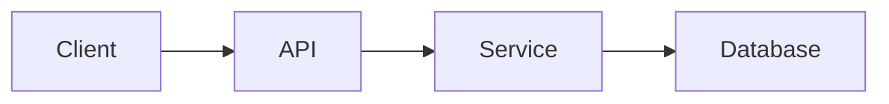
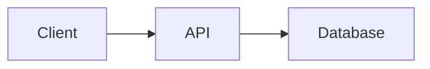
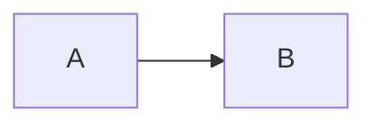
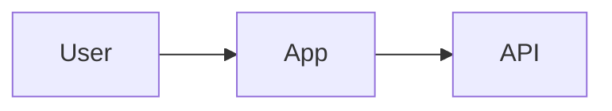
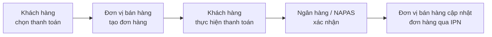
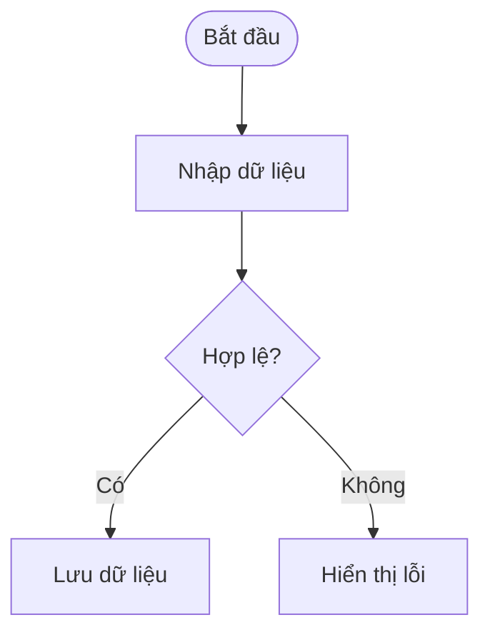
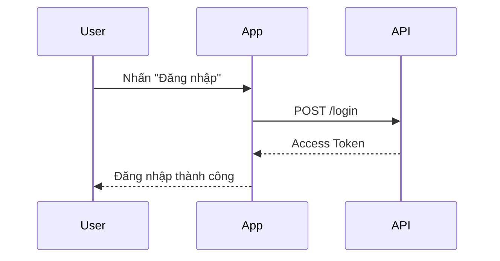
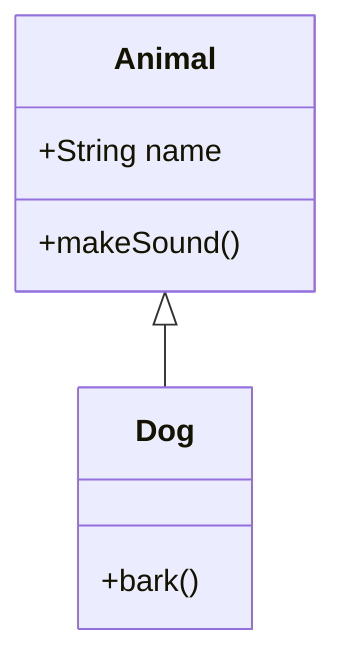
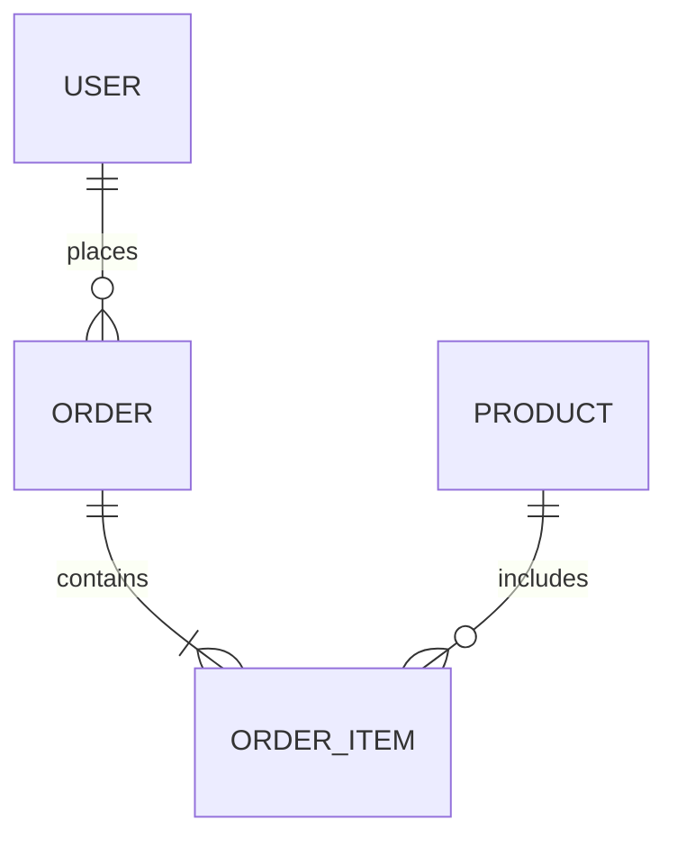

Mermaid là một ngôn ngữ mô tả diagram bằng text. Thay vì phải tự vẽ từng node, đường nối hay mũi tên, bạn chỉ cần mô tả cấu trúc của diagram bằng cú pháp Mermaid, sau đó hệ thống sẽ render phần mô tả đó thành hình ảnh trực quan.

Điểm thú vị là Mermaid vẫn được viết bên trong fenced code block của Markdown/MDX:

````mdx showLineNumbers title="Mermaid cơ bản"

````


Vì vậy, về mặt cú pháp MDX, Mermaid trông rất giống một code block thông thường. Tuy nhiên, nội dung bên trong không được dùng để chạy một chương trình hay chỉ đơn giản là syntax highlighting. Nó là **source code dùng để sinh ra một diagram**.

## Mermaid khác gì code block thông thường?

Một code block thông thường:

````mdx showLineNumbers title="TypeScript"
```ts
const user = {
    name: "Ninh",
    age: 22,
};
```
````

chủ yếu dùng để hiển thị source code với syntax highlighting.

Trong khi đó, Mermaid:

````mdx showLineNumbers title="Flowchart"

````

được dùng để mô tả một diagram.

Có thể hiểu đơn giản:

| Loại      | Mục đích                |
| --------- | ----------------------- |
| `ts`      | Hiển thị TypeScript     |
| `java`    | Hiển thị Java           |
| `json`    | Hiển thị JSON           |
| `css`     | Hiển thị CSS            |
| `mermaid` | Mô tả và render diagram |

Identifier `mermaid` vì vậy có ý nghĩa nhiều hơn việc chọn syntax highlighting. Nó cho hệ thống biết rằng nội dung bên trong cần được xử lý như một diagram.

## Cấu trúc cơ bản

Một sơ đồ Mermaid thường bắt đầu bằng keyword xác định loại sơ đồ:

````mdx showLineNumbers title="Cấu trúc Mermaid"

````


Trong ví dụ trên:

* `flowchart` xác định loại diagram.
* `LR` xác định hướng vẽ từ **Left → Right**.
* `A` và `B` là các node.
* `-->` tạo mối liên kết giữa hai node.

Từ keyword đầu tiên, Mermaid sẽ xác định parser và cú pháp được phép sử dụng bên trong diagram.

:::note
Luôn để một dòng trống trước và sau fenced code block Mermaid trong MDX. Nếu block nằm sát ngay một dòng text hoặc một bảng phía trên, một số MDX parser có thể không nhận diện đúng code fence và khiến diagram không render.
:::

---

## Cách người dùng sử dụng Mermaid

Khi đọc tài liệu có Mermaid, người dùng thường làm việc với hai phần: **source Mermaid** và **sơ đồ đã render**.

## Viết Mermaid trong MDX

Để tạo một sơ đồ, viết Mermaid bên trong fenced code block và dùng identifier `mermaid`:

````mdx showLineNumbers title="Ví dụ Mermaid"

````

Phần này là source để hệ thống render thành sơ đồ. Nếu cần đặt tên riêng cho khung sơ đồ, thêm dòng comment `%% title:` ở đầu source:

````mdx showLineNumbers title="Mermaid có tiêu đề"

````

## Xem sơ đồ đã render

Ngay bên dưới phần code, tài liệu nên đặt một block Mermaid thật để người đọc thấy kết quả:


Trong khung render, người dùng có thể:

* Nhấn **Fullscreen** để mở sơ đồ ở chế độ xem lớn.
* Dùng **+** và **-** để zoom, tối đa 1000%.
* Kéo chuột để pan khi sơ đồ lớn hơn màn hình.
* Nhấn **0** để reset zoom và vị trí.
* Giữ phím **C** để xem Mermaid source code, thả **C** để quay lại sơ đồ.
* Nhấn **Esc** để đóng màn hình xem lớn.

Nếu một loại sơ đồ chưa được Mermaid version hiện tại hỗ trợ, khung render sẽ báo không render được thay vì làm vỡ layout của trang.

:::caution
Khi dùng các diagram type có hậu tố `-beta` (`architecture-beta`, `packet-beta`, `radar-beta`, `sankey-beta`, `treemap-beta`, `xychart-beta`), hãy kiểm tra Mermaid version của project trước khi đưa vào tài liệu chính thức. Cú pháp beta có thể thay đổi giữa các phiên bản, và diagram render đúng ở local chưa chắc render đúng trên production nếu version không khớp.
:::

---

## Các loại sơ đồ Mermaid

Mermaid hỗ trợ nhiều loại diagram phục vụ các mục đích khác nhau. Không nên cố dùng một loại diagram cho mọi tình huống; hãy chọn loại phù hợp với thông tin cần truyền đạt.

## Flowchart

**Flowchart** phù hợp để mô tả luồng xử lý, điều kiện, quy trình hoặc logic của một hệ thống.

**Mã nguồn**

````mdx showLineNumbers title="Flowchart"

````

**Thử nghiệm**


`LR` nghĩa là **Left to Right**. Ngoài `LR`, flowchart thường sử dụng:

* `TD` — Top to Down.
* `TB` — Top to Bottom.
* `RL` — Right to Left.
* `BT` — Bottom to Top.

Ví dụ với luồng thanh toán SePay:

**Mã nguồn**

````mdx showLineNumbers title="Luồng thanh toán SePay (nghiệp vụ)"

````

**Thử nghiệm**


Ví dụ với nhánh điều kiện:

**Mã nguồn**

````mdx showLineNumbers title="Flowchart với điều kiện"

````

**Thử nghiệm**



---

## Sequence Diagram

**Sequence Diagram** dùng để mô tả thứ tự tương tác giữa các thành phần trong một hệ thống.

Đây là một trong những loại diagram hữu ích nhất khi viết tài liệu API, authentication hoặc communication flow.

**Mã nguồn**

````mdx showLineNumbers title="Sequence Diagram"

````

**Thử nghiệm**


Một số arrow thường gặp:

* `->>` — message.
* `-->>` — response.
* `-)` — asynchronous message.
* `--x` — message kết thúc bằng X.

---

## Class Diagram

**Class Diagram** phù hợp để mô tả class, thuộc tính, method và quan hệ giữa các class.

**Mã nguồn**

````mdx showLineNumbers title="Class Diagram"

````

**Thử nghiệm**


---

## Entity Relationship Diagram

**ER Diagram** thường được dùng để mô tả database và quan hệ giữa các entity.

**Mã nguồn**

````mdx showLineNumbers title="Entity Relationship Diagram"

````

**Thử nghiệm**


Đây là lựa chọn rất phù hợp khi tài liệu cần giải thích database schema ở mức tổng quan.

---

## State Diagram

**State Diagram** dùng để mô tả trạng thái của một object hoặc process và các transition giữa chúng.

**Mã nguồn**

````mdx showLineNumbers title="State Diagram"
```mermaid
stateDiagram-v2
    [*] --> Pending
    Pending --> Paid
    Paid --> Shipped
    Shipped --> [*]
```
````

**Thử nghiệm**

```mermaid
stateDiagram-v2
    [*] --> Pending
    Pending --> Paid
    Paid --> Shipped
    Shipped --> [*]
```

---

## Mindmap

**Mindmap** phù hợp để trình bày cấu trúc phân cấp của một chủ đề.

**Mã nguồn**

````mdx showLineNumbers title="Mindmap"
```mermaid
mindmap
    root((Product))
        Backend
            API
            Database
        Frontend
            Web
            Mobile
```
````

**Thử nghiệm**

```mermaid
mindmap
    root((Product))
        Backend
            API
            Database
        Frontend
            Web
            Mobile
```

---

## Architecture Diagram

Architecture Diagram dùng để mô tả kiến trúc giữa các service hoặc thành phần hạ tầng.

**Mã nguồn**

````mdx showLineNumbers title="Architecture Diagram"
```mermaid
architecture-beta
    group api(cloud)[API]
    service server(server)[Server] in api
    service db(database)[Database] in api
    server:R -- L:db
```
````

**Thử nghiệm**

```mermaid
architecture-beta
    group api(cloud)[API]
    service server(server)[Server] in api
    service db(database)[Database] in api
    server:R -- L:db
```

---

## Block Diagram

Block Diagram dùng để mô tả các block và mối quan hệ giữa chúng.

**Mã nguồn**

````mdx showLineNumbers title="Block Diagram"
```mermaid
block-beta
    columns 3
    Client Gateway Service
```
````

**Thử nghiệm**

```mermaid
block-beta
    columns 3
    Client Gateway Service
```

---

## C4 Diagram

C4 Diagram phù hợp để mô tả kiến trúc phần mềm theo mô hình C4.

**Mã nguồn**

````mdx showLineNumbers title="C4 Context"
```mermaid
C4Context
    Person(user, "User")
    System(app, "Application")
    Rel(user, app, "Uses")
```
````

**Thử nghiệm**

```mermaid
C4Context
    Person(user, "User")
    System(app, "Application")
    Rel(user, app, "Uses")
```

---

## Gantt Chart

Gantt Chart dùng để biểu diễn kế hoạch và tiến độ công việc theo thời gian.

**Mã nguồn**

````mdx showLineNumbers title="Gantt Chart"
```mermaid
gantt
    title Release Plan
    dateFormat YYYY-MM-DD

    section Backend
    API Design       :a1, 2026-01-01, 5d
    API Development  :a2, after a1, 10d
```
````

**Thử nghiệm**

```mermaid
gantt
    title Release Plan
    dateFormat YYYY-MM-DD

    section Backend
    API Design       :a1, 2026-01-01, 5d
    API Development  :a2, after a1, 10d
```

---

## Git Graph

Git Graph dùng để mô tả branch, commit và merge trong Git.

**Mã nguồn**

````mdx showLineNumbers title="Git Graph"
```mermaid
gitGraph
    commit
    branch feature
    checkout feature
    commit
    checkout main
    merge feature
```
````

**Thử nghiệm**

```mermaid
gitGraph
    commit
    branch feature
    checkout feature
    commit
    checkout main
    merge feature
```

---

## Kanban

Kanban dùng để mô tả trạng thái của các task.

**Mã nguồn**

````mdx showLineNumbers title="Kanban"
```mermaid
kanban
    Todo
        Task A
        Task B
    Doing
        Task C
    Done
        Task D
```
````

**Thử nghiệm**

```mermaid
kanban
    Todo
        Task A
        Task B
    Doing
        Task C
    Done
        Task D
```

---

## Packet Diagram

Packet Diagram phù hợp để mô tả cấu trúc bit hoặc field của một network packet.

**Mã nguồn**

````mdx showLineNumbers title="Packet Diagram"
```mermaid
packet-beta
    0-15: "Source Port"
    16-31: "Destination Port"
```
````

**Thử nghiệm**

```mermaid
packet-beta
    0-15: "Source Port"
    16-31: "Destination Port"
```

---

## Pie Chart

Pie Chart dùng để thể hiện tỷ lệ giữa các nhóm dữ liệu.

**Mã nguồn**

````mdx showLineNumbers title="Pie Chart"
```mermaid
pie title Traffic Source
    "Organic" : 45
    "Referral" : 25
    "Direct" : 30
```
````

**Thử nghiệm**

```mermaid
pie title Traffic Source
    "Organic" : 45
    "Referral" : 25
    "Direct" : 30
```

---

## Quadrant Chart

Quadrant Chart dùng để phân loại các yếu tố dựa trên hai trục.

**Mã nguồn**

````mdx showLineNumbers title="Quadrant Chart"
```mermaid
quadrantChart
    title Feature Priority
    x-axis Low Impact --> High Impact
    y-axis Low Effort --> High Effort
    quadrant-1 Do first
    quadrant-2 Plan
    quadrant-3 Avoid
    quadrant-4 Delegate
```
````

**Thử nghiệm**

```mermaid
quadrantChart
    title Feature Priority
    x-axis Low Impact --> High Impact
    y-axis Low Effort --> High Effort
    quadrant-1 Do first
    quadrant-2 Plan
    quadrant-3 Avoid
    quadrant-4 Delegate
```

---

## Radar Chart

Radar Chart dùng để so sánh nhiều thuộc tính của một hoặc nhiều đối tượng.

**Mã nguồn**

````mdx showLineNumbers title="Radar Chart"
```mermaid
radar-beta
    axis Speed, Security, Cost, UX
    curve Product["Speed": 80, "Security": 60, "Cost": 40, "UX": 90]
```
````

**Thử nghiệm**

```mermaid
radar-beta
    axis Speed, Security, Cost, UX
    curve Product["Speed": 80, "Security": 60, "Cost": 40, "UX": 90]
```

---

## Requirement Diagram

Requirement Diagram dùng để mô tả requirement và mối quan hệ giữa requirement với các thành phần hệ thống.

**Mã nguồn**

````mdx showLineNumbers title="Requirement Diagram"
```mermaid
requirementDiagram
    requirement loginReq {
        id: 1
        text: User must be able to log in
        risk: medium
    }
```
````

**Thử nghiệm**

```mermaid
requirementDiagram
    requirement loginReq {
        id: 1
        text: User must be able to log in
        risk: medium
    }
```

---

## Sankey Diagram

Sankey Diagram dùng để biểu diễn luồng và tỷ trọng dữ liệu giữa các nhóm.

**Mã nguồn**

````mdx showLineNumbers title="Sankey Diagram"
```mermaid
sankey-beta
Traffic,Organic,45
Traffic,Referral,25
Traffic,Direct,30
```
````

**Thử nghiệm**

```mermaid
sankey-beta
Traffic,Organic,45
Traffic,Referral,25
Traffic,Direct,30
```

---

## Timeline

Timeline dùng để mô tả các sự kiện theo trình tự thời gian.

**Mã nguồn**

````mdx showLineNumbers title="Timeline"
```mermaid
timeline
    title Product Roadmap
    2026 Q1 : Launch MVP
    2026 Q2 : Add payments
    2026 Q3 : Scale infrastructure
```
````

**Thử nghiệm**

```mermaid
timeline
    title Product Roadmap
    2026 Q1 : Launch MVP
    2026 Q2 : Add payments
    2026 Q3 : Scale infrastructure
```

---

## Treemap

Treemap dùng để biểu diễn dữ liệu phân cấp theo diện tích.

**Mã nguồn**

````mdx showLineNumbers title="Treemap"
```mermaid
treemap-beta
    "Revenue"
        "Product A": 40
        "Product B": 35
        "Product C": 25
```
````

**Thử nghiệm**

```mermaid
treemap-beta
    "Revenue"
        "Product A": 40
        "Product B": 35
        "Product C": 25
```

---

## User Journey

User Journey dùng để mô tả trải nghiệm hoặc các bước mà người dùng thực hiện trong một quy trình.

**Mã nguồn**

````mdx showLineNumbers title="User Journey"
```mermaid
journey
    title Checkout Journey
    section Cart
        Add item: 5: User
    section Payment
        Enter card: 3: User
        Confirm: 4: User
```
````

**Thử nghiệm**

```mermaid
journey
    title Checkout Journey
    section Cart
        Add item: 5: User
    section Payment
        Enter card: 3: User
        Confirm: 4: User
```

---

## XY Chart

XY Chart phù hợp với dữ liệu có trục X/Y như biểu đồ cột hoặc đường.

**Mã nguồn**

````mdx showLineNumbers title="XY Chart"
```mermaid
xychart-beta
    title "Monthly Revenue"
    x-axis [Jan, Feb, Mar]
    y-axis "Revenue" 0 --> 1000
    bar [300, 500, 800]
```
````

**Thử nghiệm**

```mermaid
xychart-beta
    title "Monthly Revenue"
    x-axis [Jan, Feb, Mar]
    y-axis "Revenue" 0 --> 1000
    bar [300, 500, 800]
```

---

## ZenUML

ZenUML cho phép mô tả sequence diagram bằng cú pháp gần với code.

**Mã nguồn**

````mdx showLineNumbers title="ZenUML"
```mermaid
zenuml
    Client->API: request()
    API->Client: response()
```
````

**Thử nghiệm**

```mermaid
zenuml
    Client->API: request()
    API->Client: response()
```

---

## Flowchart chuyên sâu

Flowchart là một trong những loại diagram phổ biến nhất khi viết technical documentation.

Thay vì mô tả một quy trình dài bằng nhiều đoạn văn, bạn có thể chuyển nó thành một diagram để người đọc nhìn thấy toàn bộ flow trong một lần.

Ví dụ một authentication flow:

**Mã nguồn**

````mdx showLineNumbers title="Authentication Flow"
```mermaid
flowchart TD
    Start([Start]) --> Login[Login Request]
    Login --> Validate{Credentials valid?}

    Validate -- Yes --> Token[Generate Token]
    Validate -- No --> Error[Return Error]

    Token --> Response[Return Response]
    Error --> End([End])
    Response --> End
```
````

**Thử nghiệm**

```mermaid
flowchart TD
    Start([Start]) --> Login[Login Request]
    Login --> Validate{Credentials valid?}

    Validate -- Yes --> Token[Generate Token]
    Validate -- No --> Error[Return Error]

    Token --> Response[Return Response]
    Error --> End([End])
    Response --> End
```

## Subgraph

Khi flowchart có nhiều thành phần, `subgraph` có thể được sử dụng để nhóm các node liên quan.

**Mã nguồn**

````mdx showLineNumbers title="Flowchart với Subgraph"
```mermaid
flowchart LR
    subgraph Client
        Mobile
        Web
    end

    subgraph Backend
        API
        Service
        Database
    end

    Mobile --> API
    Web --> API
    API --> Service
    Service --> Database
```
````

**Thử nghiệm**

```mermaid
flowchart LR
    subgraph Client
        Mobile
        Web
    end

    subgraph Backend
        API
        Service
        Database
    end

    Mobile --> API
    Web --> API
    API --> Service
    Service --> Database
```

`subgraph` đặc biệt hữu ích khi mô tả architecture vì nó giúp người đọc phân biệt được boundary giữa frontend, backend, database hoặc các hệ thống bên ngoài.

---

## Sequence Diagram chuyên sâu

Sequence Diagram đặc biệt hữu ích khi tài liệu cần giải thích API request/response.

Ví dụ một OAuth login flow:

**Mã nguồn**

````mdx showLineNumbers title="OAuth Authentication Flow"
```mermaid
sequenceDiagram
    participant User
    participant App
    participant OAuth
    participant API

    User->>App: Click Login
    App->>OAuth: Authorization Request
    OAuth-->>App: Authorization Code
    App->>API: Exchange Code
    API->>OAuth: Verify Code
    OAuth-->>API: Access Token
    API-->>App: Session
    App-->>User: Login Success
```
````

**Thử nghiệm**

```mermaid
sequenceDiagram
    participant User
    participant App
    participant OAuth
    participant API

    User->>App: Click Login
    App->>OAuth: Authorization Request
    OAuth-->>App: Authorization Code
    App->>API: Exchange Code
    API->>OAuth: Verify Code
    OAuth-->>API: Access Token
    API-->>App: Session
    App-->>User: Login Success
```

Khi tài liệu mô tả API, authentication, payment hoặc communication giữa nhiều service, sequence diagram thường dễ đọc hơn rất nhiều so với một danh sách request/response dài.

---

## Khi nào nên sử dụng Mermaid?

Mermaid đặc biệt phù hợp khi thông tin có **quan hệ, thứ tự hoặc cấu trúc**.

Nên sử dụng Mermaid khi:

* Có nhiều component tương tác với nhau.
* Có flow xử lý nhiều bước.
* Có nhánh `if/else`.
* Cần mô tả request/response.
* Cần mô tả architecture.
* Cần mô tả database relationship.
* Cần mô tả lifecycle hoặc state.
* Cần mô tả timeline hoặc roadmap.
* Cần mô tả branch/merge của Git.

Ngược lại, không phải mọi thứ đều cần diagram.

Nếu một quy trình chỉ có hai hoặc ba bước đơn giản:

> User đăng nhập → API xác thực → Server trả token.

thì một đoạn văn có thể dễ đọc hơn cả một diagram.

---

## Giữ sơ đồ Mermaid dễ đọc

Một diagram quá lớn có thể phản tác dụng. Nếu người đọc phải zoom hoặc kéo màn hình liên tục mới hiểu được flow thì diagram đang làm tài liệu khó đọc hơn.

Một số nguyên tắc nên áp dụng:

### 1. Một diagram nên có một mục đích

Thay vì đưa toàn bộ architecture vào một diagram khổng lồ, hãy tách thành:

* High-level architecture.
* Authentication flow.
* Payment flow.
* Database relationship.
* Deployment architecture.

### 2. Không nhồi quá nhiều node

Nếu một flowchart bắt đầu có quá nhiều node hoặc quá nhiều nhánh, hãy cân nhắc tách thành nhiều diagram.

### 3. Đặt tên node rõ ràng

Không nên:

```text
A --> B --> C
```

nếu diagram dành cho người đọc tài liệu.

Thay vào đó:

```text
Client --> API --> Auth Service --> Database
```

:::danger
Tránh dùng ký tự đặc biệt như `"`, `(`, `)`, `:`, `#` hoặc xuống dòng thô bên trong label của node mà không bọc trong dấu ngoặc kép. Đây là nguyên nhân phổ biến nhất khiến Mermaid parse lỗi cú pháp, và khi đó cả diagram — thậm chí cả trang tài liệu — có thể không render được thay vì chỉ báo lỗi ở đúng chỗ sai.
:::

### 4. Dùng đúng loại diagram

Không nên dùng flowchart cho mọi thứ.

| Nội dung           | Diagram phù hợp   |
| ------------------ | ----------------- |
| Process / logic    | Flowchart         |
| Request / response | Sequence          |
| Class relationship | Class             |
| Database           | ER Diagram        |
| State / lifecycle  | State             |
| Architecture       | Architecture / C4 |
| Git workflow       | Git Graph         |
| Timeline           | Timeline / Gantt  |
| User experience    | User Journey      |
| Data proportion    | Pie / Sankey      |
| Metrics            | XY / Radar        |

---

## Mermaid và MDX

Trong MDX, Mermaid có thể được đặt cạnh các code block thông thường.

Ví dụ cùng một trang có thể chứa cả TypeScript và Mermaid:

**Mã nguồn**

````mdx showLineNumbers title="TypeScript + Mermaid"
```ts
const user = await api.getUser();
```

```mermaid
flowchart LR
    App --> API --> Database
```
````

**Thử nghiệm**

```ts
const user = await api.getUser();
```

```mermaid
flowchart LR
    App --> API --> Database
```

Điều này giúp technical documentation kết hợp được **source code** và **visual explanation** trong cùng một trang.

---

## Lưu ý về phiên bản Mermaid

Không phải mọi diagram đều có cùng mức độ ổn định giữa các phiên bản Mermaid.

Một số syntax có hậu tố `-beta`, ví dụ:

* `architecture-beta`
* `packet-beta`
* `radar-beta`
* `sankey-beta`
* `treemap-beta`
* `xychart-beta`

Vì vậy, trước khi đưa một loại diagram mới vào documentation chính thức, nên kiểm tra:

1. Mermaid version của project.
2. Diagram type có được version đó hỗ trợ hay không.
3. Syntax hiện tại có thay đổi so với documentation của Mermaid hay không.
4. Build production có render diagram giống môi trường development hay không.

Đặc biệt, không nên chỉ kiểm tra bằng cách nhìn source. Một sơ đồ Mermaid có thể hợp lệ về mặt cú pháp nhưng vẫn không render nếu integration hoặc version của Mermaid không hỗ trợ loại sơ đồ đó.

---

## Mermaid Rendering trong Documentation

Mermaid không tự động biến thành diagram chỉ vì Markdown có:

````md
```mermaid
...
```
````

Project cần có một **Mermaid rendering pipeline** để nhận diện code block `mermaid`, parse source và render thành diagram.

Pipeline cụ thể phụ thuộc vào cách project được xây dựng. Ví dụ có thể là:

* Markdown/MDX plugin.
* Remark/Rehype integration.
* Starlight integration.
* Mermaid component.
* Client-side Mermaid rendering.
* Build-time diagram rendering.

Vì vậy, documentation của project nên mô tả **pipeline thực tế đang được sử dụng**, thay vì giả định rằng mọi MDX environment đều xử lý Mermaid giống nhau.

---

## Tóm tắt

Mermaid là một cách mạnh mẽ để biến text thành diagram trong technical documentation.

Về mặt MDX, Mermaid vẫn sử dụng fenced code block:

````mdx showLineNumbers title="Mermaid"
```mermaid
flowchart LR
    Client --> API --> Database
```
````

nhưng thay vì chỉ hiển thị source code, hệ thống có thể render source đó thành một diagram trực quan.

Khi viết documentation, hãy nhớ:

* Dùng `mermaid` làm code fence identifier.
* Chọn đúng loại diagram cho nội dung.
* Luôn cung cấp source code để người đọc có thể copy.
* Render diagram ngay bên dưới để người đọc thấy kết quả.
* Tách diagram lớn thành nhiều diagram nhỏ.
* Kiểm tra Mermaid version trước khi sử dụng syntax mới.
* Đảm bảo MDX/Markdown pipeline của project thực sự hỗ trợ Mermaid.

Một pattern tốt cho documentation là:

````mdx showLineNumbers title="Thử nghiệm tên diagram"
```mermaid
flowchart LR
    Client --> API --> Database
```
````

sau đó hiển thị ngay **Thử nghiệm Mermaid** bên dưới. Cách trình bày này vừa cho người đọc xem được kết quả, vừa cho phép developer copy chính xác source để sử dụng lại.
