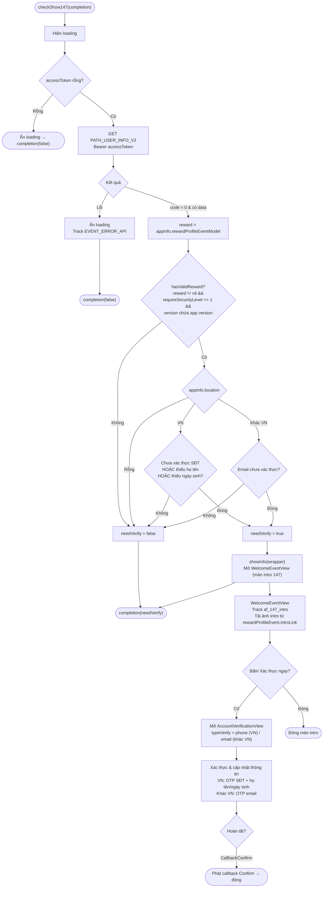

Tài liệu mô tả luồng `show147`, dựng từ code thực tế: `Sdk.checkShow147()` (Sdk+Ext.swift),
`WelcomeEventView` (màn giới thiệu) và `AccountVerificationView` (màn xác thực).

> "147" tương ứng yêu cầu định danh người dùng (Nghị định 147). SDK quyết định có bắt buộc
người dùng xác thực hay không dựa trên cấu hình sự kiện và trạng thái tài khoản, rồi hiển
thị màn giới thiệu và dẫn sang màn xác thực.

Điểm vào (app gọi, thường sau đăng nhập hoặc khi vào game):

```Swift
Sdk.sharedInstance.checkShow147 { needVerify in
    // needVerify = true nếu SDK đã hiển thị màn định danh 147
}
```

## Sơ đồ tổng quan



## Mô tả chi tiết

### 1. `checkShow147()` – quyết định có bắt buộc định danh (Sdk+Ext.swift)

1. Hiện loading. Nếu `accessToken` rỗng → ẩn loading và `completion(false)` (chưa đăng nhập
thì không xét).

2. Gọi `PATH_USER_INFO_V2` (GET, Bearer accessToken) để lấy thông tin tài khoản.

    - **Lỗi**: ẩn loading, track `EVENT_ERROR_API` (`id_check_token_api`), `completion(false)`.

    - **code = 0 và có data**: tính `needVerify` theo quy tắc bên dưới.

Quy tắc tính `needVerify`:

- `reward = appInfo.rewardProfileEventModel` (cấu hình sự kiện định danh).

- `hasValidReward = reward != nil && reward.requireSecurityLevel == 1 && reward.version` chứa
version hiện tại của app.

- Nếu `appInfo.location` rỗng → `needVerify = false`.

- Ngược lại nếu `hasValidReward`:

    - **Việt Nam (`location == "VN"`)**: `needVerify = true` khi **chưa xác thực SĐT**, hoặc
    **thiếu họ tên**, hoặc **thiếu ngày sinh**.

    - **Ngoài Việt Nam**: `needVerify = true` khi **email chưa xác thực**.

Nếu `needVerify == true` → gọi `showInfo(wrapper)` mở màn giới thiệu. Cuối cùng luôn trả
`completion(needVerify)` để app biết SDK có hiển thị màn định danh hay không.

### 2. `WelcomeEventView` – màn giới thiệu 147

Khi mở, màn này gửi tracking `af_147_intro` (kèm `account_id`, `location`, `type` = PHONE/EMAIL,
`requireSecurityLevel`, `version`) và tải ảnh giới thiệu từ `rewardProfileEvent.introLink`
(ảnh mặc định theo hướng màn hình).

- **Bấm "Xác thực ngay"** (`btnConfirmNow`): đóng màn intro và mở `AccountVerificationView`
với `typeVerify = .phone` nếu ở VN, ngược lại `.email`. Truyền `userWrapper` và `delegate`.

- **Đóng**: gỡ màn intro.

### 3. `AccountVerificationView` – màn xác thực & hoàn thiện thông tin

Tùy `typeVerify` và trạng thái tài khoản, màn này xử lý:

- **VN (`.phone`)**: gửi/nhập OTP số điện thoại (`PATH_OTP_PHONE_V2` + verify) và bổ sung
**họ tên / ngày sinh** nếu còn thiếu (cập nhật qua `PATH_UPDATE_INFO_V2`).

- **Ngoài VN (`.email`)**: gửi/nhập OTP email để xác thực.

Khi hoàn tất, phát `callback(CallbackConfirm)` để `WelcomeEventView` chuyển tiếp callback về
nơi gọi.

## Các endpoint sử dụng

- `PATH_USER_INFO_V2` – lấy trạng thái tài khoản để quyết định `needVerify` (GET)

- `PATH_OTP_PHONE_V2` – gửi OTP số điện thoại (POST) – ở `AccountVerificationView` (VN)

- `PATH_UPDATE_INFO_V2` – cập nhật họ tên / ngày sinh (POST) – ở `AccountVerificationView` (VN)

- OTP email tương ứng – ở `AccountVerificationView` (ngoài VN)

## Ghi chú

- Điều kiện bắt buộc định danh phụ thuộc cấu hình `rewardProfileEventModel`
(`requireSecurityLevel == 1` và version khớp) — nghĩa là chỉ bật cho những phiên bản/sự kiện
được cấu hình, không áp dụng đại trà.

- Tiêu chí xác thực **khác nhau theo vùng**: Việt Nam yêu cầu SĐT + họ tên + ngày sinh; ngoài
Việt Nam yêu cầu email.

- `checkShow147` là hàm bất đồng bộ trả kết quả qua `completion(needVerify)`; app có thể dựa
vào đó để chặn/mở tính năng cho tới khi người dùng hoàn tất định danh.

- `location` được xác định ở luồng khởi tạo (`getLocation` theo IP) — nếu rỗng thì bỏ qua
bước định danh.
