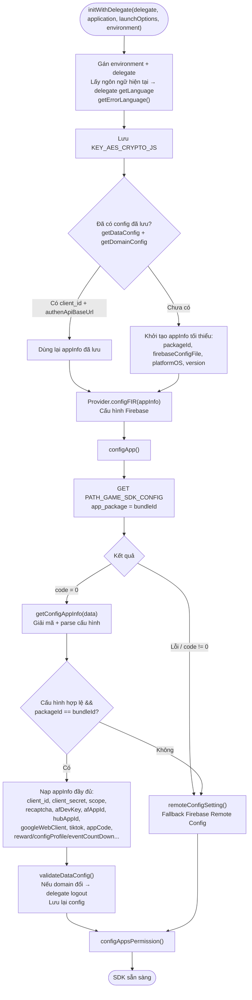

Tài liệu mô tả luồng khởi tạo SDK bắt đầu từ `Sdk.initWithDelegate(...)`, dựng từ code
thực tế: `Sdk+Ext.swift` (điểm vào), `Sdk+Config.swift` (lấy & phân giải cấu hình).

Điểm vào (app gọi khi khởi động, thường trong `application(_:didFinishLaunchingWithOptions:)`):

```Swift
Sdk.sharedInstance.initWithDelegate(delegate,
                                    application: application,
                                    launchOptions: launchOptions,
                                    environment: .prod)
```

## Sơ đồ tổng thể



## Sơ đồ nhánh Fallback & cấu hình bên thứ ba

```mermaid
flowchart TD
    subgraph RC["remoteConfigSetting – Firebase Remote Config"]
        A1["Đặt minimumFetchInterval = 0<br/>setDefaults từ plist"] --> A2["remoteConfig.fetch → activate"]
        A2 -- "Thành công" --> A3["getAppInfoConfigDefaultFirebase()<br/>Giải mã APPINFO_CONFIG từ Remote Config"]
        A2 -- "Lỗi" --> A4["getAppInfoConfigDefault()<br/>Đọc từ plist mặc định trong bundle"]
        A3 -- "Giải mã lỗi" --> A4
        A3 --> A5["configAppsPermission()"]
        A4 --> A5
    end

    subgraph AP["configAppsPermission – khởi tạo bên thứ ba"]
        B1{"Có afAppId?"} -- "Không" --> B9["Bỏ qua phần tracking"]
        B1 -- "Có" --> B2["Facebook: ApplicationDelegate didFinishLaunching + Settings"]
        B2 --> B3["AppsFlyer: devKey, appleAppID,<br/>waitForATT, delegate"]
        B3 --> B4["setupTiktTokSDK()"]
        B4 --> B5["sendLaunch()"]
        B5 --> B6["Trackier: initWith + logDevice + setTimeTrackier"]
        B9 --> B7
        B6 --> B7["getPublicIPAddress → appInfo.ipPublic<br/>getLocation → appInfo.location"]
        B7 --> B8["subscribeToTopic()"]
    end

    subgraph SL["sendLaunch → checkInit"]
        C1["applicationDidBecomeActive5s<br/>AppsFlyer.start() + appDidBecomeActive"] --> C2["checkInit()"]
        C2 --> C3["Track EVENT_APP_LAUNCH<br/>TikTok launchAPP + subscribe"]
        C3 --> C4{Lần đầu mở app?}
        C4 -- "Có" --> C5["Track EVENT_FIRST_LAUNCH"]
        C4 -- "Không" --> C6{Đổi version?}
        C5 --> C6
        C6 -- "Có" --> C7["Track EVENT_UPGRADE_VERSION_SUCCESS"]
    end

    subgraph ST["subscribeToTopic"]
        D1["GET PATH_GAME_CHECK_MAINTAIN"] --> D2["Subscribe các FCM topic"]
        D1 --> D3["UpdatePushIDRepo.execute()<br/>Cập nhật push id"]
    end
```



## Mô tả chi tiết

### 1. `initWithDelegate()` – điểm vào (Sdk+Ext.swift)

1. Gán `environment` và `delegate`.

2. Lấy ngôn ngữ hiện tại (`Localize.currentLanguage()`), gọi delegate `getLanguage` và tải
bảng lỗi đa ngôn ngữ (`getErrorLanguage()`).

3. Lưu khóa mã hóa `KEY_AES_CRYPTO_JS`.

4. Đọc cấu hình đã lưu (`getDataConfig` + `getDomainConfig`):

    - Nếu đã có `client_id` và `authenApiBaseUrl` → dùng lại `appInfo` đã lưu (khởi động nhanh).

    - Nếu chưa có → khởi tạo `appInfo` tối thiểu (packageId từ bundle, firebase config, platformOS, version).

5. `Provider.shared.configFIR(appInfo)` cấu hình Firebase.

6. Gọi `configApp(...)` để lấy cấu hình từ server.

### 2. `configApp()` – lấy cấu hình từ server (Sdk+Config.swift)

Gọi `PATH_GAME_SDK_CONFIG` (GET, `app_package = bundleId`) qua `configApiService`.

- `code = 0`: `getConfigAppInfo(data)` – giải mã AES và parse cấu hình.

- Lỗi mạng hoặc `code != 0`: chuyển sang `remoteConfigSetting()` (Firebase Remote Config).

### 3. `getConfigAppInfo()` – giải mã & nạp cấu hình

Giải mã chuỗi bằng `KEY_AES_CRYPTO_JS`, parse JSON và kiểm tra đủ các trường bắt buộc
(client_id, client_secret, apiKeyRecapcha, afDevKey, scope, googleWebClient, packageId,
afAppId, các base URL, hubAppId, appCode...).

- Nếu đủ trường **và** `packageId == bundleIdentifier`:

    - Nạp toàn bộ vào `appInfo` (kèm cấu hình mở rộng: `rewardProfileEvent`, `showFloating`,
    `configProfile`, `eventCountDown`).

    - Dựng `DomainConfig`, gọi `validateDataConfig()`: nếu domain authen đổi so với bản đã lưu
    thì phát delegate `logout`; sau đó lưu lại cấu hình.

    - Gọi `configAppsPermission()`.

- Nếu thiếu trường, sai package, hoặc giải mã/parse lỗi → `remoteConfigSetting()`.

### 4. `remoteConfigSetting()` – fallback Firebase Remote Config

Đặt `minimumFetchInterval = 0`, nạp mặc định từ plist, rồi `fetch → activate`:

- Thành công: `getAppInfoConfigDefaultFirebase()` giải mã `APPINFO_CONFIG` từ Remote Config;
nếu giải mã lỗi thì `getAppInfoConfigDefault()` đọc từ plist mặc định trong bundle.

- Lỗi: `getAppInfoConfigDefault()` (plist mặc định).

Cả hai nhánh đều tiếp tục gọi `configAppsPermission()`. Ngoài ra có đăng ký
`addOnConfigUpdateListener` để cập nhật cấu hình khi có thay đổi.

### 5. `configAppsPermission()` – khởi tạo SDK bên thứ ba

Chỉ chạy khi có `afAppId`. Thực hiện:

- Facebook SDK: `ApplicationDelegate didFinishLaunching`, cấu hình `Settings`.

- AppsFlyer: `devKey`, `appleAppID`, `waitForATTUserAuthorization`, gán delegate.

- `setupTiktTokSDK()` khởi tạo TikTok Business SDK.

- `sendLaunch()` (xem mục 6).

- Trackier: `initWith`, gửi `logDevice`, `setTimeTrackier(30)`.

Sau đó lấy IP công khai (`getPublicIPAddress` → `appInfo.ipPublic`) và vị trí
(`getLocation` → `appInfo.location`), rồi `subscribeToTopic()`.

### 6. `sendLaunch()` → `checkInit()` (Sdk+Ext.swift)

`sendLaunch()` gọi `applicationDidBecomeActive5s`, `AppsFlyerLib.start()`, `appDidBecomeActive()`
và `checkInit()`. `checkInit()` gửi tracking khởi động:

- `EVENT_APP_LAUNCH` và sự kiện TikTok `launchAPP` / `subscribe`.

- Lần đầu mở app → `EVENT_FIRST_LAUNCH`.

- Nếu version thay đổi so với lần trước → `EVENT_UPGRADE_VERSION_SUCCESS`.

### 7. `subscribeToTopic()`

Gọi `PATH_GAME_CHECK_MAINTAIN` để lấy và subscribe các FCM topic, đồng thời chạy
`UpdatePushIDRepo` để cập nhật push id lên server.

## Các endpoint sử dụng

- `PATH_GAME_SDK_CONFIG` – lấy cấu hình SDK từ server (GET)

- `PATH_GAME_CHECK_MAINTAIN` – lấy FCM topic / kiểm tra bảo trì (GET)

- `PATH_LOCATION` – lấy mã quốc gia từ IP (POST)

- `getclientip` (id.vplay.vn) – lấy IP công khai của thiết bị (GET)

## Ghi chú

- Thứ tự ưu tiên nguồn cấu hình: **server (`PATH_GAME_SDK_CONFIG`) → Firebase Remote Config
→ plist mặc định trong bundle**. Mỗi tầng lỗi thì rơi xuống tầng kế tiếp.

- Cấu hình nhạy cảm (client_id/secret, scope, các base URL) được mã hóa AES và chỉ nạp khi
`packageId` khớp bundle của app.

- `initWithDelegate` sẽ dùng lại cấu hình đã lưu để khởi động nhanh, nhưng vẫn gọi
`configApp` để làm mới cấu hình mỗi lần khởi động.

- Nếu domain authen thay đổi giữa hai lần khởi động, SDK chủ động phát delegate `logout` để
tránh dùng token cũ trên domain mới.
