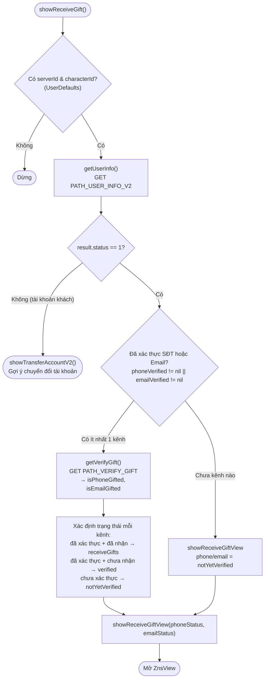
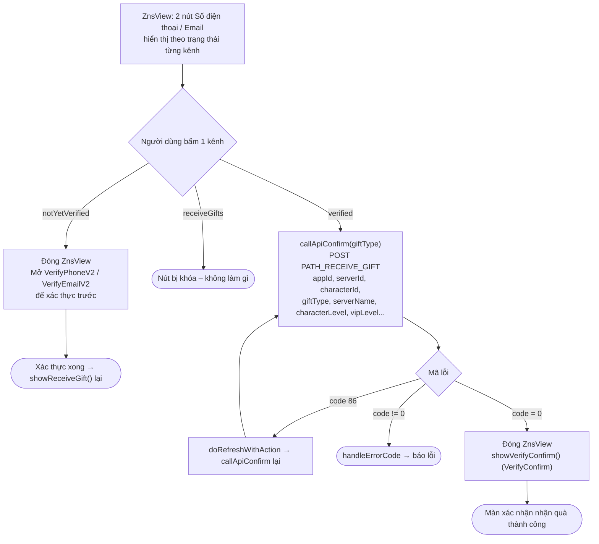

Tài liệu mô tả luồng nhận quà (xác thực SĐT/Email để nhận quà), dựng từ code thực tế:
`Sdk+Gift.swift` (quyết định trạng thái) và `ZnsView.swift` (màn chọn nhận quà).

Điểm vào:

```Swift
Sdk.sharedInstance.showReceiveGift()
```

`showReceiveGift()` còn được gọi tự động **sau khi xác thực SĐT/Email thành công** (từ
`VerifyOTP` / `VerifyPhoneV2` / `VerifyEmailV2`), tạo thành vòng: xác thực → quay lại nhận quà.

## Ba trạng thái của mỗi kênh (SĐT / Email) – `VerifyStatus`

|Trạng thái|Ý nghĩa|Nút trên `ZnsView`|
|---|---|---|
|`notYetVerified`|Chưa xác thực kênh này|Bấm để **mở màn xác thực** (VerifyPhoneV2 / VerifyEmailV2)|
|`verified`|Đã xác thực, **chưa nhận quà**|"Nhận quà ..." – bật, bấm để **nhận quà**|
|`receiveGifts`|Đã nhận quà rồi|"Nhận quà ..." – **khóa** (xám)|

## 1. Quyết định trạng thái – `showReceiveGift()`



## 2. Hành động trên `ZnsView`



## Mô tả chi tiết

### `showReceiveGift()` – quyết định luồng (Sdk+Gift.swift)

1. Bắt buộc có `serverId` và `characterId` (đọc từ `UserDefaults`: `KEY_SERVER_ID` /
`KEY_SERVER_NAME`); thiếu thì dừng.

2. Gọi `getUserInfo()` (`PATH_USER_INFO_V2`):

    - Nếu `result.status != 1` (tài khoản khách) → `showTransferAccountV2()` gợi ý chuyển đổi
    sang tài khoản chính, kết thúc luồng nhận quà.

    - Nếu `status == 1`:

        - **Đã xác thực ít nhất một kênh** (`phoneVerified != nil` hoặc `emailVerified != nil`):
        gọi `getVerifyGift()` để biết đã nhận quà chưa, rồi tính trạng thái từng kênh:

            - SĐT: đã xác thực → `receiveGifts` nếu `isPhoneGifted == true`, ngược lại `verified`.

            - Email: đã xác thực → `receiveGifts` nếu `isEmailGifted == true`, ngược lại `verified`.

            - Kênh chưa xác thực giữ `notYetVerified`.

        - **Chưa xác thực kênh nào**: cả hai kênh = `notYetVerified`.

    - Mở `ZnsView` với hai trạng thái đã tính (`showReceiveGiftView`).

### `getVerifyGift()` – kiểm tra đã nhận quà chưa

Gọi `PATH_VERIFY_GIFT` (GET, kèm chữ ký + Bearer accessToken) với `appId`, `appPackage`,
`serverId`, `characterId`. Trả về `isPhoneGifted`, `isEmailGifted` (mỗi kênh đã nhận quà chưa).

### `ZnsView` – màn chọn nhận quà

Hiển thị 2 nút (Số điện thoại / Email), giao diện thay đổi theo trạng thái từng kênh
(xem bảng ở trên). Khi bấm một kênh:

- **`notYetVerified`**: đóng `ZnsView`, mở `VerifyPhoneV2` / `VerifyEmailV2` để xác thực trước.
Sau khi xác thực xong, luồng gọi lại `showReceiveGift()` để cập nhật trạng thái.

- **`verified`**: gọi `callApiConfirm()` để nhận quà.

- **`receiveGifts`**: nút bị khóa, không làm gì.

### `callApiConfirm()` – nhận quà

Gọi `PATH_RECEIVE_GIFT` (POST, kèm chữ ký + Bearer accessToken) với `appId`, `appPackage`,
`serverId`, `characterId`, `sdkVersion`, `giftType` (`phone`/`email`), `serverName`,
`characterName`, `characterLevel`, `characterVipLevel`.

- `code = 0`: đóng `ZnsView` và mở `VerifyConfirm` (màn xác nhận nhận quà thành công).

- `code = 86` (token hết hạn): `doRefreshWithAction` làm mới token rồi gọi lại `callApiConfirm()`.

- lỗi khác: `handleErrorCode`.

## Các endpoint sử dụng

- `PATH_USER_INFO_V2` – lấy trạng thái tài khoản & xác thực (GET)

- `PATH_VERIFY_GIFT` – kiểm tra mỗi kênh đã nhận quà chưa (GET)

- `PATH_RECEIVE_GIFT` – gửi yêu cầu nhận quà (POST)

## Ghi chú

- Điều kiện tiên quyết: phải có `serverId` + `characterId` (thường được set khi
`mappingUser` / `payProduct`), và tài khoản phải là tài khoản chính (`status == 1`) —
tài khoản khách sẽ được điều hướng sang chuyển đổi tài khoản.

- Muốn nhận quà thì kênh (SĐT/Email) phải **đã xác thực**; nếu chưa, `ZnsView` dẫn người dùng
đi xác thực rồi tự quay lại luồng nhận quà.

- Các request nhận quà dùng header có **chữ ký** (`createHeaderFieldWithSignatureAndBearerToken`).

- Nhận quà thành công kết thúc bằng màn `VerifyConfirm` xác nhận.
