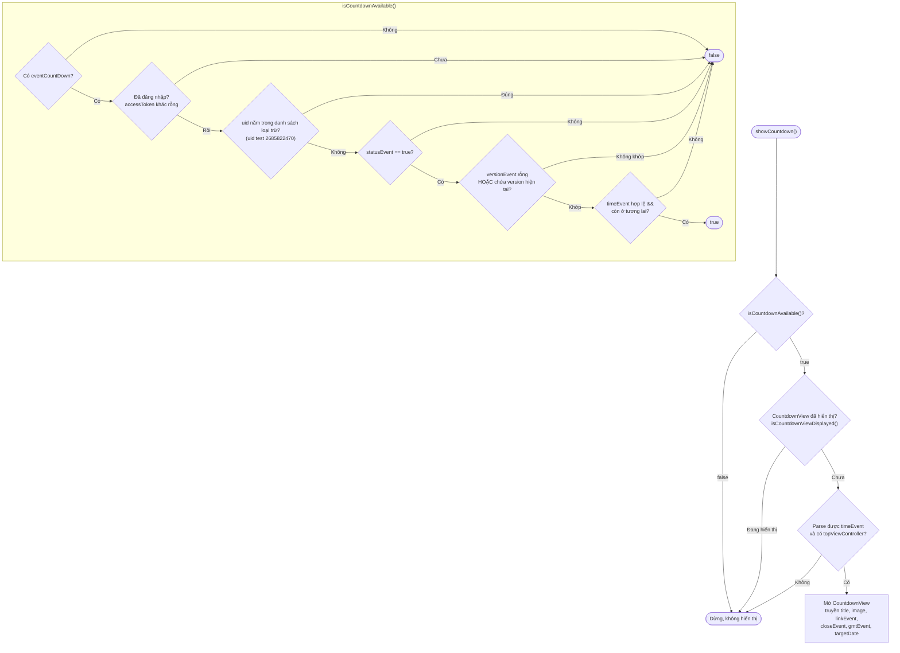
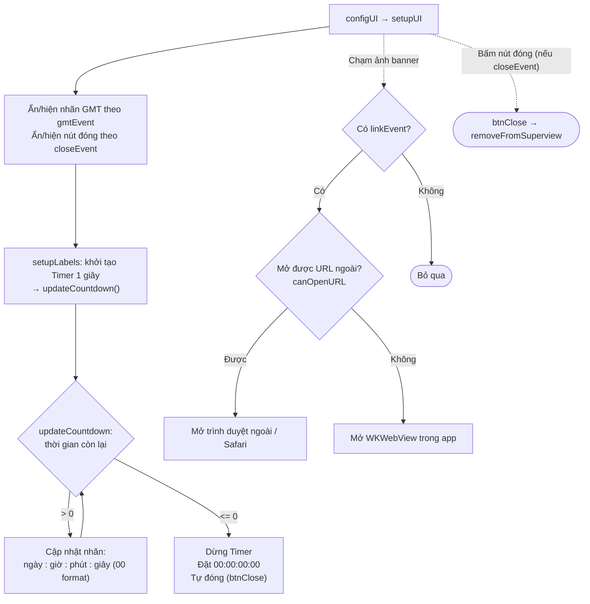

Tài liệu mô tả luồng `showCountdown`, dựng từ code thực tế: `Sdk+Countdown.swift` (điều kiện
hiển thị + mở màn) và `CountdownView.swift` (đồng hồ đếm ngược + mở link sự kiện).

Điểm vào (app gọi để hiển thị banner sự kiện đếm ngược):

```Swift
Sdk.sharedInstance.showCountdown()
```

Cấu hình sự kiện lấy từ `appInfo.eventCountDown` (nạp ở luồng khởi tạo, trường `EVENT_COUNTDOWN`).

## 1. Điều kiện hiển thị – `showCountdown()` / `isCountdownAvailable()`



## 2. Vòng đời `CountdownView`



## Mô tả chi tiết

### `showCountdown()` – điểm vào (Sdk+Countdown.swift)

1. Kiểm tra `isCountdownAvailable()`; nếu không đủ điều kiện thì dừng.

2. Kiểm tra `isCountdownViewDisplayed()` — nếu banner đang hiển thị thì dừng (tránh mở trùng).

3. Lấy `event = appInfo.eventCountDown` và parse `targetDate` từ `event.timeEvent`
(định dạng `yyyy-MM-dd'T'HH:mm:ssZ`). Thiếu thì dừng.

4. Mở `CountdownView` lên `topViewController`, truyền: `titleText`, `imageUrl`, `linkEvent`,
`closeEvent`, `gmtEvent`, `targetDate`.

### `isCountdownAvailable()` – điều kiện hiển thị

Trả về `true` chỉ khi thỏa **tất cả**:

- Có cấu hình `appInfo.eventCountDown`.

- Đã đăng nhập (`accessToken` không rỗng).

- Tài khoản **không** nằm trong danh sách loại trừ (mã kiểm tra uid test `2685822470`).

- `event.statusEvent == true` (sự kiện đang bật).

- `versionEvent` rỗng **hoặc** có chứa version hiện tại của app (lọc theo phiên bản).

- `timeEvent` parse được và **vẫn ở tương lai** (`timeIntervalSinceNow > 0`).

### `isCountdownViewDisplayed()`

Duyệt các subview của `topViewController`; nếu đã có một `CountdownView` thì coi như đang
hiển thị (không mở thêm).

### `CountdownView` – đồng hồ đếm ngược

- **`setupUI`**: ẩn/hiện nhãn GMT theo `gmtEvent`, ẩn/hiện nút đóng theo `closeEvent`
(nếu `closeEvent == false` thì không cho đóng thủ công).

- **Đếm ngược**: `setupLabels()` tạo `Timer` chạy mỗi giây gọi `updateCountdown()`.

    - Còn thời gian: cập nhật 4 nhãn **ngày : giờ : phút : giây** (định dạng 2 chữ số).

    - Hết giờ (`<= 0`): dừng timer, đặt `00:00:00:00` và **tự đóng** banner.

- **Chạm ảnh banner** (`imageViewTapped`): nếu có `linkEvent` thì mở link sự kiện —
ưu tiên mở URL bằng trình duyệt ngoài (`UIApplication.open`); nếu không mở được thì
hiển thị `WKWebView` ngay trong app.

- **Đóng** (`btnClose`): gỡ banner khỏi màn hình; `deinit` cũng hủy timer.

## Ghi chú

- `showCountdown` **không gọi API** — toàn bộ dữ liệu (thời điểm kết thúc, tiêu đề, ảnh, link,
cờ hiển thị) lấy từ cấu hình `eventCountDown` đã nạp sẵn khi khởi tạo SDK.

- Banner tự đóng khi hết giờ; người dùng chỉ đóng thủ công được khi `closeEvent == true`.

- Sự kiện được **lọc theo phiên bản app** (`versionEvent`) và theo trạng thái bật/tắt
(`statusEvent`), nên chỉ hiển thị đúng đối tượng/phiên bản đã cấu hình.

- Có kiểm tra chống hiển thị trùng (`isCountdownViewDisplayed`), an toàn khi gọi
`showCountdown()` nhiều lần.
