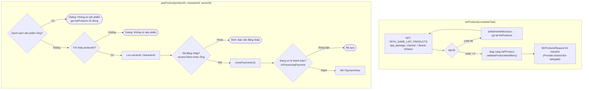
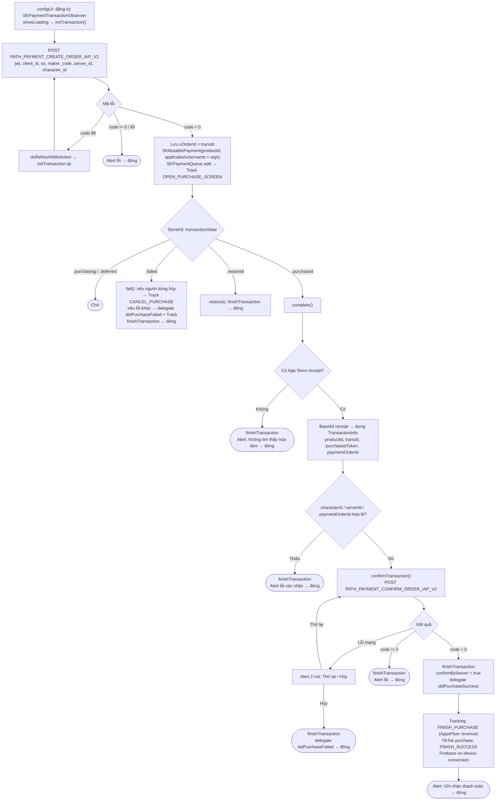

Tài liệu mô tả luồng thanh toán In-App Purchase của SDK, dựng từ code thực tế:
`Sdk+Payment.swift` (API công khai) và `PaymentView.swift` (xử lý giao dịch StoreKit +
xác thực với server).

## 1. Lấy danh sách sản phẩm & mở thanh toán

## 2. Vòng đời giao dịch trong `PaymentView`

## Mô tả chi tiết

### `listProducts()` – lấy danh sách sản phẩm

Gọi `PATH_GAME_LIST_PRODUCTS` (GET, kèm Bearer `idToken`) với `app_package` và `channel`.

- `code = 0`: chuyển dữ liệu thành `[IAPProduct]`, rồi `validateProductIdentifiers()` tạo
`SKProductsRequest` để lấy thông tin sản phẩm thật từ StoreKit (delegate là `Provider.shared`).
Nếu danh sách rỗng thì trả lỗi `CODE_PAYMENT_ERROR_NO_CONFIG`.

- `code = 86`: refresh token rồi gọi lại; thất bại thì trả lỗi qua `getProductTask`.

### `payProduct(productID, characterId, serverId)` – bắt đầu mua

1. Nếu chưa có sản phẩm nào → hiện dialog "Không có sản phẩm" và gọi `listProducts(nil)` rồi dừng.

2. Tìm sản phẩm theo `productID`; không thấy → dialog "Không có sản phẩm".

3. Lưu `serverId`, `characterId` (vào biến và UserDefaults).

4. Nếu `accessToken` rỗng → alert "Bạn cần đăng nhập" rồi dừng.

5. Gọi `showPaymentUI()`: nếu chưa có giao dịch nào đang chạy (`isProcessingPayment == false`)
thì mở `PaymentView` (truyền products, serverId, characterId, productId, delegate).

### `PaymentView` – tạo đơn & thanh toán StoreKit

**Khởi tạo (`configUI`)**: đăng ký làm `SKPaymentTransactionObserver`, hiện loading và gọi
`initTransaction()`.

**`initTransaction()`** – tạo đơn phía server: gọi `PATH_PAYMENT_CREATE_ORDER_IAP_V2` (POST)
với `jwt`, `client_id`, `os`, `maker_code = productId`, `server_id`, `character_id`.

- `code = 0`: lưu `vOrderId = transId`, tạo `SKMutablePayment` (gán
`applicationUsername = sign` từ server) và đưa vào `SKPaymentQueue` để mở hộp thoại thanh
toán của Apple; track `EVENT_OPEN_PURCHASE_SCREEN`.

- `code = 86`: refresh token rồi gọi lại `initTransaction()`.

- lỗi khác: hiện alert lỗi rồi đóng.

**Theo dõi giao dịch (`paymentQueue:updatedTransactions`)**:

- `.purchasing` / `.deferred`: chờ.

- `.failed` → `fail()`: nếu người dùng hủy thì track `EVENT_CANCEL_PURCHASE`; nếu lỗi khác thì
phát delegate `didPurchaseFailed` và track; luôn `finishTransaction` rồi đóng.

- `.restored` → `restore()`: `finishTransaction` rồi đóng.

- `.purchased` → `complete()`.

**`complete()`** – chuẩn bị xác thực: hiện loading "Đang xác thực giao dịch", đọc
`appStoreReceiptURL` lấy receipt.

- Không có receipt → `finishTransaction` + alert "Không tìm thấy hóa đơn" → đóng.

- Có receipt → base64 encode, dựng `TransactionInfo` (`productId`, `transId`,
`purchasedToken = receipt`, `paymentOrderId = vOrderId`).

- Nếu thiếu `characterId` / `serverId` / `paymentOrderId` → `finishTransaction` + alert lỗi → đóng.

- Đủ điều kiện → `confirmTransaction()`.

**`confirmTransaction()`** – xác thực với server: gọi `PATH_PAYMENT_CONFIRM_ORDER_IAP_V2` (POST)
với `jwt`, `cid`/`client_id`, `client_secret = transactionIdentifier`, `os`,
`b_code = purchasedToken` (receipt), `transId = paymentOrderId`, `maker_code = productId`,
`character_id`, `server_id`.

- **Lỗi mạng**: alert 2 nút "Thử lại" / "Hủy". "Thử lại" gọi lại `confirmTransaction`; "Hủy"
thì `finishTransaction`, phát delegate `didPurchaseFailed` rồi đóng.

- `code = 0`: `finishTransaction`, đặt `confirmByServer = true`, phát delegate
`didPurchaseSuccess`. Ghi nhận tracking `EVENT_FINISH_PURCHASE` (AppsFlyer kèm doanh thu),
sự kiện mua TikTok, `EVENT_FINISH_SUCCESS`, Firebase on-device conversion. Hiện alert
"Ghi nhận thanh toán ..." rồi đóng.

- `code != 0`: `finishTransaction` + alert lỗi → đóng.

## Các endpoint sử dụng

- `PATH_GAME_LIST_PRODUCTS` – lấy danh sách sản phẩm IAP (GET, Bearer idToken)

- `PATH_PAYMENT_CREATE_ORDER_IAP_V2` – tạo đơn thanh toán (POST)

- `PATH_PAYMENT_CONFIRM_ORDER_IAP_V2` – xác thực / ghi nhận giao dịch (POST)

## Ghi chú

- Đây là **thanh toán có xác thực phía server**: SDK tạo đơn trước (lấy `transId` + `sign`),
dùng `sign` làm `applicationUsername` của `SKPayment`, và chỉ ghi nhận thành công sau khi
server xác thực receipt (`PATH_..._CONFIRM_...`).

- `SKPaymentQueue.finishTransaction` chỉ được gọi sau khi xác thực xong (thành công hoặc
người dùng chọn hủy), tránh mất giao dịch khi lỗi mạng — khi lỗi mạng, người dùng có thể
bấm "Thử lại" để xác thực lại.

- Kết quả cuối cùng luôn được trả về app qua delegate `didPurchaseSuccess` /
`didPurchaseFailed` (kèm `TransactionInfo`).

- `isProcessingPayment` đảm bảo không mở hai màn thanh toán cùng lúc.
